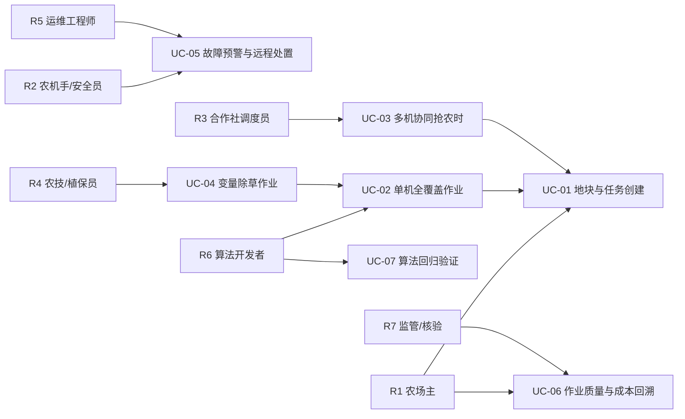

# 01 需求与场景分析

> 智能农机（Intelligent Agricultural Machinery）无人作业系统 · Node.js 软件原型
> 仓库根目录：`D:\work\smart-agri-machinery` ｜ 关联文档：`docs/00_项目总览与执行摘要.md`

## 1.1 文档信息

| 项目 | 内容 |
| --- | --- |
| 文档编号 | SAM-DOC-01 |
| 文档名称 | 需求与场景分析 |
| 版本 / 状态 | v1.0 / 基线 |
| 适用范围 | 智能农机无人作业软件原型的需求定义、场景约束、KPI 与验收判据 |
| 上游输入 | `docs/00_项目总览与执行摘要.md` 的项目目标（G1～G6）与量化指标（M-01～M-24） |
| 下游使用 | `docs/02`～`docs/07` 各设计文档；`src/` 各模块实现；`src/selftest.mjs` 断言 |
| 运行环境 | Node.js v24.19.0；ESM（`.mjs`）；仅 Node 内置模块；无第三方依赖 |
| 主命令 / 自检 | `node src\cli.mjs` / `node src\selftest.mjs` |
| 模块与接口 | 以 `docs/00` 第 0.5 节冻结清单为准，本文不改名、不新增导出符号 |

**需求编号规则**：功能需求 `FR-xx`（两位数，连续不跳号）；非功能需求 `NFR-xx`；关键绩效指标 `KPI-xx`；用例 `UC-xx`。需求一经编号即稳定，删除需求只能标记为“作废”而不复用编号。

## 1.2 术语与缩略语

| 缩写 / 术语 | 全称 / 含义 | 在本项目中的具体口径 |
| --- | --- | --- |
| RTK | Real-Time Kinematic，实时动态差分定位 | 固定解 σ = 0.010 m；浮点解 σ = 0.20 m |
| DGPS | Differential GPS，差分定位 | σ = 0.50 m |
| 单点定位 | 无差分改正的伪距定位 | σ = 1.50 m |
| EKF | Extended Kalman Filter，扩展卡尔曼滤波 | 状态 `x=[x, y, theta, v, omega]`，控制 `u=[a, alpha]` |
| NIS | Normalized Innovation Squared，归一化新息平方 | 2 自由度 99% 分位门限 9.21；1 自由度 6.63 |
| 航位推算 | Dead Reckoning | 连续丢星 > 2.0 s 进入，膨胀协方差 |
| ExG | Excess Green，超绿指数 | `ExG = 2G - R - B`（0～255 域），阈值 `ExG > 20` |
| 幅宽 | 机具有效作业宽度 | 3.0 / 4.5 / 6.0 m 三档 |
| 重叠率 | 相邻行程覆盖重叠宽度 / 幅宽 | 设定值 8%，验收区间 5%～15% |
| 地头 | 田块两端供转弯调头的区域 | 宽度 6.0 m（= 2 × 最小幅宽 3.0 m） |
| Dubins 路径 | 限定曲率下的最短可行路径 | CSC 词（LSL / RSL）与 CCC 词（LRL / RLR） |
| CTE | Cross-Track Error，横向跟踪误差 | RMS < 0.10 m |
| ISOBUS | ISO 11783 定义的农机串行控制与通信网络 | 机具即插即用与任务下发的标准载体 |
| J1939 | SAE 卡车与客车串行控制通信网络标准 | 29 位标识符、PGN/SPN 编码 |
| DM1 | Diagnostic Message 1 | PGN 65226，含 SPN 19 bit + FMI 5 bit + OC 1 bit |
| EWMA | Exponentially Weighted Moving Average | λ = 0.2 的指数加权移动平均控制图 |
| 可变作业 | Variable Rate Application | 依据杂草密度栅格调整喷施/除草强度 |

## 1.3 典型场景分析

### 1.3.1 场景一：大田旱作（小麦 / 玉米 / 大豆）

- **地块规模**：单块 50～500 亩（约 3.3～33 hm²），东北与新疆垦区常见 500～2000 亩连片条田；
- **行距**：小麦窄行条播 15～20 cm；玉米等行距 60 cm（部分区域 40 cm + 70 cm 宽窄行）；大豆大垄密植 65 cm 或 45 cm 双行；
- **作业环节**：秸秆处理 → 耕整地（深松 / 旋耕 / 耙）→ 播种施肥（复式作业）→ 植保 → 中耕 → 收获 → 秸秆还田；
- **作业痛点**：
  1. 播种直线度差导致后续中耕与收获对行困难，机收损失率上升；
  2. 人工驾驶重叠率常达 12%～18%，直接放大油耗、种子与肥料消耗；
  3. 农时窗口 7～15 天，机手不足时只能“抢晴天、压质量”；
  4. 地头转弯无规划，形成“地头重耕带”与土壤压实。
- **与前程模块的对应**：本场景是 `src/planning/coverage_path.mjs` 的主战场——幅宽 3.0 / 4.5 / 6.0 m、设定重叠率 8%、地头宽 6.0 m、转弯半径 4.0 m（拖拉机）；作物行距在仿真中取 0.6 m 基线（对应玉米等行距），行带半宽 0.15 m 用于视觉分类。

### 1.3.2 场景二：果园（乔化 / 矮砧密植）

- **地块规模**：单园 20～300 亩，山地丘陵果园地块不规则、多台坎，单行长 50～150 m；
- **行距 / 株距**：矮砧密植苹果行距 3.5～4.0 m、株距 1.0～1.5 m；乔化园行距 5～6 m；葡萄棚架行距 2.5～3.0 m；
- **作业环节**：行间割草 → 行内/行间喷药 → 施肥 → 疏花疏果（人工为主）→ 采摘（人工 / 半自动）→ 运输；
- **作业痛点**：
  1. 树冠遮挡导致 GNSS 可见星数下降、多径严重，固定解易掉；
  2. 行间通行空间窄，最小转弯半径与机具宽度共同限制调头策略；
  3. 药液飘移与重复喷施，变量喷施缺少冠层尺度感知；
  4. 采摘环节自动化程度低，人机混行带来安全风险。
- **与前程模块的对应**：`src/perception/gnss_fusion.mjs` 的丢星降级（> 2.0 s 航位推算）与 NIS 粗差剔除在多径环境下成为主用路径；LiDAR 选型（禾赛 JT16 / 速腾聚创 RS-Helios-16P）与视觉（海康 MV-CA050-10GC + Sony IMX264）用于行内定位与障碍检测。

### 1.3.3 场景三：设施园艺（连栋温室 / 日光温室）

- **地块规模**：单栋 1～10 亩，连栋温室跨度 8～12 m，长度 50～100 m；
- **行距 / 垄距**：番茄等果菜垄距 1.2～1.6 m、株距 0.3～0.45 m；叶菜畦宽 1.0～1.2 m；草莓高架栽培架间距 1.2～1.5 m；
- **作业环节**：起垄 / 做畦 → 移栽 → 灌溉施肥（水肥一体化）→ 植保 → 授粉 → 采收 → 棚内转运；
- **作业痛点**：
  1. 室内 GNSS 不可用，定位必须依赖激光 SLAM 或 UWB / 视觉里程计；
  2. 通道狭窄，转向空间不足，往复式全覆盖路径不适用，需按垄单向作业；
  3. 高温高湿、粉尘与农药腐蚀对传感器与电气防护要求高；
  4. 多棚并行作业时调度与转运衔接复杂。
- **与前程模块的对应**：本项目中以“小地块 + 窄幅宽”参数档位承载（幅宽 3.0 m 以下按比例缩放）；定位方案的实车替代路径为 LiDAR SLAM（参见文献 73 / 72），遥测层（`src/cloud/telemetry.mjs`）与云平台保持一致。

### 1.3.4 三类场景对比表

| 对比维度 | 大田旱作 | 果园 | 设施园艺 |
| --- | --- | --- | --- |
| 单块规模 | 50～500 亩（连片可达 2000 亩） | 20～300 亩，地块不规则 | 1～10 亩 / 栋，多栋并行 |
| 单行长 | 200～800 m | 50～150 m（受台坎分割） | 50～100 m |
| 行距 / 垄距 | 小麦 0.15～0.20 m；玉米 0.60 m | 3.5～4.0 m（矮砧）；5～6 m（乔化） | 1.2～1.6 m（果菜）；1.0～1.2 m（叶菜畦） |
| 地表与坡度 | 平坦，坡度 < 5%，土壤含水率变化大 | 丘陵台地，坡度可达 15% | 硬化 / 铺装路面或畦面，平坦 |
| GNSS 可用性 | 优，开阔天空，RTK 固定解稳定 | 差，树冠遮挡 + 多径，固定解间歇 | 不可用（室内），需 LiDAR / UWB / 视觉 |
| 主要作业环节 | 耕整地、播种施肥、植保、中耕、收获 | 割草、喷药、施肥、采摘、运输 | 起垄、移栽、水肥、植保、采收、转运 |
| 核心痛点 | 直线度与重叠率；农时窗口；地头重耕 | 定位可用性；窄行通行；变量喷施 | 室内定位；窄通道转向；环境腐蚀与防护 |
| 典型幅宽需求 | 3.0 / 4.5 / 6.0 m | 1.0～2.0 m（行间） | 0.6～1.5 m |
| 转弯半径需求 | 4.0 m（拖拉机）/ 5.5 m（收割机） | ≤ 3.0 m，需前轮转向或铰接 | ≤ 2.0 m，需差速或全向底盘 |
| 主要对标机型 | 东方红 LX2204、丰疆 FJ-1004、雷沃谷神 GM100、沃得锐龙 4LZ-6.0 | 果园专用履带/轮式平台 | 设施电动履带拖拉机 |
| 本项目覆盖程度 | **完整覆盖**（主线场景） | 部分覆盖（定位降级 + 障碍感知扩展位） | 参数化覆盖（小地块档位 + 云链路复用） |

**场景—模块映射矩阵**（"●" 主用，"○" 扩展/预留）：

| 模块 | 大田旱作 | 果园 | 设施园艺 |
| --- | --- | --- | --- |
| `src/sim/field_simulator.mjs` | ● | ○（不规则多边形 `makeConvexPolygonField()`） | ○（小地块） |
| `src/perception/gnss_fusion.mjs` | ● | ●（丢星降级为主用） | ○（需替换为 LiDAR SLAM） |
| `src/perception/vision_weed.mjs` | ● | ○（行间杂草） | ●（垄面杂草） |
| `src/planning/coverage_path.mjs` | ● | ○ | ○（单向垄作） |
| `src/planning/dispatch.mjs` | ●（多机抢农时） | ○ | ●（多棚并行调度） |
| `src/control/pure_pursuit.mjs` | ● | ○（低速窄行） | ○ |
| `src/cloud/telemetry.mjs` | ● | ● | ● |

## 1.4 用户角色与用例

### 1.4.1 角色定义

| 角色 | 职责 | 关注点 | 主要交互 |
| --- | --- | --- | --- |
| 农场主 / 种植大户（R1） | 决策作业计划与投入产出 | 作业成本、质量、农时完成率 | 提交地块与作业任务，查看作业报告与成本台账 |
| 农机手 / 安全员（R2） | 现场值守、接管与应急处置 | 安全性、异常接管便利性 | 接收告警、查看实时位姿与轨迹、紧急停车 |
| 合作社调度员（R3） | 多机多地块排产 | 完工时间、空驶里程、机具利用率 | 使用 `DispatchOptimizer` 排产，查看甘特图 |
| 农技 / 植保员（R4） | 杂草与病害处置决策 | 杂草分布、施药量 | 查看 1 m × 1 m 杂草密度栅格，制定变量作业处方 |
| 运维工程师（R5） | 终端与链路维护 | 故障率、告警准确性、数据完整性 | 查看 DTC 与遥测时序，处理误报与漏报 |
| 算法 / 软件开发者（R6） | 算法迭代与回归 | 指标是否退化、是否可复现 | 运行 `node src\cli.mjs` 与 `node src\selftest.mjs` |
| 监管 / 第三方核验（R7） | 作业面积与质量核验 | 数据可信、可追溯 | 读取 `data/run_result.json` 与作业报告 |

### 1.4.2 用例图

### 1.4.3 关键用例描述

**UC-02 单机全覆盖作业**（核心用例）

| 项 | 内容 |
| --- | --- |
| 参与者 | R6 算法开发者（本原型）/ R2 农机手（实车） |
| 前置条件 | 地块多边形已生成；机具幅宽与最小转弯半径已选定；差分服务可用 |
| 主流程 | ① `CoveragePlanner` 按设定重叠率 8% 做 `offsetPolygon()` 内缩；② `boustrophedonPath()` 生成往复行程；③ 地头以 `dubinsPath()` 生成 Π / Ω 形转弯并计入 `turnCostModel()`；④ `planSpeedProfile()` 生成速度剖面；⑤ `PurePursuitController` 以 50 Hz 闭环跟踪，定位取 EKF 融合结果；⑥ `rasterizeCoverage()` 以 0.25 m 栅格统计覆盖率与重叠率；⑦ 输出作业报告 |
| 异常流 | E1 定位降级（丢星 > 2.0 s）→ 进入航位推算并降速，等待恢复；E2 覆盖率 < 98% → 触发补作业行程；E3 跟踪误差 RMS ≥ 0.10 m → 缩短前视距离重规划 |
| 后置条件 | 覆盖率 > 98%，重叠率 ∈ [5%, 15%]，横向误差 RMS < 0.10 m |
| 关联需求 | FR-16～FR-20、FR-25～FR-28；KPI-04～KPI-08 |

**UC-03 多机协同抢农时**

| 项 | 内容 |
| --- | --- |
| 参与者 | R3 合作社调度员 |
| 前置条件 | 多台农机能力参数（幅宽、速度、作业效率）与时间窗已录入 |
| 主流程 | ① 将地块按作业块切分；② `DispatchOptimizer` 以构造式贪心（时间窗 + 机具能力匹配）生成初始解；③ 局部搜索（2-opt / Or-opt / 机间交换）迭代优化 `J`；④ `extractGantt()` 输出甘特数据；⑤ 与 `baselineNaiveAssignment()` 对比并输出改进百分比 |
| 异常流 | E1 时间窗不可行 → 输出最小超窗方案并给出惩罚值；E2 某机故障停机 → 重新分配其剩余作业块 |
| 后置条件 | `J_opt` 相对 `J_base` 改善 ≥ 15%；甘特无资源冲突 |
| 关联需求 | FR-21～FR-24；KPI-09～KPI-11 |

**UC-04 变量除草作业**

| 项 | 内容 |
| --- | --- |
| 参与者 | R4 农技 / 植保员 |
| 前置条件 | 车载相机已采集影像；作物行距与行带半宽已知（仿真 0.6 m 行距、0.15 m 半宽） |
| 主流程 | ① `exgIndex()` 计算 `ExG = 2G - R - B`；② `segmentVegetation()` 以 `ExG > 20` 分割；③ `morphOpen()` / `morphClose()` 去噪与补洞；④ `connectedComponents()` 8 邻域两遍法（并查集）标记；⑤ `classifyComponents()` 按面积 / 行内位置 / 长宽比区分作物与杂草；⑥ `weedDensityGrid()` 生成 1 m × 1 m 密度栅格；⑦ 与生成器真值标签比对输出 P / R / F1 |
| 异常流 | E1 F1 < 0.85 → 输出参数敏感性报告（阈值、结构元尺寸）；E2 影像过曝 / 阴影 → 记录为无效帧并跳过 |
| 后置条件 | P ≥ 0.90、R ≥ 0.85、F1 ≥ 0.85；密度栅格 MAE ≤ 1.5 株 / 单元 |
| 关联需求 | FR-10～FR-15；KPI-12～KPI-14 |

**UC-05 故障预警与远程处置**

| 项 | 内容 |
| --- | --- |
| 参与者 | R2 农机手 / R5 运维工程师 |
| 前置条件 | 边缘网关在线，1 Hz 采样与批量上行链路正常 |
| 主流程 | ① `EdgeTelemetryGateway` 采集 → `encodeCanFrame()` 编码为 J1939 帧；② 批量上行（模拟 1% 丢包、120 ms 时延）；③ `TelemetryCloud` 落库；④ `AnomalyDetector` 执行 60 s 滑窗 3-sigma、EWMA(λ = 0.2)、变化率与绝对阈值规则；⑤ 分级告警（警告 / 严重）推送给 R2 / R5 |
| 异常流 | E1 丢包 → 序号连续性校验并触发补传；E2 误报 → 记录并纳入误报率统计（目标 ≤ 5%） |
| 后置条件 | A/B/C 三类注入故障 100% 检出；告警时延 ≤ 60 s；误报率 ≤ 5% |
| 关联需求 | FR-29～FR-35；KPI-15～KPI-18 |

## 1.5 功能需求（FR）

| 编号 | 需求名称 | 需求描述 | 优先级 | 来源场景 | 验证方式 |
| --- | --- | --- | --- | --- | --- |
| FR-01 | 随机源可复现 | `createRng(seed)` 提供确定性伪随机数序列，同一 seed 下所有噪声、丢包、故障注入可重放 | 必须 | 全场景 | 同 seed 两次运行结果逐字段一致 |
| FR-02 | 地块几何计算 | `polygonArea()` 计算简单多边形面积；`pointInPolygon()` 判定点是否在多边形内（含顶点与边界的稳定判定） | 必须 | 大田 / 果园 | `selftest.mjs` 几何断言 |
| FR-03 | 地块形状生成 | `makeRectangleField()`、`makeLShapeField()`、`makeConvexPolygonField()` 生成矩形、L 形、凸多边形地块 | 必须 | 大田 / 果园 | 面积与顶点数校验 |
| FR-04 | 作物行生成 | `generateCropRows()` 按行距（仿真基线 0.6 m）与地块边界生成作物行中心线与行带 | 必须 | 大田 | 行数与行距统计 |
| FR-05 | GNSS 轨迹仿真 | `simulateGnssTrack()` 按固定解 / 浮点解 / DGPS / 单点四档噪声（σ = 0.010 / 0.20 / 0.50 / 1.50 m）生成定位序列，并支持丢星段 | 必须 | 全场景 | 残差统计与设定 σ 比对 |
| FR-06 | IMU 仿真 | `simulateImu()` 生成含零偏与随机游走的角速度、加速度序列（对标 ADIS16470 零偏稳定性 8 °/h） | 必须 | 全场景 | 零偏统计 |
| FR-07 | 合成农田影像 | `makeSyntheticFieldImage()` 生成 640 × 480 px（0.02 m/px = 12.8 m × 9.6 m）合成影像，含作物行、杂草与真值标签 | 必须 | 大田 / 设施 | 标签覆盖率检查 |
| FR-08 | EKF 状态估计 | `ExtendedKalmanFilter` 以 `x=[x, y, theta, v, omega]`、`u=[a, alpha]` 进行预测与更新；`matInverse()`、`wrapAngle()` 提供数值与角度支撑 | 必须 | 全场景 | `runFusionScenario()` 指标 |
| FR-09 | 观测噪声分级 | `GnssImuFusion` 按解算类型切换观测噪声：固定解 0.010 m、浮点解 0.20 m、DGPS 0.50 m、单点 1.50 m；双天线定向 σ_θ = 0.3° | 必须 | 大田 / 果园 | 逐档 RMSE 统计 |
| FR-10 | 粗差检测 | NIS 卡方检验：2 自由度门限 9.21（99%）、1 自由度门限 6.63；超限观测不参与状态更新 | 必须 | 果园（多径） | 注入跳变统计剔除率 |
| FR-11 | 失锁降级 | 连续丢星 > 2.0 s 进入航位推算并膨胀过程噪声协方差；恢复后平滑回切 | 必须 | 果园 / 设施 | 人工断星场景 |
| FR-12 | 超绿指数计算 | `exgIndex()` 计算 `ExG = 2G - R - B`（0～255 量化域） | 必须 | 大田 / 设施 | 逐像素与参考实现比对 |
| FR-13 | 植被分割 | `segmentVegetation()` 以 `ExG > 20` 阈值二值化 | 必须 | 大田 / 设施 | IoU 统计 |
| FR-14 | 形态学处理 | `morphOpen()` 开运算去孤立噪点；`morphClose()` 闭运算填补孔洞 | 必须 | 大田 / 设施 | 连通域数量变化检查 |
| FR-15 | 连通域标记 | `connectedComponents()` 采用 8 邻域两遍法（并查集）标记连通域 | 必须 | 大田 / 设施 | 与朴素遍历结果一致 |
| FR-16 | 作物 / 杂草分类 | `classifyComponents()` 按面积、行内位置（作物行带半宽 0.15 m）、长宽比判别 | 必须 | 大田 | P / R / F1 |
| FR-17 | 杂草密度栅格 | `weedDensityGrid()` 输出 1 m × 1 m 密度栅格，供变量作业处方 | 必须 | 大田 / 设施 | MAE ≤ 1.5 株 / 单元 |
| FR-18 | 识别性能评估 | `runWeedDetection()` 汇总精确率、召回率、F1 并输出混淆统计 | 必须 | 大田 | 报告字段完整性 |
| FR-19 | 地块内缩偏移 | `offsetPolygon()` 按幅宽与重叠率（8%）生成内缩作业边界 | 必须 | 大田 | 内缩距离校验 |
| FR-20 | 往复式全覆盖路径 | `boustrophedonPath()` 生成往复行程序列，行程间距 = 幅宽 × (1 − 重叠率) | 必须 | 大田 | 行程数与间距统计 |
| FR-21 | Dubins 地头转弯 | `dubinsPath()` 生成 Π 形（CSC：LSL / RSL）与 Ω 形（CCC：LRL / RLR）转弯；最小转弯半径 4.0 m（拖拉机）/ 5.5 m（收割机） | 必须 | 大田 | 路径连续性与曲率上限 |
| FR-22 | 转弯代价模型 | `turnCostModel()` 以“几何长度 / 转弯限速 + 转向执行时间”计算代价（转向速率上限 25 °/s） | 必须 | 大田 | 代价与实测时长对比 |
| FR-23 | 覆盖率评估 | `rasterizeCoverage()` 以 0.25 m 栅格统计覆盖率，目标 > 98% | 必须 | 全场景 | `selftest.mjs` 断言 |
| FR-24 | 规划指标输出 | `CoveragePlanner` 汇总作业幅宽重叠率、覆盖率、非作业里程、转弯次数、预计作业时长 | 必须 | 大田 | 报告字段完整性 |
| FR-25 | 多机任务分配 | `DispatchOptimizer` 构造式贪心：按时间窗与机具能力匹配生成初始分配 | 必须 | 大田 / 设施 | 解可行性检查 |
| FR-26 | 局部搜索优化 | 在初始解上执行 2-opt / Or-opt / 机间交换，迭代改进 `J` | 必须 | 大田 | 目标值单调不增 |
| FR-27 | 目标函数 | `objectiveFunction()` 计算 `J = w1·完工时间(h) + w2·空驶里程(km) + w3·等待时间(h) + w4·作业成本(元) + w5·超窗惩罚(h)`，权重 1.0 / 0.35 / 0.20 / 0.15 / 5.0 | 必须 | 全场景 | 分项可复算 |
| FR-28 | 基线对比 | `baselineNaiveAssignment()` 提供朴素轮询分配基线，输出改进百分比 | 必须 | 大田 | 改善 ≥ 15% |
| FR-29 | 甘特数据输出 | `extractGantt()` 输出每台农机每项任务的起止时间与地块编号 | 必须 | 大田 / 设施 | 甘特无冲突校验 |
| FR-30 | 纯跟踪控制 | `PurePursuitController` 基于自行车模型（轴距 L = 2.6 m、最大前轮转角 35°）计算前轮转角指令 | 必须 | 全场景 | 跟踪误差统计 |
| FR-31 | 自适应前视距离 | `Ld = clamp(kv·v + Lmin, Lmin, Lmax)`，并按曲率缩放（弯道缩短以提高跟踪精度） | 必须 | 全场景 | 参数扫描与 CTE 曲线 |
| FR-32 | 速度规划 | `planSpeedProfile()` 满足横向加速度上限 a_lat_max = 1.5 m/s²、加速度 0.8 m/s²、减速度 1.2 m/s²、最高车速 3.0 m/s | 必须 | 全场景 | 剖面约束校验 |
| FR-33 | 闭环跟踪仿真 | `simulateTracking()` 以 0.02 s（50 Hz）步长闭环仿真，定位输入使用 EKF 融合结果 | 必须 | 全场景 | CTE RMS < 0.10 m |
| FR-34 | 横向误差计算 | `crossTrackError()` 计算点到参考轨迹的法向距离，输出 RMS 与最大值 | 必须 | 全场景 | 与几何解析解比对 |
| FR-35 | J1939 编码 | `encodeCanFrame()` 按 `Priority(3) \| EDP(1) \| DP(1) \| PF(8) \| PS(8) \| SA(8)` 组 29 位标识符并填装 8 字节载荷 | 必须 | 全场景 | 位域逐位校验 |
| FR-36 | J1939 解码 | `decodeCanFrame()` 反向解析标识符与载荷，支持 PGN 65262（SPN 110，偏移 −40 ℃，1 ℃/bit）、PGN 61444（SPN 190，0.125 rpm/bit）、PGN 65266（SPN 183，0.05 L/h per bit）、PGN 65265（SPN 84，1/256 km/h） | 必须 | 全场景 | 往返一致率 100% |
| FR-37 | 故障码编解码 | `encodeDtc()` / `decodeDtc()` 处理 DM1（PGN 65226）：SPN 19 bit + FMI 5 bit + OC 1 bit | 必须 | 全场景 | 往返一致 |
| FR-38 | 边缘网关 | `EdgeTelemetryGateway` 以 1 Hz 采样、批量上行，模拟 1% 丢包与 120 ms 时延，并支持序号校验与补传 | 必须 | 全场景 | 数据完整率 ≥ 99% |
| FR-39 | 云端时序存储 | `TelemetryCloud` 以内存时序库承载遥测记录，支持按农机 / 指标 / 时间窗查询 | 必须 | 全场景 | 查询结果校验 |
| FR-40 | 异常检测 | `AnomalyDetector` 实现 60 s 滑窗 3-sigma、EWMA(λ = 0.2) 控制图、变化率检测与绝对阈值（冷却液 > 105 ℃ 严重 / > 98 ℃ 警告；转速 > 2400 rpm 或 < 500 rpm；燃油率 10 s 内突变 > 40%） | 必须 | 全场景 | 检出率与误报率 |
| FR-41 | 故障注入场景 | `runTelemetryScenario()` 注入三类故障：A 机冷却液从 88 ℃ 爬升至 112 ℃；B 机转速异常尖峰 + 燃油率突增；C 机燃油率突降至近零 | 必须 | 全场景 | 3/3 检出 |
| FR-42 | 端到端主线 | `cli.mjs` 串接仿真 → 规划 → 调度 → 控制 → 视觉 → 遥测，输出 `data/run_result.json` 与中文作业报告 | 必须 | 全场景 | 退出码 0，产物非空 |
| FR-43 | 自检断言 | `selftest.mjs` 覆盖横向误差 RMS < 0.1 m、重叠率 5%～15%、覆盖率 > 98%、调度优于基线、CAN 编解码往返一致、故障 100% 检出等断言，失败非零退出 | 必须 | 全场景 | 断言全绿 |

## 1.6 非功能需求（NFR）

### 1.6.1 性能（Performance）

| 编号 | 需求 | 指标 | 验证方式 |
| --- | --- | --- | --- |
| NFR-01 | 端到端运行时长 | `node src\cli.mjs` 在普通笔记本上单次运行 ≤ 3 min（含 50 Hz 闭环仿真） | wall-clock 计时 |
| NFR-02 | 控制仿真步长 | 闭环仿真定步长 0.02 s（50 Hz），不允许变步长导致的积分漂移 | 步数 × 步长 = 仿真总时长校验 |
| NFR-03 | 遥测采样与上行 | 采样 1 Hz；边缘批量上行；端到端时延 P95 ≤ 500 ms | 时间戳采样统计 |
| NFR-04 | 感知处理吞吐 | 640 × 480 px 单帧 `runWeedDetection()` 处理时间 ≤ 200 ms（等效 ≥ 5 fps，满足 3.0 m/s 下车载巡检） | 单帧计时 |
| NFR-05 | 地块规模上限 | 单地块面积支持 ≥ 200 hm²（≥ 3000 亩）而不发生内存溢出 | 大块压力用例 |
| NFR-06 | 内存占用 | 端到端运行峰值常驻内存 ≤ 1.5 GB（Node.js 默认堆范围内） | 运行期采样 |
| NFR-07 | 覆盖栅格分辨率 | 覆盖率统计栅格 0.25 m；杂草密度栅格 1 m × 1 m | 栅格计数校验 |
| NFR-08 | 调度求解时间 | 20 台农机 × 50 个作业块的调度求解 ≤ 10 s | 求解计时 |

### 1.6.2 可靠性（Reliability）

| 编号 | 需求 | 指标 | 验证方式 |
| --- | --- | --- | --- |
| NFR-09 | 定位降级可用性 | 连续丢星 > 2.0 s 自动进入航位推算；降级期间 30 s 位置漂移 ≤ 1.5 m | 断星注入场景 |
| NFR-10 | 粗差鲁棒性 | NIS 门限下正确观测保留率 ≥ 99%，粗差剔除率 ≥ 95% | 粗差注入统计 |
| NFR-11 | 链路丢包恢复 | 1% 丢包 + 120 ms 时延下数据完整率 ≥ 99% | 序号连续性校验 |
| NFR-12 | 结果可复现 | 同 seed 下两次运行的 `data/run_result.json` 除时间戳外逐字段一致 | 差分比对 |
| NFR-13 | 失败可检测 | 任一断言失败，`selftest.mjs` 以非零码退出并打印失败断言编号 | 故意破坏参数验证 |
| NFR-14 | 退化输入处理 | 零面积多边形、自相交多边形、空作物行、全黑/全白影像均不导致崩溃，返回显式错误或空结果 | 边界用例集 |
| NFR-15 | 告警可靠性 | A/B/C 三类注入故障 100% 检出，正常工况误报率 ≤ 5% | `runTelemetryScenario()` |

### 1.6.3 安全（Safety & Security）

| 编号 | 需求 | 指标 | 验证方式 |
| --- | --- | --- | --- |
| NFR-16 | 安全相关需求条目化 | 所有涉及“意外偏离导向路径、失控加速、误动作”的需求应按 ISO 25119 / ISO 13849-1 的口径描述其安全目标与失效响应，为后续认证预留接口 | 需求评审 |
| NFR-17 | 运动限幅 | 前轮转角 ≤ 35°、转向速率 ≤ 25 °/s、车速 ≤ 3.0 m/s、横向加速度 ≤ 1.5 m/s²，任何指令越界即饱和并记录 | 剖面与指令校验 |
| NFR-18 | 分级告警与处置建议 | 告警分“警告 / 严重”两级；严重级（如冷却液 > 105 ℃）应给出降载或停机建议 | 告警样本检查 |
| NFR-19 | 数据最小化与脱敏 | 上行数据仅含机具标识、时间戳、作业与工况量，不含个人身份信息；云端按角色控制查询权限 | 报文与接口评审 |
| NFR-20 | 不可篡改的追溯 | `data/run_result.json` 记录随机种子、参数快照与生成时间，保证作业结论可复算 | 产物字段检查 |

### 1.6.4 可维护性（Maintainability）

| 编号 | 需求 | 指标 | 验证方式 |
| --- | --- | --- | --- |
| NFR-21 | 零第三方运行时依赖 | 仅使用 Node 内置模块（`node:fs` / `node:path` / `node:url` / `node:assert` 等） | `package.json` 依赖审查 |
| NFR-22 | 模块化与接口冻结 | 模块文件路径与导出符号与 `docs/00` 第 0.5 节完全一致；新增能力以新增导出或新增模块实现，不改名已有符号 | 导出符号清单对比 |
| NFR-23 | 单一真值来源 | 文档中出现的每个数值参数在代码中有唯一来源，禁止“文档一套、代码一套” | 参数表交叉核对 |
| NFR-24 | 纯函数优先 | 数学与几何工具（`wrapAngle()`、`matInverse()`、`polygonArea()`、`exgIndex()`、`encodeCanFrame()` 等）为可独立调用的纯函数 | 单元断言 |
| NFR-25 | 中文文档与注释 | 报告与关键注释为中文，术语与 `docs/01` 术语表一致 | 文档评审 |
| NFR-26 | 可观测性 | 主线运行输出阶段化日志（地块、规划、调度、控制、感知、遥测六段），便于定位退化环节 | 日志检查 |

### 1.6.5 环境适应性（Environmental Adaptability）

| 编号 | 需求 | 指标 | 验证方式 |
| --- | --- | --- | --- |
| NFR-27 | 车载温度范围 | 边缘终端工作温度 −20 ℃～+70 ℃，存储 −40 ℃～+85 ℃（RK3588 方案需配散热设计） | 选型与热设计评审 |
| NFR-28 | 防护等级 | 车载终端 ≥ IP54（驾驶室外安装 ≥ IP67），连接器防水防尘 | 选型与 GB/T 4208 核对 |
| NFR-29 | 振动与冲击 | 满足农机作业振动谱要求，安装支架做减振处理（参考 GB/T 2423 系列试验方法） | 试验方案评审 |
| NFR-30 | 电磁兼容 | 满足 ISO 14982 与 GB/T 17626 系列抗扰度要求（静电放电、射频辐射、电快速瞬变、浪涌） | 试验方案评审 |
| NFR-31 | 光照与背景适应 | 视觉算法在 500～100000 lx 光照与土壤 / 残茬背景变化下保持 P ≥ 0.90、R ≥ 0.85；仿真中以阴影 / 过曝帧作为退化用例 | 退化用例回归 |
| NFR-32 | 地形与滑移 | 支持坡度 ≤ 15% 的地块建模；滑移率作为规划与控制的参数预留，影响跟踪误差评估 | 参数化场景 |
| NFR-33 | GNSS 遮挡适应 | 果园树冠遮挡导致的间歇失锁不得中断作业，降级期间速度自动下调 | 遮挡场景仿真 |
| NFR-34 | 粉尘与农药腐蚀 | 传感器窗口与线束接头需满足粉尘与农药喷雾环境的防护要求 | 选型评审 |

## 1.7 KPI 定义与验收判据

**通用口径**：`σ` 为单轴标准差；RMS 为均方根；覆盖率与重叠率以 0.25 m 栅格统计；P / R / F1 以合成影像真值标签为基准；所有 KPI 的实测值必须由 `node src\selftest.mjs` 或 `node src\cli.mjs` 的产物给出。

| 编号 | KPI 名称 | 定义 / 公式 | 目标值 | 验收判据（判定条件） | 关联需求 |
| --- | --- | --- | --- | --- | --- |
| KPI-01 | 定位精度（固定解） | `DRMS = \sqrt{\sigma_x^2 + \sigma_y^2}`，σ = 0.010 m | ≤ 0.02 m | `runFusionScenario()` 残差统计达标 | FR-08、FR-09 |
| KPI-02 | 航向精度 | 航向角误差 RMS，σ_θ = 0.3° | ≤ 0.5° | 与真值序列比对 | FR-09 |
| KPI-03 | 粗差剔除率 | 被 NIS 门限（9.21 / 6.63）拒绝的注入粗差比例 | ≥ 95% | 注入已知跳变统计 | FR-10 |
| KPI-04 | 覆盖率 | `covered / total`（0.25 m 栅格） | **> 98%** | `selftest.mjs` 断言 | FR-19、FR-20、FR-23 |
| KPI-05 | 幅宽重叠率 | 相邻行程重叠宽度 / 幅宽 | **8% ± 3%（5%～15%）** | 栅格重复计数落入区间 | FR-19、FR-20 |
| KPI-06 | 非作业里程占比 | (地头转弯 + 空驶里程) / 总里程 | ≤ 12% | 轨迹里程分解 | FR-22、FR-24 |
| KPI-07 | 横向误差 RMS | `\sqrt{\frac{1}{N}\sum e_i^2}`，e 为法向偏差 | **< 0.10 m**（max < 0.25 m） | `crossTrackError()` 统计 | FR-30～FR-34 |
| KPI-08 | 速度合规率 | 满足 a_lat ≤ 1.5 m/s²、v ≤ 3.0 m/s、\|a\| ≤ 0.8 / 1.2 m/s² 的仿真步比例 | 违规率 = 0 | 剖面逐步校验 | FR-32 |
| KPI-09 | 调度目标改善 | `(J_{base} - J_{opt}) / J_{base}` | **≥ 15%** | 与 `baselineNaiveAssignment()` 对比 | FR-25～FR-28 |
| KPI-10 | 完工时间压缩 | `(T_{base} - T_{opt}) / T_{base}` | ≥ 10% | 甘特对比 | FR-27、FR-29 |
| KPI-11 | 空驶里程下降 | 相对基线的空驶里程下降比例 | ≥ 20% | 甘特里程汇总 | FR-27、FR-29 |
| KPI-12 | 杂草识别精确率 | `P = TP / (TP + FP)` | ≥ 0.90 | 真值标签比对 | FR-16、FR-18 |
| KPI-13 | 杂草识别召回率 | `R = TP / (TP + FN)` | ≥ 0.85 | 真值标签比对 | FR-16、FR-18 |
| KPI-14 | 杂草识别 F1 | `F1 = 2PR / (P + R)` | ≥ 0.85 | 真值标签比对 | FR-16、FR-18 |
| KPI-15 | CAN 编解码往返一致 | `decode(encode(f)) \equiv f`（29 位 ID + 8 字节载荷） | **100%** | 批量随机帧往返 | FR-35、FR-36、FR-37 |
| KPI-16 | 故障检出率 | 注入故障被正确告警比例 | **100%（3/3）** | `runTelemetryScenario()` | FR-40、FR-41 |
| KPI-17 | 误报率 | 正常工况误告警数 / 正常样本数 | ≤ 5% | 正常工况长跑 | FR-40 |
| KPI-18 | 告警时延 | 故障注入至首次告警的时间 | ≤ 60 s | 时间戳比对 | FR-40 |
| KPI-19 | 数据完整率 | 云端收到的有效记录数 / 边缘发送数 | ≥ 99% | 序号连续性校验 | FR-38、FR-39 |
| KPI-20 | 端到端可运行性 | `cli.mjs` 退出码与产物完整性 | 退出码 0 且 `data/run_result.json` 非空 | 自动化执行 | FR-42 |
| KPI-21 | 自检通过率 | `selftest.mjs` 断言通过比例 | 100%（失败非零退出） | 回归执行 | FR-43 |
| KPI-22 | 作业成本下降（测算） | `\Delta C_{overlap} = A · c · (o_0 - o_1)` | ≥ 6% | 参数化测算 + 敏感性分析 | FR-19、FR-20、FR-25 |

**验收流程（判定顺序）**：
1. 运行 `node src\selftest.mjs`，全部断言通过 → 否则验收不通过，按失败断言编号定位模块；
2. 运行 `node src\cli.mjs`，检查 `data/run_result.json` 与中文作业报告字段完整性；
3. 从产物中提取 KPI-01～KPI-22 实测值，与目标值逐项比对；
4. 对 KPI-22 做敏感性分析（重叠率基准 15% ± 3%、亩均作业成本 80 元/亩 ± 20%）；
5. 出具验收报告，记录随机种子与参数快照。

## 1.8 竞品与现状调研

### 1.8.1 国外主流方案

| 厂商 / 产品 | 国别 | 定位与精度 | 规划 / 调度能力 | 云平台与开放性 |
| --- | --- | --- | --- | --- |
| John Deere AutoTrac + StarFire 接收机 | 美国 | 卫星导航自动转向；StarFire 分级精度（SF1 / SF2 / SF3），最高档重复精度为 ±2.5 cm 量级 | AutoTrac 转向自动化、AutoTrac Turn Automation 地头自动调头、AutoPath 依据收获轨迹生成次年作业线以减重叠与压实 | Operations Center 云端作业记录与机队管理；机具侧遵循 ISOBUS，第三方接入需授权 |
| John Deere 8R 全自主拖拉机（2022 发布） | 美国 | 在 8R 拖拉机上集成 360° 立体相机 + GPS，实现无人耕整地 | 单机自主作业，面向耕整地环节 | 依托 Operations Center；需人工远程监护 |
| Trimble NAV-900 + GFX 系列显示器 | 美国 | CenterPoint RTX 差分服务，重复精度 ±2.5 cm 量级；NAV-900 导航控制器 + 电动方向盘 | 引导线、自动转向、地头管理；与 Müller-Elektronik 的 ISOBUS 终端互补 | Trimble Agriculture 云服务；车载侧标准 ISOBUS |
| Topcon AGI-4 / AES-35 | 日本 / 美国 | 高精度 GNSS 接收机 + 电动方向盘，支持 RTK 与差分服务 | 引导与自动转向，地头调头自动化 | Topcon 精准农业平台 |
| AGCO Fuse（Fendt / Valtra / Massey Ferguson） | 美国 / 德国 | 整合品牌内导航与机具控制 | 机具与作业任务管理，逐步向自主作业演进 | Fuse 平台 + 品牌云；强调 ISOBUS 一致性 |
| CNH Industrial（含 Raven） | 美国 / 意大利 | 2021 年收购 Raven Industries，整合 RS1 自动转向与 Viper 终端；2022 发布基于 Magnum 拖拉机的 Autonomous Concept Vehicle | 概念机面向全自主作业；Raven 侧强于机具控制与变量作业 | CNH 云平台 |
| Naïo Technologies（Oz / Orio / TED） | 法国 | RTK 导航，面向葡萄园与蔬菜地的除草机器人 | 行间 / 行内除草路径规划，机队协同有限 | 农场级管理软件 |
| FarmDroid FD20 | 丹麦 | RTK 定位，太阳能驱动，播种 + 行内机械除草 | 播种时即记录株位，除草阶段据此避苗 | 面向有机农场，强调低功耗 |
| AgXeed AgBot | 荷兰 | 重型自主拖拉机平台，RTK + 感知 | 耕整地等大田环节的自主作业 | 面向承包商机队 |

**共性趋势**：① 定位精度已进入 ±2.5 cm 量级并趋同；② 竞争焦点从“能不能自动转向”转向“路径与调度能不能更省、更少压实”（AutoPath 即典型）；③ 机具侧标准化（ISO 11783 / ISOBUS）成为生态门槛；④ 云端从“数据看板”走向“处方与结算”。

### 1.8.2 国内主流方案

| 厂商 / 产品 | 定位与技术路线 | 能力特点 | 与本项目的关系 |
| --- | --- | --- | --- |
| 丰疆智能 FJ Dynamics（FJ-1004 等） | 北斗 RTK 自动驾驶终端后装 + 前装，覆盖拖拉机、插秧机、收割机 | 公开指标为直线精度 ±2.5 cm；插秧机自动驾驶是其差异化场景（行距 0.30 m 的稻作） | 精度对标基准；本项目 FR-30～FR-34 的目标区间与其公开指标同量级 |
| 中科原动力 | 农机无人驾驶与作业机器人，强调农机农艺融合 | 面向大田耕、种、管、收环节的自主作业 | 场景对标：大田全环节无人化 |
| 悟牛智能 | 无人驾驶农机与无人农场整体方案 | 与主机厂合作推进无人农机落地 | 场景对标：多机协同与农场级管理 |
| 博创联动 | 农机智能终端与北斗作业监测终端 + 农机大数据平台 | 作业面积与质量监测终端装机量大，数据平台成熟 | 对标遥测链路与作业台账能力（FR-35～FR-39） |
| 上海联适导航 | 农机自动驾驶导航后装市场 | 导航终端与作业监测一体化 | 对标后装自动驾驶终端的接口形态 |
| 司南导航 / 中海达 / 华测导航 | 北斗高精度板卡、CORS 与终端 | 板卡与差分服务供应链 | 对应本项目 GNSS 板卡与差分服务假设 |
| 千寻位置 FindCM | 差分服务 | 固定解水平精度 ±2 cm + 1 ppm | 对应 σ = 0.010 m 观测噪声假设的工程来源 |
| 大疆农业 T60 / 极飞 P100 等 | 农业无人机植保与播撒 | RTK 厘米级航线、变量喷洒、地块级作业记录 | 对应本项目“地空协同”的扩展位与云链路复用 |

### 1.8.3 国内外对比与差距

| 维度 | 国外头部（John Deere / Trimble） | 国内头部（丰疆 / 中科原动力 / 悟牛） | 本项目原型 |
| --- | --- | --- | --- |
| 定位精度 | ±2.5 cm 量级 | ±2.5 cm 量级 | 仿真 σ = 0.010 m（固定解），DRMS ≤ 0.02 m |
| 路径规划 | 引导线 + AutoPath 轨迹复用，商业闭源 | 直线引导为主，部分具备地头自动调头 | 内缩偏移 + 往复 + Dubins Π / Ω 转弯，全覆盖指标可量化 |
| 多机调度 | 车队管理为主，跨地块优化有限 | 平台级调度起步，算法细节少公开 | `DispatchOptimizer` + 基线对比，目标函数与权重全公开 |
| 感知（杂草） | 商业化变量喷施（相机 + 处方图） | 以遥感 / 无人机处方图为主 | `ExG = 2G - R - B` + 形态学 + 连通域，指标口径公开可复算 |
| 遥测与运维 | 原厂云平台，生态封闭 | 终端 + 平台，数据开放度不一 | J1939 位域级实现 + 多规则异常检测，链路全仿真可复现 |
| 可验证性 | 黑盒，第三方难复算 | 部分可对接第三方平台 | 零依赖、可复现、一键自检（`selftest.mjs`） |
| 主要短板 | 生态封闭、成本高、适配国内机具需改造 | 算法与调度公开材料少，跨品牌兼容性不足 | 仅为软件原型，无实车标定与认证 |

### 1.8.4 本项目的差异化定位

1. **算法链路全公开、可复算**：从地块几何到 J1939 位域，全部参数以表格固化，第三方可替换任一环节参数重算；
2. **指标驱动而非功能堆砌**：以 KPI-01～KPI-22 作为唯一验收语言，避免“演示能用、无法量化”；
3. **多机协同与遥测一体化**：调度目标函数把完工时间、空驶里程、等待、成本与超窗统一进 `J`，并同步到甘特与告警，形成“计划—执行—监控”闭环；
4. **零依赖可移植**：仅 Node 内置模块，任意装有 Node.js v24 的机器可复现，适合作为教学、评审与二次开发的基线工程。

## 1.9 约束与假设

| 类别 | 约束 / 假设 | 影响与应对 |
| --- | --- | --- |
| 运行环境 | Node.js v24.19.0，ESM（`.mjs`），无 Python，无第三方运行时依赖 | 数值计算手写实现（矩阵求逆、EKF、Dubins），需保证数值稳定性 |
| 数据来源 | 全部为合成数据（种子化随机） | 结论仅在仿真域成立；实车迁移需重新标定噪声模型 |
| 几何假设 | 地块为简单多边形；作物行为直线；地块内无不可通行障碍（障碍为扩展位） | 复杂地块需引入单元分解 |
| 运动学假设 | 自行车模型，轴距 L = 2.6 m，无侧滑（滑移为参数预留） | 高速与湿滑条件下的误差未建模 |
| 通信假设 | 1% 丢包、120 ms 时延；云端为内存时序库 | 容量与查询性能未验证，迁移方案见 `docs/06` |
| 安全合规 | 仅做安全相关需求条目化，不做 ISO 25119 / ISO 13849 完整认证流程 | 上车前必须补做功能安全与风险评估 |
| 数据写权限 | 禁止修改 `src/`、`scripts/`、`literature/`、`package.json` 之外的既有文件；`scripts/` 与 `literature/` 目录绝对禁止改动 | 文档工作仅写入 `docs/` |

## 1.10 需求追溯矩阵（摘要）

| 需求组 | 承载模块 | 主要 KPI | 验证入口 |
| --- | --- | --- | --- |
| FR-01～FR-07（仿真） | `src/sim/field_simulator.mjs` | KPI-01、KPI-12～14 | `createRng()` 复现性检查 |
| FR-08～FR-11（定位融合） | `src/perception/gnss_fusion.mjs` | KPI-01～KPI-03 | `runFusionScenario()` |
| FR-12～FR-18（视觉） | `src/perception/vision_weed.mjs` | KPI-12～KPI-14 | `runWeedDetection()` |
| FR-19～FR-24（规划） | `src/planning/coverage_path.mjs` | KPI-04～KPI-06 | `rasterizeCoverage()` |
| FR-25～FR-29（调度） | `src/planning/dispatch.mjs` | KPI-09～KPI-11 | `extractGantt()` |
| FR-30～FR-34（控制） | `src/control/pure_pursuit.mjs` | KPI-07、KPI-08 | `simulateTracking()` |
| FR-35～FR-41（遥测） | `src/cloud/telemetry.mjs` | KPI-15～KPI-19 | `runTelemetryScenario()` |
| FR-42～FR-43（集成） | `src/cli.mjs`、`src/selftest.mjs` | KPI-20～KPI-21 | `node src\selftest.mjs` |

## 参考标准与文献

### 标准与规范

1. ISO 11783-1:2017 *Tractors and machinery for agriculture and forestry — Serial control and communications data network — Part 1: General standard for mobile data communication*. ISO.
2. ISO 11783-2 / -3 / -5 / -6 / -7 / -9 / -10 / -11 / -13 *Tractors and machinery for agriculture and forestry — Serial control and communications data network*（依次为：物理层、数据链路层、网络管理、虚拟终端、机具报文应用层、拖拉机 ECU、任务控制器与管理信息系统数据交换、移动数据元字典、文件服务器）. ISO.
3. GB/T 35381（所有部分）《农林拖拉机和机械 串行控制和通信数据网络》。中国国家标准化管理委员会。（对应 ISO 11783 系列）
4. ISO 25119-1:2018 *Tractors and machinery for agriculture and forestry — Safety-related parts of control systems — Part 1: General principles for design and development*. ISO.
5. ISO 25119-2:2018 / -3:2018 / -4:2018 *Tractors and machinery for agriculture and forestry — Safety-related parts of control systems*（概念阶段；系列开发（硬件与软件）；生产、运行、修改与支持过程）. ISO.
6. ISO 18497-1:2024 *Agricultural machinery and tractors — Safety of highly automated agricultural machines — Part 1: Principles for design*. ISO.
7. ISO 12100:2010 *Safety of machinery — General principles for design — Risk assessment and risk reduction*. ISO.
8. ISO 13849-1:2023 *Safety of machinery — Safety-related parts of control systems — Part 1: General principles for design*. ISO.
9. ISO 4254-1:2013 *Agricultural machinery — Safety — Part 1: General requirements*. ISO.
10. GB 10395.1《农林机械 安全 第1部分：总则》。中国国家标准化管理委员会。
11. GB/T 3871（所有部分）《农业拖拉机 试验规程》。中国国家标准化管理委员会。
12. ISO 14982:1998 *Agricultural and forestry machinery — Electromagnetic compatibility — Test methods and acceptance criteria*. ISO.
13. GB/T 17626（所有部分）《电磁兼容 试验和测量技术》。中国国家标准化管理委员会。
14. GB/T 4208-2017《外壳防护等级（IP代码）》。中国国家标准化管理委员会。
15. GB/T 2423（所有部分）《环境试验 第2部分：试验方法》。中国国家标准化管理委员会。
16. SAE J1939-11 *Serial Control and Communications Heavy Duty Vehicle Network — Physical Layer, 250 Kbps, Twisted Shielded Pair*；SAE J1939-21 *— Data Link Layer*. SAE International.
17. SAE J1939-71 *Serial Control and Communications Heavy Duty Vehicle Network — Vehicle Application Layer*. SAE International.
18. SAE J1939-73 *Serial Control and Communications Heavy Duty Vehicle Network — Application Layer — Diagnostics*. SAE International.
19. ISO 11898-1:2015 *Road vehicles — Controller area network (CAN) — Part 1: Data link layer and physical signalling*. ISO.
20. Robert Bosch GmbH. *CAN Specification Version 2.0*. Stuttgart: Robert Bosch GmbH, 1991.
21. ISO 22400-1:2014 *Automation systems and integration — Key performance indicators (KPIs) for manufacturing operations management — Part 1: Overview, concepts and terminology*. ISO.
22. ISO/IEC 25010:2011 *Systems and software engineering — Systems and software Quality Requirements and Evaluation (SQuaRE) — System and software quality models*. ISO/IEC.
23. NY/T 3213-2018《植保无人飞机 质量评价技术规范》。中华人民共和国农业农村部。
24. GB/T 22239-2019《信息安全技术 网络安全等级保护基本要求》。中国国家标准化管理委员会。

### 学术文献

25. Dubins, L. E. "On curves of minimal length with a constraint on average curvature, and with prescribed initial and terminal positions and tangents." *American Journal of Mathematics*, 1957, 79(3): 497–516.
26. Coulter, R. C. "Implementation of the Pure Pursuit Path Tracking Algorithm." *Technical Report CMU-RI-TR-92-01*, Robotics Institute, Carnegie Mellon University, 1992.
27. Choset, H. "Coverage for robotics — A survey of recent results." *Annals of Mathematics and Artificial Intelligence*, 2001, 31: 113–126.
28. Choset, H., Pignon, P. "Coverage Path Planning: The Boustrophedon Cellular Decomposition." *Field and Service Robotics*, Springer, 1998.
29. Kalman, R. E. "A New Approach to Linear Filtering and Prediction Problems." *Journal of Basic Engineering*, 1960, 82(1): 35–45.
30. Bar-Shalom, Y., Li, X.-R., Kirubarajan, T. *Estimation with Applications to Tracking and Navigation: Theory, Algorithms and Software*. New York: John Wiley & Sons, 2001.
31. Woebbecke, D. M., Meyer, G. E., Von Bargen, K., Mortensen, D. A. "Color indices for weed identification under various soil, residue, and lighting conditions." *Transactions of the ASAE*, 1995, 38(1): 259–269.
32. Meyer, G. E., Neto, J. C. "Verification of color vegetation indices for automated crop imaging applications." *Computers and Electronics in Agriculture*, 2008, 63(2): 282–293.
33. Rosenfeld, A., Pfaltz, J. L. "Sequential operations in digital picture processing." *Journal of the ACM*, 1966, 13(4): 471–494.
34. Sokolova, M., Lapalme, G. "A systematic analysis of performance measures for classification tasks." *Information Processing & Management*, 2009, 45(4): 427–437.
35. Shewhart, W. A. *Economic Control of Quality of Manufactured Product*. New York: D. Van Nostrand Company, 1931.
36. Roberts, S. W. "Control chart tests based on geometric moving averages." *Technometrics*, 1959, 1(3): 239–250.
37. Höffmann, M., Patel, S., Büskens, C. "Optimal guidance track generation for precision agriculture: A review of coverage path planning techniques." *Journal of Field Robotics*, 2024.
38. Pourreau, D., Spisser, M., Essert, C. "Complete coverage path planning for wheeled agricultural robots." *Journal of Field Robotics*, 2023.
39. Hameed, I. A., la Cour-Harbo, A., Osen, O. L. "Side-to-side 3D coverage path planning approach for agricultural robots to minimize skip/overlap areas between swaths." *Robotics and Autonomous Systems*, 2015.
40. Li, L., Shi, D., Jin, S., Yang, S., Zhou, C., Lian, Y., Liu, H. "Exact and Heuristic Multi-Robot Dubins Coverage Path Planning for Known Environments." *Sensors*, 2023, 23(5): 2560.
41. Li, B., Wang, Y., Ma, S., Bian, X., Hu, L. C., Zhang, T., Li, X., Zhang, Y. M. "Adaptive Pure Pursuit: A Real-Time Path Planner Using Tracking Controllers to Plan Safe and Kinematically Feasible Paths." *IEEE Transactions on Intelligent Vehicles*, 2023.
42. Wen, J., Yao, L., Zhou, J., Yang, Z., Xu, L., Yao, L. "Path Tracking Control of Agricultural Automatic Navigation Vehicles Based on an Improved Sparrow Search-Pure Pursuit Algorithm." *Agriculture*, 2025, 15(11): 1215.
43. Fue, K. G., Porter, W. M., Barnes, E. M., Li, C., Rains, G. C. "Autonomous Navigation of a Center-Articulated and Hydrostatic Transmission Rover using a Modified Pure Pursuit Algorithm in a Cotton Field." *Sensors*, 2020, 20(16): 4412.
44. Cui, B., Zhang, J., Wei, X., Cui, X., Sun, Z., Zhao, Y. M., Liu, Y. "Improved Information Fusion for Agricultural Machinery Navigation Based on Context-Constrained Kalman Filter and Dual-Antenna RTK." *Actuators*, 2024, 13(5): 160.
45. Kaczmarek, A., Rohm, W., Klingbeil, L., Tchórzewski, J. "Experimental 2D extended Kalman filter sensor fusion for low-cost GNSS/IMU/Odometers precise positioning system." *Measurement*, 2022, 193: 110963.
46. Wang, N., Li, S., Xiao, J., Wang, T., Han, Y., Wang, H., Zhang, M., Li, H. "A collaborative scheduling and planning method for multiple machines in harvesting and transportation operations—Part I: Harvester task allocation and sequence optimization." *Computers and Electronics in Agriculture*, 2025, 110060.
47. Li, S., Zhang, M., Wang, N., Cao, R., Zhang, Z., Ji, Y., Li, H., Wang, H. "Intelligent scheduling method for multi-machine cooperative operation based on NSGA-III and improved ant colony algorithm." *Computers and Electronics in Agriculture*, 2022, 199: 107532.
48. Liu, X., Zhu, X., Hao, K. "Dynamic immune cooperative scheduling of agricultural machineries." *Complex & Intelligent Systems*, 2021.
49. Ma, Z., Wang, C., Cui, B., Hu, B. "Research Progress on Autonomous Navigation and Multi-Robot Cooperative Operation of Intelligent Agricultural Machinery." *Agriculture*, 2026, 16(12): 1293.
50. Sharipov, G. M., Bresilla, T., Nieuwenhuizen, A. T., Hemming, J., van Evert, F. K., Aubé, C., Baron, S. J., Benrais, A., Heiß, A., Paraforos, D. S. "Communication between agricultural robot and mechanical weeding machine based on ISO 11783 network." *IFAC-PapersOnLine*, 2023.
51. Paraforos, D. S., Aubé, C., Athanasakos, L., Avgoustakis, I., Baron, S. J., Bresilla, T., Fountas, S., Hemming, J., Karagiannis, P., Mylonas, N., Nieuwenhuizen, A. T., Roure Garcia, F., Pavlenko, T., Scovill, A., Sharipov, G. M., Vidal, J. P., van Evert, F. K. "Connecting agricultural robots and smart implements by using ISO 11783 communication." *IFAC-PapersOnLine*, 2022.
52. Gerhards, R., Andújar Sánchez, D., Hamouz, P., Peteinatos, G. G., Christensen, S., Fernández-Quintanilla, C. "Advances in site-specific weed management in agriculture—A review." *Weed Research*, 2022.
53. Ma, X., Deng, X., Qi, L., Jiang, Y., Li, H., Wang, Y., Xing, X. "Fully convolutional network for rice seedling and weed image segmentation at the seedling stage in paddy fields." *PLoS ONE*, 2019, 14(4): e0215676.
54. Yao, X.-B., Bai, Y., Zhang, B.-H., Xu, D.-H., Cao, G., Bian, Y. "Autonomous navigation and adaptive path planning in dynamic greenhouse environments utilizing improved LeGO-LOAM and OpenPlanner algorithms." *Journal of Field Robotics*, 2024.
55. Guo, H., Li, Y., Wang, H., Wang, T., Rong, L., Wang, H., Wang, Z., Wang, C., Zhang, J., Huo, Y., Guo, S. "Research on autonomous navigation system of greenhouse electric crawler tractor based on LiDAR." *Frontiers in Plant Science*, 2024, 15: 1377269.
56. Shamshiri, R. R., Kalantari, F., Ting, K. C., Thorp, K. R., Hameed, I. A., Weltzien, C., Ahmad, D., Shad, Z. M. "Advances in greenhouse automation and controlled environment agriculture: A transition to plant factories and urban agriculture." *International Journal of Agricultural and Biological Engineering*, 2018, 11(1).
57. Han, X., Kim, H.-J., Jeon, C.-W., Moon, H. C., Kim, J. H., Seo, I.-H. "Design and field testing of a polygonal paddy infield path planner for unmanned tillage operations." *Computers and Electronics in Agriculture*, 2021, 187: 106567.
58. Zhong, T., Chu, P., Ding, Z., Fang, M. "From compaction to coexistence: A review of chassis engineering for intelligent agricultural machinery in complex paddy field ecosystems." *Science Progress*, 2026.
59. Yu, P., Teng, F., Zhu, W., Shen, C., Chen, Z., Song, J. "Cloud–edge–device collaborative computing in smart agriculture: architectures, applications, and future perspectives." *Frontiers in Plant Science*, 2025.
60. Chamara, N., Bai, G., Ge, Y. "AICropCAM: Deploying classification, segmentation, detection, and counting deep-learning models for crop monitoring on the edge." *Computers and Electronics in Agriculture*, 2023, 213: 108420.
61. Siponen, M., Seilonen, I., Brodie, S., Oksanen, T. "Next Generation Task Controller for agricultural Machinery using OPC Unified architecture." *Computers and Electronics in Agriculture*, 2022, 203: 107475.
62. Jackenkroll, M., Peteinatos, G. G., Kollenda, B., Mink, R., Gerhards, R. "Optimizing precision agricultural operations by standardized cloud-based functions." *Spanish Journal of Agricultural Research*, 2021, 19(4).
63. Manono, B. O. "Smart Farming for Small Farms: Technologies, Challenges, and Opportunities for Small-Scale Producers." *Green*, 2026, 1(1): 3.
