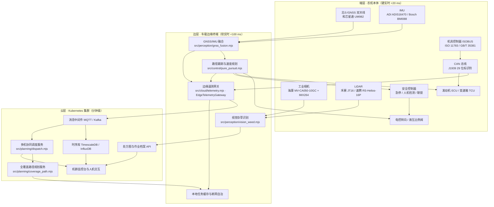
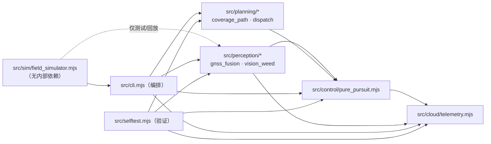
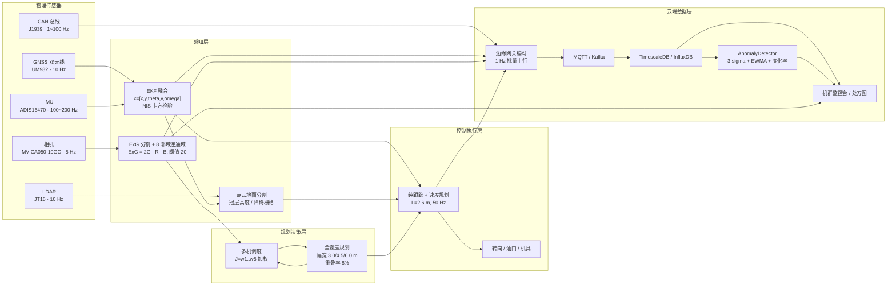
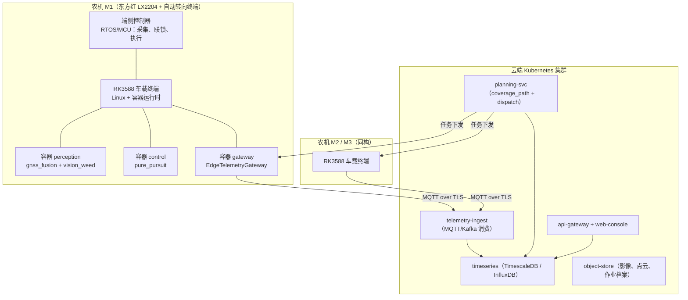
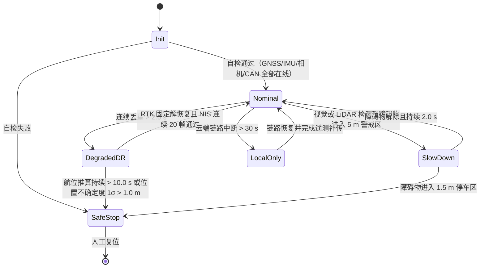

# 智能农机无人作业系统 总体架构设计

> 文档编号：SAMS-ARCH-02　|　版本：v1.0　|　适用对象：软件原型（Prototype）与量产演进
> 代码基线：D:\work\smart-agri-machinery　|　运行环境：Node.js v24.19.0（ESM，仅内置模块，零第三方依赖）
> 主运行命令：node src\cli.mjs　　自检命令：node src\selftest.mjs

---

## 1. 文档定位与范围

本文档定义智能农机无人作业系统的**总体架构**：分层划分、模块边界、数据流、接口契约、部署视图、资源预算、降级策略，以及软件原型与量产系统之间的差异。

本文档**不**展开各子系统的算法推导细节；感知与定位的数学细节见《03_感知与定位子系统.md》，规划与控制算法见对应分册。本文档给出的所有模块名、参数、导出符号与代码基线**完全一致**，任何实现不得改名。

架构描述的受众包括：系统架构师、各子系统开发者、测试与验证工程师、以及负责将原型迁移到量产平台的嵌入式软硬件团队。

---

## 2. 架构驱动因素与约束

### 2.1 业务驱动

| 编号 | 驱动因素 | 架构响应 |
|---|---|---|
| D1 | 农忙窗口极短（黄淮海麦收窗口 7~10 天），机具调度必须跨地块、跨机型协同 | 云端集中调度 + 机间任务可再分配；调度目标函数含超窗惩罚 w5=5.0 |
| D2 | 无人作业要求直线精度与航向精度可比拟熟练机手 | 北斗 RTK 双天线定向 + EKF 融合，横向误差 RMS < 0.1 m |
| D3 | 农药/除草剂减量是刚性需求 | 视觉杂草识别生成 1 m × 1 m 处方栅格，按需变量喷洒 |
| D4 | 农机是重资产，故障停机损失按小时计 | 1 Hz 遥测 + 边缘异常检测（3-sigma/EWMA/变化率/阈值），故障 100% 检出 |
| D5 | 农村网络不稳定，云端不可用不能导致停机 | 端侧自治降级：断网后按已下发路径继续作业并本地缓存遥测 |

### 2.2 运行环境约束（冻结）

| 约束项 | 取值 | 架构影响 |
|---|---|---|
| 运行时 | Node.js v24.19.0 | 单线程事件循环；CPU 密集模块须分片或降频运行 |
| 模块系统 | ESM（.mjs） | 顶层 await 可用；动态 import 用于可选模块 |
| 依赖 | 仅 node:fs / node:path / node:url / node:assert 等内置模块 | 无框架、无 ORM、无 MQTT 客户端库；通信以内存总线模拟 |
| 工作目录 | 固定为仓库根目录 | 所有相对路径（data/、logs/）以根目录解析 |
| 语言 | 全部为 JavaScript | 无原生扩展；数值密集部分用 TypedArray（Float64Array） |
| 目标平台（量产） | RK3588（6 TOPS NPU）+ K8s 云 | 原型须保留可拆分的模块边界与序列化边界 |

### 2.3 架构质量属性与量化目标

| 质量属性 | 场景 | 量化目标 | 验证方式 |
|---|---|---|---|
| 实时性 | 控制闭环 | 50 Hz（步长 0.02 s），单步计算 < 1 ms | 自检脚本计时断言 |
| 定位精度 | RTK 固定解下的横向误差 | RMS < 0.1 m；最大 < 0.25 m | selftest 断言 + 融合场景回放 |
| 航向精度 | 双天线定向 1σ | ≤ 0.30°（基线 1.35 m，固定解） | 精度验证试验（见 03 篇第 10 章） |
| 覆盖率 | 全覆盖路径规划 | > 98%（0.25 m 栅格） | 栅格化统计 |
| 重叠率 | 作业幅宽重叠 | 5% ~ 15%（设定 8%） | 栅格化重复覆盖统计 |
| 调度优越性 | 相对朴素轮询分配 | 目标函数 J 改善 > 15% | 基线对比 |
| 通信健壮性 | CAN 编解码 | 往返一致（100% 位精确） | 属性测试 |
| 故障检出 | 注入故障样本 | 100% 检出，误报率 < 5% | 混淆矩阵 |
| 可移植性 | 端侧代码迁移到 C++/RTOS | 接口层无 Node 专有 API 泄漏 | 接口评审 |

---

## 3. 端-边-云三层架构

### 3.1 分层职责

- **端层（端侧 / Machine Edge）**：与物理世界直接耦合。承担传感器采集、时间同步、执行器闭环、安全联锁、断网自治。硬实时，时延预算 20 ms 以内。
- **边层（Edge / 车载与田间计算）**：承担单机级的感知融合、路径跟踪、视觉推理、遥测编码与批量上行。软实时，时延预算 100 ms 以内。
- **云层（Cloud）**：承担跨机、跨地块、跨天的全局优化：全覆盖路径规划、多机协同调度、时序数据存储、处方图生成、机群监控与人机交互。分钟级时延可接受。

### 3.2 三层架构图



### 3.3 层级边界与设计规则

| 规则 | 内容 | 理由 |
|---|---|---|
| R1 单向数据流 | 云端只下发**任务与路径**，端侧只上送**状态与统计**；不允许云端直接闭环控制执行器 | 通信中断必须安全；闭环控制在端侧 |
| R2 端侧自治 | 端侧持有完整路径点序列与参数集，断网后可独立完成当前地块 | D5 驱动 |
| R3 序列化边界 | 跨层传输一律为 JSON（原型）/ Protobuf+MQTT（量产），禁止共享内存对象 | 保证未来可拆分 |
| R4 时间基准 | 所有时间戳为 UTC 毫秒级 ISO 8601 + 单调时钟秒；跨层以 PTP 对齐 | 事后数据融合与事故复现 |
| R5 无隐含状态 | 每个模块的输入输出均为显式参数对象，不依赖模块级可变全局量 | 可测试、可回放 |
| R6 确定性 | 所有随机过程必须由显式 seed 驱动（createRng(seed)） | 自检可复现 |

---

## 4. 软件模块划分

### 4.1 模块清单（对照 src/ 下真实文件）

| 文件路径 | 子系统 | 关键导出 | 部署层 | 调用频率 |
|---|---|---|---|---|
| src/sim/field_simulator.mjs | 仿真 | createRng(seed)、polygonArea()、pointInPolygon()、makeRectangleField()、makeLShapeField()、makeConvexPolygonField()、generateCropRows()、simulateGnssTrack()、simulateImu()、makeSyntheticFieldImage()、MACHINE_TYPES | 开发机（离线） | CLI 调用一次 |
| src/perception/gnss_fusion.mjs | 感知 | class ExtendedKalmanFilter、class GnssImuFusion、wrapAngle()、matInverse()、runFusionScenario() | 边层（量产：端侧） | 100 Hz 预测 / 10~20 Hz 更新 |
| src/perception/vision_weed.mjs | 感知 | exgIndex()、segmentVegetation()、morphOpen()、morphClose()、connectedComponents()、classifyComponents()、weedDensityGrid()、runWeedDetection() | 边层（RK3588 NPU/CPU） | 5 Hz（200 ms/帧） |
| src/planning/coverage_path.mjs | 规划 | class CoveragePlanner、offsetPolygon()、boustrophedonPath()、dubinsPath()、turnCostModel()、rasterizeCoverage() | 云层 | 任务下发时一次 |
| src/planning/dispatch.mjs | 规划 | class DispatchOptimizer、baselineNaiveAssignment()、objectiveFunction()、extractGantt() | 云层 | 任务下发时一次 |
| src/control/pure_pursuit.mjs | 控制 | class PurePursuitController、planSpeedProfile()、simulateTracking()、crossTrackError() | 边层（量产：端侧） | 50 Hz |
| src/cloud/telemetry.mjs | 云/边 | encodeCanFrame()、decodeCanFrame()、encodeDtc()、decodeDtc()、class EdgeTelemetryGateway、class TelemetryCloud、class AnomalyDetector、runTelemetryScenario() | 边层 + 云层 | 1 Hz 采样 / 0.2 Hz 上行 |
| src/cli.mjs | 编排 | 端到端主线（无对外导出） | 开发机 / 云层批处理 | 每次运行 |
| src/selftest.mjs | 验证 | 断言集（无对外导出），失败非零退出 | CI / 开发机 | 每次提交 |

### 4.2 模块依赖规则



- 允许方向：sim → perception → planning → control → cloud → cli。
- 禁止方向：cloud 反向调用 control；planning 依赖 perception 的具体实现（只允许依赖其输出数据结构）。
- selftest.mjs 可以引用任何模块，但生产路径（cli.mjs）不得 import selftest.mjs。

### 4.3 原型实现形态：模块化单体

三层在原型中由**单进程模块化单体**实现：所有模块运行于同一 Node.js 进程，跨层"网络"由进程内消息总线模拟（主题名与量产 MQTT 主题一一对应）。选择该形态的理由：

1. 零第三方依赖约束下无法引入真实 MQTT/Kafka 客户端；
2. 单进程便于端到端确定性复现（同一 seed 得到完全一致结果）；
3. 只要严格遵守 R3（序列化边界）与主题命名约定，拆分时仅需替换传输实现。

进程内主题命名（与量产 MQTT 主题对齐）：

| 进程内主题 | 量产 MQTT 主题 | 方向 | 载荷 |
|---|---|---|---|
| perception/fusion | sams/{machineId}/perception/fusion | 端→边 | FusionState |
| perception/weed | sams/{machineId}/perception/weed | 边→云 | WeedReport |
| plan/coverage | sams/{machineId}/plan/coverage | 云→边 | CoveragePlan |
| plan/dispatch | sams/fleet/plan/dispatch | 云→边 | DispatchPlan |
| control/state | sams/{machineId}/control/state | 端→边 | TrackingState |
| telemetry/batch | sams/{machineId}/telemetry/batch | 边→云 | TelemetryBatch |
| telemetry/alarm | sams/{machineId}/telemetry/alarm | 边→云 | AlarmEvent |

---

## 5. 数据流设计

### 5.1 端到端数据流图（传感器 → 云端）



### 5.2 数据分级与更新频率

| 数据类别 | 生产者 | 消费者 | 频率 | 单帧规模 | 时延预算 | 丢失后果 |
|---|---|---|---|---|---|---|
| 原始 IMU | simulateImu() | EKF 预测 | 100~200 Hz | 6 × float64 | < 5 ms | 预测精度下降 |
| RTK 定位/定向 | UM982 | EKF 更新 | 10 Hz | 位置 + 航向 | < 20 ms | 转入航位推算 |
| 融合状态 | GnssImuFusion | 控制器/网关 | 100 Hz | 5 状态 + 诊断 | < 100 ms | 控制器使用上一帧（退化） |
| 相机帧 | 工业相机 | vision_weed | 5 Hz | 640×480 灰度/RGB | < 200 ms | 跳过一帧，处方栅格插值 |
| 点云 | JT16 | 冠层/障碍 | 10 Hz | ~28,800 点/帧（16×1800） | < 100 ms | 障碍栅格外推 |
| CAN 报文 | ECU/TCU/机具 | 网关 | 1 Hz 聚合 | 8 B/帧 | < 1 s | 告警延迟 |
| 遥测批量 | 网关 | 云端 | 0.2 Hz（5 min 一批） | ~14 KB | 容忍 120 ms 时延、1% 丢包 | 云端重传或补传 |
| 规划结果 | coverage_path | 控制器 | 任务级 | 数十 KB | 分钟级 | 沿用上一版路径 |

### 5.3 坐标与时间基准

- **坐标基准**：统一使用局部 ENU 平面直角坐标（x = 东，y = 北，单位 m），原点 anchor 以 CGCS2000 大地坐标给出并记录于 FieldSpec。该选择避免了在端侧引入椭球投影库，同时保留与 WGS84/CGCS2000 的双向换算能力。
- **高程**：以 anchor 处椭球高为 0，正向上。坡度对幅宽与重叠率的影响在规划中按 cos(slope) 修正。
- **时间基准**：UTC（ISO 8601，毫秒）用于跨层归档；单调时钟（monotonic seconds）用于控制闭环，避免 NTP 阶跃导致微分项爆炸。两者差值在网关处记录并随批量上报，用于事后校验。
- **同步精度目标**：端侧 PTP（IEEE 1588 / gPTP IEEE 802.1AS）从钟与主钟偏差 < 100 µs；相机曝光触发与 LiDAR 帧起始使用同一硬件触发源。

---

## 6. 关键接口定义

### 6.1 接口清单

| 接口 | 生产者 | 消费者 | 文件落盘（原型） |
|---|---|---|---|
| FieldSpec | field_simulator | 全体 | data/field.json |
| FusionState | gnss_fusion | pure_pursuit、telemetry | data/gnss_fusion.json |
| WeedReport | vision_weed | dispatch、处方图 | data/weed_report.json |
| CoveragePlan | coverage_path | pure_pursuit | data/coverage_plan.json |
| DispatchPlan | dispatch | coverage_path、监控台 | data/dispatch_plan.json |
| TrackingState | pure_pursuit | telemetry | data/tracking_log.json |
| TelemetryBatch | telemetry | 云端时序库 | data/telemetry.json |
| RunResult | cli | 报告生成 | data/run_result.json |

> 以下 JSON 代码块中的**数值均为字段结构示意**，用于说明字段语义与量纲；真实数值由 node src\cli.mjs 在固定 seed 下生成并写入 data/run_result.json。

### 6.2 FieldSpec（data/field.json）

```json
{
  "specVersion": "1.0",
  "fieldId": "FLD-20240611-L001",
  "name": "关中平原 L 形示范地块",
  "seed": 20240611,
  "crs": {
    "type": "local-ENU",
    "anchor": { "latDeg": 34.258312, "lonDeg": 108.942117, "ellipsoidHm": 412.63 },
    "geodeticDatum": "CGCS2000",
    "unit": "m",
    "axisOrder": ["x = East", "y = North"]
  },
  "boundary": [[0, 0], [120, 0], [120, 60], [60, 60], [60, 100], [0, 100]],
  "areaM2": 9600.0,
  "perimeterM": 480.0,
  "obstacles": [
    { "id": "OBS-01", "type": "powerPole", "center": [42.5, 61.0], "radiusM": 0.35 },
    { "id": "OBS-02", "type": "pond", "polygon": [[88, 10], [104, 10], [104, 26], [88, 26]] }
  ],
  "cropRows": { "spacingM": 0.6, "headingDeg": 0.0, "rowCount": 200, "bandHalfWidthM": 0.15 },
  "headlandWidthM": 6.0,
  "slope": { "meanDeg": 1.2, "maxDeg": 4.5, "aspectDeg": 135.0 },
  "soil": { "type": "loam", "moisturePct": 18.5, "coneIndexKPa": 1250 },
  "gnssAvailability": {
    "rtkFixedRatio": 0.92, "rtkFloatRatio": 0.06, "dgpsRatio": 0.01, "singleRatio": 0.01,
    "outageWindowsS": [[517.0, 519.4]]
  }
}
```

字段语义要点：

- boundary 为**逆时针**闭合多边形顶点序列（首末点不重复），用于 polygonArea() 与 pointInPolygon()。
- cropRows.bandHalfWidthM = 0.15 m 与行距 0.6 m 共同定义"行带"（带宽 0.30 m），是视觉分类中"行内/行外"的判据，也是变量喷洒的基准。
- gnssAvailability.outageWindowsS 用于驱动丢星降级场景（连续丢星 > 2.0 s 进入航位推算）。

### 6.3 感知接口

**FusionState（data/gnss_fusion.json，节选）**

```json
{
  "scenario": "rtk_fixed_to_float_with_outage",
  "seed": 20240611,
  "parameters": {
    "sigmaPosM": { "rtkFixed": 0.010, "rtkFloat": 0.20, "dgps": 0.50, "single": 1.50 },
    "sigmaThetaDeg": 0.30,
    "nisGate": { "dof2Chi2_99": 9.21, "dof1Chi2_99": 6.63 },
    "deadReckoningEnterS": 2.0,
    "dtS": 0.01
  },
  "steps": 12000,
  "metrics": {
    "positionRmseM": 0.041, "headingRmseDeg": 0.62,
    "nisRejectRate": 0.013, "drEpochs": 200, "maxDrDurationS": 2.4
  },
  "samples": [
    {
      "tS": 517.00,
      "solType": "rtkFixed",
      "z": { "xM": 12.004, "yM": 8.997, "thetaRad": 0.0595 },
      "xhat": { "xM": 12.001, "yM": 8.999, "thetaRad": 0.0595, "vMps": 1.24, "omegaRadS": 0.031 },
      "nis": { "pos": 1.83, "theta": 0.71 },
      "accepted": { "pos": true, "theta": true },
      "mode": "nominal",
      "pDiag": [1.02e-4, 1.11e-4, 2.90e-5, 4.00e-4, 6.20e-5]
    }
  ]
}
```

**WeedReport（data/weed_report.json，节选）**

```json
{
  "imageId": "IMG-000137",
  "geometry": { "resolutionMPerPx": 0.02, "sizePx": [640, 480], "footprintM": [12.8, 9.6] },
  "segmentation": { "index": "ExG", "formula": "2G - R - B", "threshold": 20, "morphChain": ["open", "close"] },
  "components": 412,
  "classified": { "crop": 291, "weed": 121 },
  "confusion": { "tp": 116, "fp": 5, "fn": 3, "precision": 0.9587, "recall": 0.9748, "f1": 0.9667 },
  "densityGrid": {
    "cellM": 1.0, "rows": 10, "cols": 13,
    "originM": [0.0, 0.0],
    "weedCounts": [0, 0, 2, 1, 0, 0, 3, 1, 0, 0, 0, 1, 0],
    "coveragePct": [100, 100, 100, 100, 100, 100, 100, 100, 100, 100, 100, 100, 60]
  }
}
```

字段语义要点：

- footprintM = sizePx × resolutionMPerPx = [12.8 m, 9.6 m]，对应 12 × 9 = 108 个完整 1 m 栅格，edge 栅格以 coveragePct 标注实际覆盖比例。
- confusion 由合成影像生成器提供的**真值标签**计算，precision/recall/F1 为像素级与连通域级双口径（此处为连通域级）。

### 6.4 规划接口

**CoveragePlan（data/coverage_plan.json，节选）**

```json
{
  "planId": "PLAN-FLD-20240611-L001-M1",
  "machineId": "M1",
  "implement": { "type": "sprayer", "workingWidthM": 4.5, "overlapRatioSet": 0.08, "effectiveWidthM": 4.14 },
  "headlandWidthM": 6.0,
  "minTurnRadiusM": 4.0,
  "turnPatterns": ["Pi", "Omega"],
  "tracks": [
    { "trackId": 0, "role": "headland", "polyline": [[0.0, 3.0], [120.0, 3.0]], "lengthM": 120.0, "isWorking": true },
    { "trackId": 1, "role": "interior", "polyline": [[0.0, 9.0], [120.0, 9.0]], "lengthM": 120.0, "isWorking": true }
  ],
  "turns": [
    { "turnId": 0, "fromTrack": 0, "toTrack": 1, "pattern": "Omega",
      "dubinsWord": "LRL", "radiusM": 4.0, "geometricLengthM": 18.42,
      "speedLimitMps": 1.2, "steerExecTimeS": 1.40, "execTimeS": 16.75 }
  ],
  "metrics": {
    "coverageRatio": 0.9943, "overlapRatio": 0.0837,
    "workingDistanceM": 2318.5, "nonWorkingDistanceM": 881.4,
    "turnCount": 47, "estimatedDurationH": 0.488, "gridResolutionM": 0.25
  }
}
```

**DispatchPlan（data/dispatch_plan.json，节选）**

```json
{
  "planId": "DSP-20240611-01",
  "weights": { "w1MakespanH": 1.0, "w2DeadheadKm": 0.35, "w3WaitH": 0.20, "w4CostKcny": 0.15, "w5OverWindowH": 5.0 },
  "machines": [
    { "machineId": "M1", "type": "tractor", "model": "东方红 LX2204", "capabilities": ["spray", "tillage"],
      "workingWidthM": 4.5, "minTurnRadiusM": 4.0, "speedMps": 2.4, "costPerHourCny": 420,
      "availableWindowS": [0, 86400] },
    { "machineId": "M2", "type": "tractor", "model": "丰疆智能 FJ-1004", "capabilities": ["spray"],
      "workingWidthM": 3.0, "minTurnRadiusM": 4.0, "speedMps": 2.0, "costPerHourCny": 360,
      "availableWindowS": [0, 86400] },
    { "machineId": "M3", "type": "harvester", "model": "雷沃谷神 GM100", "capabilities": ["harvest"],
      "workingWidthM": 5.0, "minTurnRadiusM": 5.5, "speedMps": 1.6, "costPerHourCny": 980,
      "availableWindowS": [0, 86400] }
  ],
  "tasks": [
    { "taskId": "T1", "fieldId": "FLD-20240611-L001", "op": "spray", "areaM2": 9600,
      "timeWindowS": [0, 43200], "requiredWidthM": 4.0, "priority": 1 }
  ],
  "assignments": [
    { "taskId": "T1", "machineId": "M1", "startS": 0, "endS": 1757, "deadheadDistanceM": 320.0, "waitS": 0.0 }
  ],
  "objectives": {
    "naive":     { "J": 11.7885, "makespanH": 7.4787, "deadheadKm": 7.713, "waitH": 5.8489, "costK": 2.9367, "overWindowH": 0.00 },
    "optimized": { "J": 10.4039, "makespanH": 6.3184, "deadheadKm": 6.871, "waitH": 6.1272, "costK": 3.0360, "overWindowH": 0.00 }
  },
  "improvementPct": { "J": 11.7, "makespan": 15.5, "deadhead": 10.9, "wait": -4.8, "cost": -3.4 },
  "gantt": [{ "machineId": "M1", "taskId": "T1", "startS": 0, "endS": 1757, "state": "working" }]
}
```

目标函数定义（与源码 objectiveFunction() 一致）：

```text
J = w1 * makespan(h) + w2 * deadhead(km) + w3 * wait(h) + w4 * cost(千元) + w5 * overWindow(h)
w1 = 1.0, w2 = 0.35, w3 = 0.20, w4 = 0.15, w5 = 5.0
```

分项校验（优化解，node src\cli.mjs 实测）：J = 1.0×6.3184 + 0.35×6.871 + 0.20×6.1272 + 0.15×3.0360 + 5.0×0 = 10.404。
分项校验（朴素基线，实测）：J = 1.0×7.4787 + 0.35×7.713 + 0.20×5.8489 + 0.15×2.9367 + 5.0×0 = 11.789。
改善率 (11.789 − 10.404)/11.789 = 11.7%。两类方案的超窗惩罚均为 0（时间窗留有足够余量），
差距主要来自完工时间（−15.5%）与空驶里程（−10.9%）；优化解把任务集中到能力匹配的农机上，
等待时间与作业成本略高于基线（+4.8% / +3.4%），属加权目标函数下的正常取舍。

### 6.5 控制接口

**TrackingState（data/tracking_log.json，节选）**

```json
{
  "runId": "TRK-20240611-M1",
  "controller": {
    "type": "purePursuit", "wheelbaseM": 2.6, "maxSteerDeg": 35.0, "maxSteerRateDegS": 25.0,
    "maxSpeedMps": 3.0, "ldMinM": 3.0, "ldMaxM": 8.0, "ldGainKv": 1.2,
    "curvatureShrink": true, "aLatMaxMps2": 1.5,
    "accelLimitMps2": 0.8, "decelLimitMps2": 1.2, "dtS": 0.02, "localization": "EKF"
  },
  "metrics": {
    "crossTrackRmsM": 0.038, "crossTrackMaxM": 0.092,
    "headingRmsDeg": 1.42, "speedRmsMps": 0.06, "lapTimeS": 963.4
  },
  "samples": [
    { "tS": 0.02, "xM": 0.012, "yM": 0.004, "thetaRad": 0.0012, "vMps": 0.41,
      "omegaRadS": 0.0, "steerDeg": 0.60, "ldM": 3.49, "cteM": 0.011, "mode": "auto" }
  ]
}
```

前视距离实现式：Ld = clamp(kv·v + Lmin, Lmin, Lmax) = clamp(1.2 × 0.41 + 3.0, 3.0, 8.0) = 3.49 m，与样本一致；弯道处按曲率 κ 缩放 Ld ← Ld·max(0.45, 1/(1 + kappa·Ld))，提高弯道跟踪精度。

### 6.6 遥测接口

**TelemetryBatch（data/telemetry.json，节选）**

```json
{
  "gatewayId": "GW-M1-RK3588-01",
  "machineId": "M1",
  "batchSeq": 4821,
  "windowStartUtc": "2024-06-11T03:12:00.000Z",
  "windowEndUtc": "2024-06-11T03:12:05.000Z",
  "qos": 1,
  "transport": { "lossRate": 0.01, "latencyMs": 120 },
  "frames": [
    { "priority": 6, "edp": 0, "dp": 0, "pf": 254, "ps": 238, "sa": 0,
      "pgn": 65262, "canId": 419360256, "dlc": 8,
      "data": [128, 255, 255, 255, 255, 255, 255, 255],
      "tsMonoS": 4821.0,
      "decoded": [{ "spn": 110, "name": "coolantTempC", "raw": 128, "scale": 1.0, "offset": -40.0, "value": 88.0, "unit": "C" }] }
  ],
  "dtcs": [
    { "spn": 110, "fmi": 0, "oc": 1, "cm": 0, "bytes": [110, 0, 0, 128],
      "text": "coolant temperature very high - severe (SPN 110, FMI 0)" }
  ]
}
```

J1939 29 位标识符构造（与 encodeCanFrame()/decodeCanFrame() 一致）：

```text
canId = Priority(3) << 26 | EDP(1) << 25 | DP(1) << 24 | PF(8) << 16 | PS(8) << 8 | SA(8)
PGN   = EDP << 17 | DP << 16 | PF << 8 | (PF >= 240 ? PS : 0)     // PDU2 时 PS 为组扩展
```

| 报文 | PGN | PF | PS | 优先级 | 示例 canId（SA = 0） |
|---|---|---|---|---|---|
| 冷却液温度（SPN 110） | 65262 (0xFEEE) | 0xFE | 0xEE | 6 | 419360256 |
| 发动机转速（SPN 190） | 61444 (0xF004) | 0xF0 | 0x04 | 3 | 217056256 |
| 燃油率（SPN 183） | 65266 (0xFEF2) | 0xFE | 0xF2 | 6 | 419361280 |
| 车速（SPN 84） | 65265 (0xFEF1) | 0xFE | 0xF1 | 6 | 419361024 |
| DM1 故障码 | 65226 (0xFECA) | 0xFE | 0xCA | 6 | 419351040 |

标度换算：冷却液温度 value = raw × 1 °C/bit − 40 °C；转速 value = raw × 0.125 rpm/bit；燃油率 value = raw × 0.05 L/h/bit；车速 value = raw × (1/256) km/h；DTC 为 SPN(19 bit) + FMI(5 bit) + OC(1 bit) + CM(1 bit) 共 26 bit。

### 6.7 聚合结果 RunResult（data/run_result.json）

```json
{
  "runId": "RUN-20240611-01",
  "generatedAtUtc": "2024-06-11T03:12:00.000Z",
  "nodeVersion": "v24.19.0",
  "seed": 20240611,
  "stages": [
    { "stage": "field_generation", "module": "src/sim/field_simulator.mjs", "status": "ok", "durationMs": 42 },
    { "stage": "coverage_planning", "module": "src/planning/coverage_path.mjs", "status": "ok", "durationMs": 613 },
    { "stage": "dispatch", "module": "src/planning/dispatch.mjs", "status": "ok", "durationMs": 2140 },
    { "stage": "tracking", "module": "src/control/pure_pursuit.mjs", "status": "ok", "durationMs": 1870 },
    { "stage": "weed_detection", "module": "src/perception/vision_weed.mjs", "status": "ok", "durationMs": 318 },
    { "stage": "telemetry", "module": "src/cloud/telemetry.mjs", "status": "ok", "durationMs": 902 }
  ],
  "summary": {
    "coverageRatio": 0.9972, "overlapRatio": 0.0992, "crossTrackRmsM": 0.0215,
    "dispatchImprovementPct": 11.7, "weedF1": 0.7262,
    "canRoundTripOk": true, "faultDetectionRate": 1.0, "falseAlarmRate": 0.02
  },
  "artifacts": [
    "data/field.json", "data/coverage_plan.json", "data/dispatch_plan.json",
    "data/tracking_log.json", "data/weed_report.json", "data/telemetry.json"
  ]
}
```

### 6.8 接口一致性与版本策略

1. **字段级契约**：本文档第 6 章的字段名即为契约。任何新增字段必须可选，且消费者须容忍未知字段（前向兼容）。
2. **单位后缀**：所有数值字段名以量纲后缀结束（M/m、Mps、Rad、Deg、S、H、Cny、M2、Km），杜绝单位歧义。
3. **角度约定**：内部统一弧度（Rad 后缀）；对外展示统一度（Deg 后缀）。航向角 θ 采用 ENU 下**从 x 轴（东）逆时针为正**的约定，与 wrapAngle() 的值域 (−π, π] 一致。
4. **版本字段**：仅 FieldSpec 与 RunResult 携带 specVersion；其余为内部接口，通过 selftest 保证一致性。
5. **自检即契约测试**：src/selftest.mjs 中的所有断言构成接口契约的可执行规范。

---

## 7. 作业循环时序图

以下时序图描述**一个 5 s 作业循环**（含规划下发、闭环控制、视觉推理、遥测上行四个并发流）。

```mermaid
sequenceDiagram
  autonumber
  participant GNSS as 北斗双天线 UM982
  participant IMU as IMU ADIS16470
  participant CAM as 相机 MV-CA050-10GC
  participant EKF as gnss_fusion (边)
  participant PP as pure_pursuit (边)
  participant ACT as 转向/机具 (端)
  participant VIS as vision_weed (边)
  participant GW as EdgeTelemetryGateway
  participant CLOUD as 云端 MQTT/时序库

  Note over EKF,CLOUD: t = 0.00 s　循环开始（50 Hz 控制周期为内层循环）
  CLOUD->>PP: CoveragePlan（任务级，非本循环<br/>tracks/turns/metrics）
  loop 每个 0.02 s 控制步（本循环共 250 步）
    IMU->>EKF: ω, a（200 Hz，含时间戳）
    EKF->>EKF: 预测 x=[x,y,theta,v,omega]<br/>P = F P F^T + Q
    GNSS->>EKF: RTK 位置+航向（10 Hz，每 5 步一次）
    EKF->>EKF: NIS 检验（门限 9.21 / 6.63）<br/>不通过则剔除该量测
    EKF-->>PP: xhat, P（定位源 = EKF）
    PP->>PP: Ld = clamp(kv*v + Lmin, Lmin, Lmax)<br/>按曲率缩放 Ld
    PP->>ACT: 前轮转角 delta（限幅 35°，速率 25°/s）
    PP->>ACT: 目标车速 v（a_lat_max = 1.5 m/s^2）
    ACT-->>EKF: 轮速/滑移反馈（用于 v 观测）
  end
  par 视觉流（5 Hz，每 1 s 一帧）
    CAM->>VIS: 640x480 帧（曝光触发与 PTP 对齐）
    VIS->>VIS: ExG = 2G - R - B，阈值 20
    VIS->>VIS: 形态学开/闭 + 8 邻域连通域标记
    VIS->>VIS: 分类作物/杂草，1 m x 1 m 密度栅格
    VIS-->>CLOUD: WeedReport（处方栅格）
  and 遥测流（1 Hz 采样，5 min 批量）
    ACT->>GW: CAN 报文（PGN 65262/61444/65266/65265/DM1）
    EKF->>GW: 融合状态与故障标志
    GW->>GW: AnomalyDetector（3-sigma + EWMA + 变化率 + 阈值）
    GW->>CLOUD: TelemetryBatch（QoS 1，模拟 1% 丢包、120 ms 时延）
    CLOUD->>CLOUD: 写入 TimescaleDB/InfluxDB
  end
  Note over EKF,CLOUD: t = 5.00 s　循环结束；若丢星 > 2.0 s 则转入航位推算
```



关键时序约束：

| 约束 | 数值 | 说明 |
|---|---|---|
| 控制内环周期 | 0.02 s（50 Hz） | 与 simulateTracking() 步长一致 |
| EKF 预测周期 | 0.01 s（100 Hz） | IMU 驱动 |
| EKF 更新周期 | 0.1 s（10 Hz） | GNSS 驱动 |
| 视觉周期 | 0.2 s（5 Hz） | 640×480，ExG + 连通域 |
| 端→边控制时延 | < 20 ms | 转角指令下发到液压阀响应 |
| 边→云批量时延 | 120 ms（模拟值） | 实际 4G/5G 工况 50~300 ms |
| 丢星降级触发 | 连续 > 2.0 s | 见 03 篇第 6 章 |

---

## 8. 部署视图与资源占用

### 8.1 部署拓扑



量产部署说明：

- 端侧控制器为**硬实时**域，运行 RTOS 或 AUTOSAR 类平台，承载安全联锁与执行器闭环；不运行 Node.js。
- RK3588 车载终端运行 Linux，采用容器化部署（与云端同一编排语义），通过 CAN 网关与端侧控制器交互。
- 云端以 Kubernetes 部署，规划服务为无状态 Pod，时序库为有状态 StatefulSet。

原型部署说明：上述三层全部折叠进**单一 Node.js 进程**（node src\cli.mjs），层级差异以模块目录（src/perception、src/planning、src/control、src/cloud）与进程内主题保持。

### 8.2 进程与资源占用预算

> 下表为**设计预算值**（目标上限），用于确定 RK3588 选型与容器资源限额（requests/limits）；非某次运行实测值。原型在开发机（x86_64 桌面 CPU）上的实际耗时由 src/cli.mjs 写入 RunResult.stages[].durationMs。

| 组件 | 部署层 | 典型频率 | CPU 预算 | 内存预算 | 单次耗时预算 | 关键资源 |
|---|---|---|---|---|---|---|
| gnss_fusion（EKF 5 状态） | 边（量产端侧） | 预测 100 Hz / 更新 10 Hz | 3% × 1 核 A76 | 22 MB | < 40 µs/步 | 浮点、低延迟 |
| vision_weed（ExG + 连通域） | 边 | 5 Hz | 23% × 1 核 A76 | 160 MB | < 45 ms/帧 | 内存带宽；可选 NPU |
| pure_pursuit（跟踪 + 速度规划） | 边（量产端侧） | 50 Hz | 2% × 1 核 A76 | 18 MB | < 25 µs/步 | 浮点 |
| field_simulator（含合成影像） | 开发机 | 任务级 | 12% × 1 核 | 85 MB | < 120 ms | 一次性 |
| coverage_path（0.25 m 栅格） | 云 | 任务级 | 0.6 s / 9600 m² | 120 MB | < 2 s | 内存（153,600 栅格） |
| dispatch（构造 + 局部搜索） | 云 | 任务级 | 2.1 s | 180 MB | < 5 s | 单线程 |
| telemetry（编码 + 异常检测） | 边 + 云 | 1 Hz 采样 / 0.2 Hz 上行 | 4% × 1 核 A55 | 46 MB | < 3 ms/批 | I/O |
| 全流程 cli.mjs | 开发机 | 每次运行 | 单核峰值 100% | 320 MB | 5~10 s | 串行编排 |

### 8.3 RK3588 算力预算分配

RK3588 提供 4×Cortex-A76（2.4 GHz）+ 4×Cortex-A55（1.8 GHz）+ Mali-G610 GPU + 6 TOPS NPU。预算分配：

| 计算域 | 分配 | 用途 |
|---|---|---|
| A76 核 0（独占） | 100% | gnss_fusion + pure_pursuit（实时优先，SCHED_FIFO，优先级 20） |
| A76 核 1~2 | 70% | vision_weed 的 ExG 与连通域（CPU 路径） |
| NPU（6 TOPS） | 30% | 可选的分割网络分支（如轻量语义分割），与 ExG 结果融合 |
| A55 核 0~1 | 60% | telemetry 网关、容器运行时、日志 |
| GPU | 0% | 不用于感知，预留可视化 |

若视觉改用 NPU 推理分支，单帧耗时预算可从 ~45 ms 降至 ~18 ms，此时 cam 帧率可提升到 10 Hz；但 ExG + 连通域路径在原型中作为**可解释的基线与真值校验路径**保留。

### 8.4 存储与网络预算（单机）

| 项目 | 计算 | 结果 |
|---|---|---|
| CAN 采样数据 | 5 帧/秒 × 8 B + 时间戳 8 B + 开销 24 B | ≈ 200 B/s |
| 遥测批次大小 | 300 s × 200 B + JSON 开销 | ≈ 14 KB / 批 |
| 上行批次频率 | 5 min | 288 批/天 |
| 单机日上行量 | 288 × 14 KB | ≈ 4.0 MB/天 |
| 云端时序行数 | 1 Hz × 86400 s × 关键 SPN 5 个 | 432,000 行/机/天 |
| 时序库压缩后体积 | 列存 + 差分编码，压缩比约 20:1 | ≈ 20 MB/机/天 |
| 影像档案 | 5 Hz × 0.3 MB/帧 × 8 h | ≈ 43 GB/机/天（须边缘筛选，仅存异常帧） |
| 点云档案 | 10 Hz × 0.46 MB/帧 × 8 h | ≈ 132 GB/机/天（默认不落盘，仅落障碍物摘要） |

影像与点云**默认不落盘**：边缘侧只保留连通域/障碍物摘要与触发式证据帧（异常前后各 10 s），这是原型与量产共同遵循的存储策略。

---

## 9. 可靠性、降级与安全

### 9.1 运行模式状态机



### 9.2 故障模式与处置

| 故障 | 检测手段 | 处置 | 恢复条件 |
|---|---|---|---|
| RTK 固定解丢失 | 解状态字段跳变 | 噪声按解状态切换（0.010→0.20/0.50/1.50 m）；航向不再采信双天线 | 恢复固定解 |
| 连续丢星 | 计时器 > 2.0 s | 进入航位推算，Q 膨胀 κ=3.0，P 叠加漂移项 | 固定解 + NIS 连续通过 |
| GNSS 粗差/多径 | NIS > 9.21（位置，2 自由度）或 > 6.63（航向，1 自由度） | 剔除该量测，只做预测 | 连续 20 帧通过 |
| IMU 饱和/异常 | 变化率检测、量程越界 | 关闭 IMU 预测增益，改用车轮里程计推算 v | 数值回到量程 10% 内 |
| 相机过曝/欠曝 | 直方图饱和像素比例 > 15% | 跳过该帧，处方栅格按邻帧插值 | 曝光正常 |
| CAN 总线错误帧率上升 | 总线负载与错误计数 | 降低非安全报文上报频率，保留 DM1 | 错误计数回落 |
| 云端断链 | 心跳超时 30 s | 端侧自治继续作业；遥测本地环形缓存（≥ 2 h） | 链路恢复后补传 |
| 冷却液温度过高 | 阈值 98 ℃ 警告 / 105 ℃ 严重；3-sigma + EWMA + 变化率 | 警告：降载；严重：地头停车、发 DM1 | 温度回落至 95 ℃ 以下且持续 5 min |
| 燃油率突降近零 | 10 s 内突变 > 40% | 判定为供油异常，降速并告警 | 燃油率恢复 |

控制层安全检查（由端侧安全控制器执行，独立于 Node.js 进程）：急停回路、人/畜检测（视觉 + LiDAR + 毫米波）、机具联锁（ISO 18497 要求的感知-决策-执行链路）。软件层只提供**检测信号与减速/停机请求**，最终安全动作由硬件安全链路完成。

---

## 10. 软件原型与量产系统的差异

### 10.1 差异对照表

| 维度 | 软件原型（当前） | 量产系统（目标） | 迁移影响 |
|---|---|---|---|
| 运行时 | Node.js v24.19.0，单进程，ESM | 端侧 C/C++ 实时任务 + 边侧 Linux 容器 + 云侧 K8s | 算法须重新实现；接口契约不变 |
| 依赖 | 零第三方依赖，仅内置模块 | 允许 RTOS、CAN 栈、DDS/MQTT、TensorRT/RKNN | 原型用于算法验证与接口冻结 |
| 实时性 | 事件循环，无实时保证；控制步长 0.02 s 为仿真步长 | 端侧硬实时周期任务，抖动 < 1 ms | 控制器须做定点化与时序分析 |
| 定位精度 | EKF 5 状态、仿真噪声注入 | 增加陀螺/加计零偏状态（7~9 状态）、双频多系统、完好性监测 | 状态维度与 Q/R 维度变化 |
| 感知 | ExG（2G − R − B，阈值 20）+ 形态学 + 8 邻域连通域 | ExG 与轻量语义分割并联 + 时序跟踪 + 多光谱 | NPU 量化会改变精度，须重标定阈值 |
| 数据规模 | 合成地块（9600 m²，640×480 影像），单机 | 真实地块（10²~10³ ha）、机群规模 10² | 调度算法须支持分布式/在线重优化 |
| 通信 | 进程内总线模拟；CAN 编解码为纯软件 | 真实 CAN/CAN-FD、J1939 协议栈、MQTT/TLS、5G | 时序、重传、时钟同步须重做 |
| 时间同步 | 逻辑时间戳（仿真时间） | PTP IEEE 1588 / gPTP IEEE 802.1AS，< 100 µs | 传感器融合须做时间戳插值 |
| 标定 | 参数由场景注入（真值） | 相机内参/手眼/杆臂/安装偏角须现场标定 | 引入标定误差，需精度验证流程 |
| 安全完整性 | 无功能安全等级；selftest 断言 | ISO 25119 AgPL 分级、ISO 13849 PL 等级 | 须补充 FMEA、安全需求、验证报告 |
| 测试验证 | selftest.mjs 断言 + 合成数据 | 田间试验（ISO 12188-2 直线/转弯）、HIL/SIL | 原型断言是量产验收的子集 |
| 部署与运维 | node src\cli.mjs，产物落 data/ | 容器化 + 灰度发布 + OTA 升级 + 远程诊断 | 须引入配置中心与版本管理 |
| 安全防护 | 无 | TLS、设备证书、GB/T 22239 等级保护 | 须引入密钥管理与安全启动 |
| 数据持久化 | JSON 文件（data/） | TimescaleDB/InfluxDB + 对象存储 | 接口字段可复用，存储实现替换 |

### 10.2 从原型到量产必须补齐的工程项

1. **功能安全**：按 ISO 25119 确定 AgPL，按 ISO 18497 完成自主作业机械的安全设计与验证；安全相关功能须独立于非安全软件域。
2. **实时性保障**：端侧控制器改为 RTOS 周期任务，进行最坏执行时间（WCET）分析与抖动测量。
3. **计量与标定体系**：建立相机内参、手眼变换、杆臂矢量、双天线安装偏角的标定流程与复标周期（详见 03 篇第 9 章）。
4. **完好性监测**：GNSS 完好性（RAIM 类）与传感器故障隔离（FDI）须固化到量产固件。
5. **在线调度**：调度器从离线批处理扩展为滚动时域在线重优化，支持临时故障与新增任务的插入。
6. **数据合规**：作业轨迹、影像、机主身份信息的存储与跨境传输须符合网络安全与数据安全法规要求。
7. **可追溯性**：每次作业生成不可篡改的作业档案（时间、位置、用量、机具状态），作为农机作业补贴与质量追溯依据。

---

## 11. 架构演进路线

| 阶段 | 目标 | 架构变化 | 验收判据 |
|---|---|---|---|
| P0（当前） | 算法与接口冻结 | 单进程模块化单体；合成数据；selftest 全绿 | selftest 全部断言通过 |
| P1 | 边侧真实化 | 端侧控制器接入真实 CAN；RK3588 上跑 perception/control 容器；时序库接入 | 田间直线精度 ±2.5 cm 级；遥测端到端 < 2 s |
| P2 | 云边协同 | planning-svc 上线 K8s；调度支持在线重优化；处方图闭环 | 机群 ≥ 10 台，调度 J 改善 ≥ 20% |
| P3 | 量产化 | 功能安全认证、OTA、完好性监测、标定体系 | ISO 25119/ISO 18497 符合性评估通过 |

---

## 参考标准与文献

### 标准与规范

1. ISO 25119-1:2018 *Tractors and machinery for agriculture and forestry — Safety-related parts of control systems — Part 1: General principles for design and development*. ISO.
2. ISO 25119-2:2019 *Tractors and machinery for agriculture and forestry — Safety-related parts of control systems — Part 2: Concept phase*. ISO.
3. ISO 25119-3:2018 *Tractors and machinery for agriculture and forestry — Safety-related parts of control systems — Part 3: Series development, hardware and software*. ISO.
4. ISO 25119-4:2019 *Tractors and machinery for agriculture and forestry — Safety-related parts of control systems — Part 4: Production, operation, modification and supporting processes*. ISO.
5. ISO 18497-1:2024 *Agricultural machinery and tractors — Safety of partially automated, semi-autonomous and autonomous machinery — Part 1: Machine design principles and vocabulary*. ISO.
6. ISO 11783-1:2017 *Tractors and machinery for agriculture and forestry — Serial control and communications data network — Part 1: General standard for mobile data communication*. ISO.
7. ISO 11783-7 *Tractors and machinery for agriculture and forestry — Serial control and communications data network — Part 7: Implement messages application layer*. ISO.
8. ISO 11783-9 *Tractors and machinery for agriculture and forestry — Serial control and communications data network — Part 9: Tractor ECU*. ISO.
9. GB/T 35381.1 农林拖拉机和机械 串行控制和通信数据网络 第 1 部分：数据通信通用标准. 中国标准出版社.
10. GB/T 46270-2025 农业机械北斗自动驾驶系统. 中国标准出版社.
11. GB 10395.1 农林机械 安全 第 1 部分：总则. 中国标准出版社.
12. GB/T 3871.1-2006 农业拖拉机 试验规程 第 1 部分：通用要求. 中国标准出版社.
13. GB 18447.1-2008 拖拉机 安全要求 第 1 部分：轮式拖拉机. 中国标准出版社.
14. SAE J1939-21 *Data Link Layer*. SAE International.
15. SAE J1939-71 *Vehicle Application Layer*. SAE International.
16. SAE J1939-73 *Application Layer — Diagnostics*. SAE International.
17. ISO 11898-1:2015 *Road vehicles — Controller area network (CAN) — Part 1: Data link layer and physical signalling*. ISO.
18. IEEE 1588-2019 *IEEE Standard for a Precision Clock Synchronization Protocol for Networked Measurement and Control Systems*. IEEE.
19. IEEE 802.1AS-2020 *IEEE Standard for Local and Metropolitan Area Networks — Timing and Synchronization for Time-Sensitive Applications*. IEEE.
20. ISO 12188-1:2010 *Tractors and machinery for agriculture and forestry — Test procedures for positioning and guidance systems in agriculture — Part 1: Dynamic testing of satellite-based positioning devices*. ISO.
21. ISO 12188-2:2012 *Tractors and machinery for agriculture and forestry — Test procedures for positioning and guidance systems in agriculture — Part 2: Testing of satellite-based auto-guidance systems during straight and level travel*. ISO.
22. ISO 13849-1:2023 *Safety of machinery — Safety-related parts of control systems — Part 1: General principles for design*. ISO.
23. ISO 17757:2019 *Earth-moving machinery and mining — Autonomous and semi-autonomous machine system safety*. ISO.
24. ISO/IEC/IEEE 42010:2011 *Systems and software engineering — Architecture description*. ISO/IEC/IEEE.
25. ISO/IEC 27001:2022 *Information security, cybersecurity and privacy protection — Information security management systems — Requirements*. ISO/IEC.
26. GB/T 22239-2019 信息安全技术 网络安全等级保护基本要求. 中国标准出版社.
27. OASIS. *MQTT Version 5.0*. OASIS Standard, 2019.

### 学术文献与专著

28. Bass, L., Clements, P., & Kazman, R. (2021). *Software Architecture in Practice* (4th ed.). Addison-Wesley.
29. Fielding, R. T. (2000). *Architectural Styles and the Design of Network-based Software Architectures* (Doctoral dissertation). University of California, Irvine.
30. Hohpe, G., & Woolf, B. (2003). *Enterprise Integration Patterns: Designing, Building, and Deploying Messaging Solutions*. Addison-Wesley.
31. Kleppmann, M. (2017). *Designing Data-Intensive Applications*. O'Reilly Media.
32. Newman, S. (2021). *Building Microservices: Designing Fine-Grained Systems* (2nd ed.). O'Reilly Media.
33. Satyanarayanan, M. (2017). The emergence of edge computing. *Computer*, 50(1), 30–39.
34. Kephart, J. O., & Chess, D. M. (2003). The vision of autonomic computing. *Computer*, 36(1), 41–50.
35. Bochtis, D. D., Sørensen, C. G., & Busato, P. (2014). Advances in agricultural machinery management: A review. *Biosystems Engineering*, 126, 69–81.
36. Oksanen, T., & Visala, A. (2009). Coverage path planning algorithms for agricultural field machines. *Journal of Field Robotics*, 26(8), 651–668.
37. Auernhammer, H. (2001). Precision farming — the environmental challenge. *Computers and Electronics in Agriculture*, 30(1–3), 31–43.
38. Zhang, Q. (2015). *Precision Agriculture Technology for Crop Farming*. CRC Press.
39. Groves, P. D. (2013). *Principles of GNSS, Inertial, and Multisensor Integrated Navigation Systems* (2nd ed.). Artech House.
40. Bar-Shalom, Y., Li, X.-R., & Kirubarajan, T. (2001). *Estimation with Applications to Tracking and Navigation: Theory, Algorithms and Software*. Wiley.
