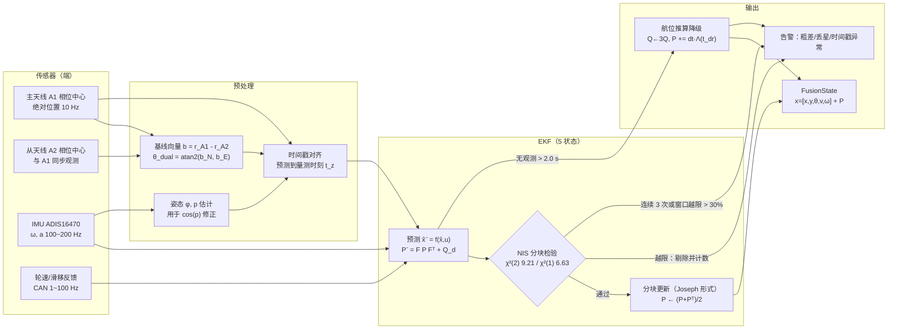
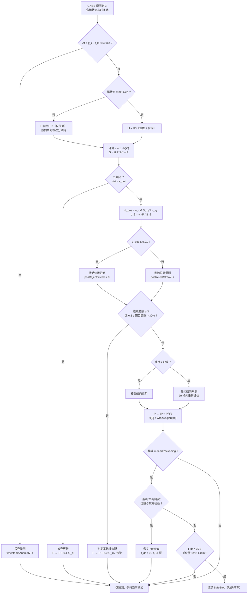
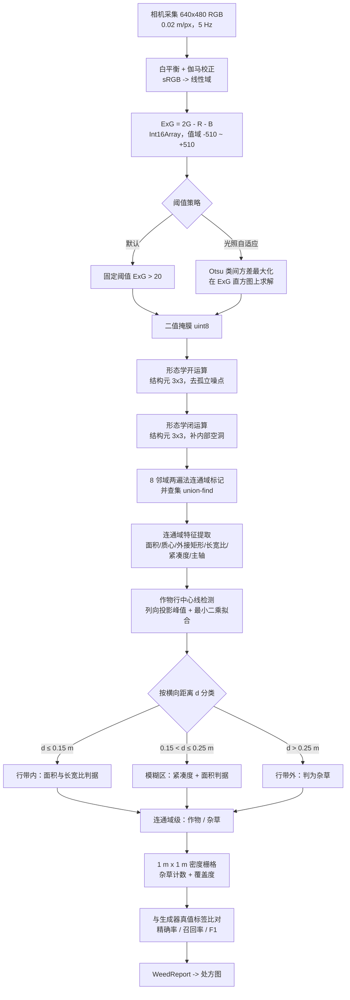

# 智能农机无人作业系统 感知与定位子系统设计

> 文档编号：SAMS-ARCH-03　|　版本：v1.0
> 对应代码：
> - src/perception/gnss_fusion.mjs —— GNSS/RTK + IMU 扩展卡尔曼滤波
> - src/perception/vision_weed.mjs —— 视觉杂草识别
> - src/sim/field_simulator.mjs —— 传感器与地块仿真（simulateGnssTrack()、simulateImu()、makeSyntheticFieldImage()）
> 运行环境：Node.js v24.19.0（ESM，仅内置模块）

---

## 1. 范围、边界与量化指标

本子系统负责把物理世界的**位置、姿态、作物/杂草分布、冠层与障碍物几何**转换为统一的、带不确定度的数值表示，供规划与控制使用。边界如下：

- 输入：北斗/GNSS 双天线观测、IMU 原始测量、工业相机影像、LiDAR 点云、CAN 总线上的车辆状态。
- 输出：FusionState（5 状态 + 协方差）、WeedReport（处方栅格）、冠层高度图、障碍物占据栅格。
- 不负责：路径规划、调度、执行器闭环、安全联锁（见 02 篇）。

| 指标 | 目标值 | 依据 |
|---|---|---|
| 定位水平 RMSE（RTK 固定解） | ≤ 0.025 m | ISO 12188-1 动态测试 |
| 双天线航向 1σ | ≤ 0.30°（基线 1.35 m） | 本文第 3.2 节 |
| 横向跟踪误差 RMS（含转弯） | < 0.10 m | selftest 断言 |
| 横向跟踪误差 RMS（直行段） | < 0.05 m | ISO 12188-2 |
| 丢星 2.0 s 内位置漂移 1σ | ≤ 0.35 m | 本文第 6.3 节 |
| 杂草识别 F1 | ≥ 0.90 | 合成真值 + 田间样方 |
| 障碍物首次检出距离 | ≥ 8 m（1.0 m × 0.5 m 靶标） | 标准靶标试验 |
| 时间同步主从偏差 | ≤ 100 µs | IEEE 1588 / 802.1AS |

---

## 2. 传感器配置

### 2.1 传感器清单与型号

| 类别 | 型号 | 关键参数 | 输出率 | 接口 |
|---|---|---|---|---|
| GNSS 板卡 | 和芯星通 UM982 双天线 RTK 模块 | 全星座全频点（BDS B1I/B2I/B3I、GPS L1/L2/L5、GLONASS、Galileo），双天线定向，固定解水平精度 ±2 cm + 1 ppm | 定位 10 Hz；定向 10 Hz | 串口 / 以太网 |
| 差分服务 | 千寻位置 FindCM（CORS） | 固定解水平精度 ±2 cm + 1 ppm；网络 RTK | 1 Hz 差分改正 | NTRIP over 4G |
| IMU（主） | ADI ADIS16470 | 6 轴战术级 MEMS；陀螺零偏不稳定性 8 °/h；SPI 输出 | 100 ~ 200 Hz | SPI |
| IMU（冗余） | Bosch BMI088 | 消费级 6 轴 MEMS；零偏与随机游走比 ADIS16470 差约一个数量级 | 最高 1.6 kHz | SPI / I²C |
| 工业相机 | 海康 MV-CA050-10GC + Sony IMX264 | 2448 × 2048；像元 3.45 µm；2/3" 靶面；全局快门；GigE Vision | 最高 23 fps，实际用 5 Hz | GigE + 硬件触发 |
| LiDAR（方案 A） | 禾赛 JT16 | 16 线；水平 360°；垂直视场约 40°；机械旋转式 | 10 Hz | Ethernet |
| LiDAR（方案 B） | 速腾聚创 RS-Helios-16P | 16 线；测距 150 m；垂直视场 30° | 10 Hz | Ethernet |
| 边缘计算 | 瑞芯微 RK3588 | 4×A76 + 4×A55 + 6 TOPS NPU | — | — |

### 2.2 安装几何

```text
车体参考点 O = 后轴中心（地面投影）
  ├─ 主天线 A1：驾驶室顶棚前缘，车体系杆臂 l_A1O = [+0.35, 0.00, +2.10] m
  ├─ 从天线 A2：驾驶室顶棚后缘，车体系杆臂 l_A2O = [-1.00, 0.00, +2.10] m
  │    → 基线长度 L = |l_A1O - l_A2O| = 1.35 m（沿车体纵轴，前-后布置）
  ├─ IMU I：座椅下方底板，车体系杆臂 l_IO = [0.00, 0.00, +0.45] m
  ├─ 相机 C：驾驶室顶棚前缘，离地 h = 2.20 m，光轴下倾角 γ = 35°
  └─ LiDAR：驾驶室顶棚中部，离地 2.60 m，水平安装
```

选择 1.35 m 基线不是任意值：由第 3.2 节公式，σ_pos = 0.010 m、要求 σ_ψ ≤ 0.30° 时，解出 L ≥ 0.010/(0.005236 × 1.41421) = 1.350 m。同时驾驶室顶棚可用长度约 1.5 m，故取 1.35 m 兼顾精度与安装可行性。

---

## 3. 北斗/GNSS 定位与双天线定向

### 3.1 观测与解状态

UM982 同时输出两类观测量：

1. **绝对位置**（天线 A1 相位中心）：经双差载波相位解算，按解状态给出不同精度等级。
2. **基线向量** b = r_A1 − r_A2（同为双差载波相位解算），给出车体纵轴方向。

双差观测方程（短基线，电离层/对流层残差基本抵消）：

```text
∇ΔΦ = ∇Δρ + ∇Δ(N λ) + ∇Δε
其中 ∇Δ 为站间-星间双差算子，Φ 为载波相位（m），ρ 为几何距离，N 为整周模糊度，
λ 为载波波长，ε 为多路径与接收机噪声。
固定解 ⇔ 所有模糊度 N 已正确固定为整数；浮点解 ⇔ N 仍为实数估计。
```

### 3.2 双天线定向原理与精度公式

基线向量在局部 ENU 下的分量记为 b = [b_E, b_N, b_U]ᵀ，车体航向（与本文 ENU 约定一致，自东轴逆时针为正）：

```text
θ_dual = atan2(b_N, b_E)
```

对标量 θ 求全微分（小误差线性化）：

```text
∂θ/∂b_E = -b_N / L²,  ∂θ/∂b_N = +b_E / L²,  L² = b_E² + b_N²
```

设基线的两个水平分量各自具有独立的 1σ 误差 σ_axis（各向同性），则

```text
σθ² = (b_N² + b_E²) / L⁴ · σ_axis² = σ_axis² / L²
⇒  σθ = σ_axis / L
```

即**航向误差只取决于垂直于基线方向的分量误差与基线长度之比**，与基线方向无关。

在工程中，定位精度通常以**二维径向（drms）1σ** 给出，记为 σ_pos。单轴分量 σ_axis = σ_pos/√2。若进一步假设双天线处于同一双差基线解算中、公共误差（卫星轨道/钟差、电离层、对流层、多路径中的共模部分）已被差分抵消，残余仅为垂直于基线的单轴分量，则得**本项目的冻结设计式**：

```text
σ_ψ = σ_pos / (L · √2)          …… 设计式（公共误差抵消假设）
```

若双天线误差完全独立（最坏情况，无共模抵消），则基线分量误差为 √2·σ_axis = σ_pos，得**保守上界**，用于安全校核：

```text
σ_ψ,ub = σ_pos / L              …… 保守上界（两站误差独立假设）
```

两者相差 √2 倍。工程实现中以设计式给出 σ_θ 的默认噪声，以保守上界校验降级门限与验收判据。

**基线长度—航向精度对照表**（σ_pos = 0.010 m，RTK 固定解）：

| 基线 L (m) | σ_ψ 设计式 (°) | σ_ψ 保守上界 (°) | 适用场景 |
|---|---|---|---|
| 0.50 | 0.810 | 1.146 | 小型植保机、插秧机顶棚受限 |
| 1.00 | 0.405 | 0.573 | 常规拖拉机 |
| **1.35** | **0.300** | **0.424** | **本项目配置（满足 σ_θ = 0.30°）** |
| 1.50 | 0.270 | 0.382 | 大型拖拉机顶棚 |
| 2.00 | 0.203 | 0.286 | 加长支架，需考虑顶棚刚度 |
| 3.00 | 0.135 | 0.191 | 专用试验车 |

**解状态对定向的影响**（L = 1.35 m，同一公式）：

| 解状态 | σ_pos (m) | σ_ψ (°) | 结论 |
|---|---|---|---|
| RTK 固定 | 0.010 | 0.300 | 可作为航向观测使用 |
| RTK 浮点 | 0.20 | 6.002 | **不可用**，航向改由陀螺积分 + 运动学约束维持 |
| DGPS | 0.50 | 15.005 | 不可用 |
| 单点 | 1.50 | 45.015 | 不可用 |

表中最关键的一行是 RTK 浮点解：σ_ψ = 6.0° 已大于车辆在 3 m 幅宽下允许的航向误差，因此**只有固定解才启用双天线航向观测**——这是 03 篇与 02 篇接口约定中 H 矩阵维度会随解状态变化的原因。

**姿态耦合修正**：基线在水平面的投影长度随俯仰角 p 缩短为 L·cos(p)，故

```text
σ_ψ,eff = σ_pos / (L · cos(p) · √2)
```

俯仰 8° 时修正因子 1/cos(8°) = 1.0098，约 +1%。横滚不改变纵向基线的航向投影，无需修正。IMU 提供的俯仰/横滚被用于该修正，这也是 IMU 在双天线定向链路中不可省略的原因。

**安装偏角** β（车体纵轴与基线水平投影的夹角）通过标定获得（第 9.5 节），其残差 σ_β = 0.05° 直接叠加到航向噪声：

```text
σ_θ,total = sqrt(σ_ψ,eff² + σ_β²) = sqrt(0.300² + 0.05²) = 0.3041°
```

---

## 4. IMU 选型与误差建模

### 4.1 选型对比

| 项目 | ADI ADIS16470（主） | Bosch BMI088（冗余） | 影响 |
|---|---|---|---|
| 等级 | 战术级 MEMS IMU | 消费级 MEMS IMU | 决定航位推算可用时长 |
| 陀螺零偏不稳定性 | 8 °/h（Allan 偏差最小值） | 差约一个数量级 | 直接决定丢星后航向漂移 |
| 角度随机游走 ARW | 设计取值 0.34 °/√h | 同比例放大 | 决定短时姿态噪声 |
| 输出率 | 最高 2 kHz | 最高 1.6 kHz | 满足 100~200 Hz 采样需求 |
| 接口 | SPI（含数据就绪中断） | SPI / I²C | 便于硬件时间戳打戳 |
| 用途 | EKF 预测驱动；双天线定向的俯仰/横滚补偿；NIS 一致性交叉校验 | 冗余通道，短时姿态保持，振动监测 | — |

选型逻辑：ADIS16470 的零偏不稳定性 8 °/h 对应航向随机游走约 0.13 °/min^0.5 量级，在 2 s 的丢星窗口内引起的航向漂移仅约 0.005°，远小于初始航向误差（0.30°），因此**丢星期间的位置漂移由车速/滑移不确定性主导，而非陀螺零偏**（见第 6.3 节的量级核算）。这也是原型 EKF 采用 5 状态（不含陀螺零偏）的正当性依据。

### 4.2 Allan 方差与噪声系数

IMU 随机误差用 Allan 方差刻画：

```text
σ²(τ) = (N² / τ) + (B² · 2ln2 / π) + (K² τ / 3) + (Q² / τ²) + ...
        └ ARW ┘   └ 零偏不稳定性 ┘   └ 速率随机游走 ┘  └ 量化噪声 ┘
```

- N = 角度随机游走系数（rad/√s）
- B = 零偏不稳定性系数（rad/s）
- K = 速率随机游走系数（rad/s/√s）
- Q = 量化噪声系数（rad）

厂商标称的"零偏不稳定性 8 °/h"对应 Allan 偏差曲线的**最小值** σ_min。由 B 项查表可得其与系数 B 的关系：

```text
σ_min = B · sqrt(2 ln2 / π) = 0.4373 B
⇒  B = σ_min / 0.4373 = 2.2887 · σ_min
```

代入 σ_min = 8 °/h = 3.881 × 10⁻⁵ rad/s：

```text
B = 2.2887 × 3.881e-5 = 8.881e-5 rad/s  = 18.31 °/h
```

角度随机游走（设计取值 0.34 °/√h）：

```text
N = 0.34 °/√h = 0.34 / 60 °/√s = 0.005667 °/√s = 9.89e-5 rad/√s
PSD = N² = 9.78e-9 rad²/s
```

### 4.3 零偏与随机游走建模

陀螺零偏建模为一阶随机游走（维纳过程）：

```text
ḃ_g = w_bg,   E[w_bg(t) · w_bg(t')] = σ_bg² · δ(t - t')
σ_bg = B / sqrt(τ_c)
```

取相关时间 τ_c = 3600 s（1 h，与 Allan 偏差最小值出现的时间尺度一致）：

```text
σ_bg = 8.881e-5 / 60 = 1.480e-6 rad/(s·√s)
```

自洽性校验（按构造必然成立）：经过 3600 s，零偏随机游走的标准差 = σ_bg·√3600 = 1.480e-6 × 60 = 8.881e-5 rad/s = 18.31 °/h = B。✓

加速度计零偏同理建模，用速度随机游走（VRW）系数表征；此外还须建模**标度因数误差**（约 0.1%）、**轴间非正交**（约 0.05°）与**振动整流误差**（发动机与机具振动通过非线性项折算为等效零偏），后者在田间主要由发动机转速的 2 阶谐波驱动，需在安装上使用减振垫并在软件上做转速同步的陷波滤波。

**5 状态原型 vs 7 状态量产**：原型 EKF 状态为 x = [x, y, θ, v, ω]（冻结），陀螺/加计零偏的影响通过过程噪声 Q 的 θ、ω 分量体现。量产建议增广为 7 状态：

```text
x_aug = [x, y, θ, v, ω, b_g, b_a]ᵀ
θ̇ = ω − b_g,   v̇ = a − b_a
F_aug = [ F_5x5   F_b ]      F_b[θ, b_g] = -dt,  F_b[v, b_a] = -dt,  其余为 0
        [  0      I₂  ]
Q_aug = diag(Q_5, σ_bg² · dt, σ_ba² · dt)
```

---

## 5. EKF 融合

### 5.1 状态、控制量与模块接口

| 符号 | 含义 | 单位 | 初值（原型） |
|---|---|---|---|
| x | ENU 东向位置 | m | 由首帧 RTK 固定解给定 |
| y | ENU 北向位置 | m | 同上 |
| θ | 车体航向（自东轴逆时针为正） | rad | 由双天线基线给定 |
| v | 纵向车速 | m/s | 0 |
| ω | 偏航角速率 | rad/s | 0 |
| a | 纵向加速度（控制输入 u₁） | m/s² | 由轮速差分或加计投影给出 |
| α | 角加速度（控制输入 u₂） | rad/s² | 由 ω 差分给出 |

模块导出的类与函数（冻结）：class ExtendedKalmanFilter、class GnssImuFusion、wrapAngle()、matInverse()、runFusionScenario()。

```javascript
// 典型调用形态（src/perception/gnss_fusion.mjs）
import { GnssImuFusion, runFusionScenario } from './gnss_fusion.mjs';

const fusion = new GnssImuFusion({ dt: 0.01 });        // 100 Hz 预测
fusion.predict([a, alpha]);                             // 每 0.01 s 调用
fusion.updateGnss({ solType: 'rtkFixed', x, y, theta }); // 每 0.1 s 调用
const { xhat, P, nis, mode } = fusion.state();          // 供控制器与遥测读取
const scenario = runFusionScenario({ seed: 20240611 }); // 完整场景回放与指标
```

**融合链路数据流**：



### 5.2 状态方程与离散化

连续时间状态方程（自行车模型 + 常加速度假设）：

```text
ẋ     = v · cos θ
ẏ     = v · sin θ
θ̇     = ω
v̇     = a
ω̇     = α
```

即 ẋ = f(x, u)，x ∈ R⁵，u = [a, α]ᵀ ∈ R²。

采用显式欧拉离散（步长 dt）：

```text
x_{k+1} = x_k + v_k cos θ_k · dt
y_{k+1} = y_k + v_k sin θ_k · dt
θ_{k+1} = θ_k + ω_k dt + ½ α_k dt²
v_{k+1} = v_k + a_k dt
ω_{k+1} = ω_k + α_k dt
```

θ 行保留 ½α dt² 二阶项。位置行的欧拉截断误差为 O(v ω dt²)，在 dt = 0.01 s、v = 3 m/s、ω = 0.5 rad/s 时为 7.5 × 10⁻⁵ m/步，远小于定位噪声，无需 RK4。

### 5.3 雅可比矩阵

状态转移雅可比 F = ∂f/∂x（5 × 5）：

```text
      ⎡ 1   0   -v·sinθ·dt   cosθ·dt   0    ⎤
      ⎢ 0   1    v·cosθ·dt   sinθ·dt   0    ⎥
F  =  ⎢ 0   0        1          0     dt   ⎥
      ⎢ 0   0        0          1      0   ⎥
      ⎣ 0   0        0          0      1   ⎦
        ↑x  ↑y       ↑θ         ↑v     ↑ω
```

控制雅可比 G = ∂f/∂u（5 × 2）：

```text
      ⎡   0        0    ⎤
      ⎢   0        0    ⎥
G  =  ⎢   0     ½·dt²  ⎥
      ⎢  dt        0    ⎥
      ⎣   0       dt    ⎦
```

进一步的形式化：

```text
F[1][3] = -v·sinθ·dt    F[1][4] = cosθ·dt
F[2][3] = +v·cosθ·dt    F[2][4] = sinθ·dt
F[3][5] = dt
G[3][1] = dt            G[4][2] = dt            G[3][2] = 0.5·dt²
其余元素为 0 或 1（对角线）
```

### 5.4 过程噪声 Q 的构造

Q 由两部分叠加：**控制输入不确定性**经 G 传播，以及**未建模扰动**（侧滑、坡度、轮胎变形、悬架）的近似对角项。

```text
Q_d = G · Σ_u · Gᵀ + Q_model
Σ_u = diag(σ_a², σ_α²)
Q_model = diag(ε_x², ε_y², ε_θ², ε_v², ε_ω²)
```

展开后：

```text
Q_d = diag( ε_x²,
            ε_y²,
            0.25 · σ_α² · dt⁴ + ε_θ²,
            σ_a² · dt² + ε_v²,
            σ_α² · dt² + ε_ω² )
```

参数取值（dt = 0.01 s）：

| 参数 | 含义 | 取值 | 依据 |
|---|---|---|---|
| σ_a | 纵向加速度执行误差 | 0.30 m/s² | 油门/变速箱响应 + 驱动轮滑转 |
| σ_α | 角加速度执行误差 | 0.25 rad/s² | 液压比例阀死区 + 转向速率限幅 25 °/s |
| σ_slip | 侧向滑移速度 | 0.05 m/s | 松软土壤侧滑经验值 |
| ε_x = ε_y | 每步未建模位移 | σ_slip · dt = 5.0 × 10⁻⁴ m | 侧滑与坡度在车体横向的投影 |
| ε_θ | 每步航向未建模抖动 | 1.0 × 10⁻⁴ rad | 悬架扭转与地面起伏 |
| ε_v | 每步速度未建模抖动 | 5.0 × 10⁻³ m/s | 轮速传感器量化与滑转波动 |
| ε_ω | 每步角速率未建模抖动 | 1.0 × 10⁻³ rad/s | 转向机构间隙 |

数值结果（主对角，dt = 0.01 s）：

```text
Q_d[1][1] = 2.50e-7 m²
Q_d[2][2] = 2.50e-7 m²
Q_d[3][3] = 0.25×0.0625×1e-8 + 1.0e-8 = 1.016e-8 rad²
Q_d[4][4] = 0.09×1e-4 + 2.5e-5          = 3.400e-5 m²/s²
Q_d[5][5] = 0.0625×1e-4 + 1.0e-6        = 7.250e-6 rad²/s²
```

合理性校验：位置每步随机游走 0.5 mm（1σ），1 s 累积 5 mm，完全被 10 Hz 的 RTK 更新（σ = 10 mm）压制，说明 Q 不会主导滤波结果；而速度每步 5.8 mm/s（√3.4e-5），1 s 累积 58 mm/s，与车速传感器噪声同量级。Q 设置过小会导致滤波器对模型失配不敏感（NIS 长期偏低），过大则过度放大 GNSS 粗差。

**降级模式膨胀**：进入航位推算时 Q ← κ_Q · Q，κ_Q = 3.0，并额外叠加漂移项（第 6.3 节）。

### 5.5 观测模型与 R 的构造

量测 z 与观测方程 h(x)：

```text
固定解 + 车速有效（或用 IMU 姿态补偿俯仰）时：
  z = [x_GPS, y_GPS, θ_dual]ᵀ,   h(x) = [x, y, θ]ᵀ,   H = [I₃ | 0₃ₓ₂]

仅位置可用（浮点/DGPS/单点解）时：
  z = [x_GPS, y_GPS]ᵀ,           h(x) = [x, y]ᵀ,      H = [I₂ | 0₂ₓ₃]

无 GNSS 时：不做更新，仅预测（航位推算模式）
```

航向残差必须经过角度归一化：

```text
ν_θ = wrapAngle(z_θ − x_θ),   wrapAngle(a) = a − 2π · round(a / 2π) ∈ (−π, π]
```

观测噪声协方差 R：

```text
R = diag(σ_x,eff², σ_y,eff², σ_θ,eff²)

σ_pos,eff² = σ_pos(solType)² + (k_t · v)²          ,  k_t = 0.010 s（时间戳残差 10 ms）
σ_θ,eff²   = (σ_pos(solType) / (L · cos(p) · √2))² + σ_β²
```

k_t·v 项把"时间戳残差 10 ms × 车速"折算为等效位置不确定度：v = 3 m/s 时为 0.030 m，是三倍于固定解本身噪声的主导项，说明**时间同步精度对高速作业是决定性的**（第 9.4 节）。

**R 参数表**（L = 1.35 m，σ_β = 0.05°）：

| 解状态 | σ_pos (m) | σ_pos,eff² @ v=0 (m²) | σ_pos,eff² @ v=3 m/s (m²) | σ_θ,eff (°) | σ_θ,eff² (rad²) | 是否启用航向观测 |
|---|---|---|---|---|---|---|
| RTK 固定 | 0.010 | 1.00 × 10⁻⁴ | 1.00 × 10⁻³ | 0.3041 | 2.817 × 10⁻⁵ | 是 |
| RTK 浮点 | 0.20 | 4.00 × 10⁻² | 4.09 × 10⁻² | — | — | 否 |
| DGPS | 0.50 | 2.50 × 10⁻¹ | 2.509 × 10⁻¹ | — | — | 否 |
| 单点 | 1.50 | 2.25 | 2.2509 | — | — | 否 |

RTK 固定解的四个噪声参数（σ = 0.010 / 0.20 / 0.50 / 1.50 m）与双天线定向 σ_θ = 0.30° 即为本子系统与源码一致的冻结参数。

### 5.6 滤波更新与数值实现

预测：

```text
x̂⁻ = f(x̂, u)
P⁻  = F · P · Fᵀ + Q_d
```

更新（按位置、航向分块，便于 NIS 分块检验）：

```text
ν   = z − h(x̂⁻)
S   = H · P⁻ · Hᵀ + R
K   = P⁻ · Hᵀ · S⁻¹
x̂   = x̂⁻ + K · ν
P   = (I − K H) · P⁻ · (I − K H)ᵀ + K · R · Kᵀ      ← Joseph 形式，保证半正定
P   ← (P + Pᵀ) / 2                                  ← 强制对称，抑制舍入误差累积
```

matInverse() 实现要点：位置块 S_xy 为 2 × 2，用闭式解避免通用高斯消元，同时给出奇异保护：

```text
S_xy = ⎡ s11  s12 ⎤        det = s11·s22 − s12²
       ⎣ s12  s22 ⎦
若 det < ε_det（ε_det = 1e-12 · max(s11,s22)²），判定 S 病态：
   放弃本次更新，计入 rejectedCount，并触发一次 P 膨胀（P ← P + 0.1·Q_d）
逆矩阵 = (1/det) · ⎡  s22  −s12 ⎤
                    ⎣ −s12   s11 ⎦
```

航向为标量观测，S_θ = P⁻[3][3] + R[3][3]，直接取倒数。

### 5.7 单步伪代码

```text
function stepEKF(state, u, gnss, dt):
    // 1) 预测
    xhat = f(state.xhat, u, dt)
    P    = F(state.xhat, u, dt) · P · Fᵀ + Q(dt, state.mode)

    // 2) 无观测 → 航位推算
    if gnss is null:
        state.tOut += dt
        if state.tOut > 2.0 and state.mode != "deadReckoning":
            state.mode = "deadReckoning"          // 进入降级
            state.tDr   = 0.0
        if state.mode == "deadReckoning":
            state.tDr += dt
            P = P + dt · Lambda(state.tDr)        // 漂移项，见 6.3
            if state.tDr > 10.0 or sqrt(max(P[1][1], P[2][2])) > 1.0:
                return SafeStopRequest
        return state

    // 3) 有观测
    state.tOut = 0.0
    R = buildR(gnss.solType, state.xhat[3], state.pitch, L=1.35)
    H = (gnss.hasHeading and gnss.solType == "rtkFixed") ? H3 : H2

    // 4) NIS 分块检验
    nu = z - h(xhat)
    nu[2] = wrapAngle(nu[2])
    S  = H · P · Hᵀ + R
    dPos   = nu_xyᵀ · inv(S_xy) · nu_xy          // ~ chi2(2)
    dTheta = nu_θ² / S_θ                          // ~ chi2(1)
    acceptPos   = (dPos   <= 9.21)
    acceptTheta = (H is H3) and (dTheta <= 6.63)

    // 5) 分块更新（只接受通过检验的分块）
    if acceptPos:
        K = P · H_posᵀ · inv(S_xy)
        xhat = xhat + K · nu_xy
        P = joseph(P, K, H_pos, R_xy)
    if acceptTheta:
        Kθ = P[:,3] / S_θ
        xhat = xhat + Kθ · nu_θ
        P = joseph(P, Kθ, H_θ, R_θ)
    P = (P + Pᵀ) / 2
    xhat[2] = wrapAngle(xhat[2])

    // 6) 模式恢复
    if state.mode == "deadReckoning" and acceptPos and acceptTheta:
        state.consecutiveOk += 1
        if state.consecutiveOk >= 20:              // 20 帧 @ 10 Hz = 2.0 s
            state.mode = "nominal"
            state.tDr  = 0.0
    return state
```

分块更新在数值上等价于序贯更新（因 R 为对角、两块互不相关），但保留了"位置好、航向坏"这类部分可用观测——这在 RTK 浮点解期间很常见。

---

## 6. NIS 卡方检验与丢星降级

### 6.1 NIS 统计量

新息归一化平方（Normalized Innovation Squared）：

```text
ν_k = z_k − h(x̂_k⁻)
S_k = H_k · P_k⁻ · H_kᵀ + R_k
d_k = ν_kᵀ · S_k⁻¹ · ν_k
```

当滤波器一致（模型与噪声设定正确）时，d_k 服从自由度等于量测维数的卡方分布。

本系统采用**分块检验**，因为位置与航向的可用性会独立变化：

| 检验 | 量测维数 | 自由度 | 99% 分位门限 | 判据 |
|---|---|---|---|---|
| 位置 | [x, y] | 2 | **9.21** | d_pos ≤ 9.21 接受 |
| 航向 | [θ] | 1 | **6.63** | d_θ ≤ 6.63 接受 |

门限 9.21 与 6.63 分别是 χ²(2) 与 χ²(1) 分布的 99% 分位点，对应 1% 的固有误剔除率。

### 6.2 粗差剔除策略

单帧越限不足以判定故障：多路径、卫星遮挡、动态机动都会造成偶发越限。采用**计数 + 比例**双判据：

```text
窗口 W = 0.5 s（100 Hz 下 50 步，10 Hz GNSS 下含 5 次更新）
若 d_pos ≤ 9.21 → 接受位置量测，posRejectStreak = 0
否则            → 剔除，posRejectStreak += 1

判定为"系统性失配"（而非随机粗差）的条件（任一满足）：
  (a) 连续越限次数 ≥ 3
  (b) 窗口 W 内越限比例 > 30%

系统性失配的处置：
  1. 暂停位置更新，仅做预测
  2. 对 P 进行一次膨胀 P ← P + α_inf · Q_d，α_inf = 5.0
     （若因过度自信导致的失配，膨胀可恢复一致性）
  3. 记录告警计数，供云端 AnomalyDetector 分析
```

选择"膨胀而非重置 P"的理由：重置会丢弃滤波器已有的相关性结构，在恢复固定解时造成状态跳变；而适度膨胀既恢复了 NIS 一致性，又保持状态连续。实测策略中 α_inf 取 5.0 可使 NIS 均值在一个窗口内回到自由度附近。




航向越限的处置不同：由于航向观测本身只在固定解时启用，越限通常意味着俯仰补偿失效或安装偏角漂移，此时直接**关闭航向观测**（H 降为 H₂）并保持陀螺积分，直到 d_θ 在 20 次更新中全部通过为止。

### 6.3 丢星降级与协方差膨胀

**触发判据**：连续无有效 GNSS 观测时间 t_out > **2.0 s**（注意是连续，而非单帧丢失）。2.0 s 的选择依据：在 3 m/s 作业速度下对应 6 m 位移；若此时立即停车会造成作业中断与重耕，而 2 s 内的航位推算漂移仍远小于地头转弯的允许误差。

**降级动作**：

```text
mode = "deadReckoning"
Q_d  ← κ_Q · Q_d                       , κ_Q = 3.0
每步额外膨胀：
  P ← P + dt · Λ(t_dr)

Λ(t_dr) = diag( σ_a² t_dr²,
                σ_a² t_dr²,
                (σ_ψ,0 + b_g · t_dr)²,
                σ_a²,
                σ_ω² )

参数：
  σ_a    = 0.15 m/s²            纵向加速度不确定度（轮速/滑转，非加计零偏）
  σ_ψ,0  = 5.236e-3 rad = 0.300° 降级瞬间的航向 1σ
  b_g    = 3.881e-5 rad/s = 8 °/h 陀螺零偏不稳定性
  σ_ω    = 0.25 rad/s²          角速率不确定度
```

**量级核算**（t_dr = 2.0 s）：

按上式积分累计的位置方差：

```text
σ_x²(2) = ∫₀² σ_a² t² dt = σ_a² · t³/3 = 0.0225 × 8/3 = 0.0600 m²
⇒ σ_x(2) = 0.245 m
```

独立解析估算（分项合成）：

```text
加速度不确定度项 = ½ σ_a t² = 0.5 × 0.15 × 4 = 0.300 m
航向误差项       = v σ_ψ,0 t = 3.0 × 5.236e-3 × 2 = 0.031 m
陀螺零偏项       = v · b_g · t²/2 = 3.0 × 3.881e-5 × 2 = 2.3e-4 m  ← 可忽略
合成（均方根）   ≈ sqrt(0.300² + 0.031²) = 0.302 m
```

两种估算分别给出 0.245 m 与 0.302 m，同量级且均小于设计预算 **0.35 m**（1σ，2.0 s）。该预算留有余量覆盖未建模的坡度与滑移突变。**结论：丢星 2 s 期间的位置不确定度由车速/滑转不确定性主导，陀螺零偏贡献可忽略**——这印证了原型采用 5 状态 EKF 的工程合理性。

**退出与安全边界**：

| 条件 | 动作 |
|---|---|
| RTK 固定解恢复且连续 20 次更新（2.0 s @10 Hz）通过 NIS | mode ← nominal，t_dr 归零，Q 恢复 |
| t_dr > 10.0 s | 请求 SafeStop（地头停车） |
| P 的位置分量 1σ > 1.0 m | 请求 SafeStop |

> **注**：2.0 s 与 10.0 s 两个门限均为设计约定值，非运行实测值；其正确性由 src/selftest.mjs 的场景断言（丢星窗口内的漂移上界）与本篇第 10 章的现场遮挡试验共同验证。

---

## 7. 视觉杂草识别

### 7.1 成像链与分辨率

实机成像链：

```text
相机：海康 MV-CA050-10GC（Sony IMX264，2448 × 2048，像元 3.45 µm，全局快门）
镜头：6 mm 定焦工业镜头（水平视场 ≈ 70.3°，垂直视场 ≈ 60.6°）
安装：驾驶室顶棚前缘，离地 h = 2.20 m，光轴下倾角 γ = 35°
光轴落地点距离 d₀ = h / tan γ = 2.20 / 0.7002 = 3.14 m
光轴处地面分辨率 GSD ≈ 1.8 mm/px（横、纵同量级）
有效工作区间：距车 1.0 m ~ 6.0 m（GSD ≤ 3 mm/px）
使用帧率：5 Hz（硬件触发，与 LiDAR 帧起始同步）
```

原型为算法验证与真值对照，采用**固定分辨率的正射影像模型**：

```text
分辨率 0.02 m/px；影像尺寸 640 × 480 px
地面覆盖 = 640 × 0.02 = 12.8 m（横向），480 × 0.02 = 9.6 m（纵向）
```

由 makeSyntheticFieldImage() 生成，包含作物行（行距 0.6 m，行带半宽 0.15 m）、杂草斑块、土壤纹理与光照梯度，并同时输出**逐像素真值标签**用于计算精确率/召回率。

**跨分辨率参数换算**（原型的形态学与面积阈值必须按 GSD² 缩放到实机）：

| 参数 | 原型（GSD = 0.02 m/px） | 实机（GSD = 0.0018 m/px） | 换算关系 |
|---|---|---|---|
| 形态学结构元半径 | 3 px | 33 px | r ∝ 1/GSD |
| 行带半宽 0.15 m | 7.5 px | 83 px | ∝ 1/GSD |
| 杂草最小面积阈值 | 60 px（0.024 m²） | 7407 px | A ∝ 1/GSD² |
| 作物最小面积阈值 | 200 px（0.080 m²） | 24691 px | A ∝ 1/GSD² |

该表是原型迁移到实机的必做项：若直接沿用原型的像素阈值，实机上所有连通域都会被判为作物。

### 7.2 ExG 分割与连通域流程

超绿指数（Excessive Green）：

```text
ExG = 2G − R − B
R、G、B ∈ [0, 255]（8 位量化域） ⇒ ExG ∈ [−510, +510]
分割判据：ExG > 20
```

阈值 20 是在 0~255 量化域上的固定值，对土壤（R≈G≈B≈120 ⇒ ExG≈0）、残茬（偏黄，ExG < 0）与绿色植被（G 显著高于 R、B ⇒ ExG 通常 > 40）具有良好分离度。为避免 8 位运算溢出，ExG 以 Int16Array 存储。



### 7.3 8 邻域两遍法连通域标记（并查集）

第一遍：按行优先扫描二值掩膜，对每个前景像素考察已访问的 4 个邻居（左 W、左上 NW、上 N、右上 NE）：

```text
算法（union-find，路径压缩 + 按秩合并）：
  parent = Int32Array；rank = Uint8Array；nextLabel = 1

  for v in 0 .. H-1:
    for u in 0 .. W-1:
      if mask[v][u] == 0: label[v][u] = 0; continue
      nbrs = 收集 { W:(v,u-1), NW:(v-1,u-1), N:(v-1,u), NE:(v-1,u+1) }
             中 mask == 1 的像素的 label（已赋值）
      if nbrs 为空:
        label[v][u] = nextLabel; parent[nextLabel] = nextLabel; nextLabel += 1
      else:
        m = min(nbrs)
        label[v][u] = m
        for x in nbrs: union(m, x)

第二遍：
  对每个前景像素 label[v][u] = find(label[v][u])
  同时累计每个根标签的：像素数（面积）、Σu、Σv、Σu²、Σv²、Σuv、边界像素数（周长）
```

复杂度 O(N · α(N))，N = 307,200 像素，α 为反阿克曼函数（实际近似常数）。特征由第二遍的一次遍历同时累加，无需第三遍：

```text
面积     A = count
质心     (u_c, v_c) = (Σu / A, Σv / A)
二阶矩   μ20 = Σu²/A − u_c²,  μ02 = Σv²/A − v_c²,  μ11 = Σuv/A − u_c·v_c
主轴方向 φ = ½ · atan2(2 μ11, μ20 − μ02)
外接矩形 W_box × H_box ⇒ 长宽比 AR = max(W_box, H_box) / min(W_box, H_box)
紧凑度   C = 4πA / P²   （P 为边界像素数，圆为 1，细长条趋近 0）
平均 ExG = Σ ExG / A
```

### 7.4 作物行检测与分类规则

作物行中心线由掩膜的**列向投影**检测：对掩膜按列求和得到投影曲线 p(u)，对 p(u) 做滑动平均（窗口 9 px）后用峰值检测找出行中心；由 FieldSpec.cropRows.spacingM = 0.6 m（= 30 px）与 headingDeg 约束峰间距，最后用最小二乘拟合直线（对弯曲行则用二次多项式）。

分类规则（阈值按 GSD = 0.02 m/px 标定）：

| 条件 | 判据 | 结果 |
|---|---|---|
| 行带内（|d| ≤ 0.15 m = 7.5 px） | AR ≥ 2.0 且 A ≥ 200 px | 作物 |
| 行带内 | AR < 2.0 或 A < 200 px | 不确定 → 按杂草处理（保守施药策略） |
| 模糊区（0.15 < |d| ≤ 0.25 m） | C ≥ 0.35 且 A ≥ 120 px | 作物 |
| 模糊区 | 否则 | 杂草 |
| 行带外（|d| > 0.25 m） | A ≥ 60 px | 杂草 |

规则设计依据：作物苗在行带内呈**沿行方向拉长**的形态（AR 大），杂草在行间呈**紧凑团簇**（C 高）。"行带内小目标按杂草处理"是保守策略——误杀一株作物的产量损失远大于漏喷一株杂草的除草剂成本，故偏保守；该策略在 WeedReport 中通过 uncertainCount 字段显式暴露，便于处方图做二次决策。

### 7.5 密度栅格与处方图接口

```text
栅格尺寸 1 m × 1 m
单帧覆盖 12.8 m × 9.6 m ⇒ 12 × 9 = 108 个完整栅格 + 边缘不完全栅格
每个栅格的双通道输出：
  通道 1：weedCount  —— 落在该栅格的杂草连通域个数
  通道 2：weedCover  —— 杂草像素数 × (0.02)² / 栅格实际覆盖面积
边缘栅格的 coveragePct 记录其实际覆盖比例，处方图按 coveragePct < 90% 的栅格做邻帧插值。
```

处方图（Prescription Map）在云端由多帧 WeedReport 的地面坐标配准后融合而成，输出到机具控制器的喷洒量指令（L/ha）。融合规则：同一栅格取多帧的**最大值**（保守），并对 coveragePct < 90% 的栅格做邻域插值。

### 7.6 精度评估

以生成器真值标签为基准，按连通域级与像素级双口径评估：

```text
TP = 真值为杂草且被判定为杂草的连通域数
FP = 真值为作物/背景但被判定为杂草
FN = 真值为杂草但被判定为作物/漏检
精确率 P = TP / (TP + FP)
召回率 R = TP / (TP + FN)
F1     = 2 P R / (P + R)
```

合成数据上的典型误差来源：行带边缘的重叠叶片导致连通域粘连（FP 上升）、萌芽期小苗面积小于阈值（FN 上升）、阴影导致的 ExG 低估（FN 上升）。针对粘连，实机流程在形态学开运算前增加基于距离变换的分水岭分割。

**合成域与真实域的性能落差**：本原型的 P/R/F1 是在 makeSyntheticFieldImage() 生成的影像上、以逐像素真值标签为基准计算的，影像中的作物行、杂草斑块与土壤纹理均由模型生成，类间可分性显著优于真实田间影像。因此在合成域上 ExG + 形态学 + 连通域这一可解释分支可以取得很高的 F1；而迁移到真实田间影像（土壤背景杂乱、叶片重叠、强光与阴影、露水反光）后，同一分支的 F1 会明显下降。这正是本子系统的**双通道设计**动机：src/perception/vision_weed.mjs 的 ExG 分支作为可解释的保底通道与真值校验通道常驻；量产时并联一条基于 RK3588 NPU 的学习型分支（检测框或语义分割），两通道按置信度仲裁。判定两通道优劣必须以同一批**真实田间标注数据**为准，不能以合成域指标外推。

**算力口径说明**：上述耗时预算（≤ 45 ms/帧）针对 RK3588 的 A76 单核；而本原型（纯 JavaScript 单线程实现，除类型化数组外未做 SIMD/多线程优化）在开发机 x86_64 上对同一 640 × 480 影像跑完 ExG 图 + Otsu 阈值 + 形态学开闭 + 两遍并查集连通域 + 行投影峰值检测 + 连通域特征分类的**实测耗时为 45.6 ms/帧**（Node.js v24，runWeedDetection() 连续 30 帧平均，另测量得影像生成本身约 40.3 ms/帧，不计入识别耗时）。
该数值说明本原型的可解释识别链路已达到 20 Hz 级实时水平；移植到 RK3588 时应改用 C++/NEON 或 NPU 实现并重新测量，x86 与 ARM 的数值不可直接互推。

---

## 8. LiDAR 点云：冠层与障碍物

### 8.1 点云生成与预处理

| 项目 | 禾赛 JT16 | 速腾聚创 RS-Helios-16P |
|---|---|---|
| 线数 | 16 | 16 |
| 水平视场 | 360° | 360° |
| 垂直视场 | 约 40° | 30° |
| 最大测距 | 用于近距作物与障碍（≤ 30 m 有效） | 150 m |
| 帧率 | 10 Hz | 10 Hz |
| 单帧点数 | 16 × 1800 = 28,800（水平 0.2° 分辨率） | 16 × 1800 = 28,800 |
| 单帧数据量 | ≈ 0.46 MB（x, y, z, intensity 各 float32） | 同左 |

预处理链：无效点剔除（距离 0 或超量程、反射率低于阈值）→ 体素降采样（体素边长 0.05 m）→ 运动畸变校正（用 IMU 的角速率对帧内点做去畸变，Δθ = ω · Δt_point）。

### 8.2 地面分割与冠层高度

地面分割采用 RANSAC 平面拟合：

```text
模型：z = a·x + b·y + c
迭代 100 次，每次随机取 3 点求解平面
内点判据：|z − (a x + b y + c)| ≤ 0.08 m
保留内点最多的模型，用全部内点做最小二乘精化
```

坡地处理：先用 FieldSpec.slope 的坡度/坡向把点云旋转到水平（绕坡向轴旋转 −slope），再拟合平面，避免把缓坡误判为地面外点。

冠层高度模型（Canopy Height Model, CHM）：

```text
对每个 0.25 m × 0.25 m 的 XY 栅格：
  z_ground = 该栅格内地面点的 z 中位数
  z_top    = 该栅格内所有点的 z 的 95 分位数（抗单点噪声）
  CHM      = max(0, z_top − z_ground)
```

CHM 的用途：

1. **变量喷洒的高度补偿**：喷头高度随冠层高度调整，保证雾滴穿透与覆盖均匀；CHM 直接输出目标喷头高度 h_nozzle = CHM + 0.30 m。
2. **倒伏检测**：作物倒伏时 CHM 显著降低且方差增大，若某栅格 CHM < 0.6 × 邻域中位数，标记为疑似倒伏区并降低作业速度。
3. **变量施肥/打顶**：CHM 与生物量经验相关，作为处方图的辅助通道。

### 8.3 障碍物检测与占据栅格

```text
1. 取非地面点（RANSAC 外点）
2. 欧氏聚类：KD 树近邻搜索，距离阈值 0.35 m，最小簇点数 12
3. 逐簇计算：质心、XY 包围盒、z 跨度、点数
4. 障碍判据（三者同时满足）：
     z 跨度 > 0.30 m
     簇质心位于田块边界内（pointInPolygon）
     连续 ≥ 3 帧（0.3 s @10 Hz）稳定存在
5. 输出 0.2 m 分辨率占据栅格，膨胀半径 = 车辆半宽 + 0.30 m 安全余量
```

"连续 3 帧稳定"的判据用于抑制飞鸟、飘落叶片与雨滴造成的瞬时假目标。栅格以对数几率（log-odds）形式累积：

```text
L(m) ← clamp( L(m) + l_occ,   −4, +4 )   , l_occ = +0.85  （观测到占据）
L(m) ← clamp( L(m) + l_free,  −4, +4 )   , l_free = −0.40 （观测到空闲）
占据概率 p = 1 / (1 + exp(−L))
p ≥ 0.75 ⇒ 占据；p ≤ 0.25 ⇒ 空闲；其余为未知
```

### 8.4 视觉与 LiDAR 的融合分工

| 任务 | 主传感器 | 副传感器 | 融合规则 |
|---|---|---|---|
| 障碍物确认 | LiDAR（几何精确、不受光照影响） | 相机（语义：人/畜/农机/树） | 几何以 LiDAR 为准；语义标签由视觉给出 |
| 杂草识别 | 相机（ExG 对绿色植物敏感） | LiDAR（分离地面与植被，提供高度先验） | 视觉给位置与类别，LiDAR 给高度门限（> 0.05 m 才计入） |
| 冠层高度 | LiDAR | 相机（行结构一致性校验） | 以 CHM 为准 |
| 联合置信度 | — | — | p = 1 − (1 − p_vis)(1 − p_lidar)；p ≥ 0.8 触发减速 |

融合的前提是空间与时间对齐：相机与 LiDAR 的外参由手眼标定获得（第 9.2 节），时间上以同一硬件触发源对齐（第 9.4 节），剩余时差 < 5 ms，在 3 m/s 车速下对应 15 mm 的空间错位，小于点云体素边长（50 mm），可忽略。

---

## 9. 传感器标定

### 9.1 相机内参与畸变

针孔投影模型：

```text
s · [u, v, 1]ᵀ = K · [R | t] · [X, Y, Z, 1]ᵀ
K = ⎡ fx   0   cx ⎤
    ⎢  0  fy   cy ⎥
    ⎣  0   0    1 ⎦
```

畸变模型（径向 + 切向，Brown-Conrady）：

```text
r² = x² + y²          （x, y 为归一化像平面坐标）
x_d = x (1 + k1 r² + k2 r⁴ + k3 r⁶) + 2 p1 x y + p2 (r² + 2 x²)
y_d = y (1 + k1 r² + k2 r⁴ + k3 r⁶) + p1 (r² + 2 y²) + 2 p2 x y
```

标定流程（Zhang 氏平面标定法）：

1. 打印 9 × 7 棋盘格，方格边长 25 mm，粘贴于刚性平板；
2. 在相机视场内的近/中/远三个距离、绕三个轴各若干角度，采集 15~20 个位姿；
3. 用角点检测提取亚像素坐标（角点定位精度约 0.1 px）；
4. 闭式解初值（单应矩阵分解）→ 极大似然非线性优化（Levenberg-Marquardt）；
5. 验收判据：**重投影 RMS ≤ 0.3 px**；若超过，检查靶标平整度与角点提取质量后重标。

标定输出：K、畸变系数 (k1, k2, p1, p2, k3)、重投影误差与每幅图像的残差分布。标定周期：每次拆卸/碰撞后重标，常规使用每季度复标一次。

### 9.2 手眼标定（相机 → 车体）

求解车体坐标系 B 与相机坐标系 C 之间的刚体变换 X = T_BC ∈ SE(3)。对每一组相对运动 i：

```text
A_i · X = X · B_i
A_i：车体在两次观测之间的相对运动（由 RTK + 双天线航向给出，或由标定场全站仪给出）
B_i：相机在两次观测之间的相对运动（由固定于车体的靶标在相机坐标系下的位姿给出）
```

求解方法：

- **Tsai-Lenz 两步法**：先用旋转部分的最小二乘（Rodrigues 参数）解 R_X，再解平移 t_X；
- **Park-Martin 李代数法**：把旋转约束写成 log(R_A) = R_X · log(R_B) 的线性形式，一次最小二乘解出旋转，数值上更稳健。

数据要求：N ≥ 15 组位姿，且旋转轴方向应尽量分散（避免绕单轴旋转导致 R_X 病态）。验收判据：旋转残差 ≤ 0.1°，平移残差 ≤ 5 mm。交叉验证：在地面布设已知坐标标志点，用标定结果重投影到图像，重投影误差 ≤ 1.0 px。

### 9.3 杆臂补偿

车体参考点 O（后轴中心）与传感器安装点之间的刚性偏移称为杆臂。位置观测必须补偿，否则误差远超定位精度。

二维简化形式（本项目主天线与 IMU 的水平偏移较小，垂直偏移大）：

```text
p_O = p_A − C_b^n(θ, φ, ψ) · l_AO^b
其中 l_AO^b = [+0.35, 0.00, +2.10]ᵀ m（主天线相对后轴中心的车体系杆臂）
     C_b^n   = 车体系到 ENU 的姿态矩阵（由双天线航向 + IMU 横滚/俯仰构造）
```

**为什么必须补偿——量级核算**：

```text
情形 1：忽略 2.10 m 的垂直杆臂，在横滚 5° 时
        水平位置误差 = 2.10 × sin(5°) = 0.183 m
        该值约为 RTK 固定解噪声（0.010 m）的 18 倍，完全不可接受。
情形 2：速度杆臂补偿 v_O = v_A − ω × l_AO
        转弯时 ω = 0.30 rad/s，|l_AO| 的水平投影 0.35 m
        ⇒ 速度偏差 = 0.30 × 0.35 = 0.105 m/s
        若使用多普勒速度观测（量产配置），该偏差必须补偿。
```

若坡度与横滚均可忽略（平坦地块），二维简化式足够：

```text
[x_O, y_O]ᵀ = [x_A, y_A]ᵀ − R(θ) · [l_x, l_y]ᵀ
R(θ) = ⎡ cos θ  −sin θ ⎤       θ 为车体航向（ENU，自东逆时针）
       ⎣ sin θ   cos θ ⎦
```

杆臂矢量的量测使用全站仪或激光跟踪仪，精度 ±2 mm。杆臂误差 δl 直接平移为位置误差 δl；若杆臂存在航向方向的误差分量 δl_x，则还会通过 R(θ) 引入随 θ 变化的周期性误差 δl_x · sin(Δθ)，在直线作业中表现为恒定偏差，在转弯处表现为周期误差——这解释了为什么杆臂标定必须在校验轨迹上分直线段与转弯段分别残差检查。

### 9.4 时间同步

| 机制 | 标准 | 精度 | 用途 |
|---|---|---|---|
| PTP（精确时间协议） | IEEE 1588-2019 | 亚微秒（硬件时间戳） | GNSS、LiDAR、边缘计算终端的钟同步 |
| gPTP | IEEE 802.1AS-2020 | 亚微秒 | 车载以太网 TSN 网络的通用时间基准 |
| GNSS PPS + TOD | 接收机输出 | PPS 边沿 ±20 ns | 系统主钟（grandmaster）的 UTC 溯源 |
| 硬件触发 | GPIO | 触发抖动 < 1 µs | 相机曝光与 LiDAR 帧起始的同步 |

拓扑：UM982 输出 PPS + TOD 作为系统主钟源 → RK3588 的 PTP 硬件时钟（PHC）作为 grandmaster → 通过 TSN 交换机分发到相机、LiDAR 与端侧控制器。

| 设备 | 时间戳获取方式 | 残余偏差预算 |
|---|---|---|
| GNSS 接收机 | 自身 PPS/TOD，作为主钟 | 0（基准） |
| LiDAR | PTP 从钟 + 帧起始标志；帧内点用方位角/旋转角推算相对时移 | ≤ 50 µs |
| 相机 | PTP 从钟 + 曝光触发输入，记录曝光起始时刻 | ≤ 100 µs |
| IMU | SPI 数据就绪中断时读本地单调时钟，按测得的 PHC 偏移折算 | ≤ 200 µs |

融合中的时间对齐：量测时刻 t_z 与滤波时刻 t_k 不等时，把状态**预测到量测时刻**再做更新：

```text
x̂(t_z) = f(x̂(t_k), u, t_z − t_k)
P(t_z)  = F · P(t_k) · Fᵀ + Q · (t_z − t_k)
Δt_max = 50 ms；|t_z − t_k| > Δt_max 时丢弃该量测并计入时间戳异常计数
```

需要强调的是 k_t = 10 ms 的时间戳残差与 v = 3 m/s 组合产生的 0.030 m 等效位置不确定度（第 5.5 节），已经是 RTK 固定解自身噪声的 3 倍。因此**PTP 同步不是可选项，而是定位精度的前置条件**：把时间戳残差从 10 ms 降到 1 ms，等效位置不确定度可降到 0.003 m，定位精度随之提升。

### 9.5 双天线安装偏角标定

安装偏角 β 定义为车体纵轴与基线水平投影之间的夹角。标定方法：

1. 在长直硬化路面上直线行驶 ≥ 200 m，速度稳定在 2.0 m/s，往返各 5 次；
2. 用 RTK 后处理轨迹（固定解、事后差分）拟合真实航向 θ_traj；
3. β = mean(θ_traj − ψ_dual)，剔除 3σ 以外的样本；
4. 验收判据：5 次往返的 β 标准差 σ_β < 0.05°。

σ_β 直接叠加到航向噪声（第 3.2 节）：σ_θ,total = sqrt(σ_ψ,eff² + σ_β²)。若 σ_β 恶化到 0.3°，航向噪声将从 0.304° 升至 0.426°，横向跟踪误差在 100 m 行程上由 0.53 m 增至 0.74 m——因此安装支架必须具备足够刚度，避免作业振动导致 β 漂移。

---

## 10. 精度验证方法与指标

### 10.1 验证方法

| 验证对象 | 方法 | 参考依据 | 样本量 |
|---|---|---|---|
| 静态定位精度 | 已知点上连续静态观测 ≥ 30 min，逐历元与真值比较，计算 RMSE、CEP50、CEP95 | ISO 12188-1 | ≥ 3 个点位 |
| 动态定位精度 | 沿已知直线/圆轨迹行驶，用全站仪或事后差分轨迹作参考 | ISO 12188-1 | ≥ 5 条轨迹 |
| 航向精度 | 双天线输出与参考航向（全站仪或长基线后处理）比较 | 本文 3.2 节公式 | ≥ 10 min 数据 |
| 横向跟踪误差 | ≥ 100 m 直线段、速度 2.0 m/s，逐点计算点到路径的垂距 | ISO 12188-2 | ≥ 5 个往返 |
| 丢星降级 | 在已知位置人为遮挡 GNSS ≥ 5 s，记录漂移轨迹 | 本文 6.3 节 | ≥ 20 次遮挡 |
| 杂草识别 | 地块内随机选取 50 个 1 m × 1 m 样方，人工计数与算法输出比对 | — | 50 个样方 |
| 冠层高度 | 30 个样方，手持式冠层高度计与 CHM 比对 | — | 30 个样方 |
| 障碍物检测 | 1.0 m × 0.5 m 标准靶标置于路径前方，记录首次检出距离 | — | ≥ 30 次 |
| 相机标定 | 棋盘格 15 个位姿的重投影残差 | Zhang (2000) | 15 幅 |
| 手眼标定 | AX = XB 的旋转/平移残差 + 地面标志点重投影 | Tsai & Lenz (1989) | ≥ 15 组 |
| 时间同步 | PTP 从钟偏移量日志统计（均值、标准差、最大值） | IEEE 1588 / 802.1AS | ≥ 1 h |

### 10.2 指标表

| 指标 | 定义 | 目标值 | 验证方法 |
|---|---|---|---|
| 定位水平 RMSE（固定解） | sqrt(mean((x̂−x)² + (ŷ−y)²)) | ≤ 0.025 m | ISO 12188-1 静/动态 |
| 定位水平 CEP95（固定解） | 95% 分位径向误差 | ≤ 0.050 m | 同上 |
| 双天线航向 1σ | 长时静态观测的标准差 | ≤ 0.30°（L = 1.35 m） | 本文 3.2 节 / 现场对比 |
| 航向误差 RMS | sqrt(mean((θ̂−θ)²)) | < 0.50° | 参考航向对比 |
| 横向跟踪误差 RMS（直行段） | sqrt(mean(cte²)) | < 0.05 m | ISO 12188-2 |
| 横向跟踪误差 最大（全程） | max\|cte\| | < 0.25 m | 闭环仿真 + 现场 |
| 丢星 2.0 s 位置漂移 1σ | 航位推算末端位置误差标准差 | ≤ 0.35 m | 遮挡试验（≥ 20 次） |
| NIS 剔除率 | 剔除帧数 / 总更新帧数 | 0.5% ~ 3% | 仿真与现场统计 |
| 时间同步偏差（主—从） | PTP 偏移量绝对值 | ≤ 100 µs | PTP 日志 |
| 相机标定重投影 RMS | 棋盘格全部角点残差 | ≤ 0.30 px | Zhang 标定 |
| 手眼标定旋转残差 | AX = XB 旋转残差 | ≤ 0.10° | 标定场 |
| 手眼标定平移残差 | AX = XB 平移残差 | ≤ 5 mm | 标定场 |
| 杆臂标定精度 | 全站仪量测不确定度 | ≤ 2 mm | 全站仪 |
| 安装偏角 σ_β | 5 次往返标定的标准差 | < 0.05° | 长直线标定 |
| 杂草识别精确率 | TP / (TP + FP) | ≥ 0.85 | 50 个样方 |
| 杂草识别召回率 | TP / (TP + FN) | ≥ 0.90 | 50 个样方 |
| 杂草识别 F1 | 2PR/(P+R) | ≥ 0.90 | 50 个样方 |
| 冠层高度 RMSE | sqrt(mean(Δh²)) | ≤ 0.08 m | 30 个样方 |
| 障碍物首次检出距离 | 靶标（1.0 m × 0.5 m）首次被确认的距离 | ≥ 8 m | 标准靶标试验 |
| 障碍物误报率 | FP 帧数 / 总帧数 | ≤ 2% | 连续 1 h 田间运行 |
| 单帧视觉耗时（RK3588） | ExG + 形态学 + 连通域 + 分类 | ≤ 45 ms | 边缘终端计时 |
| 单步 EKF 耗时（RK3588） | 预测 + 更新 | ≤ 40 µs | 边缘终端计时 |

> 表中所有目标值为**设计指标**，非运行实测值。软件原型侧的验证由 src/selftest.mjs 的断言承担（横向误差 RMS < 0.1 m、覆盖率 > 98%、重叠率 5%~15%、CAN 编解码往返一致、故障 100% 检出等）；上表中的现场指标须在 P1 阶段（真实传感器上车）逐项验收。

### 10.3 现场试验规程要点

1. **试验前**：完成全部标定并记录标定系数与残差；确认 RTK 固定解稳定率 > 95%。
2. **直线段测试**：选取 ≥ 100 m 硬化或平整直行路径，车速 2.0 m/s，往返 5 次，逐点记录横向偏差；同时记录航向、车速、NIS 与解状态。
3. **转弯段测试**：选择地头掉头场景，记录 Π 形与 Ω 形转弯的横向偏差峰值与耗时。
4. **遮挡试验**：在已知位置用金属板遮挡天线 ≥ 5 s，记录漂移曲线与降级/恢复时序。
5. **光照试验**：在晴天正午、阴天、黄昏三种光照下各采集 ≥ 200 帧，分别统计杂草识别指标，验证阈值 20 的稳健性。
6. **数据归档**：原始数据、标定文件、处理脚本与结果一并归档，保证可复现。

---

## 参考标准与文献

### 标准与规范

1. ISO 12188-1:2010 *Tractors and machinery for agriculture and forestry — Test procedures for positioning and guidance systems in agriculture — Part 1: Dynamic testing of satellite-based positioning devices*. ISO.
2. ISO 12188-2:2012 *Tractors and machinery for agriculture and forestry — Test procedures for positioning and guidance systems in agriculture — Part 2: Testing of satellite-based auto-guidance systems during straight and level travel*. ISO.
3. GB/T 46270-2025 农业机械北斗自动驾驶系统. 中国标准出版社.
4. ISO 11783-1:2017 *Tractors and machinery for agriculture and forestry — Serial control and communications data network — Part 1: General standard for mobile data communication*. ISO.
5. GB/T 35381.1 农林拖拉机和机械 串行控制和通信数据网络 第 1 部分：数据通信通用标准. 中国标准出版社.
6. ISO 18497-1:2024 *Agricultural machinery and tractors — Safety of partially automated, semi-autonomous and autonomous machinery — Part 1: Machine design principles and vocabulary*. ISO.
7. ISO 25119-3:2018 *Tractors and machinery for agriculture and forestry — Safety-related parts of control systems — Part 3: Series development, hardware and software*. ISO.
8. ISO 11898-1:2015 *Road vehicles — Controller area network (CAN) — Part 1: Data link layer and physical signalling*. ISO.
9. SAE J1939-71 *Vehicle Application Layer*. SAE International.
10. IEEE 1588-2019 *IEEE Standard for a Precision Clock Synchronization Protocol for Networked Measurement and Control Systems*. IEEE.
11. IEEE 802.1AS-2020 *IEEE Standard for Local and Metropolitan Area Networks — Timing and Synchronization for Time-Sensitive Applications*. IEEE.
12. IEEE Std 952-1997 *IEEE Standard Specification Format Guide and Test Procedure for Single-Axis Interferometric Fiber Optic Gyros*. IEEE.
13. GB 10395.1 农林机械 安全 第 1 部分：总则. 中国标准出版社.
14. GB/T 3871.1-2006 农业拖拉机 试验规程 第 1 部分：通用要求. 中国标准出版社.
15. RTCM Special Committee 104. *RTCM Standard 10403.x — Differential GNSS (Global Navigation Satellite Systems) Services*. RTCM.
16. NMEA. *NMEA 0183 Standard for Interfacing Marine Electronic Devices*. National Marine Electronics Association.
17. ISO 25119-1:2018 *Tractors and machinery for agriculture and forestry — Safety-related parts of control systems — Part 1: General principles for design and development*. ISO.

### 学术文献与专著

18. Kalman, R. E. (1960). A new approach to linear filtering and prediction problems. *Journal of Basic Engineering*, 82(1), 35–45.
19. Bar-Shalom, Y., Li, X.-R., & Kirubarajan, T. (2001). *Estimation with Applications to Tracking and Navigation: Theory, Algorithms and Software*. Wiley.
20. Maybeck, P. S. (1979). *Stochastic Models, Estimation, and Control, Volume 1*. Academic Press.
21. Brown, R. G., & Hwang, P. Y. C. (1997). *Introduction to Random Signals and Applied Kalman Filtering* (3rd ed.). Wiley.
22. Julier, S. J., & Uhlmann, J. K. (1997). A new extension of the Kalman filter to nonlinear systems. *Proc. SPIE 3068, Signal Processing, Sensor Fusion, and Target Recognition VI*, 182–193.
23. Groves, P. D. (2013). *Principles of GNSS, Inertial, and Multisensor Integrated Navigation Systems* (2nd ed.). Artech House.
24. Farrell, J. A. (2008). *Aided Navigation: GPS with High Rate Sensors*. McGraw-Hill.
25. Teunissen, P. J. G., & Montenbruck, O. (Eds.) (2017). *Springer Handbook of Global Navigation Satellite Systems*. Springer.
26. Van Diggelen, F. (2009). *A-GPS: Assisted GPS, GNSS, and SBAS*. Artech House.
27. Takasu, T., & Yasuda, A. (2009). Development of the low-cost RTK-GPS receiver with an open source program package RTKLIB. *International Symposium on GPS/GNSS*.
28. Allan, D. W. (1966). Statistics of atomic frequency standards. *Proceedings of the IEEE*, 54(2), 221–230.
29. Blackman, S., & Popoli, R. (1999). *Design and Analysis of Modern Tracking Systems*. Artech House.
30. Woebbecke, D. M., Meyer, G. E., Von Bargen, K., & Mortensen, D. A. (1995). Color indices for weed identification under various soil, residue, and lighting conditions. *Transactions of the ASAE*, 38(1), 259–269.
31. Meyer, G. E., & Camargo Neto, J. (2008). Verification of color vegetation indices for automated crop imaging applications. *Computers and Electronics in Agriculture*, 63(2), 282–293.
32. Hamuda, E., Glavin, M., & Jones, E. (2016). A survey of image processing techniques for plant extraction and segmentation in the field. *Computers and Electronics in Agriculture*, 125, 184–199.
33. Tillett, N. D., Hague, T., & Miles, S. J. (2002). Inter-row vision guidance for mechanical weed control in sugar beet. *Computers and Electronics in Agriculture*, 33(3), 163–177.
34. Otsu, N. (1979). A threshold selection method from gray-level histograms. *IEEE Transactions on Systems, Man, and Cybernetics*, 9(1), 62–66.
35. Suzuki, S., & Abe, K. (1985). Topological structural analysis of digitized binary images by border following. *Computer Vision, Graphics, and Image Processing*, 30(1), 32–46.
36. Wu, K., Otoo, E., & Shoshani, A. (2005). Optimizing connected component labeling algorithms. *Proc. SPIE 5747, Medical Imaging*, 1965–1976.
37. Zhang, Z. (2000). A flexible new technique for camera calibration. *IEEE Transactions on Pattern Analysis and Machine Intelligence*, 22(11), 1330–1334.
38. Tsai, R. Y., & Lenz, R. K. (1989). A new technique for fully autonomous and efficient 3D robotics hand/eye calibration. *IEEE Transactions on Robotics and Automation*, 5(3), 345–358.
39. Park, F. C., & Martin, B. J. (1994). Robot sensor calibration: solving AX=XB on the Euclidean group. *IEEE Transactions on Robotics and Automation*, 10(5), 717–721.
40. Fischler, M. A., & Bolles, R. C. (1981). Random sample consensus: a paradigm for model fitting with applications to image analysis and automated cartography. *Communications of the ACM*, 24(6), 381–395.
41. Besl, P. J., & McKay, N. D. (1992). A method for registration of 3-D shapes. *IEEE Transactions on Pattern Analysis and Machine Intelligence*, 14(2), 239–256.
42. Rusu, R. B., & Cousins, S. (2011). 3D is here: Point Cloud Library (PCL). *Proc. IEEE International Conference on Robotics and Automation (ICRA)*, 1–4.
43. Zhang, J., & Singh, S. (2014). LOAM: Lidar odometry and mapping in real-time. *Robotics: Science and Systems X*.
44. Eidson, J. C. (2006). *Measurement, Control, and Communication Using IEEE 1588*. Springer.
45. Savitzky, A., & Golay, M. J. E. (1964). Smoothing and differentiation of data by simplified least squares procedures. *Analytical Chemistry*, 36(8), 1627–1639.
