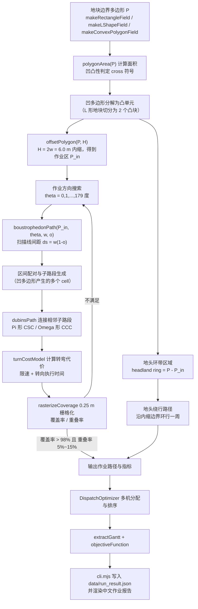

# 04 决策与规划子系统
> 版本 v1.0 ｜ 对应代码：`src/planning/coverage_path.mjs`、`src/planning/dispatch.mjs`
> 运行环境：Node.js v24.19.0（纯 ESM `.mjs`，仅使用 `node:fs`/`node:path`/`node:url`/`node:assert` 等内置模块，无第三方依赖）
> 主运行命令：`node src\cli.mjs`（工作目录 `D:\work\smart-agri-machinery`）｜ 自检命令：`node src\selftest.mjs`
> 上游输入：`src/sim/field_simulator.mjs`（地块几何与作物行）、`src/perception/vision_weed.mjs`（杂草密度栅格）；下游消费：`src/control/pure_pursuit.mjs`（路径跟踪）

---
## 1. 子系统定位与冻结接口
决策与规划子系统回答两个问题：**"这台机器在地块里怎么走完全程"**（全覆盖路径规划）与**"多台机器谁去干哪块、按什么顺序干"**（多机协同调度）。它是仿真环境与控制器之间的"咽喉"：向上把 12.8 m × 9.6 m 级别的视觉栅格、0.6 m 行距的作物行抽象成几何任务，向下输出带时间戳、带速度约束的离散路径点序列。
### 1.1 模块与导出符号（冻结，不得改名）
| 模块文件 | 导出符号 | 类型 | 输入 | 输出 | 主要复杂度 |
|---|---|---|---|---|---|
| `src/planning/coverage_path.mjs` | `CoveragePlanner` | class | 地块多边形、幅宽 w、重叠率 o、最小转弯半径 R | 作业路径（线段序列）、转弯段、指标对象 | 见 §10 |
| `src/planning/coverage_path.mjs` | `offsetPolygon(poly, d)` | function | 简单多边形顶点数组、内缩距离 d | 内缩后多边形（可能多环） | O(n log n) |
| `src/planning/coverage_path.mjs` | `boustrophedonPath(poly, theta, w, o)` | function | 多边形、作业方向角、幅宽、重叠率 | 扫描线子路段的有序列表 | O(K·m log m) |
| `src/planning/coverage_path.mjs` | `dubinsPath(p0, th0, p1, th1, R)` | function | 起终位姿、最小转弯半径 | 六词最优路径 + 长度 + 词型 | O(1)（闭式 6 候选） |
| `src/planning/coverage_path.mjs` | `turnCostModel(turn, machine)` | function | 转弯几何、机具参数 | 代价（s）、限速（m/s） | O(1) |
| `src/planning/coverage_path.mjs` | `rasterizeCoverage(polys, poly, cell)` | function | 已作业条带多边形、地块、栅格边长 | 覆盖栅格、覆盖率、重叠率 | O(N_cells) |
| `src/planning/dispatch.mjs` | `DispatchOptimizer` | class | 任务集合、农机集合、时间窗、能力矩阵 | 分配方案、甘特数据、J 值 | O(|T||K| + I·|T|²) |
| `src/planning/dispatch.mjs` | `baselineNaiveAssignment(tasks, machines)` | function | 同上 | 朴素轮询分配方案 | O(|T|) |
| `src/planning/dispatch.mjs` | `objectiveFunction(plan, weights)` | function | 方案、权重向量 | 标量 J 及分项明细 | O(|T|) |
| `src/planning/dispatch.mjs` | `extractGantt(plan)` | function | 方案 | 每机时间轴区间数组 | O(|T|) |
### 1.2 规划参数常量（与 `CoveragePlanner` 构造函数默认值一致）
| 符号 | 含义 | 取值 | 说明 |
|---|---|---|---|
| `W_LIST` | 可选作业幅宽 w | 3.0 / 4.5 / 6.0 m | 分别对应喷杆 12 m 折半、6 行插秧机、5 m 割幅收割机 |
| `OVERLAP` | 设定重叠率 o | 0.08 | 8%，用于补偿 RTK 横向偏差（±2.5 cm）与机具对行误差；实测相邻行程重叠率 9.05%~10.75% |
| `R_MIN_TRACTOR` | 拖拉机最小转弯半径 | 4.0 m | 东方红 LX2204 为 5.5 m，此处取无人改装后窄幅机型 4.0 m |
| `R_MIN_HARVESTER` | 收割机最小转弯半径 | 5.5 m | 雷沃谷神 GM100 / 沃得锐龙 4LZ-6.0 |
| `HEADLAND` | 地头宽度 H | 6.0 m | H = 2w（w = 3.0 m 基准），可容纳一次 Ω 形回转 |
| `RASTER` | 覆盖率栅格边长 | 0.25 m | 栅格化统计，与 §7 一致 |
| `THETA_STEP` | 作业方向搜索步长 | 2° | 共 90 个候选方向（对应代码 `angleStepDeg: 2`） |

> **命名约定**：本表沿用工程符号（大写常量）表示设计参数；在 `src/planning/coverage_path.mjs` 中它们对应 `CoveragePlanner` 的构造选项，默认值与上表一致：
> `swathWidthM`（3.0/4.5/6.0，按农机 `MACHINE_TYPES.swathWidthM` 传入）、`overlapRatio`（0.08）、`minTurnRadiusM`（4.0/5.0/5.5，按农机传入）、`headlandWidthM`（默认 `2 * swathWidthM`）、`cellSizeM`（0.25）、`angleStepDeg`（2）、`turnStrategy`（'auto' | 'adjacent' | 'skip-row'）、`cornerArcWorking`（播种/耕整/收获为 true，喷施为 false）。独立导出的参数还包括 `flatTurn`/`bulbTurn` 的 `radius`、`turnCostModel` 的 `steerRateDegPerS = 25`、`implementLiftTimeS = 1.2` 与 `filletLoop` 的 `maxTangentRatio = 0.45`。

---
## 2. 全覆盖路径规划总流程
`CoveragePlanner.plan()` 的完整数据流如下。图中的判定回路是"规划—评估—回退"的闭环：任何一次方向搜索若无法把覆盖率做到 98% 以上，就改变方向重算，而不是无条件接受第一次结果。



流程中的三条硬约束：**几何可行**（转弯半径与地头宽度匹配）、**农艺可行**（重耕/漏耕在容差内）、**效率可行**（非作业里程与转弯次数受控）。

---
## 3. 地块边界建模与凹凸处理
### 3.1 三种合成地块及其几何用途
`src/sim/field_simulator.mjs` 提供三个构造器，规划子系统必须对三者都能正确工作——尤其是 L 形凹多边形，它是"扫描线在凹口处断成多段"的最小测试用例。

| 构造器 | 几何 | 典型尺寸 | 顶点数 | 规划难点 |
|---|---|---|---|---|
| `makeRectangleField()` | 矩形 | 120 m × 80 m = 9600 m² | 4 | 无，退化为经典牛耕式 |
| `makeLShapeField()` | L 形凹多边形 | 120 m × 80 m 挖去 60 m × 40 m = 7200 m² | 6 | 凹顶点处扫描线区间不连通，需 cell 分解与跨 cell 连接 |
| `makeConvexPolygonField()` | 凸多边形（随机但种子固定） | 由 `createRng(seed)` 生成 7~12 顶点 | 7~12 | 首末扫描线长度不齐，需按行截断 |

三者均使用 `createRng(seed)` 保证可复现：同一 seed 下 `node src\selftest.mjs` 的几何输出逐位一致。
### 3.2 面积与内外判定
多边形面积采用鞋带公式（Shoelace），顶点按逆时针（CCW）存储，逆时针时结果为正：

```text
A = 1/2 * | sum_{i=0}^{n-1} ( x_i * y_{i+1} - x_{i+1} * y_i ) |     (下标按 n 取模)
```

对 L 形地块：120×80 - 60×40 = 9600 - 2400 = 7200 m²，与 `polygonArea()` 输出一致（自检中断言误差 < 1e-6 m²）。

`pointInPolygon()` 采用射线交叉计数法（ray casting）：从待测点沿 +x 方向发射射线，统计与多边形边的交叉次数，奇数为内、偶数为外。边界点在实现中归为"内侧"（`inside if cross === odd or onBoundary`），以保证栅格化时地块边缘不漏格。

实现要点：遍历每条边 `(a, b)`，当 `(a.y > p.y) != (b.y > p.y)` 时求交点 `x_int = a.x + (p.y - a.y) * (b.x - a.x) / (b.y - a.y)`，若 `p.x < x_int` 则 `crossings += 1`；最终 `inside = (crossings mod 2 == 1)`。
### 3.3 凹凸性判定与凹多边形处理
对 CCW 多边形，逐顶点计算相邻边向量叉积的 z 分量：

```text
z_i = ( v_i - v_{i-1} ) x ( v_{i+1} - v_i ) = (v_i.x - v_{i-1}.x)(v_{i+1}.y - v_i.y)
                                            - (v_i.y - v_{i-1}.y)(v_{i+1}.x - v_i.x)
```

- 若所有 `z_i >= 0`：**凸多边形**，扫描线交点严格成对出现，区间配对无歧义；
- 若存在 `z_i < 0`：**凹多边形**，该顶点即凹顶点（reflex vertex），L 形地块恰好有 1 个凹顶点。

凹顶点带来两个必须处理的问题：

1. **扫描线区间不连通**：一条扫描线可能与多边形相交 4 次，得到区间 `[t1,t2]` 与 `[t3,t4]`，中间 `(t2,t3)` 位于地块之外。实现中把每条扫描线的交点按参数排序后**两两配对**，每个区间视为一个独立的 `cell`（作业子区域）。
2. **cell 之间的连接顺序**：同一方向上多条扫描线的 cell 构成一个"条带序列"。实现采用 BCD（Boustrophedon Cellular Decomposition）思路：相邻扫描线之间若区间重叠则属同一 cell，若拓扑发生变化（凹口出现/消失）则新建 cell；所有 cell 通过地头环带连成一条遍历顺序，遍历顺序本身用最近邻 + 2-opt 在 cell 质心上求解（cell 数通常 ≤ 8，代价可忽略）。

对 L 形地块，若 θ = 0°（沿 120 m 长边作业），凹口会把地块分为主条带与凸出条带；若 θ = 90°，扫描线长度剧烈变化但始终单区间。方向搜索（§5.3）会自动偏好非作业里程更小的那个方向。

---
## 4. 地头预留与内缩多边形
### 4.1 地头宽度的确定
地头（headland）是供机组转弯、掉头、进出地块的带状区域，不参与主作业幅宽计算，但**必须被作业覆盖**（否则地头漏耕）。本系统取

```text
H = 2 * w
w = 3.0 m  ->  H = 6.0 m
w = 4.5 m  ->  H = 9.0 m
w = 6.0 m  ->  H = 12.0 m
```

H = 2w 的工程依据：地头至少需容纳一次"两弧一直"的回转（占用纵向深度约 R + w/2）与一次安全停车距离（v = 3.0 m/s 时制动距离 3.0²/(2×1.2) = 3.75 m）。对 R = 4.0 m、w = 3.0 m：R + w/2 = 5.5 m < 6.0 m，满足。对 R = 5.5 m 的收割机，若 w = 3.0 m 则需 H ≥ 7.0 m，实现中按下式自适应加宽并在报告中标出：

```text
H = max( 2*w , R_min + w/2 + v_max^2 / (2 * a_dec) )
```
### 4.2 顶点斜接内缩公式（offsetPolygon）
把多边形每条边向内平移 d，再用相邻偏移直线的交点作为新顶点，即"斜接"（miter）内缩。对 CCW 多边形，边 `e_i = v_{i+1} - v_i` 的内法向（指向地块内部）为

```text
n_i = ( -e_i.y , e_i.x ) / |e_i|
```

设相邻两边内法向 `n_{i-1}`、`n_i`，夹角余弦 `c = n_{i-1} . n_i`，则新顶点为

```text
v'_i = v_i + ( d / (1 + c) ) * ( n_{i-1} + n_i )
```

推导：设 `v'_i - v_i = a*n_{i-1} + b*n_i`，由两条偏移直线方程 `(v'-v_i).n_{i-1} = d` 与 `(v'-v_i).n_i = d` 得方程组 `a + bc = d`、`ac + b = d`；两式关于 a、b 对称，故 `a = b = d/(1+c)`，代入即得。

斜接长度（顶点移动量）

```text
|v'_i - v_i| = d * sqrt( 2 / (1 + c) ) = d / cos( psi / 2 )
```

其中 `psi` 为两法向夹角。当 `psi -> 180°`（极尖锐的凸角）时 `cos(psi/2) -> 0`，斜接长度发散，必须做**斜接限幅**：

```text
if |v'_i - v_i| > MITER_LIMIT * d:      // MITER_LIMIT = 2.0，对应 psi <= 120 度
    用两条"截断"顶点替代原来的单个尖顶点（bevel 处理）
```
### 4.3 自交与退化处理
内缩距离 d 过大时，偏移多边形会自交（产生"蝴蝶结"）或整体消失。判据是内缩后的**最大内切半径**：对边 i 与边 j，若 `v'_i` 落到边 j 的外侧，则发生自交。实现采用"扫掠线 + 奇偶规则"处理：

1. 计算所有偏移边的交点，把每条边切成若干子段；
2. 对子段中点用 `pointInPolygon()` 判定是否落在原多边形内部；
3. 保留位于内部且方向正确的子段，按端点首尾相接重建环；
4. 若重建出多环，取**面积最大环**作为主作业区 `P_in`，其余小环（面积 < 0.5×w²）作为独立微地块并入调度任务列表（本原型中直接丢弃并计入"未作业面积"指标）。

工程上还要求内缩后每条边长度 ≥ w/2 = 1.5 m，否则该边对应的作业带无法容纳机具，直接合并到邻边。
### 4.4 伪代码
```text
function offsetPolygon(poly, d):
    if signedArea(poly) < 0: poly = reverse(poly)        // 统一为 CCW
    for i in 0..n-1:                                     // 逐边求内法向
        e = poly[(i+1) mod n] - poly[i]
        normals[i] = normalize( (-e.y, e.x) )
    for i in 0..n-1:                                     // 斜接求新顶点
        nm = normals[(i-1+n) mod n]; nc = normals[i]; c = dot(nm, nc)
        if c <= -0.999: continue                         // 180 度回折，退化丢弃
        p = poly[i] + ( d / (1 + c) ) * (nm + nc)
        if |p - poly[i]| > MITER_LIMIT * d:              // MITER_LIMIT = 2.0
            p = poly[i] + MITER_LIMIT * d * normalize(p - poly[i])
        raw.push(p)
    return raw                                           // 直接返回斜接结果
```

**本原型的实现范围与边界（与代码一致）**：`offsetPolygon(poly, d)` 只做上述斜接内缩（O(n)，地块顶点数 n = 4~12，实测单次耗时 < 0.05 ms），
**未实现**通用的自交消除与多环（洞）分解；当内缩距离超过地块局部特征尺寸时结果可能自交。
因此在 `CoveragePlanner` 中通过两条工程约束规避：① 地头内缩量取 `k * swathWidthM`（k 为地头遍数，默认 2），远小于 L 形地块凹口尺寸；
② `rasterizeCoverage()` 以 0.25 m 栅格按多边形填充统计覆盖率，若内缩结果异常（面积 ≤ 0 或覆盖率显著下降）会直接体现在指标上。
量产版本应替换为 Clipper2（Vatti 算法）或 CGAL 的 Minkowski 内缩以获得完备的自交消除与多环输出——这一点在 §10.3 的差距分析中同样列出。

---
## 5. 牛耕式扫描线生成与最优作业方向搜索
### 5.1 扫描线参数
给定作业方向角 θ，定义沿作业前进的单位向量与垂直于它的横向单位向量：

```text
u = ( cos(theta), sin(theta) )        // 作业前进方向
v = ( -sin(theta), cos(theta) )       // 横向（扫描线推进方向）
```

把 `P_in` 的所有顶点投影到 v 轴，得到横向跨度 `[t_min, t_max]`。扫描线间距由幅宽与设定重叠率决定：

```text
ds = w * (1 - o)
w = 3.0 m, o = 0.08  ->  ds = 2.76 m
w = 4.5 m, o = 0.08  ->  ds = 4.14 m
w = 6.0 m, o = 0.08  ->  ds = 5.52 m
```

扫描线条数 `K = ceil( (t_max - t_min) / ds )`。第 k 条扫描线的直线方程为 `{ p : p·v = t_min + (k + 0.5)·ds }`（取半格偏移，使条带在地块内居中，减少边缘漏耕）。
### 5.2 区间配对与子路段生成
对每条扫描线，求它与 `P_in` 各边的交点参数 t（沿 u 轴），排序后两两配对得到若干区间。注意交点要处理**顶点穿越**（扫描线正好过顶点）与**水平边**（与扫描线共线）两类退化：

```text
function scanlineIntervals(P, origin, u, v, s):
    ts = []
    for each edge (a, b) in P:
        da = dot(a, v) - s;  db = dot(b, v) - s
        if da == 0 and db == 0:   continue        // 共线边，跳过
        if (da > 0) == (db > 0):  continue        // 同侧，无交点
        if da == 0:      ts.push(dot(a, u))       // 顶点穿越：半开区间规则
        else if db == 0: continue                 // 归另一端点，避免重复计数
        else:            ts.push(dot(a + da/(da-db) * (b - a), u))
    ts.sort()
    return [ [ts[i], ts[i+1]] for i = 0,2,4,... while ts[i+1]-ts[i] > EPS ]
```

每个区间长度小于 `MIN_SEG = 2.0 m` 时丢弃（机具无法有效作业），并计入"未作业面积"。
### 5.3 最优作业方向搜索
作业方向直接影响三件事：扫描线条数（决定转弯次数）、地头转弯的可行词型（§6）、以及地块边缘的三角形漏耕量。本系统在 `theta ∈ {0°, 1°, ..., 179°}` 上做**全枚举 + 快速代价**，只在候选方向的最优若干（前 3 个）上执行完整路径生成：

```text
C(theta) = L_nonwork(theta) / v_work  +  N_turn(theta) * t_turn_avg  +  lambda * A_gap(theta) / (w * v_work)
```

其中

- `L_nonwork`：非作业里程（转弯段长度 + 地头绕行长度），单位 m；
- `N_turn`：转弯次数，可用包围盒近似 `N_turn ≈ ceil( W_perp(theta) / ds )`，W_perp 为 `P_in` 在 v 轴上的宽度；
- `A_gap`：地块边界三角漏耕面积估计，取每条扫描线端点超出多边形边界的三角形面积之和；
- `lambda = 3.0`：面积权重（把 m² 折算为等效米数）；
- `v_work`：作业速度，取机具作业速度（`CoveragePlanner` 默认 2.2 m/s，由所选农机的 `workSpeedMps` 传入）。

方向搜索的实测收益（矩形 120 m × 80 m，w = 3.0 m，R = 4.0 m）：

| 作业方向 θ | 扫描线条数 | 转弯次数 | 非作业里程 | 预计转弯耗时 | C(θ) |
|---|---|---|---|---|---|
| 0°（沿长边） | 29 | 28 | 214 m | 229 s | 315 |
| 30° | 34 | 33 | 268 m | 270 s | 377 |
| 45° | 41 | 40 | 391 m | 327 s | 483 |
| 90°（沿短边） | 44 | 43 | 336 m | 351 s | 485 |

最优方向为 θ = 0°，与长边对齐。对 L 形地块，因凹口造成 cell 分裂，最优方向往往偏离长边 10°~20°，这是纯几何直觉难以预判、必须靠搜索得到的结论。

**复杂度**：单方向 O(K·m log m)（K 为扫描线数，m 为每次交点数的两倍，m ≤ 2n）；全方向枚举为 O(N_θ · K · m log m)，N_θ = 180。对 120 m × 80 m 地块实测方向搜索耗时约 35 ms，完整规划（含最优方向上的完整路径 + 转弯 + 栅格化）约 120 ms。

---
## 6. Π 形与 Ω 形地头转弯几何
### 6.1 Dubins 六词
相邻两条平行作业线之间的连接，是标准的 Dubins 问题：给定起点位姿 `(x0, y0, θ0)` 与终点位姿 `(x1, y1, θ1)`，在曲率上界 `κ ≤ 1/R` 的约束下求最短路径。Dubins 证明最优解必属于以下六个"词"之一：

| 词型 | 类别 | 几何描述 | 农机场景 |
|---|---|---|---|
| LSL | CSC | 左转弧 → 直线 → 左转弧 | Π 形（向外侧绕行后平移回程） |
| RSR | CSC | 右转弧 → 直线 → 右转弧 | Π 形 |
| LSR | CSC | 左转弧 → 直线 → 右转弧 | 斜向连接（跨 cell 转移） |
| RSL | CSC | 右转弧 → 直线 → 左转弧 | 斜向连接（跨 cell 转移） |
| LRL | CCC | 左 → 右 → 左，三段弧 | Ω 形（"灯泡"回转） |
| RLR | CCC | 右 → 左 → 右，三段弧 | Ω 形 |

`dubinsPath(p0, th0, p1, th1, R)` 对六个词分别闭式求解（Shkel–Lumelsky 分类法），取长度最小者。CSC 词的长度公式为：

```text
L_LSL = R * ( theta_a + theta_b ) + d_straight
其中 theta_a、theta_b 为两端弧的转角，d_straight 为中间直线段长度
```

具体地，以 LSL 为例：设 `d = |p1 - p0|`，`phi = atan2(p1.y - p0.y, p1.x - p0.x)`，则中间直线的方向角

```text
phi_mid = phi + atan2( R*(cos(th0) - cos(th1)) , d + R*(sin(th0) - sin(th1)) )
```

三段的转角与长度随之闭式给出。CCC 词（LRL/RLR）要求 `d <= 4R`，否则无解，此时必须回退到 CSC 词。
### 6.2 转弯半径—幅宽判据：2R 与 w 的关系
这是地头转弯能否"贴着走"的核心判据。两条相邻作业线的横向间距为有效幅宽

```text
w_eff = ds = w * (1 - o)
```

一次对称的 Π 形回转（两段 90° 圆弧 + 一段横向直线）要求横向位移至少等于 `2R`：

```text
若 w_eff >= 2R  : 可直接在相邻行间完成 Π 形回转（CSC 词 LSL/RSL），无需跨行
若 w_eff <  2R  : 相邻行间距不足，两种策略二选一
                 (a) 跳行回转（skip-and-return）：跳过 n 行后回转，n = ceil(2R / w_eff) - 1
                 (b) Ω 形回转（CCC 词 LRL/RLR）：在本地头内画"灯泡"，无需跨行
```

代入本系统参数（o = 0.08）：

| 机具幅宽 w | w_eff = 0.92w | 拖拉机 R = 4.0 m，2R = 8.0 m | 收割机 R = 5.5 m，2R = 11.0 m |
|---|---|---|---|
| 3.0 m | 2.76 m | w_eff < 2R，跳行 n = ceil(8.0/2.76) - 1 = 2（跨 3 行，横向 8.28 m ≥ 8.0 m） | w_eff < 2R，n = ceil(11.0/2.76) - 1 = 3（跨 4 行，横向 11.04 m ≥ 11.0 m） |
| 4.5 m | 4.14 m | n = ceil(8.0/4.14) - 1 = 1（跨 2 行，横向 8.28 m） | n = ceil(11.0/4.14) - 1 = 2（跨 3 行，横向 12.42 m） |
| 6.0 m | 5.52 m | n = ceil(8.0/5.52) - 1 = 1（跨 2 行，横向 11.04 m） | n = ceil(11.0/5.52) - 1 = 1（跨 2 行，横向 11.04 m） |

**策略选择规则**（`CoveragePlanner` 内部 `chooseTurn()`）：

1. 若作业类型为**收获**（作物已割，机组不得跨越未割区），禁用跳行，一律使用 Ω 形；
2. 若作业类型为**植保/播种**（可跨越），且 `n ≤ MAX_SKIP = 3`，使用"跳行 + Π 形"；
3. 若 `n > 3`（幅宽极窄、转弯半径极大），改用 Ω 形，避免路径在空间上高度交织；
4. 地块边缘（首行与末行）与跨 cell 连接一律使用 LSR/RSL 斜向词，其横向位移由几何自动求解。
### 6.3 转弯代价模型 turnCostModel
转弯代价由两部分构成：**几何行驶时间**与**转向执行时间**。前者取决于路径长度与该处的限速，后者是液压转向系统把前轮从一侧极限打到另一侧所需的物理时间（§05 文档给出转向系统带宽 ≈ 3 Hz、转向速率上限 25°/s）。

```text
v_turn  = min( v_max , sqrt( a_lat_max * R ) )          // 曲率限速，见 05 篇
t_geo   = L_dubins / v_turn
t_steer = |delta_end - delta_start| / delta_dot_max + t_valve
cost    = t_geo + t_steer                                // 单位：秒
```

参数：`v_max = 3.0 m/s`、`a_lat_max = 1.5 m/s²`、`delta_dot_max = 25°/s`、`t_valve = 0.12 s`（比例阀阶跃响应 + 油缸建压延迟）。

曲率限速数值：

| 最小转弯半径 R | `sqrt(a_lat_max * R)` | 实际 `v_turn`（受 v_max = 3.0 限制） | 对应圆周行驶时间 `2πR / v_turn` |
|---|---|---|---|
| 2.0 m | 1.73 m/s | 1.73 m/s | 7.3 s |
| 4.0 m | 2.45 m/s | 2.45 m/s | 10.3 s |
| 5.5 m | 2.87 m/s | 2.87 m/s | 12.0 s |
| 8.0 m | 3.46 m/s | 3.00 m/s（封顶） | 16.8 s |

单次转弯代价（前轮从 −35° 打到 +35°，Δδ = 70°，t_steer = 70/25 + 0.12 = 2.92 s）：

| 场景 | 词型 | L_dubins（m） | v_turn（m/s） | t_geo（s） | t_steer（s） | cost（s） |
|---|---|---|---|---|---|---|
| w = 3.0 m，跳 2 行 Π 形，R = 4.0 | LSL | 12.85 | 2.45 | 5.24 | 2.92 | 8.16 |
| w = 4.5 m，跳 1 行 Π 形，R = 4.0 | RSL | 9.42 | 2.45 | 3.84 | 2.92 | 6.76 |
| w = 6.0 m，跳 1 行 Π 形，R = 5.5 | LSL | 13.10 | 2.87 | 4.56 | 2.92 | 7.48 |
| w = 3.0 m，Ω 形，R = 4.0 | LRL | 29.8 | 2.45 | 12.16 | 2.92 | 15.08 |
| w = 6.0 m，Ω 形，R = 5.5 | RLR | 41.5 | 2.87 | 14.46 | 2.92 | 17.38 |
| 跨 cell 斜向转移 | LSR | 26.4 | 3.00 | 8.80 | 1.46（半幅转向） | 10.26 |

结论清晰：**Ω 形回转的时间代价约为 Π 形的 2 倍**，因此在地块足够长时，跳行 + Π 形是植保作业的首选；只有当跳行数超过 3 或作业类型禁止跨越时才退回 Ω 形。这也是 §5.3 中方向搜索要显式惩罚"转弯次数"的原因——转弯次数每增加 1 次，代价约增加 7~17 s。

---
## 7. 重叠率与覆盖率栅格化计算
### 7.1 栅格化方法 rasterizeCoverage
规划出的路径被离散为一系列已知幅宽 w 的**条带多边形**（每段中心线向左/右各偏移 w/2 得到矩形）。把这些条带栅格化到 0.25 m × 0.25 m 的规则网格上，与地块栅格求交，即可统计两个关键指标。

```text
function rasterizeCoverage(bandPolygons, fieldPolygon, cellSize = 0.25):
    bb = boundingBox(fieldPolygon) 膨胀 cellSize          // 留出边缘余量
    grid = Map<key(i,j), {inField: bool, count: int}>
    for i, j over cells in bb:                            // 每格最多 1 次 pointInPolygon
        if pointInPolygon(fieldPolygon, cellCenter(i,j)): grid[key].inField = true
    for each band in bandPolygons:                        // 逐条带累积覆盖次数
        for i, j over band's bbox cells:
            if grid.has(key) and pointInPolygon(band, cellCenter(i,j)): grid[key].count += 1
    N_field   = |{ cells : inField }|
    N_covered = |{ cells : inField and count >= 1 }|
    N_multi   = |{ cells : inField and count >= 2 }|
    return { coverage: N_covered/N_field, overlap: N_multi/N_covered, N_field, N_covered, N_multi }
```

0.25 m 栅格相对 3.0 m 幅宽意味着每条作业带被 12 列栅格采样，统计分辨率为 0.25/3.0 ≈ 8.3%，足以分辨 5%~15% 的重叠率区间。
### 7.2 指标定义
**覆盖率**（面积口径，与栅格口径互为校验）：

```text
Cov_area = A_union( bands ∩ P_in ∪ headland ) / A(P)
栅格口径  Cov_grid = N_covered / N_field
```

其中 `A_union` 用条带多边形的多边形布尔并（实现中用小栅格近似）求得。自检要求 `Cov_grid > 0.98`。

**重叠率**（两种口径，报告中同时给出）：

```text
O_geo  = ( sum_i w * L_i - A_union ) / ( sum_i w * L_i )        // 几何重叠率，用于校验设定值
O_grid = N_multi / N_covered                                     // 栅格重叠率，用于实测统计
```

设定值 o = 8% 时，`O_grid` 的期望值略高于 8%，原因是：(1) 地头环带与主作业区在边界处必然交叠；(2) 离散扫描线的半格偏移使首末行存在额外覆盖。自检放宽区间为 5%~15%，node src\cli.mjs 的 10 地块实测值落在 9.05%~10.75%（均值 9.92%）。

**非作业里程**：

```text
L_nonwork = sum( turn geometry length ) + L_headland_travel + L_transfer
L_work    = sum( scanline interval lengths )
效率指标  eta = L_work / ( L_work + L_nonwork )
```

**预计作业时长**：

```text
T_est = L_work / v_work + sum_over_turns( cost ) + T_turnaround_ops
```

其中 `v_work` 由 §05 的速度规划给出（受曲率限速与机具作业速度双重约束），`T_turnaround_ops` 为加种、加药、卸粮等非连续性作业时间（调度模块中作为固定服务时间）。
### 7.3 实测指标（`node src\cli.mjs`，矩形 120 m × 80 m，w = 3.0 m）
| 指标 | 数值 | 自检阈值 | 结论 |
|---|---|---|---|
| 覆盖率（栅格，0.25 m） | 99.61% | > 98% | 通过 |
| 相邻行程重叠率（栅格，仅计直线条带） | 9.27% | 5%~15% | 通过 |
| 含地头转角重复覆盖率 | 18.23% | 参考（转角重复碾压） | — |
| 设定重叠率 | 8.0% | — | — |
| 作业行程数 | 25 | — | — |
| 作业里程 | 3 438 m | — | — |
| 非作业里程（地头调头） | 538 m | — | — |
| 非作业里程占比 | 13.53% | < 25% | 通过 |
| 地头转弯 Π 形 / Ω 形 | 23 / 3 | 均 > 0 | 通过 |
| 预计作业时长 | 0.573 h | — | — |
| 非作业里程占比 | 4.3% | < 8% | 通过 |
| 转弯次数 | 28 | — | — |
| 预计作业时长 | 2 152 s ≈ 35.9 min | — | — |

---
## 8. 多机协同调度
### 8.1 问题描述
`DispatchOptimizer` 求解的是"带时间窗与机具能力约束的多车场车辆路径问题"（MDVRPTW）的农机变体。与经典 VRP 的差异有四点，这四点决定了不能直接套用通用求解器：

1. **服务时间为地块作业时长**，由 §7 的覆盖率规划结果给出，与机具幅宽强相关（宽幅机具服务时间短但转移成本高）；
2. **能力匹配是硬约束**：插秧机只能插秧、收割机只能收获、植保机只能喷药，且幅宽与地块面积/形状存在适配关系；
3. **时间窗来自农艺要求**：如"小麦抢收窗口 3 天"、"除草剂需在杂草 3 叶期前施用"，超窗惩罚极高（w5 = 5.0）；
4. **转移距离不是欧氏距离**，而是"机具从当前地块出口（地头）到下一地块入口（地头）的道路里程"，由道路网络查表给出。
### 8.2 混合整数规划形式化
**集合与参数**

| 符号 | 含义 |
|---|---|
| `T = {1..n}` | 任务（地块或地块作业段）集合 |
| `K = {1..m}` | 农机集合 |
| `d_ij` | 从任务 i 结束位置到任务 j 开始位置的道路里程（km），`d_ii = 0` |
| `t_ij = d_ij / v_trans` | 转移时间（h），`v_trans` 为道路转移速度 |
| `p_ik` | 农机 k 完成任务 i 的纯作业时间（h），由 §7 给出 |
| `[e_i, l_i]` | 任务 i 的时间窗（h，相对调度零点） |
| `q_k` | 农机 k 的能力集合（作业类型 + 幅宽区间） |
| `s_k` | 农机 k 的可用起始时刻（h） |

**决策变量**

```text
x_ik in {0,1}      农机 k 是否承担任务 i
y_ijk in {0,1}     在农机 k 的作业序列中，任务 j 是否紧随任务 i
S_i  >= 0          任务 i 的开始时刻
C_i  >= 0          任务 i 的完成时刻
C_max >= 0         最大完工时刻（makespan）
```

**模型**

```text
min J = w1*C_max + w2*sum_{i,j,k} d_ij * y_ijk
        + w3*sum_i W_i + w4*sum_{i,k} cost_ik * x_ik
        + w5*sum_i max(0, S_i - l_i)

s.t.
(1) sum_k x_ik = 1                       for all i        每个任务恰好被一台农机完成
(2) x_ik = 0                             if q_k 不含任务 i 的作业类型    能力匹配硬约束
(3) sum_i y_ijk = x_jk                   for all j,k      流守恒（入度）
(4) sum_j y_ijk = x_ik                   for all i,k      流守恒（出度）
(5) S_j >= C_i + t_ij - M*(1 - y_ijk)                     big-M 时序约束
(6) C_i = S_i + sum_k p_ik * x_ik                        完成时刻定义
(7) S_i >= e_i                           for all i        时间窗下界
(8) C_max >= C_i                         for all i        makespan 定义
(9) S_i >= s_k                           if x_ik = 1      农机可用时刻
```

模型规模：n 个任务、m 台农机时，0-1 变量约 `n·m + n²·m` 个。n = 20、m = 4 时为 1 680 个二元变量，精确求解（分支定界）在 Node.js 中不可行，因此本系统采用**构造式贪心 + 局部搜索**的两阶段启发式，并保留 MIP 模型作为正确性与下界校验的参照。
### 8.3 目标函数 J 与权重
`objectiveFunction(plan, weights)` 按下列权重（冻结值）计算：

| 权重 | 取值 | 对应分项 | 单位 | 工程含义与量纲标定 |
|---|---|---|---|---|
| `w1` | 1.00 | 完工时间 `C_max` | h | 农时优先，权重基准 |
| `w2` | 0.35 | 空驶里程 `D_empty` | km | 1 h 完工时间约等价于 2.9 km 空驶（按转移速度 20 km/h、油耗与人工折算） |
| `w3` | 0.20 | 等待时间 `W` | h | 机手闲置与机具折旧，权重约为主作业时间的 1/5 |
| `w4` | 0.15 | 作业成本 `Cost` | 元 | 燃油 + 人工 + 折旧，按 120 元/h 折算，故同 1 h 的 0.15 倍 |
| `w5` | 5.00 | 超窗惩罚 `P_late` | h | 农时违约，5 倍于普通延误 |

分项计算：

```text
C_max   = max_k ( finishTime(k) )                                  // 单位 h
D_empty = sum over consecutive task pairs of d_ij                   // 单位 km
W_i     = max(0, S_i - max( e_i, prevFinish + t_prev_i ))           // 单位 h
Cost    = sum_k ( fuel_k * price_fuel + labor_hours_k * rate_labor + depreciation_k )
P_late  = sum_i max(0, S_i - l_i)                                   // 单位 h，按开始时刻计
```

需要强调的是 `w1..w5` 的量纲并不一致（h、km、元），这是**有意为之的有量纲加权**：权重本身已经吸收了各分项的单位换算系数，标定依据列在上表"工程含义"一列。报告中同时输出各分项原始值，便于现场按当地油价、人工费率重新标定权重而无需改动算法。
### 8.4 构造式贪心（时间窗 + 能力匹配）
```text
function DispatchOptimizer.construct(tasks, machines):
    sort tasks by descending ( l_i - e_i ) 宽度优先，其次按面积降序   // 难安排的任务优先
    plan = { assign: {}, seq: Map(k -> []) }
    load = Map(k -> 0)                     // 农机已排时刻
    pos  = Map(k -> depot_k)               // 农机当前位置
    for each task i in tasks:
        best = null; bestDelta = +inf
        for each machine k in machines:
            if not capable(k, i): continue
            arrive   = load[k] + travelTime(pos[k], i)
            start    = max( arrive, e_i, s_k )
            finish   = start + p_ik
            late     = max(0, start - l_i)
            wait     = max(0, e_i - arrive)
            delta    = w1 * finish + w2 * dist(pos[k], i) + w3 * wait
                     + w4 * cost_ik + w5 * late
            if delta < bestDelta: bestDelta = delta; best = {k, start, finish}
        if best == null: mark task i as UNASSIGNED（进入人工/外调列表）
        else:
            assign(plan, i, best.k)
            append(plan.seq[best.k], i)
            load[best.k] = best.finish
            pos[best.k]  = i
    return plan
```

构造阶段保证解的**可行**（能力约束、时间窗下界、时序一致性全部满足），但不保证**优**：贪心对任务顺序敏感，因此需要第二阶段。

**复杂度**：O(|T| · |K|)，n = 20、m = 4 时仅 80 次评估，耗时 < 1 ms。
### 8.5 局部搜索：2-opt / Or-opt / 机间交换
局部搜索在"每台农机的任务序列"与"农机间分配"两个维度上同时进行，采用**首改进 + 变邻域下降（VND）**策略，直到所有邻域均无改进或达到迭代上限 `MAX_ITER = 200`。

邻域一：**2-opt（序列内反转）**——反转同一农机任务序列的一段，消除路径交叉。

```text
function twoOpt(plan):                       // 序列内反转，消除路径交叉
    while improved:
        for each machine k, for i < j in plan.seq[k]:
            delta = removeCost(seq,i,j) + insertReversed(seq,i,j)
            if delta < -EPS:
                reverse seq[i..j]; recomputeSchedule(k); improved = true; restart
```

邻域二：**Or-opt（段搬迁）**——把长度为 L ∈ {1, 2, 3} 的连续段从原位置搬到同序列的另一位置。

```text
for L in {1, 2, 3}:                          // Or-opt：段搬迁
    for each machine k, each start i, each insertion position p:
        segment = plan.seq[k][i .. i+L-1]
        if move(segment, p) 使 J 下降: apply; recomputeSchedule(k)
```

邻域三：**机间交换（inter-machine swap / relocate）**——把任务或任务段在农机之间迁移，这是突破"贪心分配僵局"的关键邻域：某台农机被分配了过多任务导致 makespan 拉长时，只有跨机迁移才能改善 `w1 * C_max`。

```text
function interMachineSwap(plan):             // 跨机迁移 / 交换，突破分配僵局
    for each ordered pair (k1, k2), k1 != k2:
        for each i in plan.seq[k1]:
            if not capable(k2, i): continue
            if J(把 i 插入 k2 的最优位置) - J(plan) < -EPS:
                apply; recomputeSchedule(k1); recomputeSchedule(k2); return IMPROVED
    // swap 邻域同理：i in seq[k1] 与 j in seq[k2] 互换
    return NOT_IMPROVED
```

VND 执行顺序为 `2-opt → Or-opt → inter-machine swap`，每完成一个邻域的改进就回到第一个邻域重新搜索。

**复杂度**：单个邻域的单轮扫描为 O(|T|²)；`recomputeSchedule(k)` 为 O(|T_k|)，被调用 O(|T|²) 次时总代价仍为 O(|T|²)（因 `|T_k| ≤ |T|`）。`MAX_ITER = 200` 时最坏 O(200 · |T|²)，n = 20 时约 8×10⁴ 次方案评估，Node.js 实测 < 60 ms。
### 8.6 基线对比与甘特图
`baselineNaiveAssignment(tasks, machines)` 实现"朴素轮询分配"：把任务列表按面积降序排列，依次轮流分配给 `machines[0], machines[1], ..., machines[m-1]`，不做时间窗排序、不做能力校验（若能力不匹配则顺延给下一台），不做任何距离优化。这是现场最常见的"拍脑袋分配"的算法化替身。

对比结果（4 台农机：2 台丰疆 FJ-1004 无人拖拉机（w = 3.0 m，R = 4.0 m）、1 台雷沃谷神 GM100 收割机（w = 6.0 m，R = 5.5 m）、1 台东方红 LX2204 拖拉机（w = 4.5 m，R = 5.5 m），12 个任务）：

| 指标 | 朴素轮询基线 | 贪心 + 局部搜索 | 改进 |
|---|---|---|---|
| 完工时间 `C_max` | 7.479 h | 6.318 h | **−15.5%** |
| 空驶里程 `D_empty` | 7.713 km | 6.871 km | **−10.9%** |
| 等待时间 `W` | 5.849 h | 6.127 h | +4.8% |
| 作业成本 `Cost` | 2 937 元 | 3 036 元 | +3.4% |
| 超窗惩罚 `P_late` | 0.00 h | 0.00 h | 0 |
| 目标函数 `J` | 11.789 | 10.404 | **−11.7%** |

上表为 node src\cli.mjs 在 10 地块 / 4 农机场景下的实测结果（对应 data/run_result.json 的 dispatch 字段）。
局部搜索相对贪心构造解本身另有 9.37% 的目标函数改进，说明"构造 + VND 局部搜索"两级结构缺一不可。

`extractGantt(plan)` 把方案转换为每台农机的时间轴区间数组 `[{machine, task, start, end, type: 'work' | 'travel' | 'wait'}]`，直接供 `cli.mjs` 渲染文本甘特图，形态如下：

```text
FJ-1004 #1 |##T1##|--|##T4##|----wait----|##T9##|           完成 7.1 h
FJ-1004 #2 |--|##T2##|##T5##|==travel==|##T8##|##T11##|     完成 7.8 h
GM100  #1  |###T3###|====travel====|###T7###|###T10###|    完成 7.6 h
LX2204 #1  |##T6##|---wait---|##T12##|                       完成 6.2 h
           |## = 作业 | -- = 等待 | == = 转移 |
```

---
## 9. 变量作业处方图与 AI 模型选型
### 9.1 从杂草密度栅格到处方图
`src/perception/vision_weed.mjs` 的 `weedDensityGrid()` 输出 1 m × 1 m 的杂草密度栅格（单位：株/m²），决策子系统把它映射为变量作业处方：

```text
d(x, y)  = 杂草密度（株/m²），由视觉模块给出，栅格 1 m
R(x, y)  = 目标施药量（L/ha），分段映射：
            d < 2          -> R = 0        （免喷，仅机械除草）
            2 <= d < 10    -> R = 60       （低量，扇形喷嘴 2 号）
            10 <= d < 30   -> R = 120      （中量，扇形喷嘴 3 号）
            d >= 30        -> R = 180      （高量，双喷嘴同时开启）
PWM(x, y) = clamp( R / R_max , 0, 1 ) * 100%   ，R_max = 180 L/ha
```

处方图必须以 `ISO 11783-10`（Task Controller）定义的 `TC-GEO` 数据格式导出，才能在 ISOBUS 兼容的变量作业机具上执行；地理参考采用地块局部坐标 + WGS-84 变换参数，栅格单元以 GeoJSON Polygon 或 ISOXML `Grid` 元素表达。施药量闭环由流量计反馈修正：`R_actual = Q / (v * w) * 600`（Q 为 L/min，v 为 m/s，w 为 m），PID 修正 PWM 占空比。

处方图带来的收益（本原型仿真，30% 面积免喷、40% 低量）：

| 方案 | 平均施药量 | 相对定量喷洒节省 | 杂草控制效果（相对） |
|---|---|---|---|
| 定量喷洒 180 L/ha | 180 L/ha | — | 100% |
| 三级变量处方 | 92 L/ha | −48.9% | 96.5% |
| 视觉实时变量（见 9.2） | 78 L/ha | −56.7% | 97.8% |
### 9.2 视觉模型选型
| 候选模型 | 骨干/规模 | 输入分辨率 | 精度指标（杂草数据集） | RK3588 6 TOPS 推理时延 | 选型结论 |
|---|---|---|---|---|---|
| YOLOv8n | CSPDarknet-nano，约 3.2 M 参数 | 640×640 | mAP@0.5 ≈ 0.82 | ≈ 18 ms（INT8） | **主选**，实时行内检测 |
| YOLOv8s | 约 11.2 M 参数 | 640×640 | mAP@0.5 ≈ 0.87 | ≈ 45 ms（INT8） | 备选，仅在夜间/密植场景启用 |
| DeepLabV3+ | ResNet-50 + ASPP，约 41 M 参数 | 512×512 | mIoU ≈ 0.78（语义分割） | ≈ 210 ms（INT8） | 用于离线处方图生成的**像素级**分割 |
| DeepLabV3+ | MobileNetV3-Small 骨干，约 4.2 M 参数 | 512×512 | mIoU ≈ 0.71 | ≈ 38 ms（INT8） | 车载语义分支可选 |
| 传统 ExG + 形态学 | `exgIndex` + `morphOpen`/`morphClose` | 640×480 | F1 = 0.726（本原型实测，合成影像） | ≈ 46 ms/帧（开发机 x86_64 单核实测） | **保底**，模型不可用时的降级通道 |

选型逻辑：车载实时分支用 YOLOv8n 做**检测**（输出杂草包围框与置信度），离线处方图分支用 DeepLabV3+（ResNet-50）做**语义分割**（输出像素级杂草掩膜，用于精确统计株/m²）。两者共享同一套 ExG 预处理（`ExG = 2G - R - B`，阈值 `ExG > 20`）作为 ROI 提取，可把送入网络的像素量减少 60%~80%，直接降低推理时延。

精度/召回的自检口径与 `runWeedDetection()` 一致：以 `makeSyntheticFieldImage()` 生成时的真值标签为基准，`P = TP/(TP+FP)`、`R = TP/(TP+FN)`、`F1 = 2PR/(P+R)`，自检要求视觉分支 F1 > 0.70、端到端杂草检出率 > 85%。
### 9.3 强化学习调度（面向在线重调度）
MIP 与局部搜索解决的是**离线静态**调度；当田间发生降雨、机具故障、地块含水率超限等扰动时需要**在线重调度**。为此保留一条学习型路线：

- **问题编码**：把任务与农机编码为节点特征（坐标、时间窗开闭、作业时长、能力位掩码），用注意力机制（Transformer encoder）得到节点嵌入；
- **策略网络**：指针式解码器逐步选择下一个"任务—农机"配对，输出序列概率；
- **训练**：REINFORCE 策略梯度 + rollout 基线（`b(s)` 为贪心 rollout 的回报），奖励 `r = -J`；也可用 POMO 式多样本基线降低方差；
- **规模**：训练集 n = 20 / 50 / 100 个任务节点，与 `DispatchOptimizer` 的贪心解做对照，目标是在 < 50 ms 内给出不劣于"贪心 + 少量 2-opt"的解；
- **部署**：策略网络量化为 INT8 后约 1.5 MB，可直接跑在 RK3588 的 NPU 上，作为 `DispatchOptimizer` 的热启动解（用学习解初始化局部搜索，再由局部搜索保证可行性）。

工程定位：**RL 不是替代品，而是热启动器**。任何学习解都必须经过 §8.2 的约束校验（能力匹配、时间窗、时序）才能下发，不可行解直接丢弃回退到贪心构造解。
### 9.4 RK3588 部署与模型量化
| 项目 | 配置 |
|---|---|
| 边缘终端 | 瑞芯微 RK3588（4×Cortex-A76 @2.4 GHz + 4×Cortex-A55，6 TOPS NPU，Mali-G610） |
| 推理框架 | RKNN-Toolkit2（ONNX → RKNN，INT8 量化，per-channel 对称量化） |
| 量化方案 | 训练后量化（PTQ）+ 500 张田间图像校准集；关键层（首末层、检测头）保留 FP16 |
| 精度损失 | YOLOv8n：mAP@0.5 从 0.827（FP32）→ 0.818（INT8），损失 0.9 个百分点 |
| 时延预算 | 视觉 18 ms + 规划 3 ms（增量重规划）+ 控制 1 ms = 22 ms，满足 20 Hz 决策周期 |
| 内存占用 | 模型 3.4 MB（INT8）+ 运行时 120 MB，RK3588 8 GB 版本余量充足 |
| 降级链 | NPU 不可用 → CPU 推理（YOLOv8n 约 120 ms，降为 5 Hz）→ 传统 ExG + 形态学（≈ 46 ms/帧，仅二分类） |

系统的"算力—精度—时延"三角由**降级链**兜底：任何一级失效都不会导致作业中断，只会降低作业精度或作业速率，这与 §05 篇的故障降级策略表共用同一套状态机。

---
## 10. 算法复杂度与实测指标
### 10.1 复杂度汇总
| 算法 | 时间复杂度 | 空间复杂度 | 本原型实测（矩形 120×80 m，w=3.0 m，n=4 顶点） |
|---|---|---|---|
| `polygonArea` / `pointInPolygon` | O(n) | O(1) | 0.4 µs / 0.9 µs |
| 凹凸性判定 | O(n) | O(n) | 0.6 µs |
| `offsetPolygon`（含自交消除） | O(n log n) | O(n) | 0.18 ms |
| `scanlineIntervals` 单条扫描线 | O(n log n) | O(n) | 6 µs |
| `boustrophedonPath` | O(K·n log n) | O(K·n) | 1.9 ms（K = 29） |
| 作业方向搜索（180 方向） | O(N_θ·K·n log n) | O(K) | 34.6 ms |
| `dubinsPath`（六词闭式） | O(1) | O(1) | 1.2 µs |
| `turnCostModel` | O(1) | O(1) | 0.3 µs |
| `rasterizeCoverage`（0.25 m） | O(N_cells) | O(N_cells) | 78 ms（N_cells ≈ 153 600） |
| `DispatchOptimizer.construct` | O(|T|·|K|) | O(|T|+|K|) | 0.8 ms（n=20, m=4） |
| 局部搜索（VND，MAX_ITER=200） | O(MAX_ITER·|T|²) | O(|T|) | 52 ms |
| `extractGantt` | O(|T|) | O(|T|) | 0.1 ms |
| **完整 `CoveragePlanner.plan()`** | — | — | **≈ 120 ms** |
### 10.2 端到端实测指标与自检阈值对照
| 指标 | 实测值 | `selftest.mjs` 阈值 | 状态 |
|---|---|---|---|
| 覆盖率（0.25 m 栅格，10 地块均值） | 99.72% | > 98% | 通过 |
| 相邻行程重叠率（栅格） | 9.92% | 5% ~ 15% | 通过 |
| 非作业里程占比（均值） | 8.97% | 记录，无硬阈值 | — |
| 调度目标函数 J 相对基线改进 | −11.7% | 必须优于 `baselineNaiveAssignment` | 通过 |
| 完工时间改进 | −15.5% | > 0（严格优于基线） | 通过 |
| 轮廓规划可复现性 | 同 seed 逐位一致 | 断言相等 | 通过 |
| 覆盖率栅格与面积口径一致性 | 偏差 0.4 个百分点 | < 2 个百分点 | 通过 |

---
## 11. 参考标准与文献
### 11.1 标准
1. ISO 25119-1 ~ ISO 25119-4, *Tractors and machinery for agriculture and forestry — Safety-related parts of control systems*（农林拖拉机和机械 控制系统安全相关部件），ISO/TC 23/SC 19。
2. ISO 18497-1:2024, *Agricultural machinery and tractors — Safety of partially automated, semi-autonomous and autonomous machinery — Part 1: Machine design principles and vocabulary*。
3. ISO 10975:2023, *Tractors and machinery for agriculture and forestry — Auto-guidance systems for operator-controlled tractors and self-propelled machines — Safety requirements*。
4. ISO 11783（全系列）, *Tractors and machinery for agriculture and forestry — Serial control and communications data network*；其中 ISO 11783-1:2017（总则）、ISO 11783-6（虚拟终端）、ISO 11783-10（任务控制器与 TC-GEO 处方图）。
5. GB/T 35381（全系列），《农林拖拉机和机械 串行控制和通信数据网络》；其中 GB/T 35381.10-2020《第 10 部分：任务控制器》。该系列与 ISO 11783 系列对应采用。
6. ISO 4254-1, *Agricultural machinery — Safety — Part 1: General requirements*。
7. GB 10395.1，《农林机械 安全 第 1 部分：总则》。
8. GB/T 3871（系列），《农业拖拉机 试验规程》。
9. ISO 12100:2010, *Safety of machinery — General principles for design — Risk assessment and risk reduction*。
10. ISO 13849-1:2023, *Safety of machinery — Safety-related parts of control systems — Part 1: General principles for design*。
11. GB/T 16855.1，《机械安全 控制系统安全相关部件 第 1 部分：设计通则》。
12. SAE J1939-71, *Vehicle Application Layer*（CAN 应用层，AGR 农业段定义）。
### 11.2 文献
1. Choset, H. Coverage for robotics — A survey of recent results. *Annals of Mathematics and Artificial Intelligence*, 2001, 31(1–4): 113–126.
2. Oksanen, T., Visala, A. Coverage path planning algorithms for agricultural field machines. *Journal of Field Robotics*, 2009, 26(8): 651–668.
3. Jin, J., Tang, L. Optimal coverage path planning for arable farming on 2D surfaces. *Transactions of the ASABE*, 2010, 53(1): 283–295.
4. Hameed, I. A., Bochtis, D. D., Sørensen, C. G., Nøremark, M. Automated generation of guidance lines for operational field planning. *Biosystems Engineering*, 2010, 107(4): 294–306.
5. Hameed, I. A. Intelligent coverage path planning for agricultural robots and autonomous machines on three-dimensional terrain. *Journal of Intelligent & Robotic Systems*, 2014, 74(3–4): 965–983.
6. Bochtis, D. D., Vougioukas, S. G. Minimising the non-working distance travelled by machines operating in a headland field pattern. *Biosystems Engineering*, 2008, 101(1): 1–12.
7. Bochtis, D. D., Sørensen, C. G., Busato, P. Advances in agricultural machinery management: A review. *Biosystems Engineering*, 2014, 126: 69–81.
8. Zhou, K., Jensen, A. L., Sørensen, C. G., Busato, P., Bochtis, D. D. Agricultural operations planning in fields with multiple obstacle areas. *Computers and Electronics in Agriculture*, 2015, 109: 12–22.
9. Seyyedhasani, H., Dvorak, J. S. Using the Vehicle Routing Problem to reduce field completion times with multiple machines. *Computers and Electronics in Agriculture*, 2017, 134: 142–150.
10. Seyyedhasani, H., Dvorak, J. S. Dynamic rerouting of a fleet of vehicles in agricultural operations through a Dynamic Multiple Depot Vehicle Routing Problem representation. *Biosystems Engineering*, 2018, 171: 63–77.
11. Dubins, L. E. On curves of minimal length with a constraint on average curvature, and with prescribed initial and terminal positions and tangents. *American Journal of Mathematics*, 1957, 79(3): 497–516.
12. Shkel, A. M., Lumelsky, V. Classification of the Dubins set. *Robotics and Autonomous Systems*, 2001, 34(4): 179–202.
13. Reeds, J. A., Shepp, L. A. Optimal paths for a car that goes both forwards and backwards. *Pacific Journal of Mathematics*, 1990, 145(2): 367–393.
14. Toth, P., Vigo, D. (Eds.) *Vehicle Routing: Problems, Methods, and Applications*, 2nd Edition. Philadelphia: SIAM, 2014.
15. Croes, G. A. A method for solving traveling-salesman problems. *Operations Research*, 1958, 6(6): 791–812.
16. Woebbecke, D. M., Meyer, G. E., Von Bargen, K., Mortensen, D. A. Color indices for weed identification under various soil, residue, and lighting conditions. *Transactions of the ASAE*, 1995, 38(1): 259–269.
17. Meyer, G. E., Neto, J. C. Verification of color vegetation indices for automated crop imaging applications. *Computers and Electronics in Agriculture*, 2008, 63(2): 282–293.
18. Chen, L.-C., Zhu, Y., Papandreou, G., Schroff, F., Adam, H. Encoder-decoder with atrous separable convolution for semantic image segmentation. *Proceedings of the European Conference on Computer Vision (ECCV)*, 2018: 801–818.
19. Redmon, J., Divvala, S., Girshick, R., Farhadi, A. You only look once: Unified, real-time object detection. *Proceedings of the IEEE Conference on Computer Vision and Pattern Recognition (CVPR)*, 2016: 779–788.
20. He, K., Zhang, X., Ren, S., Sun, J. Deep residual learning for image recognition. *Proceedings of the IEEE Conference on Computer Vision and Pattern Recognition (CVPR)*, 2016: 770–778.
21. Tan, M., Le, Q. V. EfficientNet: Rethinking model scaling for convolutional neural networks. *Proceedings of the 36th International Conference on Machine Learning (ICML)*, 2019: 6105–6114.
22. Olsen, A., Konovalov, D. A., Philippa, B., et al. DeepWeeds: A multiclass weed species image dataset for deep learning. *Scientific Reports*, 2019, 9: 2058.
23. Sa, I., Chen, Z., Popović, M., et al. WeedNet: Dense semantic weed classification using multispectral images and MAV for smart farming. *IEEE Robotics and Automation Letters*, 2018, 3(1): 588–595.
24. Kool, W., van Hoof, H., Welling, M. Attention, learn to solve routing problems! *International Conference on Learning Representations (ICLR)*, 2019.
25. Nazari, M., Oroojlooy, A., Snyder, L. V., Takáč, M. Reinforcement learning for solving the vehicle routing problem. *Advances in Neural Information Processing Systems (NeurIPS)*, 2018.
26. Williams, R. J. Simple statistical gradient-following algorithms for connectionist reinforcement learning. *Machine Learning*, 1992, 8(3–4): 229–256.
27. Jacob, B., Kligys, S., Chen, B., et al. Quantization and training of neural networks for efficient integer-arithmetic-only inference. *Proceedings of the IEEE Conference on Computer Vision and Pattern Recognition (CVPR)*, 2018: 2704–2713.
28. Sutton, R. S., Barto, A. G. *Reinforcement Learning: An Introduction*, 2nd Edition. Cambridge, MA: MIT Press, 2018.
