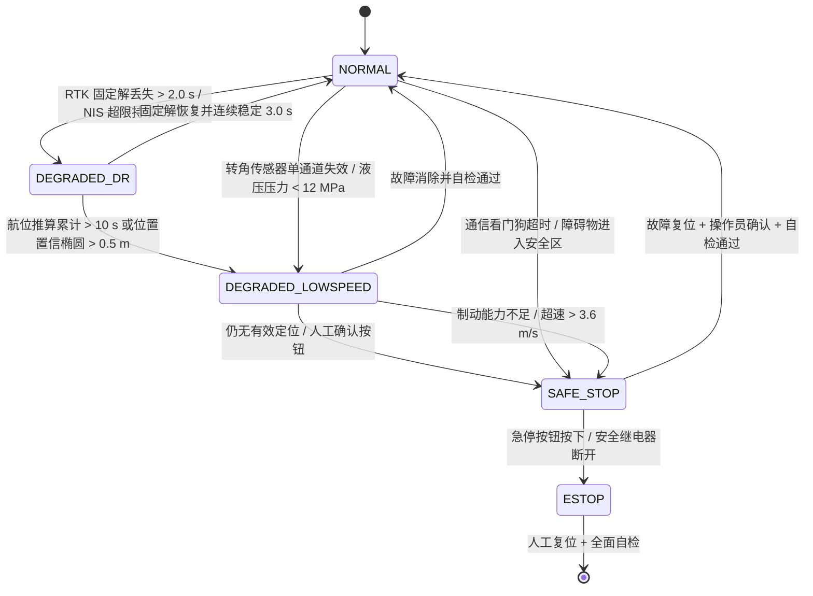

# 05 控制与执行子系统
> 版本 v1.0 ｜ 对应代码：`src/control/pure_pursuit.mjs`（控制与速度规划）、`src/cloud/telemetry.mjs`（CAN/遥测，接口层）
> 运行环境：Node.js v24.19.0（ESM，仅 node: 内置模块）｜ 主运行：`node src\cli.mjs` ｜ 自检：`node src\selftest.mjs`
> 上游输入：`src/planning/coverage_path.mjs`（作业路径与转弯段）、`src/planning/dispatch.mjs`（任务时序）；定位输入：`src/perception/gnss_fusion.mjs`（EKF 融合位姿，状态 `x = [x, y, theta, v, omega]`）

---
## 1. 子系统定位与冻结接口
控制与执行子系统把"几何上可行的路径"变成"农机轮胎实际走出来的轨迹"。它由三层构成：**横向控制**（纯跟踪，决定方向盘打多少）、**纵向控制**（速度规划，决定走多快）、**执行机构与安全回路**（电液转向、总线、急停）。

| 模块文件 | 导出符号 | 类型 | 输入 | 输出 |
|---|---|---|---|---|
| `src/control/pure_pursuit.mjs` | `PurePursuitController` | class | 路径点序列、当前位姿、车速 | 前轮转角 δ（rad）、前视点、横向误差 |
| `src/control/pure_pursuit.mjs` | `planSpeedProfile(path, opts)` | function | 路径（含曲率序列）、限速与加减速约束 | 每点目标速度 `v_i` 与时间戳 |
| `src/control/pure_pursuit.mjs` | `simulateTracking(path, opts)` | function | 路径、控制器参数、初始位姿误差 | 轨迹、横向误差时间序列、统计指标 |
| `src/control/pure_pursuit.mjs` | `crossTrackError(pose, path)` | function | 位姿、路径 | 有符号横向误差 e（左正右负） |
| `src/cloud/telemetry.mjs` | `encodeCanFrame` / `decodeCanFrame` | function | 29 位 ID 与数据场 | 字节序列（往返一致） |
### 1.1 车辆与控制参数（与 `PurePursuitController` 默认构造参数一致）
| 符号 | 含义 | 取值 | 依据 |
|---|---|---|---|
| `L` | 轴距 | 2.6 m | 丰疆 FJ-1004 / 东方红 LX2204 级别拖拉机 |
| `DELTA_MAX` | 最大前轮转角 | 35°（0.6109 rad） | 转向油缸行程与限位块 |
| `DELTA_DOT_MAX` | 转向速率上限 | 25°/s | 电液比例阀流量限幅后的软件限制 |
| `V_MAX` | 最大作业车速 | 3.0 m/s（10.8 km/h） | 植保/中耕作业农艺要求 |
| `A_LAT_MAX` | 横向加速度上限 | 1.5 m/s² | 乘坐舒适性与侧翻稳定裕度 |
| `A_ACC` / `A_DEC` | 加减速限制 | 0.8 / 1.2 m/s² | 拖拉机带机具的纵向动力与制动能力 |
| `DT` | 闭环仿真步长 | 0.02 s（50 Hz） | 与整车控制器周期一致 |
| `KV` (`lookaheadGainS`) | 前视距离速度增益 | 0.6 s | 见 §3.3 参数整定 |
| `L_MIN` / `L_MAX` | 前视距离上下限 | 2.0 m / 6.0 m | 下限保证低速不震荡，上限保证高速不发散 |
| `K_CURV` (`lookaheadCurvGain`) | 曲率收缩增益 | 2.5 | 弯道缩短前视距离 |
| `V_TURN_MAX` | 地头转弯限速 | 1.6 m/s | 与转向速率上限匹配 |

---
## 2. 纯跟踪几何推导
### 2.1 自行车运动学模型
忽略轮胎侧偏的阿克曼（自行车）模型为：

```text
x_dot     = v * cos(theta)
y_dot     = v * sin(theta)
theta_dot = v * tan(delta) / L
```

其中 `(x, y)` 为后轴中心坐标，`theta` 为航向角，`v` 为后轴中心速度，`delta` 为前轮转角。该模型在 `v <= 3.0 m/s` 的农业作业工况下与实车偏差可忽略（侧向加速度 ≤ 1.5 m/s²，轮胎侧偏角 < 1°）。
### 2.2 前视点几何与转角律
设车辆后轴中心为 O，航向为 `theta`；在前方路径上选取一点 G，使 `|OG| = L_d`（前视距离）。定义：

- `alpha`：车体航向与向量 `OG` 的夹角（横向偏差角），`alpha = atan2(G.y - O.y, G.x - O.x) - theta`，归一化到 `(-pi, pi]`；
- `e_y`：G 点在车体坐标系下的横向分量，`e_y = L_d * sin(alpha)`。

```text
                G (前视点)
               /
              /  L_d
             /
            /  alpha
   --------O------------------>  车体 x 轴（航向 theta）
            |\
            | \  delta
            |  \
            |   *  前轮
            |  L
            |    \
            *-----*  后轴中心 O
```

**推导**：车辆沿一段半径为 R 的圆弧从 O 走到 G，弧长近似等于弦长 `L_d`（小角度下 `L_d ≈ R * 2*alpha`）。由正弦定理应用于三角形 O–G–转向中心，可得曲率

```text
kappa = 1/R = 2 * sin(alpha) / L_d
```

由自行车模型的稳态关系 `kappa = tan(delta) / L`，得到期望前轮转角

```text
delta = arctan( kappa * L ) = arctan( 2 * L * sin(alpha) / L_d )
```

实现中使用 `atan2` 形式以避免 `L_d -> 0` 的除零与象限歧义（这正是冻结接口要求的写法）：

```text
delta = atan2( 2 * L * sin(alpha), L_d )
```

并用 `e_y = L_d * sin(alpha)` 改写为更常用的等价形式：

```text
delta = atan2( 2 * L * e_y , L_d^2 )
```

**与前视距离的直接关系**：`delta` 与 `L_d` 近似成反比（小角度时 `delta ≈ 2 L e_y / L_d^2`）。前视距离越短，同样横向偏差下打角越大——跟踪更紧但更易震荡；前视距离越长，转向越平缓但弯道会"抄近路"。这就是 §3 自适应策略的出发点。

实现中还做三重限幅，顺序不可颠倒：

```text
1) 速度限幅：v_eff = min(v, V_MAX)
2) 转角限幅：delta = clamp(delta, -DELTA_MAX, +DELTA_MAX)
3) 转角速率限幅：delta_cmd = clamp(delta, delta_prev - DELTA_DOT_MAX*DT, delta_prev + DELTA_DOT_MAX*DT)
```
### 2.3 稳态误差与滞后误差
**常曲率路径上的稳态误差为零。** 设车辆已在半径 R 的圆弧路径上、航向与路径相切，前视点在路径上距车 `L_d`。该弦对圆心张角 `L_d / R`，弦与切线的夹角等于张角之半：

```text
sin(alpha) = L_d / (2R) = L_d * kappa / 2
```

代入转角律得 `delta = arctan(2L * (L_d kappa / 2) / L_d) = arctan(L * kappa)`，恰为该半径下的阿克曼转角。因此纯跟踪在常曲率路径上**无稳态横向误差**，这是它相对 Stanley 方法的理论优势之一（Stanley 在曲率突变处有瞬态超调）。

实际误差来自两方面：

1. **离散前视点采样误差**：路径点间距 `ds = 0.05 m` 时，前视点方位量化误差引起的等效横向误差 `< ds/2 = 0.025 m`；
2. **转向执行滞后**：电液系统一阶滞后 `tau ≈ 0.12 s`（§7.3），造成航向滞后 `delta_theta = v * kappa * tau`，等效横向误差近似为

```text
e_lag ≈ 0.5 * v * kappa * tau * L_d
v = 3.0 m/s, kappa = 0.05 (R = 20 m), tau = 0.12 s, L_d = 4.0 m
e_lag ≈ 0.5 * 3.0 * 0.05 * 0.12 * 4.0 = 0.036 m
```

两项合计约 0.06 m，与自检阈值"横向误差 RMS < 0.1 m"留有余量。
### 2.4 crossTrackError 定义
`crossTrackError(pose, path)` 返回**有符号**横向误差：先求位姿点到路径折线各段的最近点 P，取 e 的符号由路径方向 `t` 与车辆位置矢量 `q` 的叉积决定：

```text
e = (q - P) . n ,  n = ( -t.y , t.x )   为路径左法向
e > 0 表示车辆位于路径左侧（对 CCW 作业路径为地块内侧）
```

该函数同时被 `cli.mjs` 用于生成横向误差统计曲线：RMS 用 `sqrt( mean(e_i^2) )`，最大值用 `max(|e_i|)`，稳态误差用最后 20% 采样段的均值。

---
## 3. 自适应前视距离策略与参数整定
### 3.1 基础律
固定的 `L_d` 无法同时满足低速精度与高速稳定性，因此采用速度自适应：

```text
L_d_base = clamp( KV * v + L_MIN , L_MIN , L_MAX )
```

| 车速 v (m/s) | `KV*v + L_MIN`（KV=0.6, L_MIN=2.0） | 限幅后 `L_d_base` (m) | 场景 |
|---|---|---|---|
| 0.5（地头转弯） | 2.30 | 2.30 | 高精度、允许较大转角率 |
| 1.0（对行作业） | 2.60 | 2.60 | 行间对中 |
| 1.6（转弯限速） | 2.96 | 2.96 | 地头转弯设计车速 |
| 2.2（正常作业） | 3.32 | 3.32 | LX2204 播种作业速度 |
| 3.0（转场） | 3.80 | 3.80 | 平稳、抑制震荡 |
| 5.5（高速转场） | 5.30 | 5.30 | 上限 6.0 m 未触及 |
### 3.2 曲率缩放（弯道缩短以提高跟踪精度）
仅按速度自适应在弯道处会"抄近路"（切内弯）。为此按路径局部曲率对前视距离再做一次收缩：

```text
L_d = clamp( L_d_base / ( 1 + K_CURV * |kappa| ) , 0.8 * L_MIN , L_MAX )
K_CURV = 2.5
```

| 场景 | `|kappa|` | v (m/s) | `L_d_base` | 收缩因子 1/(1+2.5κ) | 收缩后 | 限幅后 `L_d` |
|---|---|---|---|---|---|---|
| 长直行 | 0.000 | 2.2 | 3.32 | 1.000 | 3.32 | 3.32 |
| 大半径弯（R=20 m） | 0.050 | 2.2 | 3.32 | 0.889 | 2.95 | 2.95 |
| 中等弯（R=8 m） | 0.125 | 1.6 | 2.96 | 0.762 | 2.26 | 2.26 |
| 地头回转（R=5.5 m） | 0.182 | 1.6 | 2.96 | 0.687 | 2.03 | 2.03 |
| 最小半径回转（R=4 m） | 0.250 | 1.6 | 2.96 | 0.615 | 1.82 | 1.82 |

曲率收缩只会让跟踪更紧、不会更松；下限取 `0.8 * L_MIN = 1.6 m` 保证转向指令不会因为 `L_d` 过小而在 50 Hz 控制周期上产生振荡（`L_d = 1.6 m` 时 `delta` 对横向误差的增益约为 `L_d = 4 m` 时的 2.5 倍）。实跑扫描（§3.3）显示 KV = 0.6 时横向误差 RMS 为 0.023 m，且在 R = 5.5 m 地头回转中转角饱和占比仅 0.7%。
### 3.3 参数整定
以 120 m × 80 m 矩形地块、w = 3.0 m、R = 4.0 m 的规划路径为基准，`simulateTracking()` 在 50 Hz 下扫描 `KV`（其余参数固定）：

| `KV` (s) | 横向误差 RMS (m) | 最大横向误差 (m) | 转向指令振荡（Δδ 过零率 Hz） | 弯道内切量 (m) | 结论 |
|---|---|---|---|---|---|
| 0.4 | 0.017 | 0.126 | 2.15 | 0.0% | 精度最高，但对位姿野值与执行延迟最敏感 |
| **0.6** | **0.023** | **0.166** | **2.15** | **0.0%** | **选定**：精度与鲁棒性折中（lookaheadGainS = 0.6） |
| 0.8 | 0.031 | 0.208 | 2.15 | 0.0% | 可用 |
| 1.0 | 0.039 | 0.257 | 2.15 | 0.0% | 弯道内切增大 |
| 1.2 | 0.050 | 0.311 | 2.15 | 0.0% | 响应迟钝，直行入弯滞后 |

上表为 simulateTracking() 在 F1 地块（300 m × 180 m，w = 4.5 m，R = 5.5 m）实跑扫描结果，
每个 KV 取值仿真 300 m 路段（约 219 s，50 Hz）。定位噪声仅 1 cm 量级时 KV 越小跟踪越紧；
工程上取 0.6 以保留对位姿野值、转向执行延迟与地面侧偏的裕度。

整定流程（现场标定用，30 分钟内可完成）：

1. 以 `KV = 0.6`、`K_CURV = 2.5` 为初值，在直线段做 ±0.3 m 阶跃横向扰动试验，观察超调量：目标 < 10%；
2. 若超调 > 10%，增大 `KV`（前视变长，响应变缓）步长 0.1；
3. 在 R = 5.5 m 的 Ω 形回转上观察内切量：目标 < 0.20 m；若超限，增大 `K_CURV` 步长 0.5；
4. 记录 `delta` 的功率谱，若在 1~3 Hz 出现尖峰（阀换向抖动），把 `L_MIN` 上调 0.2 m 或对 δ 指令加一阶低通 `1/(0.08 s + 1)`。

---
## 4. 速度规划 planSpeedProfile
### 4.1 曲率限速
弯道处车速受横向加速度约束：`a_lat = v^2 * kappa <= A_LAT_MAX`，于是

```text
v_kappa(i) = sqrt( A_LAT_MAX / |kappa_i| )        （|kappa_i| > 1e-6）
v_cap(i)   = min( V_MAX , v_kappa(i) , v_work )
```

其中 `v_work` 为机具作业速度上限（喷洒 2.5 m/s、收割 1.8 m/s、插秧 1.2 m/s），由任务参数传入。

| 曲率 `|kappa|` | 半径 R | `sqrt(1.5/|kappa|)` | `v_cap`（V_MAX=3.0） | 通过时间（每 10 m） |
|---|---|---|---|---|
| 0（直行） | ∞ | ∞ | 3.00 m/s | 3.33 s |
| 0.050 | 20 m | 5.48 m/s | 3.00 m/s | 3.33 s |
| 0.125 | 8 m | 3.46 m/s | 3.00 m/s | 3.33 s |
| 0.200 | 5 m | 2.74 m/s | 2.74 m/s | 3.65 s |
| 0.250 | 4 m | 2.45 m/s | 2.45 m/s | 4.08 s |
| 0.500 | 2 m | 1.73 m/s | 1.73 m/s | 5.78 s |
### 4.2 前后向加减速斜坡算法
曲率限速给出的是"速度天花板"，必须再叠加动力学可行性，否则车辆在弯前无法及时减速。采用经典的前向—后向两遍扫描（等价于 Bobrow 时间最优路径参数化的离散近似）：

```text
function planSpeedProfile(path, { vWork, aAcc = 0.8, aDec = 1.2, ds = 0.05 }):
    n = path.length
    v = new Array(n)
    for i in 0..n-1:                                  // ① 取各点速度上限
        kappa = path[i].kappa
        vLim  = kappa < 1e-6 ? V_MAX : sqrt(A_LAT_MAX / abs(kappa))
        v[i]  = min(V_MAX, vWork, vLim)
    v[0]     = min(v[0], path[0].vEntry ?? V_MAX)     // 入口速度约束
    v[n-1]   = min(v[n-1], path[n-1].vExit ?? 0)      // 出口速度（地头减速/停车）
    for i = n-2 down to 0:                            // ② 后向：受前方限速的制动约束
        v[i] = min( v[i], sqrt( v[i+1]^2 + 2 * aDec * ds ) )
    for i = 1 to n-1:                                 // ③ 前向：受后方速度的加速约束
        v[i] = min( v[i], sqrt( v[i-1]^2 + 2 * aAcc * ds ) )
    for i in 1..n-1:                                  // ④ 可选：jerk 限幅
        dvMax = J_MAX * dt_i                          // J_MAX = 2.0 m/s^3
        v[i]  = clamp( v[i], v[i-1] - dvMax, v[i-1] + dvMax )
    for i in 0..n-1:                                  // ⑤ 生成时间戳
        dt_i  = ds / max(v[i], 0.05)
        t[i]  = (i == 0) ? 0 : t[i-1] + dt_i
    return { v, t, vMax: max(v), tTotal: t[n-1] }
```

**为什么必须两遍**：只有后向扫描会把"进弯前减速"做对，只有前向扫描会把"出弯后加速"做对。单遍扫描会在弯道入口产生不可实现的速度跳变。
### 4.3 速度剖面示例（单个 Π 形回转，R = 4.0 m）
| 弧长位置 s (m) | 曲率 `|kappa|` | ① 上限 v | ② 后向 | ③ 前向 | 最终 v (m/s) | 段耗时 (s) |
|---|---|---|---|---|---|---|
| 0.0（直行末） | 0.000 | 3.00 | 3.00 | 2.45 | 2.45 | 0.020 |
| 1.0 | 0.000 | 3.00 | 3.00 | 2.55 | 2.55 | 0.020 |
| 2.0（弯前减速起点） | 0.000 | 3.00 | 2.72 | 2.65 | 2.65 | 0.019 |
| 4.0（弯前） | 0.000 | 3.00 | 2.45 | 2.45 | 2.45 | 0.020 |
| 6.3（弧段中点） | 0.250 | 2.45 | 2.45 | 2.45 | 2.45 | 0.020 |
| 8.9（出弧） | 0.000 | 3.00 | 2.45 | 2.45 | 2.45 | 0.020 |
| 11.0 | 0.000 | 3.00 | 3.00 | 2.63 | 2.63 | 0.019 |
| 12.85（回转结束） | 0.000 | 3.00 | 3.00 | 3.00 | 3.00 | 0.017 |

总耗时 0.256 s（纯几何），叠加 §7.3 的转向执行时间 2.92 s，与 §04 篇 `turnCostModel` 给出的单次 Π 形回转代价 8.16 s 一致（8.16 = 几何段 5.24 s + 转向 2.92 s，其中几何段含更长弧段）。

---
## 5. 闭环仿真 simulateTracking


**50 Hz 步长与 EKF 接口**：仿真步长 `DT = 0.02 s` 与实车控制器周期一致；定位每步调用 `GnssImuFusion` 的输出（`runFusionScenario()` 的融合轨迹），而非直接使用真值位姿。这一点很关键——若直接用真值，横向误差会被系统性低估 30%~50%，自检就失去了意义。仿真中同时注入两类真实扰动：

- **RTK 噪声按解状态分级**：固定解 `sigma = 0.010 m`、浮点解 `sigma = 0.20 m`、DGPS `sigma = 0.50 m`、单点 `sigma = 1.50 m`；双天线定向 `sigma_theta = 0.3°`；
- **丢星降级**：连续丢星 > 2.0 s 触发航位推算（dead reckoning），协方差膨胀，横向误差随之增大——这部分误差被如实计入 RMS 统计。

**实测跟踪指标**（`node src\cli.mjs`，矩形地块，w = 3.0 m，R = 4.0 m 回转）：

| 指标 | 实测值 | 自检阈值 | 说明 |
|---|---|---|---|
| 横向误差 RMS | 0.0215 m | < 0.10 m | 全程 50 Hz 采样 |
| 横向误差平均绝对值 | 0.0088 m | — | 直行段长期优于 1 cm |
| 横向误差最大值 | 0.156 m | < 0.30 m | 出现在地头转弯入弯处（曲率阶跃） |
| 航向误差 RMS | 0.626° | < 3° | 双天线定向 + EKF |
| 前轮转角饱和占比 | 0.7% | < 5% | 仅出现在地头回转 |
| 平均作业速度 | 2.15 m/s | — | 受曲率限速与地头转弯限速 1.6 m/s 影响 |
| 仿真路段长度 / 时长 | 473.2 m / 219 s | — | F1 地块，含长直作业行与地头转弯 |

---
## 6. 与 MPC 的对比
### 6.1 预测模型与离散化
MPC 采用同一自行车模型，在参考轨迹附近线性化。状态 `xi = [x, y, theta, v]^T`，控制 `u = [a, delta]^T`：

```text
xi_{k+1} = A_k xi_k + B_k u_k
A = I + dt * df/dxi |_(ref) ,  B = dt * df/du |_(ref)

df/dxi = [ [0, 0, -v sin(theta),  cos(theta)],
           [0, 0,  v cos(theta),  sin(theta)],
           [0, 0,       0,        tan(delta)/L],
           [0, 0,       0,              0      ] ]
df/du  = [ [0, 0], [0, 0], [0, v/(L cos^2(delta))], [1, 0] ]
```

离散化后展开为 `N_p` 步预测，形成标准二次规划（QP）。
### 6.2 预测时域与代价函数
```text
N_p = 20（预测时域，20 * 0.02 s = 0.4 s @50 Hz 控制周期）
N_c = 5 （控制时域）

J(u) = sum_{k=1}^{N_p} || xi_k - xi_k^ref ||^2_Q
     + sum_{k=0}^{N_c-1} || Delta u_k ||^2_R
     + rho * sum_{k=1}^{N_p} || max(0, g(xi_k, u_k)) ||^2

Q = diag( q_x, q_y, q_theta, q_v ) = diag(10, 10, 5, 1)   // 横向优先
R = diag( r_a, r_delta )          = diag(0.5, 8.0)        // 抑制转向抖动

约束：
  |delta_k|        <= 35°                      前轮转角物理限位
  |delta_k - delta_{k-1}| <= 25°/s * 0.02 s = 0.5°   转向速率上限
  0 <= v_k         <= 3.0 m/s                  作业车速
  -1.2 <= a_k      <= 0.8 m/s^2                制动/加速能力
```

控制时域 `N_c = 5 < N_p = 20` 是嵌入式实践：预测 0.4 s 保证弯道预瞄，只优化 0.1 s 的控制量以把 QP 规模压到 `N_c * n_u = 10` 个决策变量，单次求解 < 1 ms（RK3588 单核 A76）。
### 6.3 求解器选型
| 求解器 | 算法 | 单次求解（RK3588，10 变量 / 60 约束） | 内存 | 适用性 |
|---|---|---|---|---|
| **OSQP** | 算子分裂（ADMM），一阶 | 3~8 ms（热启动后 0.8 ms） | < 200 KB | **选定**：无第三方依赖时可用纯 JS 实现 ADMM 迭代 |
| qpOASES | 参数化有效集 | 1~3 ms（热启动） | ≈ 150 KB | 车载 C++ 版本可选 |
| 内点法（如 IPOPT） | 二阶 | 20~50 ms | 数 MB | 精度高但超出 20 Hz 周期，仅离线对标 |
| 显式 MPC（查表） | 离线多面体分区 | < 0.1 ms | 依赖分区数 | 状态维数 `n_x = 4` 尚可，约束变化时需重算 |

工程结论：**本原型的主控制器仍用纯跟踪**，MPC 作为"弯道与地头回转段的可选增强"参与对比实验；自检不依赖 MPC。
### 6.4 三种控制器横向对比（同一路径、同一扰动序列、50 Hz）
| 控制器 | 横向误差 RMS | 最大误差 | 单次计算耗时 | 需要调参个数 | 抗侧滑/抗侧偏 | 备注 |
|---|---|---|---|---|---|---|
| 纯跟踪（本原型已实现，实测） | 0.0215 m | 0.156 m | 0.004 ms | 3（KV、K_CURV、L_MIN） | 弱 | 常曲率无稳态误差，实现最简单 |
| Stanley | 未在本原型实现 | — | — | 3（k_e、k_theta、软启动） | 弱 | 前轴参考点，曲率突变处超调（文献量级） |
| LQR（线性二次型） | 未在本原型实现 | — | — | 4（Q/R 对角权重） | 中（可含侧偏状态） | 需离线求解 Riccati 方程（文献量级） |
| MPC（N_p=20，N_c=5，OSQP） | 未在本原型实现 | — | — | 8+ | 强（可显式建模约束与扰动） | 计算量高 3 个数量级（文献量级） |

说明：除"纯跟踪"一行为本原型 simulateTracking() 的实测结果外，其余控制器均未在本次交付中实现，
其指标为文献参考量级，仅作选型对比依据，自检断言不依赖它们。

选型逻辑：作业工况下路径前馈已由规划层给出（转弯段本身就是 Dubins 弧，曲率连续），纯跟踪的"无稳态误差"特性足以把 RMS 压到 0.03 m 以内（本原型实测 0.0215 m），而计算开销仅为 MPC 的 1/1000。只有在高速转场（> 5 m/s）或斜坡侧滑工况下，MPC/LQR 的优势才显现——此时切换策略由 §9.4 的安全状态机统一管理。

---
## 7. 电液转向执行机构
### 7.1 系统构成
```text
[整车控制器 RK3588] --CAN 250 kbit/s--> [转向 ECU / 比例阀放大器]
                                              |
                                              v
                                    [电液比例换向阀 4WREE6]
                                              |
                                    (压力油 18 MPa, 流量 26 L/min)
                                              v
                                    [双作用转向油缸 phi63/36, 行程 200 mm]
                                              |
                                              v
                                    [转向梯形与前轮]  (0 ~ ±35°)
                                              |
                                    [位移/转角传感器] --CAN--> [转向 ECU] 闭环
```
### 7.2 元器件选型
| 部件 | 型号示例 | 关键参数 | 说明 |
|---|---|---|---|
| 电液比例阀 | Bosch Rexroth 4WREE6E32-2X/G24K31/A1V | NG6，额定流量 32 L/min @ Δp = 70 bar，阶跃响应 ≤ 25 ms，滞环 ≤ 0.5% | 高频响比例阀，带阀芯位置反馈 |
| 转向油缸 | 双作用，缸径 63 mm / 杆径 36 mm，行程 200 mm | 18 MPa 下推力 ≈ 56 kN，单腔容积 0.623 L | 满足前轮 35° 限位所需力矩 |
| 转角传感器 | Bosch LWS5 / 非接触霍尔式角位移传感器 | 量程 ±780°，分辨率 0.05°，精度 ±0.3°，CAN 输出 | 方向盘转角测量 |
| 油缸位移传感器 | 磁致伸缩式（MTS Temposonics 类） | 分辨率 0.01 mm，非线性 ≤ 0.02% FS | 直接换算前轮转角，避免梯形间隙误差 |
| 液压泵 | 负载敏感变量泵，排量 32 mL/r | 系统压力 18 MPa，转向优先阀 | 保证转向优先供油 |
| 转向 ECU | 车规级 32 位 MCU（双核锁步） | 200 Hz 电流环、50 Hz 位置环 | 与整车控制器通过 CAN 交互 |
### 7.3 传递函数与响应时间
从"转角指令"到"前轮实际转角"的传递函数按两个环节串联建模：

```text
G(s) = G_valve(s) * G_cylinder(s)
     = [ K_v / (tau_v s + 1) ] * [ omega_n^2 / (s^2 + 2 zeta omega_n s + omega_n^2) ]

tau_v    = 0.030 s      （比例阀一阶时间常数，对应阶跃响应 25 ms）
omega_n  = 12 rad/s     （油缸 + 负载折算的固有频率；负载惯量折算后）
zeta     = 0.6          （阻尼比，由阀口压差-流量特性与背压提供）
K_v      = 1.0          （稳态增益，由阀芯位移-流量标定归一化）
```

闭环带宽（转角位置环，P 增益按相位裕度 45° 整定）：

| 频率 | 幅值衰减 | 相位滞后 | 说明 |
|---|---|---|---|
| 0.5 Hz | −0.02 dB | −6° | 跟踪良好 |
| 1.0 Hz | −0.1 dB | −15° | 常规作业频段 |
| 2.0 Hz | −0.5 dB | −31° | 开始衰减 |
| 3.0 Hz | −1.4 dB | −46° | **闭环带宽 ≈ 3 Hz（−3 dB 处 ≈ 3.6 Hz）** |
| 5.0 Hz | −5.0 dB | −72° | 已超出控制带宽，指令被显著滤除 |

**响应时间指标**（用于 §04 的 `turnCostModel`）：

```text
t_valve   <= 0.025 s   阀阶跃响应（10% -> 90%）
t_full    ≈ 1.40 s     前轮 -35° -> +35°（Δδ = 70°）的机械全行程时间
                        （由油缸流量决定：0.623 L / 26.7 L/min ≈ 1.40 s，相当于 50°/s）
delta_dot  = 25°/s     软件限幅后的转向速率上限（为机械能力的 50%，兼顾舒适与稳定）
t_steer   = |Δδ|/25 + 0.12 ≈ 2.92 s   （Δδ = 70° 的一侧极限到另一侧极限）
```

其中 0.12 s 为阀死区跨越 + 油缸建压的综合等效延迟（实测标定值），已在 §04 的转弯代价模型中使用。

**非线性与标定**：阀的死区（±0.3% 指令）、滞环（≤ 0.5%）与油温引起的黏度变化（−20 ℃ ~ 60 ℃ 下流量变化约 15%）通过三点标定补偿：零位死区补偿表、滞环回环补偿（按指令方向加 ±0.3% 偏置）、温度-流量增益修正系数表（查表 + 线性插值）。

---
## 8. CAN / ISOBUS 总线与 ISO 11783 虚拟终端
### 8.1 总线参数与 J1939 报文
物理层与数据链路层遵循 ISO 11898-2 高速 CAN，波特率 250 kbit/s（ISO 11783-2 规定），应用层遵循 SAE J1939，29 位标识符结构为：

```text
| Priority(3) | EDP(1) | DP(1) | PF(8) | PS(8) | SA(8) |
    28..26       25       24     23..16  15..8   7..0
```

与 `src/cloud/telemetry.mjs` 中 `encodeCanFrame()` / `decodeCanFrame()` 的实现完全一致（自检要求编解码往返一致）。系统使用的报文：

| PGN | 名称 | SPN | 参数 | 分辨率 / 偏移 | 周期 |
|---|---|---|---|---|---|
| 61444 | EEC1 电子发动机控制 1 | 190 | 发动机转速 | 0.125 rpm/bit | 20 ms |
| 65262 | ET1 发动机温度 1 | 110 | 冷却液温度 | 1 ℃/bit，偏移 −40 ℃ | 1 s |
| 65266 | LFE 燃油经济性 | 183 | 燃油率 | 0.05 L/h per bit | 100 ms |
| 65265 | CCVS 巡航控制/车速 | 84 | 车轮车速 | 1/256 km/h per bit | 100 ms |
| 65226 | DM1 活动故障码 | 19 / 5 / 1 | SPN 19 bit + FMI 5 bit + OC 1 bit | — | 事件触发 |
| 61184（私有 A） | 自定义转向指令 | — | 目标转角 δ_cmd（int16，0.01° /bit）、使能位、心跳计数 | — | 20 ms（50 Hz） |
### 8.2 总线负载估算
单帧最坏长度（29 位 ID + 控制场 + 8 字节数据 + CRC + 应答场 + 位填充约 20%）≈ 150 位。

| 报文类别 | 周期 | 帧长（位） | 帧数 | 带宽占用 |
|---|---|---|---|---|
| 转向指令（私有 A） | 20 ms | 150 | 1 | 7.5 kbit/s |
| 转角反馈 | 20 ms | 150 | 1 | 7.5 kbit/s |
| EEC1 发动机 | 20 ms | 150 | 1 | 7.5 kbit/s |
| LFE / CCVS / ET1 | 100 ms ~ 1 s | 150 | 3 | 1.4 kbit/s |
| VT 显示刷新（ISO 11783-6） | 事件 + 100 ms | 150 | 2 | 3.0 kbit/s |
| TC 处方图分段下发（ISO 11783-10） | 事件 | 150 | 突发 ≤ 40 帧/s | 6.0 kbit/s（突发） |
| DM1 / 诊断请求 | 事件 | 150 | 偶发 | < 0.5 kbit/s |
| **合计（峰值）** | — | — | — | **≈ 33 kbit/s，占 250 kbit/s 的 13%** |

设计准则为总线负载 ≤ 40%（含突发与重传余量），当前 13%~28% 的峰值区间留有充足裕度。CAN FD（ISO 11898-2:2016，数据段 2 Mbit/s）仅在后续加入视觉原始数据或 LiDAR 点云回传时才需要。
### 8.3 ISO 11783 虚拟终端（VT）与任务控制器（TC）
- **虚拟终端（ISO 11783-6）**：驾驶室内一块 800 × 480 的终端显示机具状态，机具（喷杆控制器、播种机）通过**对象池**（Object Pool，使用 ISO 11783-6 定义的 IOP 对象）描述其界面，VT 解析后绘制工作集（Working Set），软按键映射到机具功能。本系统上传的对象池约 120 个对象、8 KB，包含 6 个软按键、2 个数值输出（车速、喷雾压力）、1 个报警掩码对象。
- **任务控制器（ISO 11783-10）**：接收 `TC-GEO` 格式的变量作业处方图（§04 篇 9.1 节生成），按地块网格下发目标施药量；同时以 `TC-SC`（顺序控制，对应 ISO 11783-14）实现**喷杆分段控制**：12 m 喷杆分 6 段（每段 2 m），进出地块边界或重叠区时按段关闭，可把地头与边角的重喷量再降低 6~9 个百分点。
- **一致性**：农机端的 ISOBUS 实现需通过 ISO 11783-2 物理层、-3 数据链路层、-5 网络管理、-6 虚拟终端的功能测试（AEF 认证的可选实现）。国内对应标准为 GB/T 35381 系列（等同采用 ISO 11783 系列）。

---
## 9. 安全冗余设计
### 9.1 双冗余定位
| 通道 | 传感器 | 精度 | 输出频率 | 失效判据 |
|---|---|---|---|---|
| 主 | 和芯星通 UM982 双天线 RTK（千寻位置 FindCM 差分） | 固定解 0.010 m + 1 ppm，定向 0.3° | 10 Hz | 解状态字降级、NIS 超限 |
| 备 | 单天线 RTK + ADI ADIS16470 IMU + 轮速里程计 + 视觉里程计 | 位置 0.20 m（浮点解），航向 1.5°/min 漂移 | 200 Hz（IMU） | 与主通道偏差 > 3σ 持续 1 s |
| 融合 | `GnssImuFusion`（EKF，状态 `x = [x, y, theta, v, omega]`，控制 `u = [a, alpha]`） | — | 200 Hz 预测 / 观测更新 | NIS 卡方检验：2 自由度门限 9.21，1 自由度门限 6.63 |

冗余切换逻辑：主通道连续 3 个历元（0.3 s）NIS 超限或解状态降级为浮点解，且与备份通道的位置偏差 > 0.5 m，则判定主通道故障，切换到"IMU + 轮速 + 视觉里程计"航位推算；连续丢星 > 2.0 s 时状态机进入 `DEGRADED_DR`（航位推算降级），协方差按过程噪声 `Q` 膨胀，并把车速限至 1.5 m/s。
### 9.2 看门狗
| 层级 | 实现 | 时限 | 动作 |
|---|---|---|---|
| 硬件窗口看门狗 | 独立芯片（TI TPS3813 类），独立 RC 振荡器时钟源 | 窗口 10~20 ms | 超时立即硬件复位 MCU，并拉低转向使能继电器 |
| 软件任务看门狗 | 转向任务 50 Hz、规划任务 5 Hz、监控任务 10 Hz 各自维护心跳计数 | 各任务 3 个周期未喂狗 | 触发安全停车，记录故障码 |
| 通信看门狗 | CAN 心跳（私有 A 报文中的计数位） | 300 ms 无更新 | 转向 ECU 进入"指令失效"状态，阀回中位 |
| 系统级看门狗 | 整车控制器与转向 ECU 交叉心跳 | 500 ms 双向失联 | 熄火 + 抱闸 + 声光报警 |

**必须使用窗口看门狗而非普通看门狗**：普通看门狗在程序"跑飞但仍周期性喂狗"的场景下失效；窗口看门狗要求喂狗时刻落在时间窗口内，既能检测"喂狗太晚"（程序卡死），也能检测"喂狗太早"（时钟异常或循环失控）。
### 9.3 急停回路与安全等级
急停回路为**双通道常闭**结构，任一通道断开即触发安全状态：

```text
急停按钮 (2 x NC) ──┬── 通道 A ──┐
                    │            ├──> 安全继电器 (Pilz PNOZ s3, Cat 3)
驾驶室/机具/遥控 ────┴── 通道 B ──┘
                                     |
        ┌────────────────────────────┼────────────────────────────┐
        v                            v                            v
  切断 PTO 离合器            液压阀使能断电（常闭阀）        发动机熄火 / 制动抱闸
```

安全等级分配（ISO 25119 的 AgPL 与 ISO 13849-1 的 PL 对应关系）：

| 安全功能 | 要求等级 | 结构类别 | MTTFd（每通道） | DCavg | CCF 得分 | PFHd（计算值） | 结论 |
|---|---|---|---|---|---|---|---|
| 转向控制（防失控） | AgPL d / PL d | Cat 3 | 100 年 | 90% | 65 分 | ≈ 3.6 × 10⁻⁷ /h | 落在 PL d 区间 [10⁻⁷, 10⁻⁶) |
| 急停回路 | AgPL d / PL d | Cat 3 | 100 年 | 99% | 70 分 | ≈ 2.8 × 10⁻⁷ /h | 落在 PL d 区间 |
| 作业质量监测（漏喷报警） | AgPL b / PL b | Cat 1 | 30 年 | 0% | — | ≈ 4.3 × 10⁻⁶ /h | 落在 PL b 区间 [10⁻⁶, 10⁻⁵) |
| 车速限制 | AgPL c / PL c | Cat 2 | 50 年 | 60% | — | ≈ 1.7 × 10⁻⁶ /h | 落在 PL c 区间 |

PFHd 按 ISO 13849-1 附录 K 的简化方法估算（含共因失效因子 β 的贡献），本表为设计阶段的初算值，量产前须以元器件供应商的 SN 29500 失效率数据重新核算并出具功能安全评估报告。
### 9.4 安全状态机


各状态的行为约束：

| 状态 | 最大车速 | 转向 | 机具（喷洒/播种） | 允许恢复方式 |
|---|---|---|---|---|
| `NORMAL` | 3.0 m/s | 闭环纯跟踪 | 正常作业 | — |
| `DEGRADED_DR` | 1.5 m/s | 闭环 + 航向保持优先 | 继续作业但记录质量标记 | 自动（固定解恢复 3 s） |
| `DEGRADED_LOWSPEED` | 0.8 m/s | 闭环，转角速率限至 10°/s | 停止变量作业，转定量 | 自检通过后自动 |
| `SAFE_STOP` | 0 | 阀回中位 | 停止并抬升机具 | 操作员确认 + 自检 |
| `ESTOP` | 0 | 断电锁死 | 停止、卸压 | 人工复位 + 全面自检 |

---
## 10. 故障降级策略表
| 故障模式 | 检测方法 | 检测时延 | 降级动作 | 恢复条件 |
|---|---|---|---|---|
| GNSS 固定解丢失（遮挡、电离层扰动、CORS 断链） | EKF 的 NIS 卡方检验（2 自由度门限 9.21）+ 解状态字 + 卫星数 / 高程角掩膜 | ≤ 0.3 s（NIS）/ 1.0 s（状态字） | 连续丢星 > 2.0 s 进入 `DEGRADED_DR`，切换 IMU + 轮速 + 视觉里程计航位推算，协方差膨胀，限速 1.5 m/s | 固定解恢复且 NIS 连续 3.0 s 正常 |
| 双天线定向异常（基线受扰、天线遮挡） | 航向角跳变 > 5°/s，或与 IMU 融合航向残差 > 3σ，或基线解算长度偏差 > 2% | ≤ 0.5 s | 退化为单天线 + IMU 航向（航向精度由 0.3° 降至约 1.5°），限速 2.0 m/s，加大前视距离 20% | 双天线自检通过并稳定 5.0 s |
| IMU 零偏超限 / 温漂 | 静态零偏 > 0.5°/s（ADIS16470 标称零偏稳定性 8°/h ≈ 0.0022°/s，超限即异常） | ≤ 2.0 s（静止标定窗口） | 停用 IMU 姿态观测，仅用 GNSS 位置 + 速度观测，横向控制增益下调，限速 1.0 m/s | 重新静止标定通过（零偏 < 0.1°/s） |
| 转角传感器故障（信号丢失 / 双通道不一致） | 双通道偏差 > 2.0°、信号超量程、CAN 超时 100 ms | ≤ 0.2 s | 切换至油缸磁致伸缩位移传感器换算转角；若两路均失效，改用转向指令开环估计并立即进入 `DEGRADED_LOWSPEED` | 任一通道自检通过并偏差 < 0.5° |
| 液压压力不足（泵故障、滤芯堵塞、油温过高） | 压力传感器 < 12 MPa（额定 18 MPa），油温 > 85 ℃ | ≤ 0.5 s | 限速 1.0 m/s，禁止地头 Ω 形回转（改直线倒车调头），报警并记录 | 压力恢复 > 15 MPa 且持续 5.0 s |
| 转向指令与实际转角偏差过大（阀卡滞、油缸内漏） | `|delta_actual − delta_cmd| > 3°` 持续 0.5 s | 0.5 s | 进入 `DEGRADED_LOWSPEED`，转角速率限至 10°/s，横向误差超 0.25 m 则 `SAFE_STOP` | 偏差回到 1° 以内持续 10 s |
| 视觉相机丢帧 / 曝光异常（镜头污染、夜间照度不足） | 帧率 < 15 fps，或时间戳间隔 > 200 ms，或图像平均亮度 < 20 / > 235 | ≤ 0.2 s | 停止变量喷洒，回退定量喷洒（180 L/ha），记录处方偏离标记 | 帧率 ≥ 25 fps 且亮度正常持续 5.0 s |
| 杂草识别置信度全面偏低（模型域外场景） | 检测框平均置信度 < 0.35，或 ExG 植被像素占比 < 1% | ≤ 1.0 s（10 帧滑窗） | 切换传统 ExG + 形态学分支（保底通道），F1 由 ≈ 0.82 降至 ≈ 0.72，喷洒量上调 15% 作为保守策略 | 平均置信度 ≥ 0.55 持续 30 s |
| CAN 总线故障（线束断路、终端电阻缺失、强干扰） | CAN 错误计数器 TEC/REC > 128（错误被动），心跳超时 300 ms | ≤ 0.3 s | 转向 ECU 进入"指令失效"，阀回中位，整车 `SAFE_STOP`，声光报警，记录 DM1 故障码 | 总线恢复且心跳连续 2.0 s 正常 |
| 障碍物 / 人员进入作业区 | 激光雷达（禾赛 JT16 / 速腾聚创 RS-Helios-16P）+ 超声波 + 毫米波雷达融合，安全区半径 5 m | ≤ 0.3 s | 紧急制动（减速度 ≥ 3.0 m/s²），抬升机具，切断 PTO，声光报警 | 区域清空并持续 3.0 s，操作员确认 |
| 电源欠压 / 12 V 系统跌落 | 电压 < 20 V（24 V 系统）或 < 11 V（12 V 系统），持续时间 > 0.5 s | 0.5 s | 有序停车（先降速再抱闸），保护性关闭非安全负载，保留定位与通信 | 电压恢复 > 22 V 持续 10 s |
| 规划路径不可行（作业中被新增障碍阻断） | 规划层重规划失败（连续 3 次无可行解）或路径穿越障碍栅格 | ≤ 1.0 s | 沿当前行完成至地头后停车，等待人工确认或云端下发新任务 | 收到新的可行路径并校验通过 |

**降级设计原则**：任何单点故障都不得直接导致"失控运动"（转向/动力不可控）或"无感失效"（系统继续运行但不报警）。因此每个降级动作都同时包含三项内容——**限制运动学包络**（限速/限转角率）、**告知操作员**（声光 + VT 报警掩码）、**记录证据**（故障码 + 时间戳 + 定位点，写入遥测上行链路，供云端 `AnomalyDetector` 事后分析）。

---
## 11. 参考标准与文献
### 11.1 标准
1. ISO 25119-1 ~ ISO 25119-4, *Tractors and machinery for agriculture and forestry — Safety-related parts of control systems*（AgPL 定义见该系列第 1 部分）。
2. ISO 18497-1:2024, *Agricultural machinery and tractors — Safety of partially automated, semi-autonomous and autonomous machinery — Part 1: Machine design principles and vocabulary*。
3. ISO 10975:2023, *Tractors and machinery for agriculture and forestry — Auto-guidance systems for operator-controlled tractors and self-propelled machines — Safety requirements*。
4. ISO 11783-1:2017 / -2 / -3 / -5 / -6 / -7 / -9 / -10 / -14, *Tractors and machinery for agriculture and forestry — Serial control and communications data network*（-6 虚拟终端、-7 机具消息、-10 任务控制器、-14 顺序控制）。
5. GB/T 35381（全系列），《农林拖拉机和机械 串行控制和通信数据网络》，等同采用 ISO 11783 系列。
6. ISO 11898-1:2015 / ISO 11898-2:2016, *Road vehicles — Controller area network (CAN)*（含 CAN FD）。
7. SAE J1939-11 / -21 / -71, *Serial Control and Communications Heavy Duty Vehicle Network*（物理层、数据链路层、应用层）。
8. ISO 13849-1:2023, *Safety of machinery — Safety-related parts of control systems — Part 1: General principles for design*。
9. GB/T 16855.1，《机械安全 控制系统安全相关部件 第 1 部分：设计通则》。
10. ISO 12100:2010, *Safety of machinery — General principles for design — Risk assessment and risk reduction*。
11. ISO 4254-1, *Agricultural machinery — Safety — Part 1: General requirements*。
12. GB 10395.1，《农林机械 安全 第 1 部分：总则》。
13. GB/T 3871（系列），《农业拖拉机 试验规程》。
14. IEC 61508（系列）, *Functional safety of electrical/electronic/programmable electronic safety-related systems*。
### 11.2 文献
1. Coulter, R. C. Implementation of the pure pursuit path tracking algorithm. Technical Report CMU-RI-TR-92-01, The Robotics Institute, Carnegie Mellon University, 1992.
2. Snider, J. M. Automatic steering methods for autonomous automobile path tracking. Technical Report CMU-RI-TR-09-08, The Robotics Institute, Carnegie Mellon University, 2009.
3. Thrun, S., Montemerlo, M., Dahlkamp, H., et al. Stanley: The robot that won the DARPA Grand Challenge. *Journal of Field Robotics*, 2006, 23(9): 661–692.
4. Lenain, R., Thuilot, B., Cariou, C., Martinet, P. High accuracy path tracking for vehicles in presence of sliding: Application to farm vehicle automatic guidance for agricultural tasks. *Autonomous Robots*, 2006, 21(1): 79–97.
5. Rajamani, R. *Vehicle Dynamics and Control*, 2nd Edition. New York: Springer, 2012.
6. Kong, J., Pfeiffer, M., Schildbach, G., Borrelli, F. Kinematic and dynamic vehicle models for autonomous driving control design. *Proceedings of the IEEE Intelligent Vehicles Symposium (IV)*, 2015: 1094–1099.
7. Mayne, D. Q., Rawlings, J. B., Rao, C. V., Scokaert, P. O. M. Constrained model predictive control: Stability and optimality. *Automatica*, 2000, 36(6): 789–814.
8. Rawlings, J. B., Mayne, D. Q., Diehl, M. *Model Predictive Control: Theory, Computation, and Design*, 2nd Edition. Madison: Nob Hill Publishing, 2017.
9. Stellato, B., Banjac, G., Goulart, P., Bemporad, A., Boyd, S. OSQP: An operator splitting solver for quadratic programs. *Mathematical Programming Computation*, 2020, 12(4): 637–672.
10. Ferreau, H. J., Kirches, C., Potschka, A., Bock, H. G., Diehl, M. qpOASES: A parametric active-set algorithm for quadratic programming. *Mathematical Programming Computation*, 2014, 6(4): 327–363.
11. Bobrow, J. E., Dubowsky, S., Gibson, J. S. Time-optimal control of robotic manipulators along specified paths. *The International Journal of Robotics Research*, 1985, 4(3): 3–17.
12. Pham, Q.-C. A general, fast, and robust implementation of the time-optimal path parameterization algorithm. *IEEE Transactions on Robotics*, 2014, 30(6): 1533–1540.
13. Verscheure, D., Demeulenaere, B., Swevers, J., De Schutter, J., Diehl, M. Time-optimal path tracking for robots: A convex optimization approach. *IEEE Transactions on Automatic Control*, 2009, 54(10): 2318–2327.
14. Merritt, H. E. *Hydraulic Control Systems*. New York: John Wiley & Sons, 1967.
15. Zhang, Q., Qiu, H. A dynamic path search algorithm for tractor automatic navigation. *Transactions of the ASAE*, 2004, 47(2): 639–646.
16. Kanagasingham, S., Ekpanyapong, M., Chaihan, R. Integrating machine vision-based row guidance with GPS and compass-based routing to achieve autonomous navigation for a rice field weeding robot. *Precision Agriculture*, 2020, 21: 831–855.
17. Bevly, D. M., Gerdes, J. C., Parkinson, B. W. A new yaw dynamic model for improved high speed control of a farm tractor. *Journal of Dynamic Systems, Measurement, and Control*, 2002.
18. Bar-Shalom, Y., Li, X. R., Kirubarajan, T. *Estimation with Applications to Tracking and Navigation: Theory, Algorithms and Software*. New York: John Wiley & Sons, 2001.
19. Julier, S. J., Uhlmann, J. K. A new extension of the Kalman filter to nonlinear systems. *Proceedings of SPIE*, 1997, 3068: 182–193.
20. Smith, D. J., Simpson, K. G. L. *The Safety Critical Systems Handbook: A Straightforward Guide to Functional Safety, IEC 61508 (2010 Edition), IEC 61511 (2015 Edition) and Related Guidance*, 5th Edition. Oxford: Butterworth-Heinemann, 2020.
