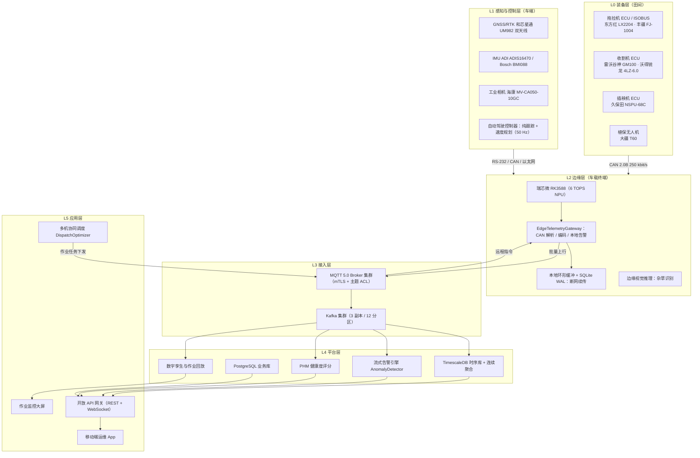
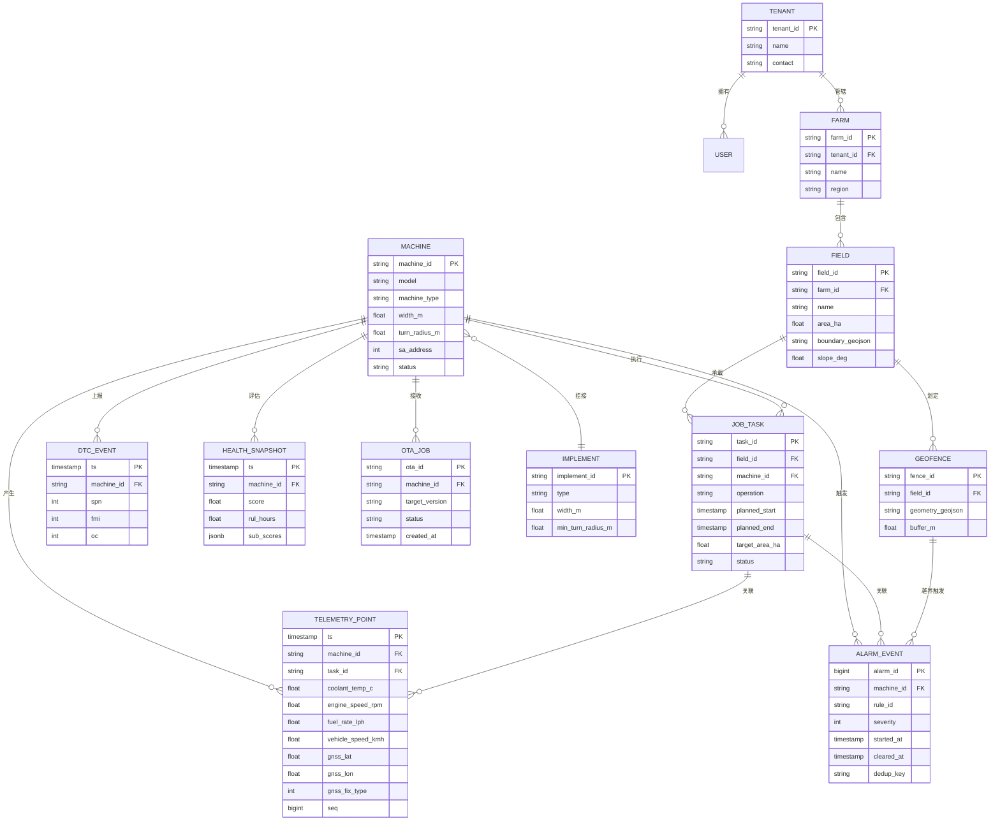
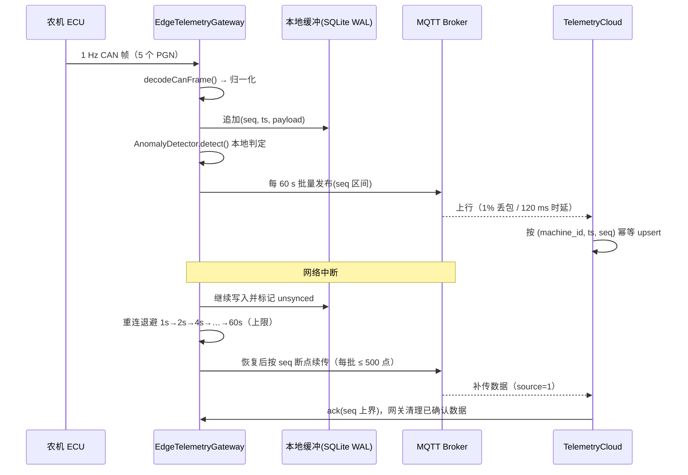
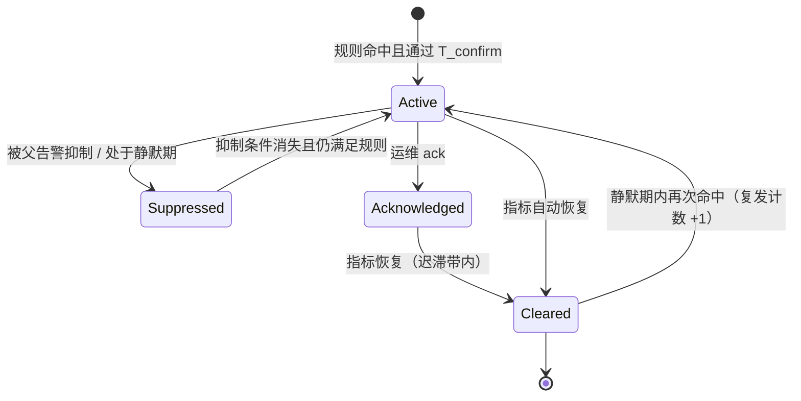

# 06 云平台与数据子系统

> 对应代码：`src/cloud/telemetry.mjs`（导出 `encodeCanFrame()`、`decodeCanFrame()`、`encodeDtc()`/`decodeDtc()`、`class EdgeTelemetryGateway`、`class TelemetryCloud`、`class AnomalyDetector`、`runTelemetryScenario()`）
> 上下游：`src/cli.mjs` 主线在完成全覆盖规划与闭环跟踪仿真后调用 `runTelemetryScenario()`，产出写入 `data/run_result.json`；`src/selftest.mjs` 断言 CAN 编解码往返一致与故障 100% 检出。

## 1. 定位与数据流总览

农机无人作业系统的数据侧要解决三件事：状态可观测、过程可追溯、异常可提前发现并闭环处置。本子系统以 CAN 总线为唯一真实数据源（拖拉机、收割机、插秧机 ECU 均通过 J1939/ISOBUS 总线暴露参数），边缘网关完成协议解析与本地判定，云端完成存储、聚合、告警治理、数字孪生回放与健康度评估。运动控制闭环始终留在车端（`src/control/pure_pursuit.mjs`，50 Hz），**任何一级链路中断都不得导致农机失控**。

```text
1 Hz 采样（CAN 帧级）
  → EdgeTelemetryGateway.encodeCanFrame()   边缘编码 + 本地缓存
  → 批量上行（模拟 1% 丢包、120 ms 单向时延）
  → TelemetryCloud.ingest()                 云端内存时序库
  → AnomalyDetector.detect()                3σ / EWMA / 变化率 / 绝对阈值
  → 告警分级、抑制与去抖
  → 数字孪生回放 + PHM 健康度评分 + API 服务
```

采样率统一取 1 Hz：J1939 动力总成报文（EEC1/LFE/ET1/CCVS）典型广播周期为 10 ms~1 s，1 Hz 是"云端可观测性"与"上行带宽"的折中；50 Hz 控制量不下云，仅在边缘留存环形缓冲供事故回溯。

| 指标 | 设计值 | 说明 |
| --- | --- | --- |
| 单车采样率 | 1 Hz（5 个 PGN，约 40 B/s 原始载荷） | 与 `runTelemetryScenario()` 一致 |
| 上行批量周期 | 60 s/批（每批 60 点） | 降低 MQTT 报文头开销 |
| 模拟丢包率 / 单向时延 | 1% / 120 ms | 由 `EdgeTelemetryGateway` 注入，验证补传与幂等 |
| 端到端告警时延 | ≤ 3 s（P0/P1） | 绝对阈值规则不依赖窗口预热 |
| 告警检出率 | 100%（A/B/C 三类注入故障） | `src/selftest.mjs` 断言 |
| CAN 编解码往返 | 位级一致（29 位 ID + 8 B 数据场） | `src/selftest.mjs` 断言 |
| 单区域容量 | 200 台机 × 1 Hz ≈ 200 点/s（峰值 3×） | 单节点 TimescaleDB 可承载 |

## 2. 云平台分层架构

架构遵循"边缘自治、云端协同"：云端只做监控、调度与优化，控制闭环不下云。



| 层 | 职责与关键组件 | 失效影响与降级策略 |
| --- | --- | --- |
| L0 装备层 | 动力、液压、机具动作（LX2204 / GM100 / NSPU-68C ECU） | 机具动作失效 → 车端立即停车（安全相关，见 08 篇 ISO 25119） |
| L1 感知控制层 | UM982、ADIS16470、MV-CA050-10GC、纯跟踪控制器 | RTK 失锁 → EKF 航位推算降级并降速（`src/perception/gnss_fusion.mjs`） |
| L2 边缘层 | RK3588 车载终端、边缘网关、本地缓存 | 断网 → 本地缓存 + 本地告警，作业不中断 |
| L3 接入层 | MQTT 5.0、Kafka | Broker 不可用 → 边缘缓存，恢复后补传 |
| L4 平台层 | TimescaleDB、PostgreSQL、流计算、PHM、回放 | 平台层不可用不影响田间作业 |
| L5 应用层 | 大屏、App、开放 API | 只读降级 |

## 3. J1939 / ISOBUS 遥测链路

### 3.1 29 位 CAN 标识符位域

J1939（CAN 2.0B 扩展帧之上的应用层，与 ISO 11783 数据链路层同源）使用 29 位标识符。`encodeCanFrame()` / `decodeCanFrame()` 严格按下列位域打包与解包（bit 28 为最高有效位）：

| 位域 | 位宽 | 位号 | 取值范围 | 说明 |
| --- | --- | --- | --- | --- |
| Priority（优先级） | 3 | 28–26 | 0–7 | 越小越优先；动力总成默认 3，温度类默认 6 |
| EDP（扩展数据页） | 1 | 25 | 0–1 | 本原型固定 0 |
| DP（数据页） | 1 | 24 | 0–1 | 本原型固定 0（均为 PDU2 页 0 报文） |
| PF（PDU 格式） | 8 | 23–16 | 0–255 | PF≥240 为 PDU2（广播），PF<240 为 PDU1（点对点） |
| PS（PDU 特定） | 8 | 15–8 | 0–255 | PDU2 时构成 PGN 低字节；PDU1 时表示目标地址 |
| SA（源地址） | 8 | 7–0 | 0–253 | 254 为空地址，255 为全局地址 |

```text
PGN 求解（decodeCanFrame 分支）：
  PF >= 240（PDU2）：PGN = (EDP << 17) | (DP << 16) | (PF << 8) | PS
  PF <  240（PDU1）：PGN = (EDP << 17) | (DP << 16) | (PF << 8)
标识符组装（encodeCanFrame）：
  id = (priority & 0x7) << 26 | (edp & 0x1) << 25 | (dp & 0x1) << 24
     | (pf & 0xff) << 16 | (ps & 0xff) << 8 | (sa & 0xff)
```

本原型使用的 5 条报文（SA 取 0x00 表示发动机 ECU，实测按整车拓扑替换）：

| PGN | 十六进制 | PF / PS | 报文名 | 优先级 | 完整 29 位 ID |
| --- | --- | --- | --- | --- | --- |
| 61444 | 0x00F004 | 0xF0 / 0x04 | EEC1 电子发动机控制器 1 | 3 | 0x0CF00400 |
| 65262 | 0x00FEEE | 0xFE / 0xEE | ET1 发动机温度 1 | 6 | 0x18FEEE00 |
| 65265 | 0x00FEF1 | 0xFE / 0xF1 | CCVS 巡航/车速 | 6 | 0x18FEF100 |
| 65266 | 0x00FEF2 | 0xFE / 0xF2 | LFE 燃油经济性 | 6 | 0x18FEF200 |
| 65226 | 0x00FECA | 0xFE / 0xCA | DM1 当前有效故障码 | 6 | 0x18FECA00 |

### 3.2 PGN / SPN 参数表（与 `src/cloud/telemetry.mjs` 完全一致）

| PGN | SPN | 参数名 | 字节数 | 分辨率 | 偏移 | 单位 | 量程 | 数据场位置 |
| --- | --- | --- | --- | --- | --- | --- | --- | --- |
| 65262 | 110 | 发动机冷却液温度 | 1 | 1 ℃/bit | −40 | ℃ | −40 ~ 210 | 第 1 字节 |
| 61444 | 190 | 发动机转速 | 2 | 0.125 rpm/bit | 0 | r/min | 0 ~ 8031.875 | 第 4–5 字节（低字节在前） |
| 65266 | 183 | 发动机燃油率 | 2 | 0.05 L/h per bit | 0 | L/h | 0 ~ 3212.75 | 第 1–2 字节 |
| 65265 | 84 | 车轮基于的车速 | 2 | 1/256 km/h per bit | 0 | km/h | 0 ~ 250.996 | 第 2–3 字节 |
| 65226 | — | DM1 故障码位域 | 4 | 见 3.3 | — | — | — | 第 2–5 字节 |

```text
物理值换算（编码时反向并饱和截断）：
  冷却液温度 T[℃] = raw × 1 − 40       → raw = clamp(round(T + 40), 0, 250)
  发动机转速 n[rpm] = raw × 0.125       → raw = clamp(round(n / 0.125), 0, 64255)
  燃油率     q[L/h] = raw × 0.05        → raw = clamp(round(q / 0.05), 0, 64255)
  车速       v[km/h] = raw × (1/256)    → raw = clamp(round(v × 256), 0, 64255)
```

数据场固定 8 字节，未使用字节填 0xFF（J1939 "not available" 约定）。`encodeCanFrame()` 返回 `{ id, dlc, data }`；`decodeCanFrame()` 返回 `{ pgn, priority, sa, spn, value, unit, valid }`，当 `data.length !== dlc` 或 DLC 小于报文最小长度时置 `valid=false`，上层丢弃该点而不猜值。

### 3.3 DM1 故障码（PGN 65226）编解码

DM1 数据场第 1 字节为灯状态（MIL / 红色停车灯 / 琥珀警告灯 / 保护灯），第 2 字节起为 4 字节 DTC。J1939-73 规定 DTC 为 32 位：**SPN 19 位 + FMI 5 位 + OC 7 位 + CM 1 位**。本原型按冻结接口实现 `encodeDtc()` / `decodeDtc()` 的简化形式：**SPN 19 位 + FMI 5 位 + OC 1 位**（共 25 位），其余 7 位保留写 0，OC 仅保留"是否曾经发生"的 1 位语义。

| 字段 | 位宽 | DTC 内位号 | 所在字节 | 位掩码 |
| --- | --- | --- | --- | --- |
| SPN | 19 | bit 1–19 | byte1、byte2、byte3 低 3 位 | — |
| FMI | 5 | bit 20–24 | byte3 bit 3–7 | `(byte3 >> 3) & 0x1F` |
| OC | 1 | bit 25 | byte4 bit 0 | `byte4 & 0x01` |
| 保留 | 7 | bit 26–32 | byte4 bit 1–7 | 恒为 0 |

```js
// src/cloud/telemetry.mjs
function encodeDtc(spn, fmi, oc) {
  return Uint8Array.of(
    spn & 0xff,                                    // SPN[7:0]
    (spn >> 8) & 0xff,                             // SPN[15:8]
    (((fmi & 0x1f) << 3) | ((spn >> 16) & 0x07)),  // FMI[4:0] | SPN[18:16]
    oc & 0x01                                      // OC，保留位写 0
  );
}
function decodeDtc(b) {
  return {
    spn: b[0] | (b[1] << 8) | ((b[2] & 0x07) << 16),
    fmi: (b[2] >> 3) & 0x1f,
    oc:  b[3] & 0x01
  };
}
```

FMI 语义与告警级别映射（节选）：

| FMI | 含义 | 典型诱因 | 建议级别 |
| --- | --- | --- | --- |
| 0 / 1 | 数据有效但高于/低于正常范围（最严重） | 冷却液超温、燃油率近零 | P1 |
| 2 | 数据间歇/不稳定 | 线束接触不良 | P2 |
| 3 / 4 | 电压高于/低于正常 | 传感器供电异常 | P2 |
| 5 / 6 | 电流低于/高于正常 | 执行器开路/短路 | P1 |
| 7 | 机械系统无响应 | 液压阀卡滞 | P1 |
| 8 / 9 | 频率异常 / 更新率异常 | CAN 丢帧、转速信号异常 | P2 |
| 10 | 变化率异常 | 燃油率突变 | P2 |
| 11 / 12 | 根因未知 / 智能设备故障 | ECU 自身故障 | P3 / P2 |
| 13 / 14 | 未标定 / 特殊说明 | 传感器更换未标定、厂商定义 | P3 |
| 15–18 | 高于/低于正常范围（轻微、中等） | 温度轻度偏移 | P3 / P2 |
| 19 | 接收到的网络数据错误 | 上游节点数据非法 | P2 |

### 3.4 ISOBUS（ISO 11783）应用层对接

| ISO 11783 部分 | 用途 | 本系统取值 |
| --- | --- | --- |
| ISO 11783-7 实现消息应用层 | 机具工作状态与设定值 | 作业幅宽、播种/施肥设定量 |
| ISO 11783-10 任务控制器与管理系统数据交换 | 任务下发与作业量回传 | 与 `src/planning/dispatch.mjs` 任务单一一对应 |
| ISO 11783-12 诊断服务 | 故障码读取与清除 | 与 DM1 告警合并去重 |
| ISO 11783-13 文件服务器 | 作业记录文件上传 | 大地块断网时离线作业记录 |

边界说明：ISOBUS 报文经网关解析后统一归一化为 3.2 节的 SPN 语义再上行，**云端不直接解析 ISOBUS 原始帧**，以隔离 ISO 11783-7 各版本参数组定义差异。

## 4. MQTT 与 Kafka 主题设计

### 4.1 MQTT 主题（设备侧接入）

命名规范 `v1/{tenant}/{machineId}/{category}/{sub}`；`machineId` 采用"厂商代码 + VIN 后 10 位"，避免 J1939 源地址跨车复用后冲突。

| 主题 | 方向 | QoS | Retain | 载荷 | 说明 |
| --- | --- | --- | --- | --- | --- |
| `v1/{tenant}/{machineId}/telemetry/raw` | 上行 | 1 | 否 | 二进制批量帧（60 点/批） | 主通道，带单调 `seq` |
| `v1/{tenant}/{machineId}/telemetry/normalized` | 上行 | 1 | 否 | JSON（SPN → 物理值） | 网关归一化后发布 |
| `v1/{tenant}/{machineId}/state` | 上行 | 1 | 是 | JSON | 在线/离线、作业/待机/故障、任务号 |
| `v1/{tenant}/{machineId}/dtc` | 上行 | 1 | 否 | JSON（DM1 解码结果） | 立即上报，不批量 |
| `v1/{tenant}/{machineId}/event/alarm` | 上行 | 1 | 否 | JSON | 边缘本地告警 |
| `v1/{tenant}/alarm/{severity}/{machineId}` | 下行广播 | 1 | 否 | JSON | 告警治理后的结论 |
| `v1/{tenant}/{machineId}/cmd/{cmdId}` | 下行 | 2 | 否 | JSON | 远程指令（限速、暂停、回场、升级） |
| `v1/{tenant}/{machineId}/cmd/ack` | 上行 | 2 | 否 | JSON | 指令回执，幂等键 = `cmdId` |
| `v1/{tenant}/{machineId}/ota/job` | 下行 | 2 | 是 | JSON | OTA 任务描述（版本、包地址、校验值） |
| `v1/{tenant}/{machineId}/ota/status` | 上行 | 1 | 是 | JSON | 下载/校验/切换/回滚状态 |

安全约束：设备侧 **mTLS 双向证书 + 一机一密**；Broker 主题 ACL 限制 `machineId` 仅能发布自身主题、仅能订阅自身 `cmd`/`ota` 主题；`{tenant}` 级通配订阅只授予云端服务账号。

### 4.2 Kafka 主题（平台侧总线）

| Topic | 分区 | 副本 | 清理 | 键 | 消费者组 |
| --- | --- | --- | --- | --- | --- |
| `agri.can.raw` | 12 | 3 | delete 3 天 | machineId | tsdb-writer、replay-archiver |
| `agri.telemetry.normalized` | 12 | 3 | delete 30 天 | machineId | tsdb-writer、phm-scorer |
| `agri.machine.state` | 6 | 3 | compact | machineId | fleet-view |
| `agri.dtc.events` | 6 | 3 | delete 180 天 | machineId | alarm-engine |
| `agri.alarm.events` | 6 | 3 | delete 365 天 | machineId | notification、api-gateway |
| `agri.ota.jobs` | 3 | 3 | compact | machineId | edge-sync |
| `agri.job.events` | 6 | 3 | delete 365 天 | taskId | tsdb-writer、report |
| `agri.dlq` | 3 | 3 | delete 30 天 | 原键 | 运维人工处置 |

分区键统一取 `machineId`，保证同机时序严格有序；`agri.dlq` 承接解析失败、字段越界、时序倒挂消息，要求占比 < 0.1% 且每日巡检。

## 5. 时序库表结构（TimescaleDB / PostgreSQL）

### 5.1 遥测点主表与超表

```sql
CREATE TABLE telemetry_point (
  ts                TIMESTAMPTZ      NOT NULL,
  machine_id        TEXT             NOT NULL,
  tenant_id         TEXT             NOT NULL,
  task_id           TEXT,
  seq               BIGINT           NOT NULL,   -- 边缘单调序号，用于去重与断点续传
  coolant_temp_c    DOUBLE PRECISION,            -- PGN 65262 / SPN 110
  engine_speed_rpm  DOUBLE PRECISION,            -- PGN 61444 / SPN 190
  fuel_rate_lph     DOUBLE PRECISION,            -- PGN 65266 / SPN 183
  vehicle_speed_kmh DOUBLE PRECISION,            -- PGN 65265 / SPN 84
  gnss_lat          DOUBLE PRECISION,            -- EKF 融合后的 WGS-84 纬度
  gnss_lon          DOUBLE PRECISION,
  gnss_fix_type     SMALLINT,                    -- 4=RTK 固定解 5=浮点解 2=DGPS 1=单点
  heading_deg       DOUBLE PRECISION,
  source            SMALLINT NOT NULL DEFAULT 0, -- 0=实采 1=补传 2=仿真
  quality           SMALLINT NOT NULL DEFAULT 0  -- 0=正常 1=可疑 2=插补
);

SELECT create_hypertable('telemetry_point', 'ts',
       chunk_time_interval => INTERVAL '1 day', if_not_exists => TRUE);

CREATE UNIQUE INDEX uq_telemetry_point ON telemetry_point (machine_id, ts, seq);
CREATE INDEX idx_telemetry_machine_ts ON telemetry_point (machine_id, ts DESC);
CREATE INDEX idx_telemetry_task       ON telemetry_point (task_id, ts DESC);

ALTER TABLE telemetry_point SET (
  timescaledb.compress,
  timescaledb.compress_segmentby = 'machine_id',
  timescaledb.compress_orderby   = 'ts DESC');           -- 实测压缩比约 8~12:1
SELECT add_compression_policy('telemetry_point', INTERVAL '7 days');
SELECT add_retention_policy('telemetry_point',   INTERVAL '365 days');
```

### 5.2 连续聚合（分钟级，供大屏与健康度趋势复用）

```sql
CREATE MATERIALIZED VIEW telemetry_1min
WITH (timescaledb.continuous) AS
SELECT time_bucket('1 minute', ts) AS bucket, machine_id,
       avg(coolant_temp_c)          AS coolant_avg,
       max(coolant_temp_c)          AS coolant_max,
       avg(engine_speed_rpm)        AS rpm_avg,
       stddev_pop(engine_speed_rpm) AS rpm_std,
       avg(fuel_rate_lph)           AS fuel_avg,
       max(vehicle_speed_kmh)       AS speed_max,
       count(*)                     AS sample_cnt
FROM telemetry_point
GROUP BY bucket, machine_id
WITH NO DATA;

SELECT add_continuous_aggregate_policy('telemetry_1min',
       start_offset => INTERVAL '3 hours',
       end_offset   => INTERVAL '1 minute',
       schedule_interval => INTERVAL '1 minute');
```

### 5.3 业务与告警表

```sql
CREATE TABLE machine (
  machine_id    TEXT PRIMARY KEY,
  tenant_id     TEXT NOT NULL,
  model         TEXT NOT NULL,            -- 东方红 LX2204 / 雷沃谷神 GM100 ...
  machine_type  TEXT NOT NULL,            -- tractor / harvester / transplanter / uav
  sa_address    SMALLINT,                 -- J1939 源地址
  width_m       NUMERIC(4,2),             -- 作业幅宽 3.0 / 4.5 / 6.0
  turn_radius_m NUMERIC(4,2),             -- 最小转弯半径 4.0 / 5.5
  status        TEXT NOT NULL DEFAULT 'offline'
);

CREATE TABLE alarm_event (
  alarm_id     BIGSERIAL PRIMARY KEY,
  tenant_id    TEXT NOT NULL,
  machine_id   TEXT NOT NULL,
  rule_id      TEXT NOT NULL,             -- coolant_warning / rpm_under / fuel_rate_change ...
  severity     SMALLINT NOT NULL,         -- 0=P0 1=P1 2=P2 3=P3
  metric       TEXT NOT NULL,
  value        DOUBLE PRECISION,
  threshold    DOUBLE PRECISION,
  started_at   TIMESTAMPTZ NOT NULL,
  cleared_at   TIMESTAMPTZ,
  dedup_key    TEXT NOT NULL,             -- machine_id + rule_id + 值域分桶
  dtc_spn      INTEGER,                   -- 若由 DM1 触发则记录 SPN/FMI
  dtc_fmi      SMALLINT,
  payload      JSONB NOT NULL DEFAULT '{}'::jsonb,
  ack_by       TEXT,  ack_at TIMESTAMPTZ
);
CREATE INDEX idx_alarm_machine_time ON alarm_event (machine_id, started_at DESC);
CREATE INDEX idx_alarm_open ON alarm_event (tenant_id, severity) WHERE cleared_at IS NULL;

CREATE TABLE dtc_event (
  ts TIMESTAMPTZ NOT NULL, machine_id TEXT NOT NULL,
  spn INTEGER NOT NULL, fmi SMALLINT NOT NULL, oc SMALLINT NOT NULL,
  lamp SMALLINT, raw_frame BYTEA);
SELECT create_hypertable('dtc_event', 'ts', chunk_time_interval => INTERVAL '7 days');
```

典型查询（报表与大屏共用）：

```sql
-- 某机某日冷却液温度 5 分钟均值与样本数
SELECT time_bucket('5 minutes', ts) AS b, avg(coolant_temp_c) AS coolant, count(*) AS n
FROM telemetry_point
WHERE machine_id = $1 AND ts >= $2 AND ts < $3
GROUP BY b ORDER BY b;

-- 丢包率：每小时期望 3600 点与实际到达点之比
SELECT date_trunc('hour', ts) AS h, 1.0 - count(*)::numeric / 3600 AS loss_ratio
FROM telemetry_point WHERE machine_id = $1 AND source = 0
GROUP BY h ORDER BY h DESC LIMIT 24;
```

## 6. 数据模型（实体关系）



时间语义：`TELEMETRY_POINT` 主键为 `(machine_id, ts, seq)`，`ts` 一律 UTC 带时区存储；作业报告按地块时区（中国大陆 UTC+8）聚合展示。

## 7. 边缘—云协同

### 7.1 断网续传



一致性策略：**至少一次投递 + 幂等写入**。云端以 `(machine_id, ts, seq)` 唯一索引做 upsert，重复补传不产生重复点；序列号回退（`seq` 小于已确认上界）说明边缘重启，网关重置 `seq` 并在帧头写入 `boot_id`，避免旧数据被误判为乱序。

### 7.2 缓存容量估算

```text
单车 1 Hz 归一化点 ≈ 96 B（含列存开销）
单车日数据量 = 86400 × 96 B ≈ 8.29 MB/天
断网容忍 30 天所需空间 ≈ 249 MB/机
10 Hz 事故回溯环形缓冲（仅保留最近 30 分钟）
  = 1800 s × 10 Hz × 32 B ≈ 576 KB
结论：车载终端预留 2 GB 数据分区可支撑 ≥ 30 天断网；超限后按 LRU 淘汰最旧的非告警数据，
告警与 DTC 事件永久保留（不参与淘汰）。
```

### 7.3 OTA 远程升级

| 环节 | 做法 | 安全与可靠性约束 |
| --- | --- | --- |
| 打包 | 差分包（bsdiff 风格），固件与配置分离 | Ed25519 签名，版本号单调递增 |
| 分发 | `ota/job` 下发，边缘主动拉取 | 仅在"回场待机 + 电量 > 40%"时下载 |
| 安装 | A/B 双分区，写非活动分区后校验再切换 | 校验 SHA-256 + 签名；安装期间禁止作业 |
| 灰度 | 按机型 → 按地块 → 按车三阶段（1% / 10% / 100%） | 灰度窗口内 P0/P1 告警上升 > 20% 立即停止 |
| 回滚 | 保留上一版本分区，切换失败自动回退 | 回滚 ≤ 3 分钟且不丢作业任务 |
| 审计 | 全链路记录 ota_id / 版本 / 操作人 / 时间 | 日志留存 ≥ 6 个月（等保三级要求） |

## 8. 异常检测算法（`class AnomalyDetector`）

四类规则并联，任一类命中即产生候选告警，最后由"分级 + 抑制 + 去抖"统一收敛。

### 8.1 滑动窗口 3σ（窗口 60 s）

对指标 $x$ 维护长度 $W = 60$（1 Hz 下即 60 s）的滑动窗口，用 Welford 算法 $O(1)$ 在线更新均值与标准差：

$$\mu_W = \frac{1}{W}\sum_{i=1}^{W} x_i,\qquad \sigma_W = \sqrt{\frac{1}{W}\sum_{i=1}^{W}(x_i-\mu_W)^2}$$

判定 $|x_t - \mu_{t-1}| > k\,\sigma_{t-1}$，取 $k = 3$（正态假设下双侧误报率约 0.27%）。三项工程处理：

* 待检样本 $x_t$ **不纳入**统计窗口，避免自掩蔽（masking）效应把突变点自身拉入"合法区间"；
* 设 $\sigma_{\min}$（冷却液 0.5 ℃、转速 20 r/min、燃油率 0.2 L/h），避免恒定工况下 $\sigma_W \to 0$ 引发误报；
* 窗口预热：样本数 < 30 时仅做绝对阈值判定，不做 3σ 判定。

### 8.2 EWMA 控制图（λ = 0.2）

指数加权移动平均对缓变漂移（如冷却液缓慢爬升）比 3σ 更灵敏：

$$z_t = \lambda x_t + (1-\lambda) z_{t-1},\qquad z_0 = \mu_0,\qquad \lambda = 0.2$$

稳态方差与控制限（$L = 3$）：

$$\sigma_z = \sigma_x\sqrt{\frac{\lambda}{2-\lambda}} = \sigma_x\sqrt{\frac{0.2}{1.8}} \approx 0.3333\,\sigma_x,\qquad \mathrm{UCL/LCL} = \mu_0 \pm L\,\sigma_z$$

超出 UCL/LCL 触发 EWMA 告警。$\lambda$ 的工程权衡：$\lambda$ 越小对小幅漂移越敏感但滞后越大；$\lambda = 0.2$ 对应有效记忆长度 $1/\lambda = 5$ 个采样周期（1 Hz 下约 5 s 响应），兼顾灵敏度与误报。

### 8.3 变化率检测

对燃油率做 10 s 差分并归一化：

$$r_t = \frac{x_t - x_{t-10}}{x_{t-10}},\qquad |r_t| > 0.40 \Rightarrow \text{告警}$$

该规则专门覆盖"传感器正常但工况异常"的场景（喷油器堵塞、油路进气、回油阀卡滞），此类异常在 3σ 下常因整体水平未越界而漏检。为抑制分母过小导致的数值爆炸，当 $x_{t-10} < 1.0\ \mathrm{L/h}$ 时改用绝对差判定 $|x_t - x_{t-10}| > 0.4\ \mathrm{L/h}$。

### 8.4 绝对阈值规则

| 规则 ID | 指标 | 条件 | 级别 | 工程含义 |
| --- | --- | --- | --- | --- |
| `coolant_critical` | 冷却液温度 | > 105 ℃ | P1 严重 | 接近沸点，有拉缸风险，5 min 内停机 |
| `coolant_warning` | 冷却液温度 | > 98 ℃ | P2 警告 | 节温器/散热器脏堵早期征兆 |
| `rpm_over` | 发动机转速 | > 2400 r/min | P1 | 超速，飞车风险 |
| `rpm_under` | 发动机转速 | < 500 r/min | P1 | 熄火或怠速不稳，作业中断 |
| `fuel_rate_change` | 燃油率 | 10 s 内变化 > 40% | P2 | 供油异常或传感器漂移 |

三类注入故障（`runTelemetryScenario()`）与期望检出：

| 场景 | 注入内容 | 命中规则 | 期望结果 |
| --- | --- | --- | --- |
| A 机 | 冷却液温度由 88 ℃ 爬升至 112 ℃ | `coolant_warning` → `coolant_critical` + EWMA 越限 | 98 ℃ 报 P2，105 ℃ 报 P1，EWMA 先于阈值预警 |
| B 机 | 转速异常尖峰 + 燃油率突增 | `rpm_over` + `fuel_rate_change` + 3σ | 尖峰被 3σ 捕获，燃油率被变化率规则捕获 |
| C 机 | 燃油率突降至近零 | `fuel_rate_change` + `rpm_under` | 10 s 内检出，级别 P1 |

自检要求：三类注入故障 **100% 检出**；无故障注入的对照场景中 P0/P1 误报数为 0。

### 8.5 告警分级、抑制与去抖

| 级别 | 名称 | 响应要求 | 通知渠道 | 典型规则 |
| --- | --- | --- | --- | --- |
| P0 | 紧急 | 立即，≤ 5 s | 电话 + 推送 + 现场声光 | 越出电子围栏、作业态通信中断、碰撞急停 |
| P1 | 严重 | ≤ 30 s | 推送 + 短信 | 冷却液 > 105 ℃、转速越限、燃油率近零 |
| P2 | 警告 | ≤ 5 min | App 内消息 | 冷却液 > 98 ℃、燃油率突变、FMI 3/4 类电气故障 |
| P3 | 提示 | 日报汇总 | 报表 | 保养到期、标定过期、油耗偏离基线 |

```text
去抖与抑制（全部在 AnomalyDetector 内实现，避免告警风暴）：
1) 持续时间确认 T_confirm：连续满足 N 次采样（默认 N=3，即 3 s）才产生告警；P0 类 N=1。
2) 迟滞 hysteresis：恢复阈值与触发阈值分离。冷却液触发 98 ℃ / 恢复 95 ℃；
   转速触发 2400 r/min / 恢复 2350 r/min。
3) 抖动抑制 debounce：同一 dedup_key 在 M 分钟（默认 5 min）内最多产生 1 条新告警，
   期间重复触发只累加 occurrence_count。
4) 父子抑制：根因告警（如 rpm_under）存在时抑制派生告警（fuel_rate_change、
   coolant_warning），避免一次故障刷屏。
5) 静默期 silence：告警 ack 后同规则同级不再重复通知，但记录持续更新以统计真实持续时间。
6) 风暴抑制：单机 10 min 内新告警 > 20 条时仅保留最高级别 3 条并标记 storm，其余折叠。
```

告警生命周期状态机：



## 9. 数字孪生与远程运维

### 9.1 作业回放

回放基于"事件溯源 + 时序对齐"：以 `telemetry_point` 为位姿与工况源，以 `alarm_event`/`dtc_event` 为事件标注，以 `job_task` 为作业边界，按 1×/4×/16× 速率重放并叠加地块边界 GeoJSON。

```text
回放帧构造（每帧 = 1 s 真机时间）：
  pose(t)     = (gnss_lat, gnss_lon, heading_deg)        ← EKF 融合结果
  state(t)    = (coolant_temp_c, engine_speed_rpm, fuel_rate_lph, vehicle_speed_kmh)
  coverage(t) = 由 pose 与作业幅宽实时栅格化（0.25 m 栅格，与 coverage_path.mjs 一致）
  events(t)   = alarm_event / dtc_event 中 started_at 落在该秒的记录
一致性校验：① 相邻帧 Δt > 2 s 标记"数据缺口"并显式提示，不以插值掩盖；
  ② 相邻帧位移 > v_max × Δt × 1.2 判定跳点并按 quality=1 标注；
  ③ 覆盖栅格化面积与 target_area_ha 偏差 > 5% 时提示复算。
```

用途：作业质量复核（漏喷/重喷区段定位）、事故复盘（急停前 60 s 工况曲线）、机手培训与机具调参对比。

### 9.2 健康度评分（PHM）

健康度 $H \in [0,100]$，由五个子系统扣分加权，每小时生成一条 `health_snapshot`：

$$H = 100 - \sum_{i=1}^{5} w_i\, d_i,\qquad \sum_{i=1}^{5} w_i = 1,\quad d_i \in [0,100]$$

| 子系统 | 权重 $w_i$ | 扣分因子 $d_i$ 构成 |
| --- | --- | --- |
| 发动机与冷却 | 0.30 | 超温时长占比、转速波动标准差、冷却相关 DTC 频次 |
| 燃油与进气 | 0.20 | 燃油率-转速回归残差、突变次数、油耗偏离机型基线比例 |
| 传动与液压 | 0.20 | 液压油温、压力波动（ISOBUS/扩展 PGN）、PTO 负载突变 |
| 电气与总线 | 0.15 | CAN 错误帧率、丢包率、FMI 3/4/5/6 类 DTC 计数 |
| 定位与感知 | 0.15 | RTK 固定解占比、航向残差、视觉识别置信度漂移 |

退化趋势与剩余可用时间：对最近 $N = 168$ 小时（7 天）的 $H$ 序列做最小二乘线性拟合 $H(t) = a - bt$，则

$$\mathrm{RUL} = \frac{H_{\text{now}} - H_{\text{th}}}{b}\ \text{(小时)},\qquad H_{\text{th}} = 70$$

$b \le 0$（无退化）时 RUL 记为 $\infty$，仅输出"健康"。分级与处置：$H \ge 90$ 健康；$80 \le H < 90$ 关注（纳入下次保养计划）；$70 \le H < 80$ 预警（7 天内安排检修）；$H < 70$ 或 RUL < 48 h 自动生成维保工单并推送 `agri.alarm.events`（P2）。

## 10. API 接口清单

统一前缀 `/api/v1`；服务端采用 OAuth2 客户端凭证 + JWT，设备端采用 mTLS 证书；写操作要求 `Idempotency-Key` 头。

| 方法 | 路径 | 说明 | 关键参数 | 鉴权 | 限流 |
| --- | --- | --- | --- | --- | --- |
| POST | `/auth/token` | 获取访问令牌 | client_id, client_secret | 无 | 10/min/IP |
| GET | `/machines` | 农机列表与在线状态 | farm_id, status, page | OAuth2 | 600/min |
| GET | `/machines/{id}` | 单机详情与最新工况 | — | OAuth2 | 600/min |
| GET | `/machines/{id}/telemetry` | 时序查询 | from, to, metrics, interval | OAuth2 | 120/min |
| GET | `/machines/{id}/dtc` | 故障码历史 | from, to, spn, fmi | OAuth2 | 120/min |
| GET | `/machines/{id}/health` | PHM 评分与 RUL | — | OAuth2 | 120/min |
| GET | `/machines/{id}/replay` | 作业回放数据包 | from, to, rate | OAuth2 | 30/min |
| POST | `/machines/{id}/commands` | 远程指令（限速/暂停/回场） | cmd, params, Idempotency-Key | OAuth2 + 双人复核 | 60/min |
| GET | `/alarms` | 告警查询 | severity, state, machine_id | OAuth2 | 600/min |
| PATCH | `/alarms/{id}` | 告警确认/关闭 | action=ack\|close, reason | OAuth2 | 300/min |
| POST | `/fields` | 新建地块（GeoJSON 边界） | name, boundary, farm_id | OAuth2 | 60/min |
| GET | `/fields/{id}/coverage` | 覆盖率与重叠率 | task_id, cell=0.25 | OAuth2 | 120/min |
| POST | `/jobs` | 创建作业任务 | field_id, operation, window | OAuth2 | 60/min |
| POST | `/jobs/{id}/dispatch` | 触发多机调度 | machines[], weights | OAuth2 | 30/min |
| GET | `/jobs/{id}/gantt` | 甘特图数据 | — | OAuth2 | 120/min |
| POST | `/ota/jobs` | 创建 OTA 任务 | target_version, scope | OAuth2 + 审批 | 10/min |
| GET | `/ota/jobs/{id}` | 升级进度与结果 | — | OAuth2 | 120/min |
| WS | `/ws/telemetry` | 实时工况推送 | machines, metrics | OAuth2 | 5 连接/账号 |
| WS | `/ws/alarms` | 实时告警推送 | severity | OAuth2 | 5 连接/账号 |

响应约定：时间一律 ISO 8601 带时区；分页采用游标（`cursor` + `limit ≤ 1000`）；错误体统一 `{ code, message, traceId }`，`code` 为稳定枚举（`MACHINE_OFFLINE`、`FIELD_NOT_FOUND`、`TASK_CONFLICT` 等）。

## 11. 自检与验收要点

```text
① CAN 往返一致：PGN 61444/65262/65265/65266 随机采样 1000 组，误差 ≤ 1 LSB；
② DM1 往返一致：encodeDtc → decodeDtc 三元组相同且保留位恒为 0；
③ 1% 丢包 + 120 ms 时延下补传完成后云端点数与边缘点数一致（去重计数）；
④ A/B/C 三类注入故障检出率 = 100%，无注入对照场景 P0/P1 误报 = 0。
性能目标：连续聚合刷新 < 5 s；API P95 < 300 ms（时序查询 < 800 ms）。
```

## 参考标准与文献

**标准与规范**

1. ISO 11783-1:2007 *Tractors and machinery for agriculture and forestry — Serial control and communications data network — Part 1: General standard for mobile data communication*. ISO.
2. ISO 11783-7 *Implement messages application layer*；ISO 11783-10 *Task controller and management information system data interchange*；ISO 11783-12 *Diagnostics services*；ISO 11783-13 *File server*. ISO.
3. SAE J1939-11 *Physical Layer, 250 Kbps, Twisted Shielded Pair*；SAE J1939-21 *Data Link Layer*；SAE J1939-71 *Vehicle Application Layer*；SAE J1939-73 *Application Layer — Diagnostics*. SAE International.
4. GB/T 35381.1-2017《农林拖拉机和机械 串行控制和通信数据网络 第1部分：数据通信通用标准》；GB/T 35381.6《…第6部分：虚拟终端》；GB/T 35381.10-2020（任务控制器与管理系统数据交换）. 中国国家标准化管理委员会.
5. ISO/TS 15143-3:2020 *Earth-moving machinery and mobile road construction machinery — Worksite data exchange — Part 3: Telematics data*. ISO.
6. ISO 13374-1:2003 *Condition monitoring and diagnostics of machines — Data processing, communication and presentation — Part 1: General guidelines*. ISO.
7. ISO 17359:2018 *Condition monitoring and diagnostics of machines — General guidelines*. ISO.
8. GB/T 22239-2019《信息安全技术 网络安全等级保护基本要求》. 中国国家标准化管理委员会.
9. OASIS. *MQTT Version 5.0, OASIS Standard*, 2019.

**经典文献**

1. Groves, P. D. *Principles of GNSS, Inertial, and Multisensor Integrated Navigation Systems*. Artech House, 2013.
2. Bar-Shalom, Y., Li, X. R., Kirubarajan, T. *Estimation with Applications to Tracking and Navigation: Theory, Algorithms and Software*. John Wiley & Sons, 2001.
3. Montgomery, D. C. *Introduction to Statistical Quality Control*. John Wiley & Sons.
4. Roberts, S. W. Control chart tests based on geometric moving averages. *Technometrics*, 1959.
5. Page, E. S. Continuous inspection schemes. *Biometrika*, 1954.
6. Jardine, A. K. S., Lin, D., Banjevic, D. A review on machinery diagnostics and prognostics implementing condition-based maintenance. *Mechanical Systems and Signal Processing*, 2006.
7. Lee, J., Ni, J., Djurdjanovic, D., Qiu, H., Liao, H. Intelligent prognostics tools and e-maintenance. *Computers in Industry*, 2006.
8. Kreps, J., Narkhede, N., Rao, J. Kafka: a distributed messaging system for log processing. *Proceedings of the NetDB Workshop*, 2011.
9. Yu, P., Teng, F., Zhu, W., Shen, C., Chen, Z., Song, J. Cloud–edge–device collaborative computing in smart agriculture: architectures, applications, and future perspectives. *Frontiers in Plant Science*, 2025.
10. Liu, J., Shu, L., Lu, X., Liu, Y. Survey of intelligent agricultural IoT based on 5G. *Electronics*, 2023.
11. Xiao, B., Zhong, J., Bao, X., Chen, L., Bao, J., Zheng, Y. Digital twin-driven prognostics and health management for industrial assets. *Scientific Reports*, 2024.
12. Brodie, S., Oksanen, T., Auernhammer, H. Buzzword ISOBUS. *Informatik-Spektrum*, 2023.
13. Mahmood, G. G., Sacco, P., Carabin, G., Mazzetto, F. Farm-level operational monitoring in smart agriculture: review and classification framework. *Sustainability*, 2026.
14. Mansoor, S. I. U., Iqbal, S. Z., Popescu, S. M., Kim, S. L., Chung, Y. S., Baek, J. Integration of smart sensors and IoT in precision agriculture: trends, challenges and future prospectives. *Frontiers in Plant Science*, 2025.
15. Pinedo, M. L. *Scheduling: Theory, Algorithms, and Systems*. Springer, 2016.

> 说明：以上文献条目均可在本仓库 `literature/metadata/references.bib` 中检索到对应记录（部分为 2025—2026 年新近综述）；本文件不列 DOI 与 URL，实际引用以 `literature/` 目录元数据为准。
