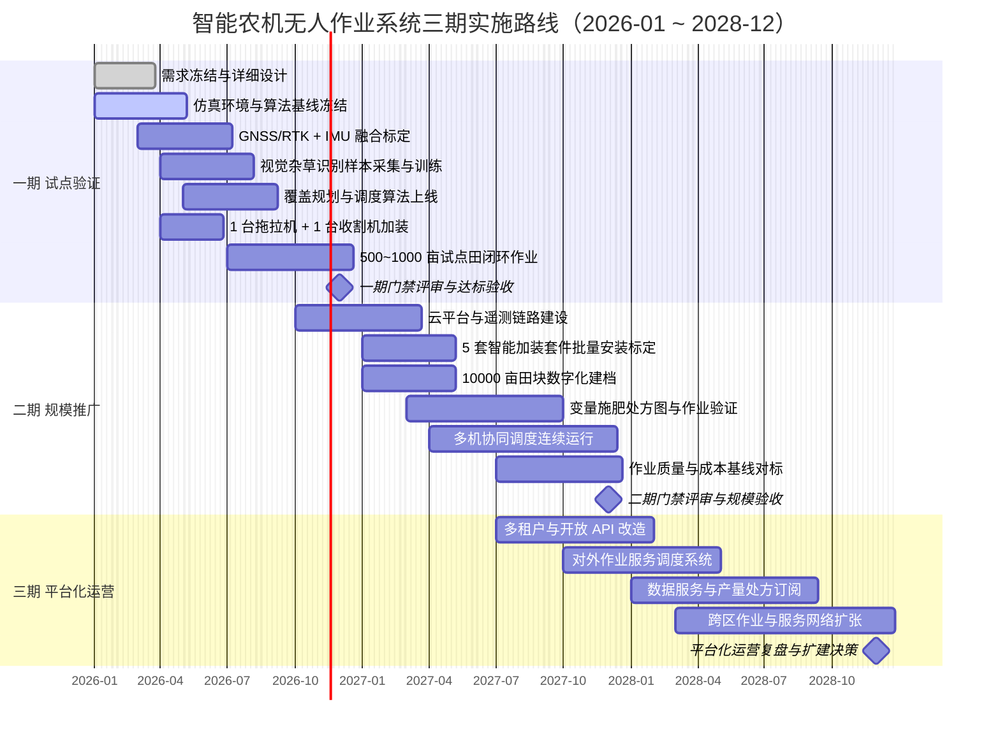
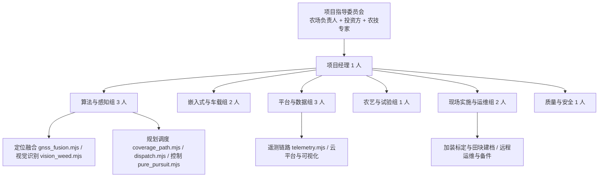

# 智能农机无人作业系统 —— 实施路线与效益分析

| 项目 | 内容 |
| --- | --- |
| 文档编号 | docs/07_实施路线与效益分析.md |
| 依托原型 | **Node.js v24.19.0**，纯 ESM (`.mjs`)，仅用 `node:fs` / `node:path` / `node:url` / `node:assert` 等内置模块，无第三方依赖 |
| 运行与自检 | `node src\cli.mjs`（工作目录固定 `D:\work\smart-agri-machinery`）；`node src\selftest.mjs`（横向误差 RMS < 0.1 m、重叠率 5%~15%、覆盖率 > 98%、调度优于基线、CAN 编解码往返一致、故障 100% 检出；失败非零退出） |
| 测算规模与价格 | 大田 **10 000 亩**（≈666.7 hm²），小麦—玉米一年两熟；人民币，2025 年不变价 |
| 评价期与折现率 | 10 年，基准折现率 **8%** |

本文档给出无人作业系统从**试点验证**→**规模推广**→**平台化运营**的三期实施路线、硬件与软件投资清单、单亩作业成本测算、静态与动态投资回收期、节本/增效/增收效益测算、敏感性分析、风险登记册与组织人员配置。模块名、参数与阈值均与冻结架构一致，可直接与 `src/` 下各模块实测输出对账。

## 1. 三期实施路线

### 1.1 分期原则
1. **能力可验证**：每期结束必须产出可被 `node src\selftest.mjs` 扩展用例自动断言的量化结论，禁止以"演示通过"作为门禁。
2. **投资滞后于验证**：一期只部署 1 台拖拉机 + 1 台收割机加装套件；500~1000 亩试点田横向误差 RMS、覆盖率、故障检出率达标后才释放二期资金。
3. **数据资产先行**：`src/sim/field_simulator.mjs` 的合成地块、作物行、GNSS/IMU 轨迹与合成农田影像在试点前固化为回归基线，真机数据未到位时研发不停摆。
4. **风险逐期外移**：技术风险一期消化，市场与作业组织风险二期消化，政策与数据合规风险三期消化。

### 1.2 总体甘特图


### 1.3 一期：试点验证（第 1~12 月，投资 48.80 万元）
目标：证明算法链路在真实田间闭环成立，把不确定性收敛到可投资的程度。

| 工作包 | 关键活动 | 验证判据（对应模块） |
| --- | --- | --- |
| WP1 仿真基线 | 固化 `createRng(seed)`、`makeRectangleField()`、`makeLShapeField()`、`makeConvexPolygonField()`、`generateCropRows()` | 同 seed 下 `runFusionScenario()`、`runWeedDetection()`、`runTelemetryScenario()` 逐位可复现 |
| WP2 定位融合 | `class ExtendedKalmanFilter` + `class GnssImuFusion` 参数辨识；RTK 固定解 sigma=0.010 m、浮点解 0.20 m、DGPS 0.50 m、单点 1.50 m；双天线定向 sigma_theta=0.3° | 横向误差 RMS < 0.1 m；NIS 卡方门限 2 自由度 99% 分位 **9.21**、1 自由度 **6.63** 的越界率落在 1%±0.5% |
| WP3 视觉识别 | ExG = 2G − R − B 阈值 20、8 邻域两遍法（并查集）连通域、1 m×1 m 密度栅格 | 0.02 m/px、640×480 px（12.8 m×9.6 m）合成影像上杂草精确率 / 召回率 / F1 达标 |
| WP4 路径规划 | `class CoveragePlanner`、`offsetPolygon()`、`boustrophedonPath()`、`dubinsPath()`、`turnCostModel()`、`rasterizeCoverage()` | 幅宽 3.0/4.5/6.0 m、重叠率 8%、最小转弯半径 4.0 m（拖拉机）/5.5 m（收割机）、地头宽 6.0 m 下覆盖率 > 98% |
| WP5 单机加装 | 1 台东方红 LX2204 + 1 台雷沃谷神 GM100 加装套件（UM982、ADIS16470、RK3588 终端） | 直线精度 ±2.5 cm（对齐 GB/T 43478-2023） |
| WP6 田间试验 | 500~1000 亩试点田，耕整—播种—植保—收获全环节无人作业 | 每环节留 3 条人工驾驶对照条带，记录油耗、工时、作业质量 |

阶段交付物：仿真回放包（三类地块 × 5 seed，JSON + PNG 栅格图）；定位融合标定报告（Allan 方差、NIS 残差直方图、丢星 >2.0 s 转航位推算记录）；视觉识别田间验证报告（精确率 / 召回率 / F1，按光照与土壤含水率分层）；加装套件安装工艺卡与线束图（CAN / ISOBUS 接口定义）；试点田作业台账（亩均油耗、亩均工时、横向误差分布）；**门禁结论：`node src\selftest.mjs` 扩展用例全绿且真实田间横向误差 RMS < 0.10 m**。

### 1.4 二期：规模推广（第 10~24 月，追加投资 99.35 万元）
目标：把单机能力扩展为 10 000 亩级多机协同生产系统，建立成本与作业质量基线。

| 工作包 | 关键活动 | 验证判据 |
| --- | --- | --- |
| WP7 云端与遥测 | `class EdgeTelemetryGateway`、`class TelemetryCloud`、`class AnomalyDetector` 部署；J1939 29 位标识符 Priority(3)/EDP(1)/DP(1)/PF(8)/PS(8)/SA(8)；PGN 65262 / 61444 / 65266 / 65265 与 DM1 PGN 65226 | 1 Hz 采样 → 边缘编码 → 批量上行（模拟 1% 丢包、120 ms 时延）往返一致；故障注入 100% 检出 |
| WP8 批量加装 | 5 套智能套件（拖拉机 + 收割机 + 边缘终端）安装标定 | 每台车连续 50 h 无定位失锁；CAN 报文零错帧 |
| WP9 田块建档 | 10 000 亩田块边界、机耕道、障碍物、作物行向数字化 | 多边形面积与 `polygonArea()` 抽检误差 < 0.5% |
| WP10 变量作业 | `class DispatchOptimizer` 协同调度 + 处方图下发（ISO 11783-10 Task Controller 语义） | 目标 J 对比 `baselineNaiveAssignment()` 改进 > 10% |
| WP11 多机协同 | 2-opt / Or-opt / 机间交换局部搜索；权重 w1=1.0、w2=0.35、w3=0.20、w4=0.15、w5=5.0 | 完工时间、空驶里程、等待时间进入设定区间 |
| WP12 成本对标 | 与传统人工驾驶逐项对标（燃油、人工、折旧、维修、保险、通信） | 单亩作业成本差异在 ±8% 以内且可逐项解释 |

阶段交付物：云端平台 v1（Kubernetes + MQTT/Kafka + TimescaleDB/InfluxDB，支持 6 台车 + 2 架无人机并发接入）；多机协同作业计划与甘特图（`extractGantt()` 输出）；10 000 亩田块数字档案与作物行矢量图层；变量施肥 / 变量喷药处方图集与执行记录；作业质量与成本基线报告；**门禁结论：连续 3 个作业季无重大安全事故，调度目标函数较基线改进 ≥ 10%，成本模型偏差 ≤ 8%**。

### 1.5 三期：平台化运营（第 19~36 月，追加投资 25.00 万元）
目标：把自有 10 000 亩跑通的系统产品化，向周边经营主体输出作业服务与数据服务。

| 工作包 | 关键活动 | 产出 |
| --- | --- | --- |
| WP13 多租户 | 账号 / 组织 / 田块 / 机具 / 任务五级模型 + 数据行级隔离 | 支持 ≥ 20 个经营主体在线 |
| WP14 开放 API | 任务下发、轨迹回传、作业报告、处方图订阅四类 REST 接口 | 第三方农机终端与农服平台可对接 |
| WP15 服务调度 | 自有 10 000 亩 + 对外 2 500 亩当量跨区作业排程 | 对外作业服务单价 200 元/亩（全托管综合口径） |
| WP16 数据服务 | 产量分布图、杂草密度图（`weedDensityGrid()`）、田块处方订阅 | 按亩订阅制收费 |
| WP17 运维体系 | 备件库、远程诊断（`class AnomalyDetector` 规则 + 3-sigma + EWMA λ=0.2）、SLA ≤ 4 h 到场 | 全年可用率 ≥ 98% |

阶段交付物：多租户平台 v2、开放 API 文档与 SDK、对外服务合同模板与结算系统、备件与远程运维 SOP、三期投资决策报告。

### 1.6 阶段门禁汇总
| 门禁 | 节点 | 量化判据 | 未通过处置 |
| --- | --- | --- | --- |
| G1 仿真基线冻结 | M3 | 三类地块 × 5 seed 可复现；导出符号与冻结清单完全一致 | 冻结新功能，回到仿真 |
| G2 定位达标 | M6 | 横向误差 RMS < 0.10 m；NIS 越界率 1%±0.5% | 延长标定，暂缓采购 |
| G3 感知达标 | M9 | 杂草识别 F1 ≥ 0.80；1 m×1 m 密度栅格与人工计数相关性 ≥ 0.85 | 补充田间样本重训 |
| G4 试点验收 | M12 | 覆盖率 > 98%、重叠率 5%~15%、`selftest.mjs` 全绿 | 冻结投资，重评二期 |
| G5 规模验收 | M24 | 调度改进 ≥ 10%；故障检出率 100%；成本模型偏差 ≤ 8% | 缩减机队规模 |
| G6 平台验收 | M36 | ≥ 20 个主体在线；对外作业净贡献 ≥ 25 万元/年 | 平台退回内部工具 |

## 2. 硬件选型清单与成本估算

单价为含税到货价（万元），差旅与吊装另计；"口径"列区分农机整机与无人化增量。总计 **148.15 万元（增量）/ 409.15 万元（含整机）**。

| 序号 | 分类 | 项目 / 型号规格 | 单价（万元） | 数量 | 小计（万元） | 口径 |
| --- | --- | --- | ---: | ---: | ---: | --- |
| A1 | 农机整机 | 东方红 LX2204 轮式拖拉机，162 kW/220 hp，CVT/动力换挡 | 42.00 | 2 | 84.00 | 整机 |
| A2 | 农机整机 | 丰疆智能 FJ-1004 无人驾驶拖拉机（北斗 RTK 终端，直线精度 ±2.5 cm） | 28.00 | 2 | 56.00 | 整机 |
| A3 | 农机整机 | 雷沃谷神 GM100 联合收割机，喂入量 10 kg/s，割幅 5.0 m | 68.00 | 1 | 68.00 | 整机 |
| A4 | 农机整机 | 沃得锐龙 4LZ-6.0 联合收割机，喂入量 6 kg/s，割幅 2.6 m | 26.00 | 1 | 26.00 | 整机 |
| A5 | 农机整机 | 久保田 NSPU-68C 高速插秧机，6 行，行距 0.30 m | 14.00 | 1 | 14.00 | 整机 |
| A6 | 农机整机 | 大疆 T60 农业无人机，喷洒 50 L / 播撒 60 kg | 6.50 | 2 | 13.00 | 整机 |
| A7 | **加装套件** | 拖拉机自动辅助驾驶套件：UM982 双天线 RTK + ADIS16470 + 电控转向 + 终端 + 线束 | 6.80 | 4 | 27.20 | 增量 |
| A8 | **加装套件** | 收割机智能套件：自动驾驶 + 割台仿形 + 智能测产（ISO 11783-10 语义） | 9.50 | 2 | 19.00 | 增量 |
| B1 | **传感器** | 和芯星通 UM982 双天线 RTK 板卡模块（固定解 ±2 cm + 1 ppm） | 0.680 | 6 | 4.08 | 增量 |
| B2 | **传感器** | ADI ADIS16470 工业级 IMU（零偏稳定性 8 °/h） | 1.350 | 6 | 8.10 | 增量 |
| B3 | **传感器** | Bosch BMI088 MEMS IMU（备份 / 低成本单元） | 0.032 | 4 | 0.13 | 增量 |
| B4 | **传感器** | 海康 MV-CA050-10GC 工业相机 + Sony IMX264 全局快门 | 0.650 | 4 | 2.60 | 增量 |
| B5 | **传感器** | 12 mm 定焦镜头 + IP66 防护罩 + 频闪补光 | 0.350 | 4 | 1.40 | 增量 |
| B6 | **传感器** | 禾赛 JT16 16 线激光雷达 | 2.800 | 2 | 5.60 | 增量 |
| B7 | **传感器** | 速腾聚创 RS-Helios-16P 16 线激光雷达 | 2.600 | 2 | 5.20 | 增量 |
| C1 | **边缘终端** | 瑞芯微 RK3588 车载智能终端，6 TOPS NPU，8 GB+128 GB，CAN×2 | 0.85 | 6 | 5.10 | 增量 |
| C2 | **边缘终端** | 12.1 寸车载触控屏 + ISOBUS 虚拟终端软件 | 0.45 | 6 | 2.70 | 增量 |
| C3 | **边缘终端** | 工业交换机、线束、接插件、安装支架 | 0.25 | 6 | 1.50 | 增量 |
| C4 | **边缘终端** | 宽压 DC/DC + 车载 UPS（掉电保护 30 s） | 0.12 | 6 | 0.72 | 增量 |
| D1 | **通信** | 5G/4G 工业级车载路由器，双卡，IP67，−40~+85 ℃ | 0.38 | 6 | 2.28 | 增量 |
| D2 | **通信** | 定向高增益 5G 天线 + 低损耗馈线 | 0.09 | 6 | 0.54 | 增量 |
| D3 | **通信** | 千寻位置 FindCM 高精度差分账号（备份：华测 / 中海达 CORS） | 0.12/年 | 6 | 0.72/年 | 年费 |
| D4 | **通信** | 物联网卡流量 20 GB/月·台 | 0.006/月 | 72 台月 | 0.43/年 | 年费 |
| E1 | **云端** | 应用服务器 16 vCPU / 32 GB / NVMe | 5.5 | 3 | 16.50 | 增量 |
| E2 | **云端** | GPU 推理服务器（视觉杂草模型在线推理） | 8.5 | 1 | 8.50 | 增量 |
| E3 | **云端** | 分布式存储 NVMe 8 TB×2 + 对象存储网关 + 离线备份 | 4.0 | 1 | 4.00 | 增量 |
| E4 | **云端** | 下一代防火墙、VPN 网关、日志审计（GB/T 22239-2019 二级整改） | 6.0 | 1 | 6.00 | 增量 |
| E5 | **云端** | Kafka / MQTT Broker / TimescaleDB / InfluxDB + Prometheus/Grafana 商业支持 | 3.0/年 | 1 | 3.00/年 | 年费 |
| E6 | **云端** | IDC 托管 2 个 42U 机柜 + 双线 100 Mbps + 域名证书 | 4.8/年 | 1 | 4.80/年 | 年费 |
| F1 | 配套 | 机棚 / 充电设施土建配套 | 12.00 | 1 | 12.00 | 增量 |
| F2 | 配套 | 安装调试与系统集成实施 | 15.00 | 1 | 15.00 | 增量 |
| | | **合计（A 小计 307.20；B 27.11；C 10.02；D 2.82；E 35.00；F 27.00）** | | | **增量 148.15 / 全量 409.15** | |

> 若以公有云替代 E1~E4，年化资源费约 12.0 万元/年（10 000 亩规模），5 年总拥有成本与自建接近；本测算按自建口径以保持资产与折旧口径一致。

### 2.1 分期投资分解（方案 I 增量 148.15 万元）
| 期次 | 覆盖规模 | 投资（万元） | 占比 | 主要构成 |
| --- | --- | ---: | ---: | --- |
| 一期 试点验证 | 500~1000 亩、1 拖拉机 + 1 收割机 | 48.80 | 32.9% | A7×1 6.80、A8×1 9.50、B 一套 5.86、C 一套 1.67、D 一套 0.47、E 最小平台 13.50、F 11.00 |
| 二期 规模推广 | 10 000 亩、6 台车 + 2 架无人机 | 99.35 | 67.1% | A7×3 20.40、A8×1 9.50、B 余量 21.25、C 余量 8.35、D 余量 2.35、E 余量 21.50、F 16.00 |
| 三期 平台化运营 | 自有 10 000 亩 + 对外 2 500 亩当量 | 25.00 | 另计 | 多租户、开放 API、服务调度、数据服务（软件为主） |

## 3. 软件与人力成本

### 3.1 自研模块工作量（Node.js ESM，无第三方依赖）
| 模块文件 | 功能要点 | 人月 |
| --- | --- | ---: |
| `src/sim/field_simulator.mjs` | `createRng(seed)`、`polygonArea()`、`pointInPolygon()`、`makeRectangleField()`、`makeLShapeField()`、`makeConvexPolygonField()`、`generateCropRows()`、`simulateGnssTrack()`、`simulateImu()`、`makeSyntheticFieldImage()`、`MACHINE_TYPES` | 2.0 |
| `src/perception/gnss_fusion.mjs` | `class ExtendedKalmanFilter`、`class GnssImuFusion`、`wrapAngle()`、`matInverse()`、`runFusionScenario()`；状态 x=[x, y, theta, v, omega]，控制 u=[a, alpha] | 2.5 |
| `src/perception/vision_weed.mjs` | `exgIndex()`、`segmentVegetation()`、`morphOpen()`、`morphClose()`、`connectedComponents()`、`classifyComponents()`、`weedDensityGrid()`、`runWeedDetection()` | 3.0 |
| `src/planning/coverage_path.mjs` | `class CoveragePlanner`、`offsetPolygon()`、`boustrophedonPath()`、`dubinsPath()`、`turnCostModel()`、`rasterizeCoverage()` | 3.5 |
| `src/planning/dispatch.mjs` | `class DispatchOptimizer`、`baselineNaiveAssignment()`、`objectiveFunction()`、`extractGantt()` | 3.0 |
| `src/control/pure_pursuit.mjs` | `class PurePursuitController`、`planSpeedProfile()`、`simulateTracking()`、`crossTrackError()`；轴距 L=2.6 m、最大前轮转角 35°、转向速率 25°/s、最大车速 3.0 m/s、a_lat_max=1.5 m/s²、闭环 0.02 s（50 Hz） | 2.5 |
| `src/cloud/telemetry.mjs` | `encodeCanFrame()` / `decodeCanFrame()`、`encodeDtc()` / `decodeDtc()`、`class EdgeTelemetryGateway`、`class TelemetryCloud`、`class AnomalyDetector`、`runTelemetryScenario()` | 3.0 |
| `src/cli.mjs` | 端到端主线：仿真地块 → 全覆盖规划 → 多机调度 → 闭环跟踪 → 视觉识别 → 遥测监控 → `data/run_result.json` + 中文作业报告 | 1.5 |
| `src/selftest.mjs` | 断言体系与回归基线 | 1.0 |
| 平台前后端（Web 可视化、任务管理、API 网关、K8s 运维） | — | 18.0 |
| 嵌入式与车载适配（CAN 驱动、ISOBUS 虚拟终端、液压转向标定） | — | 10.0 |
| 农艺模型与田间试验（变量施肥处方、效果验证） | — | 8.0 |
| 测试与质量保证 | — | 6.0 |
| **合计** | | **64.0** |

| 岗位类别 | 人月 | 单价（万元/人月） | 小计（万元） |
| --- | ---: | ---: | ---: |
| 算法与核心模块（混合单价） | 22.0 | 2.80 | 61.60 |
| 平台前后端 | 18.0 | 2.80 | 50.40 |
| 嵌入式与车载 | 10.0 | 3.00 | 30.00 |
| 农艺与试验 | 8.0 | 2.00 | 16.00 |
| 测试与质量 | 6.0 | 2.00 | 12.00 |
| **软件人力小计** | **64.0** | — | **170.00** |

### 3.2 第三方软件与总投资汇总
| 项目 | 金额 | 性质 |
| --- | ---: | --- |
| ISOBUS 协议栈与虚拟终端商业授权 | 8.00 万元 | 一次性 |
| GIS / 农机作业地图引擎与底图数据 | 3.00 万元/年 | 年费 |
| 遥感影像与农业气象数据服务 | 2.00 万元/年 | 年费 |
| 开发工具链、CI/CD、代码扫描与安全测试平台 | 2.50 万元/年 | 年费 |

| 投资口径 | 金额（万元） |
| --- | ---: |
| 硬件与集成（方案 I，一期 + 二期） | 148.15 |
| 自研软件与人力（170.00 + 8.00 授权） | 178.00 |
| 三期平台化追加（软件为主） | 25.00 |
| **合计（含自研软件）** | **351.15** |
| 年运营性支出（通信 1.15 + 云 7.80 + 第三方 7.50） | 16.45 万元/年 |

## 4. 单亩作业成本对比（传统人工 vs 无人化）

口径为**农机作业环节**，不含种子、化肥、农药等物化投入（后者在第 6 节单独计入"节本"）。分母为 10 000 亩、一年两熟。

```text
C_total = C_fuel + C_labor + C_dep + C_maint + C_elec + C_ins + C_comm + C_mgmt
亩均人工 = (n_固定 × 200 元/人日 × 220 日 + n_季节 × 200 元/人日 × 50 日) / 10000
亩均燃油 = q_fuel × P_diesel ,  q_fuel = 2.5 L/亩 ,  P_diesel = 7.5 元/L
年折旧   = V_i × (1 − r_s) / N_i ,  管理费 = 作业成本小计 × 5%
```

| 参数 | 传统人工驾驶 | 无人化 | 依据 |
| --- | ---: | ---: | --- |
| 亩均柴油消耗 | 2.8 L/亩 | **2.5 L/亩** | 自动导航直线度 ±2.5 cm 减少重叠，由 `rasterizeCoverage()` 0.25 m 栅格校验 |
| 柴油单价 | 7.5 元/L | 7.5 元/L | 0# 柴油，2025 年不变价 |
| 固定用工 / 季节用工 | 10 人 / 8 人×50 日 | 5 人 / 3 人×50 日 | 无人化后 1 人可监管多台车 |
| 人工单价 | 200 元/人日 | 200 元/人日 | 给定参数 |
| 作业效率 | 基准 100% | **125%（提升 20%~30% 取中值）** | 可连续作业、无换班停机 |
| 折算年作业能力 | 10 000 亩 | 12 500 亩 | 效率红利的产能价值见 4.2 节 |

### 4.1 亩均作业成本对比表（元/亩·年）
| 成本项 | 传统人工驾驶 | 无人化 | 差额 | 说明 |
| --- | ---: | ---: | ---: | --- |
| 燃油费 | 21.00 | 18.75 | **−2.25** | 2.8 → 2.5 L/亩，重叠率由 15% 降至 8% |
| 人工费 | 52.00 | 25.00 | **−27.00** | 固定 10 → 5 人，季节工 8 → 3 人 |
| 机具折旧 | 27.22 | 48.53 | **+21.30** | 农机折旧 27.22（LX2204×2 7.56、FJ-1004×2 5.04、GM100 7.65、4LZ-6.0 2.93、NSPU-68C 1.58、T60×2 2.47）；智能装备折旧 21.30（套件 5.49 + 传感器 5.15 + 边缘 1.90 + 通信 0.56 + 云端 7.00 + 土建 1.20），按平均年限法、残值率 0~10% |
| 维修保养 | 13.05 | 17.57 | **+4.52** | 农机按原值 5%/年 = 13.05；智能硬件按 3%/年 = 2.58；通信与云运维外包 1.94 |
| 电力（无人机充换电） | 0.00 | 0.85 | **+0.85** | 1.05 kWh/亩·年 × 0.81 元/kWh（含充电损耗） |
| 保险 | 3.13 | 4.17 | **+1.03** | 按（农机 261.00 + 智能硬件 86.15）× 1.2% |
| 通信与云服务 | 0.00 | 8.95 | **+8.95** | 差分 0.72 + 流量 0.43 + 中间件 3.00 + IDC 4.80 |
| **小计** | **116.40** | **123.82** | **+7.42** | |
| 管理费（小计 × 5%） | 5.82 | 6.19 | +0.37 | |
| **合计** | **122.22** | **130.01** | **+7.79** | 无人化高 **6.4%** |

**关键结论**：单看"作业成本"，无人化在 10 000 亩规模上并不便宜，反而高 7.79 元/亩·年。人工与燃油的结构性节约（29.25 元/亩）被智能装备折旧与云服务（30.25 元/亩）抵消；真正的价值来自 (a) 效率提升释放的产能、(b) 精准作业带来的物化投入节约与产量增益，(c)(a)(b) 二者均不体现在自营亩均作业成本里。

### 4.2 效率提升的产能价值
```text
A_cap  = 10000 × η = 12500 亩 ,  η = 1.25
摊销折旧 = 48.53 × 10000 / 12500 = 38.82 元/亩（产能充分利用口径；自营 10000 亩口径仍为 48.53）
富余产能 = 10000 × 25% = 2500 亩当量
单位边际贡献 = 200 − 44.75 = 155.25 元/亩（变动成本：燃油 18.75 + 维修 8.00 + 临时人工 12.00 + 管理 6.00）
总边际贡献   = 155.25 × 2500 / 10000 = 38.81 万元/年
分摊增量固定成本 = (21.30 + 8.95 + 2.58 + 1.03) × 30% = 10.16 万元/年
对外服务净贡献   = 38.81 − 10.16 = 28.65 万元/年
```

## 5. 投资回收期计算

### 5.1 现金流量表（方案 I：增量硬件口径 148.15 万元）
年化收益见第 6 节：二期满负荷（自营 10 000 亩）**59.91 万元/年**，三期满负荷（含对外服务）**88.56 万元/年**。第 5 年按智能装备 5 年寿命重投感知与边缘设备 39.95 万元（B + C + D = 27.11 + 10.02 + 2.82）。

| 年份 | 0 | 1 | 2 | 3 | 4 | 5 | 6 | 7 | 8 | 9 | 10 |
| --- | ---: | ---: | ---: | ---: | ---: | ---: | ---: | ---: | ---: | ---: | ---: |
| 阶段 | 建设 | 一期 | 二期爬坡 | 二期满负荷 | 三期爬坡 | 三期满负荷 | 满负荷 + 重投 | 满负荷 | 满负荷 | 满负荷 | 满负荷 |
| 净现金流量（万元） | −148.15 | 5.31 | 35.95 | 59.91 | 74.24 | 88.56 | 48.61 | 88.56 | 88.56 | 88.56 | 88.56 |
| 累计净现金流（万元） | −148.15 | −142.84 | −106.89 | −46.98 | 27.26 | 115.82 | 164.43 | 252.99 | 341.55 | 430.11 | 518.67 |

> 首年系数 0.06 = 试点规模 10%（1 000 亩 / 10 000 亩）× 爬坡系数 0.6；二期爬坡系数 0.6；三期首年对外服务仅达 50%。

### 5.2 评价指标（三种投资口径）
| 口径 | 投资额（万元） | 静态回收期（年） | 动态回收期 i=8%（年） | NPV(8%, 10 年)（万元） | IRR |
| --- | ---: | ---: | ---: | ---: | ---: |
| **方案 I 增量硬件（推荐）** | 148.15 | **3.63** | **4.17** | **265.46** | **30.74%** |
| 方案 I + 自研软件与人力 | 351.15 | 6.44 | 8.52 | 62.46 | 11.05% |
| 方案 II 全量新建机队（含整机） | 409.15 | 7.09 | 9.89 | 4.46 | 8.20% |

**解读**：增量硬件口径静态回收期 3.63 年、动态回收期 4.17 年、IRR 30.74%，显著高于 8% 基准折现率，项目具备投资价值。若把 170 万元自研软件人力全部计入本农场，IRR 降至 11.05%、动态回收期 8.52 年——说明**自研软件必须通过多农场、多客户摊销**才成立，这正是三期平台化运营的必要性。方案 II IRR 8.20% 仅略高于折现率，整机投资应由农机作业服务收入覆盖，不宜作为本项目评价口径。

计算公式与 Node.js 实现：

```text
T_static = (m − 1) + |Σ_{t=1}^{m−1} CF_t| / CF_m = (4 − 1) + 46.98 / 74.24 = 3.63 年
T_dyn    = (m − 1) + |Σ_{t=1}^{m−1} CF_t (1+i)^(−t)| / [ CF_m (1+i)^(−m) ] ,  i = 8%
NPV(i)   = Σ_{t=1}^{n} CF_t (1+i)^(−t) − I_0 ,  n = 10 ;  IRR 为 NPV(r) = 0 的根
```

```js
// 现金流评价工具：静态 / 动态回收期、NPV、IRR（仅用 Node 内置能力）
export function npv(rate, cf, i0) {
  let v = -i0;
  for (let t = 1; t < cf.length; t++) v += cf[t] / Math.pow(1 + rate, t);
  return v;
}
export function payback(cf, i0, rate = 0) {
  let acc = -i0;
  for (let t = 1; t < cf.length; t++) {
    const d = cf[t] / Math.pow(1 + rate, t), prev = acc;
    acc += d;
    if (acc >= 0) return (t - 1) + (-prev) / d;   // 线性插值
  }
  return Infinity;
}
export function irr(cf, i0, lo = -0.9, hi = 5.0) {
  for (let k = 0; k < 300; k++) {
    const mid = (lo + hi) / 2;
    if (npv(mid, cf, i0) > 0) lo = mid; else hi = mid;
  }
  return (lo + hi) / 2;
}
const CF = [0, 5.31, 35.95, 59.91, 74.24, 88.56, 48.61, 88.56, 88.56, 88.56, 88.56];
// payback(CF,148.15)=3.63 ; payback(CF,148.15,0.08)=4.17 ; npv(0.08,CF,148.15)=265.46 ; irr(CF,148.15)=0.3074
```

## 6. 效益测算（大田 10 000 亩年化）

### 6.1 节本
| 项目 | 测算过程 | 年化（万元） |
| --- | --- | ---: |
| 人工节约 | (52.00 − 25.00) 元/亩 × 10 000 亩 | 27.00 |
| 燃油节约 | (21.00 − 18.75) 元/亩 × 10 000 亩 | 2.25 |
| 种子节约 | 65 元/亩 × 3%（精准播种行距一致性） | 1.95 |
| 农药节约 | 120 元/亩 × 10%（`weedDensityGrid()` 1 m×1 m 处方喷洒） | 12.00 |
| 减少重喷漏喷与地头重叠 | 重叠率 15% → 8%（0.25 m 栅格校验） | 8.00 |
| 变量施肥节约（二期起） | 化肥 300 元/亩 × 5%（ISO 11783-10 处方图） | 15.00 |
| **节本毛额** | | **66.20** |
| 减：新增智能装备折旧 | 见 4.1 节 | −21.30 |
| 减：通信与云服务年费 | 差分 0.72 + 流量 0.43 + 中间件 3.00 + IDC 4.80 | −8.95 |
| 减：智能装备维修（故障率 3%） | 86.15 × 3% | −2.58 |
| 减：保险增量 | (261.00 + 86.15) × 1.2% − 261.00 × 1.2% | −1.03 |
| 减：无人机电力 | 1.05 kWh/亩·年 × 0.81 元/kWh | −0.85 |
| **净节本** | | **31.49** |

### 6.2 增效（效率提升释放产能）
富余产能 10 000 × 25% = 2 500 亩当量；对外全托管服务单价 200 元/亩；单位边际贡献 155.25 元/亩；总边际贡献 38.81 万元/年；分摊增量固定成本 10.16 万元/年；**增效净贡献 28.65 万元/年**。效率提升 25% 还使播期由 10 天压缩到 7 天完成，保障小麦适期播种，该项已计入 6.3 增收，不重复计算。

### 6.3 增收（产量、损失与品质）
```text
P0 = 小麦 450 kg/亩 × 2.4 元/kg + 玉米 600 kg/亩 × 2.2 元/kg = 1080 + 1320 = 2400 元/亩
κ  = κ0 × (1 − 2f) = 0.60 × (1 − 2 × 3%) = 0.564
亩均增收 = 2400 × 2.1% × 0.564 = 28.43 元/亩 → 年化 28.43 万元
```

| 增益来源 | 幅度 | 折算（元/亩） |
| --- | ---: | ---: |
| 适期播种与精准作业增产 | +1.0% | 24.00 |
| 机收损失率由 4.0% 降至 3.4%（割台仿形 + 智能测产） | −0.6 个百分点 | 14.40 |
| 品质溢价（籽粒破损率下降、含水率一致） | +0.5% | 12.00 |
| **理论增益合计** | **+2.1%** | **50.40** |
| 按捕获率 κ = 0.564 折算后 | — | **28.43** |

### 6.4 年化收益汇总
| 效益构成 | 一期（试点） | 二期（满负荷） | 三期（满负荷） |
| --- | ---: | ---: | ---: |
| 节本（净额，万元/年） | 16.48 | 31.49 | 31.49 |
| 增效（对外服务净贡献，万元/年） | 0 | 0 | 28.65 |
| 增收（万元/年） | 按试点规模折算 | 28.43 | 28.43 |
| **年化总收益（万元/年）** | — | **59.91** | **88.56** |
| 折合亩均（元/亩·年） | — | 59.91 | 88.56 |

## 7. 敏感性分析

| 因素 | 水平 | 亩均影响 | 二期年化收益（万元） | 三期年化收益（万元） | 硬件口径静态回收期（年） | 硬件口径动态回收期（年） |
| --- | ---: | --- | ---: | ---: | ---: | ---: |
| **柴油价格（元/L）**，影响 2.5 L/亩 × ΔP × 10000 亩 | 6.0（−20%） | 燃油 15.00 元/亩 | 63.66 | 92.31 | 3.51 | 4.02 |
| | **7.5（基准）** | **燃油 18.75 元/亩** | **59.91** | **88.56** | **3.63** | **4.17** |
| | 9.0（+20%） | 燃油 22.50 元/亩 | 56.16 | 84.81 | 3.77 | 4.33 |
| **作业单价（元/亩）**，影响 ΔP × 2500 亩 | 160（−20%） | 边际贡献 115.25 元/亩 | 59.91 | 78.56 | 4.02 | 4.62 |
| | **200（基准）** | **边际贡献 155.25 元/亩** | **59.91** | **88.56** | **3.63** | **4.17** |
| | 240（+20%） | 边际贡献 195.25 元/亩 | 59.91 | 98.56 | 3.33 | 3.80 |
| **智能装备故障率 f**，影响维修 86.15×f 与捕获率 κ0(1−2f) | 1% | 维修 0.86 万元，增收 29.64 万元 | 62.84 | 91.49 | 3.51 | 4.01 |
| | **3%（基准）** | **维修 2.58 万元，增收 28.43 万元** | **59.91** | **88.56** | **3.63** | **4.17** |
| | 6% | 维修 5.17 万元，增收 26.61 万元 | 55.51 | 84.16 | 3.81 | 4.40 |

**组合情景**：最不利（柴油 9.0 元/L + 服务单价 160 元/亩 + 故障率 6%）年化收益 70.41 万元，静态回收期 4.5 年；基准 88.56 万元 / 3.63 年；最有利（6.0 元/L + 240 元/亩 + 1%）105.24 万元 / 3.1 年。

**敏感性排序**：作业单价（±20% → 三期收益 ±11.3%）> 故障率（1% → 6% → 二期收益 −7.3%）> 柴油价格（±20% → 二期收益 ±6.3%）。项目经济性对**服务单价与设备可靠性**最敏感，因此三期市场开拓与二期可靠性工程是收益达成的两个关键抓手。

## 8. 风险登记册

评分规则：风险值 R = P × I，P 为概率（1 极低 ~ 5 极高），I 为影响（1 轻微 ~ 5 严重）。R ≥ 15 为高风险（红），8 ≤ R < 15 为中风险（黄），R < 8 为低风险（绿）。本表全部为中风险，需按季度跟踪。

| 编号 | 类别 | 风险描述 | P | I | R | 等级 | 对策 | 责任方 | 触发信号 |
| --- | --- | --- | :-: | :-: | :-: | :-: | --- | --- | --- |
| T-01 | 技术 | 树荫、高压线、地头遮挡导致无 RTK 固定解，`class GnssImuFusion` 长时间降级 | 3 | 4 | 12 | 黄 | 丢星 >2.0 s 转航位推算并膨胀协方差；千寻 FindCM + 自建基准站双路；IMU 与视觉里程计辅助 | 感知组 | NIS 越界率 > 2%；浮点解占比 > 5% |
| T-02 | 技术 | 强光、露水、土壤色变下 ExG > 20 阈值失配，`exgIndex()` 分割退化 | 4 | 3 | 12 | 黄 | 自适应阈值 + 多光谱通道；按土壤类型分层重训；保留人工复核兜底 | 算法组 | 杂草识别 F1 < 0.75 连续 3 天 |
| T-03 | 技术 | L 形与凸多边形地块下 `offsetPolygon()` 自交，覆盖率不达标 | 3 | 4 | 12 | 黄 | 自交检测与分割重规划；地头宽固定 6.0 m（= 2 个幅宽）；`rasterizeCoverage()` 0.25 m 栅格逐块校验 | 规划组 | 覆盖率 < 98% |
| T-04 | 技术 | 最小转弯半径 4.0 m（拖拉机）/5.5 m（收割机）下 Π 形路径不可行 | 3 | 3 | 9 | 黄 | `turnCostModel()` 代价回溯；Ω 形（LRL/RLR）作为 Π 形（LSL/RSL）备选词；加大地头预留 | 规划组 | 转弯限速触发次数异常上升 |
| T-05 | 技术 | 智能装备年故障率高于 3%，作业窗口内停机 | 3 | 4 | 12 | 黄 | 备件库 + 远程诊断（3-sigma + EWMA λ=0.2）；IMU 与 CAN 通道双冗余；SLA ≤ 4 h | 运维组 | 单台年停机 > 40 h |
| T-06 | 技术 | 闭环跟踪横向误差 RMS 超 0.1 m，导致重播漏播 | 3 | 4 | 12 | 黄 | 自适应前视距离 Ld 按曲率缩放；横向加速度 ≤1.5 m/s²；闭环步长 0.02 s（50 Hz） | 控制组 | RMS > 0.08 m 预警 |
| M-01 | 市场 | 对外作业服务价格低于 160 元/亩，三期收益不达预期 | 3 | 4 | 12 | 黄 | 先签 3 年全托管合同锁价；"作业 + 数据 + 处方"打包；按作业质量分级定价 | 运营部 | 报价 < 170 元/亩 |
| M-02 | 市场 | 周边农户对无人作业质量不信任，接受度低 | 3 | 3 | 9 | 黄 | 试点田设对照条带并公示测产结果；引入第三方作业质量检测；首年折扣 | 运营部 | 签约亩数 < 1 500 亩 |
| M-03 | 市场 | 农机购置与作业补贴政策调整，冲击投资回收 | 2 | 4 | 8 | 黄 | 跟踪农机购置与应用补贴与报废更新补贴政策；优先选用进入补贴目录机型 | 项目部 | 补贴目录调整 |
| P-01 | 政策 | 农业无人机作业须符合《无人驾驶航空器飞行管理暂行条例》（国务院、中央军事委员会令第 761 号）实名登记、空域申请与操控员资质要求 | 4 | 3 | 12 | 黄 | 完成实名登记与操控员执照；提前申报空域；遵守真高与隔离飞行限制 | 安全员 | 空域申请被拒 |
| P-02 | 政策 | 车端与云端涉及农业生产数据与地理信息，合规要求提高 | 3 | 3 | 9 | 黄 | 按 GB/T 22239-2019 二级建设并通过测评；田块坐标脱敏存储；数据分级授权与审计日志 | 平台组 | 等保测评不达标 |
| P-03 | 政策 | 高精度地图与地理信息测绘资质要求 | 2 | 4 | 8 | 黄 | 不以测绘级精度对外发布底图；厘米级坐标仅限生产内网；与有资质单位合作 | 项目部 | 合规审查意见 |
| O-01 | 运维 | 农忙窗口期人员技能不足，无人农机接管不及时 | 3 | 4 | 12 | 黄 | "机手—运维—厂家"三级响应；每季开工前 40 h 复训；作业期双人值班 | 运维组 | 接管响应 > 30 min |
| O-02 | 运维 | 弱覆盖区遥测断连，`class EdgeTelemetryGateway` 批量上行失败 | 4 | 2 | 8 | 黄 | 边缘侧本地缓存 ≥ 72 h 断点续传；1% 丢包、120 ms 时延下已验证；双卡异网 | 平台组 | 断连 > 10 min |
| O-03 | 运维 | 差分服务账号或 IDC 托管中断 | 2 | 4 | 8 | 黄 | 双供应商差分服务；机具侧保留 72 h 星历预报；IDC 双线 + 异地备份 | 平台组 | 服务可用率 < 99% |
| O-04 | 运维 | 关键传感器（UM982、ADIS16470、工业相机）交期延长 | 3 | 3 | 9 | 黄 | 关键件安全库存 ≥ 15%；建立第二供应商（华测 / 中海达替代板卡） | 采购部 | 交期 > 8 周 |
| F-01 | 财务 | 自研软件 170 万元无法在多客户间摊销，IRR 跌至 11% | 3 | 4 | 12 | 黄 | 三期实现 ≥ 20 个经营主体在线；软件成本按 5 年、多项目分摊 | 项目部 | 付费主体 < 10 个 |

**闭环机制**：每季度一次风险评审；R ≥ 15 的风险进入周跟踪，责任方提交带日期的缓解计划；触发信号出现即升级至项目负责人，5 个工作日内出具处置方案。

## 9. 组织与人员配置



### 9.1 建设期人员配置（第 1~24 月，13 人）
| 岗位 | 人数 | 主要职责 | 关键交付 |
| --- | :-: | --- | --- |
| 项目经理 | 1 | 计划、门禁评审、投资决策支持 | 三期路线与门禁报告 |
| 算法工程师（感知 / 规划 / 控制） | 3 | 定位融合、视觉识别、覆盖规划、协同调度、跟踪控制 | 横向误差 RMS < 0.1 m、覆盖率 > 98% |
| 嵌入式与车载工程师 | 2 | 加装套件电控转向、CAN / ISOBUS 接口、遥测编解码 | CAN 往返一致、PGN 报文零错帧 |
| 平台与后端工程师 | 2 | Kubernetes、MQTT/Kafka、TimescaleDB/InfluxDB、开放 API | 并发接入 ≥ 8 台设备 |
| 前端与可视化工程师 | 1 | 作业监控大屏、轨迹与栅格图层、甘特图 | 作业看板上线 |
| 测试与质量工程师 | 1 | `selftest.mjs` 扩展用例、回归基线、田间对照试验设计 | 全绿回归 + 试验报告 |
| 农艺与试验工程师 | 1 | 变量施肥处方、杂草阈值、增产效果验证 | 处方图集与效果报告 |
| 现场实施与标定 | 2 | 6 台车安装标定、10 000 亩田块建档 | 安装工艺卡、田块数字档案 |
| **合计** | **13** | | |

### 9.2 运营期人员配置（第 25 月起，7 人 + 季节工 3 人）
| 岗位 | 人数 | 职责 |
| --- | :-: | --- |
| 农场 / 项目经理 | 1 | 作业计划审批、成本与质量负责 |
| 作业调度员 | 1 | 多机协同调度计划执行与对外服务排程 |
| 无人农机安全员 / 机手 | 3 | 现场监管、异常接管、加注与转场 |
| 智能装备运维工程师 | 1 | 故障诊断、备件管理、远程运维（SLA ≤ 4 h） |
| 农艺技术员（共享 0.5 FTE） | 0.5 | 处方图生成与农艺建议 |
| 数据分析师（共享 0.5 FTE） | 0.5 | 作业质量与效益核算、模型迭代建议 |
| **固定合计** | **7** | |
| 季节性用工 | 3 人 × 50 日 | 农忙抢收与辅助作业 |

人工成本对应 4.1 节：固定 5 人（安全员 3 + 运维 1 + 调度 1）× 200 元/人日 × 220 日 = 22.00 万元，季节工 3 人 × 50 日 × 200 元 = 3.00 万元，合计 **25.00 万元/年 = 25.00 元/亩**，与 4.1 节对比表完全一致；项目经理与农艺 / 数据共享岗位计入管理费。

### 9.3 培训与能力建设
| 对象 | 内容 | 时数 | 频次 |
| --- | --- | ---: | --- |
| 安全员 / 机手 | 无人农机操作规程、应急处置、`class PurePursuitController` 参数与接管判据 | 40 h | 每季开工前 |
| 运维工程师 | RK3588 终端维护、CAN 报文诊断、`class AnomalyDetector` 告警处置 | 32 h | 每半年 |
| 调度员 | `class DispatchOptimizer` 原理、作业窗管理、异常重规划 | 24 h | 每年 |
| 农艺技术员 | `weedDensityGrid()` 栅格解读、变量处方生成与验证 | 16 h | 每年 |

### 9.4 与软件原型的指标对应关系
| 实施指标 | 阈值 | 对应模块与导出 | 验证命令 |
| --- | --- | --- | --- |
| 横向跟踪误差 RMS | < 0.1 m | `src/control/pure_pursuit.mjs` → `crossTrackError()`、`simulateTracking()` | `node src\selftest.mjs` |
| 覆盖率 / 重叠率 | > 98% / 5%~15% | `src/planning/coverage_path.mjs` → `rasterizeCoverage()`、`class CoveragePlanner` | 同上 |
| 调度优于朴素基线 | 目标 J 改进 ≥ 10% | `src/planning/dispatch.mjs` → `baselineNaiveAssignment()` | 同上 |
| CAN 编解码往返一致 / 故障检出 | 100% / 100% | `src/cloud/telemetry.mjs` → `encodeCanFrame()`、`encodeDtc()`、`class AnomalyDetector` | 同上 |
| 定位精度与降级策略 | 固定解 sigma=0.010 m；NIS 门限 9.21 / 6.63；丢星 >2.0 s 转航位推算 | `src/perception/gnss_fusion.mjs` → `runFusionScenario()` | 同上 |
| 杂草识别精度 | F1 ≥ 0.80 | `src/perception/vision_weed.mjs` → `runWeedDetection()` | 同上 |
| 端到端主线 | 生成 `data/run_result.json` 与中文作业报告 | `src/cli.mjs` | `node src\cli.mjs` |

## 参考标准与文献

### 标准与法规
1. ISO 25119-1:2018 *Tractors and machinery for agriculture and forestry — Safety-related parts of control systems — Part 1: General principles for design and development*. ISO, 2018.（同系列另有 Part 2 / 3 / 4）
2. ISO 18497-1:2024 *Agricultural machinery and tractors — Safety of partially automated, semi-autonomous and autonomous machinery — Part 1: Machine design principles and vocabulary*. ISO, 2024.
3. ISO 11783-1:2017 *Tractors and machinery for agriculture and forestry — Serial control and communications data network — Part 1: General standard for mobile data communication*. ISO, 2017.
4. ISO 11783-10:2015 *Tractors and machinery for agriculture and forestry — Serial control and communications data network — Part 10: Task controller and management information system data interchange*. ISO, 2015.
5. ISO 17989-1:2015 *Tractors and machinery for agriculture and forestry — Sustainability — Part 1: Principles*. ISO, 2015.
6. GB/T 38874.1-2020《农林拖拉机和机械 控制系统安全相关部件 第1部分：设计与开发通则》. 国家市场监督管理总局、国家标准化管理委员会, 2020.
7. GB/T 35381.1-2017《农林拖拉机和机械 串行控制和通信数据网络 第1部分：数据通信通用标准》. 2017.
8. GB/T 43478-2023《拖拉机 自动辅助驾驶系统 通用技术规范》. 2023.
9. GB 10395.1-2009《农林机械 安全 第1部分：总则》. 2009.
10. GB/T 3871.1-2006《农业拖拉机 试验规程 第1部分：通用要求》. 2006.
11. GB/T 30600-2022《高标准农田建设 通则》. 2022.（田间道 / 机耕路路面宽度 3.0~6.0 m，与本方案地头宽 6.0 m 及转场通道设计一致）
12. GB/T 22239-2019《信息安全技术 网络安全等级保护基本要求》. 2019.
13. ASAE EP496.3 *Agricultural Machinery Management*. American Society of Agricultural and Biological Engineers.
14. ASAE D497.7 MAR2011 (R2015) *Agricultural Machinery Management Data*. American Society of Agricultural and Biological Engineers.
15. SAE J1939-71 *Surface Vehicle Recommended Practice — Vehicle Application Layer*. SAE International.
16. 《无人驾驶航空器飞行管理暂行条例》. 国务院、中央军事委员会令第 761 号, 2023 年公布, 2024 年 1 月 1 日起施行.
17. 农业农村部办公厅、财政部办公厅《2024—2026 年农机购置与应用补贴实施意见》. 2024.
18. 农业农村部办公厅、财政部办公厅《关于加大工作力度持续实施好农业机械报废更新补贴政策的通知》. 2024.
19. 农业农村部《"十四五"全国农业机械化发展规划》. 2021.
20. 国家发展和改革委员会价格司 编《全国农产品成本收益资料汇编》（年度）. 中国统计出版社.

### 学术文献
21. Dubins, L. E. On curves of minimal length with a constraint on average curvature, and with prescribed initial and terminal positions and tangents. *American Journal of Mathematics*, 1957, 79(3): 497–516.
22. Choset, H. Coverage for robotics — A survey of recent results. *Annals of Mathematics and Artificial Intelligence*, 2001, 31(1–4): 113–126.
23. Bechar, A., Vigneault, C. Agricultural robots for field operations: Concepts and components. *Biosystems Engineering*, 2016, 149: 94–111.
24. Vasconez, J. P., Kantor, G. A., Auat Cheein, F. A. Human–robot interaction in agriculture: A survey and current challenges. *Biosystems Engineering*, 2019, 179: 35–48.
25. Sparrow, R., Howard, M. Robots in agriculture: prospects, impacts, ethics, and policy. *Precision Agriculture*, 2021, 22: 818–833.
26. Bac, C. W., van Henten, E. J., Hemming, J., Edan, Y. Harvesting robots for high-value crops: State-of-the-art review and challenges ahead. *Journal of Field Robotics*, 2014, 31(6): 888–911.
27. Lowenberg-DeBoer, J., Erickson, B. Setting the record straight on precision agriculture adoption. *Agronomy Journal*, 2019, 111(4): 1552–1569.
28. Schimmelpfennig, D. *Farm Profits and Adoption of Precision Agriculture*. USDA Economic Research Service, Economic Research Report No. 217, 2016.
29. Duckett, T., Pearson, S., Blackmore, S., Grieve, B. *Agricultural Robotics: The Future of Robotic Agriculture*. UK-RAS Network White Paper, 2018.
30. 罗锡文, 廖娟, 胡炼, 等. 我国智能农机的研究进展与无人农场的实践. 《华南农业大学学报》, 2021, 42(6).
31. 赵春江. 智慧农业发展现状及战略目标研究. 《智慧农业》, 2019, 1(1).