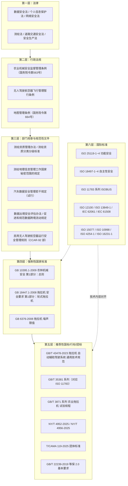
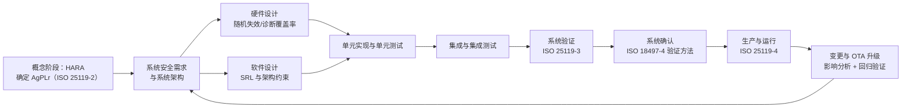

# 08 安全合规与标准

> 适用范围：智能农机无人作业系统（`src/cli.mjs` 主线所覆盖的地块建模 → 全覆盖规划 → 多机调度 → 闭环跟踪 → 视觉识别 → 遥测监控）在**功能安全、机械安全、数据安全、测绘合规、上路合规**五个维度的标准依据与合规落地要求。
> 编制原则：只引用真实存在的标准号与法规名称；本项目尚未取得任何型式试验或认证结论，凡涉及"本项目状态"的判断均按"设计要求/待第三方验证"如实标注。

## 1. 合规目标与责任边界

| 维度 | 合规目标 | 主要依据 | 项目内责任主体 |
| --- | --- | --- | --- |
| 功能安全 | 安全相关控制功能在故障时进入安全状态 | ISO 25119-1~4、IEC 61508 系列 | 车端控制（`src/control/pure_pursuit.mjs`）与整车安全概念 |
| 自动化/自主性安全 | 自主作业不得伤害人员、动物与财产 | ISO 18497-1~4、ISO 17757 | 感知（`src/perception/`）、作业区管理与远程监控 |
| 机械与操作性安全 | 操纵、防护、噪声、EMC 满足强制要求 | GB 10395.1-2009、GB 18447.1-2008、ISO 15077、ISO 10998 | 整机与机具 |
| 总线互操作 | 与 ISOBUS 机具、农机监管平台互通 | ISO 11783、GB/T 35381 系列 | `src/cloud/telemetry.mjs` 与网关 |
| 数据与个人信息 | 数据分类分级、最小必要、可审计 | 数据安全法、个人信息保护法、GB/T 22239-2019（等保 2.0 三级） | 云平台与 App |
| 测绘与高精度定位 | 高精度时空数据不违规采集、存储、出境 | 测绘法、测绘资质管理、国家秘密范围规定 | 定位服务接入（千寻 FindCM 等）与数据中心 |
| 上路与上田 | 牌证齐全、转场有人监护、空域合法 | 农业机械安全监督管理条例、无人驾驶航空器飞行管理暂行条例 | 作业队与运营方 |

明确边界：**云平台与遥测链路不属于安全相关控制系统（SRP/CS）**，其失效不得导致农机失控；因此 `src/cloud/telemetry.mjs` 全链路按"监控信息"设计（AgPLr a/b 量级），不得作为急停、限速等安全功能的唯一通道。

## 2. 法规与标准体系总览



体系关系：国际标准提供技术内容，国内标准提供强制/推荐效力与试验方法；本系统按"国际标准设计、国内标准验证、法规要求落地"的顺序组织合规工作。

## 3. ISO 25119 功能安全（AgPLr 与安全生命周期）

### 3.1 标准构成与 AgPLr 等级

ISO 25119《农林拖拉机和机械 控制系统安全相关部件》由四部分组成：

| 部分 | 名称 | 本项目对应活动 |
| --- | --- | --- |
| ISO 25119-1 | 设计与开发通用原则 | 安全文化、文档、工具置信度、配置管理 |
| ISO 25119-2 | 概念阶段 | 危害识别与风险评估、确定 AgPLr、编制安全概念 |
| ISO 25119-3 | 系列开发、硬件与软件 | 软件架构、编码准则、单元与集成验证 |
| ISO 25119-4 | 生产、运行、更改与支持过程 | 标定、售后、OTA 变更与追溯 |

ISO 25119 使用 **AgPLr（required Agricultural Performance Level，要求的农业性能等级）**，等级范围为 **AgPLr = a 到 AgPLr = e**，其中 e 为最高要求等级。等级由危害分析与风险评估导出，而不是由设计者自选；软件按标准规定的软件要求等级（SRL）施加相应严格度的开发措施。与通用功能安全体系的对应关系（定性）：

| 农业领域 | 通用机械 | 过程工业 | 汽车 |
| --- | --- | --- | --- |
| ISO 25119 AgPLr a~e | ISO 13849-1 PL a~e | IEC 61508 SIL 1~4 | ISO 26262 ASIL A~D |
| 软件 SRL 分级 | ISO 13849-1 软件要求 | IEC 61508-3 | ISO 26262-6 |

本项目安全相关功能的 AgPLr 初步分配（**须在概念阶段经风险评估确认，不得直接作为设计输入**）：

| 功能 | 描述 | 建议 AgPLr | 依据与说明 |
| --- | --- | --- | --- |
| 自动转向（横向控制） | 纯跟踪 + 曲率限幅，L=2.6 m、前轮转角 ≤35° | d | 转向失控可致人员伤害 |
| 机具启停（PTO/播种/喷药） | 作业机构动作 | d | 旋转部件与药剂喷施伤害 |
| 远程急停指令 | 云端/遥控器触发停车 | d | 人员进入作业区时的唯一远程干预手段 |
| 作业区边界限制 | 电子围栏越界停车 | c | 越界进入道路或沟渠 |
| 车速限制 | 最大 3.0 m/s（约 10.8 km/h） | c | 侧翻与制动距离风险 |
| 自动对行/变量作业 | 变量喷施、对行插秧 | b | 影响作业质量而非直接伤害 |
| 遥测与告警显示 | `src/cloud/telemetry.mjs` 全链路 | a | 信息类功能，不含控制 |

### 3.2 安全生命周期（V 模型）



风险参数与等级判定：按 ISO 25119-2 的思路，对每个危害确定 严重度 S、暴露频率 E、可控性 C，再由风险图导出 AgPLr。示例（自动转向失控）：

```text
危害 H-01：自动转向在有人进入作业区时未停止 → 碾压人员
  S = 严重（不可逆伤害） | E = 中等（人员每天需进入作业区取样） | C = 难以控制
  → AgPLr = d，要求安全性由控制系统 + 独立的安全功能共同保证
对应安全需求：
  SR-01 感知到人员进入作业区 200 ms 内输出降速指令，1.5 s 内进入最小风险状态
  SR-02 转向指令由独立的转角传感器交叉校验，偏差 > 5° 持续 200 ms 即断使能
  SR-03 安全功能失效（看门狗超时 50 ms）即切断机具动力并施加驻车制动
```

## 4. ISO 18497：部分自动化、半自主与自主机械安全

ISO 18497 于 2024—2025 年由单一标准拆分为四部分（旧版 ISO 18497:2018 已被取代）：

| 部分 | 名称 | 与本系统的落地要点 |
| --- | --- | --- |
| ISO 18497-1 | 机械设计原则与词汇（Machine design principles and vocabulary） | 统一"部分自动化/半自主/自主""作业区""最小风险状态"等术语 |
| ISO 18497-2 | 障碍物防护系统设计原则（Design principles for obstacle protection systems） | 感知冗余、探测能力声明、误检/漏检处理策略 |
| ISO 18497-3 | 自主作业区（Autonomous operating zones） | 作业区定义、边界与进入控制、区内外人员管理 |
| ISO 18497-4 | 验证方法与确认原则（Verification methods and validation principles） | 试验场验证 + 现场验证、场景库与通过准则 |

本项目按上述四部分组织的安全设计：

| 安全机制 | 实现方式 | 对应标准部分 | 验证方法 |
| --- | --- | --- | --- |
| 作业区定义与边界 | 地块边界 GeoJSON + 缓冲区 `buffer_m`；越界即触发 P0 告警并停车 | 18497-3 | 越界场景注入，边界外 0.5 m 内 100% 触发 |
| 障碍物探测 | 禾赛 JT16 / 速腾 RS-Helios-16P LiDAR + 海康 MV-CA050-10GC 视觉 + 毫米波雷达冗余 | 18497-2 | 标准障碍物（成人假人、立柱、农机）探测率与虚警率统计 |
| 人员检测 | 视觉（人形检测）+ LiDAR 点云聚类；任一通道命中即降速 | 18497-2 | 多光照/多姿态场景测试 |
| 最小风险状态（MRS） | 减速 → 停止 → 机具下放/断动力 → 驻车制动 → 上报 | 18497-1 | 触发到静止 ≤ 1.5 s（v ≤ 3.0 m/s 时） |
| 远程监控与急停 | 4G/5G 指令双通道 + 本地急停按钮 | 18497-3 | 断网时本地急停仍可用（去云依赖验证） |
| 安全距离 | 见下方制动距离模型 | 18497-2 | 满载/湿滑路面最不利工况校核 |

制动距离与安全距离模型（用于设定探测距离下限）：

$$s_{\text{stop}} = v\,t_r + \frac{v^2}{2\,a\,\mu},\qquad s_{\text{safe}} = s_{\text{stop}} + d_{\text{margin}}$$

取 $v = 3.0\ \mathrm{m/s}$、系统响应时间 $t_r = 0.3\ \mathrm{s}$、减速度 $a = 2.5\ \mathrm{m/s^2}$（田间附着系数 $\mu$ 折减）、安全余量 $d_{\text{margin}} = 1.0\ \mathrm{m}$：

$$s_{\text{stop}} = 0.9 + 1.8 = 2.7\ \mathrm{m},\qquad s_{\text{safe}} \approx 3.7\ \mathrm{m}$$

因此障碍物探测距离下限取 **5.0 m**（留 35% 余量），并要求在 5 m 处对成人目标探测率 ≥ 99%、虚警率 ≤ 1 次/小时。

## 5. ISO 11783（ISOBUS）与 GB/T 35381 系列对应

| ISO 11783 部分 | 内容 | GB/T 35381 对应 | 本项目使用情况 |
| --- | --- | --- | --- |
| Part 1 | 移动数据通信通用标准 | GB/T 35381.1-2017 | 总体架构与网络拓扑 |
| Part 2 | 物理层 | GB/T 35381.2 | 线束、终端电阻 120 Ω、供电 |
| Part 3 | 数据链路层 | GB/T 35381.3 | 29 位标识符与仲裁（与 J1939 同源） |
| Part 4 | 网络层 | GB/T 35381.4 | 点对点报文转发 |
| Part 5 | 网络管理 | GB/T 35381.5 | 地址声明与冲突处理 |
| Part 6 | 虚拟终端 | GB/T 35381.6 | 机具终端界面（本项目以车端 HMI 替代） |
| Part 7 | 实现消息应用层 | GB/T 35381.7 | 机具状态与设定值上行 |
| Part 8 | 动力总成消息 | GB/T 35381.8 | 与 J1939-71 动力总成报文互通 |
| Part 9 | 拖拉机 ECU | GB/T 35381.9 | 拖拉机与机具间的供电与信号约定 |
| Part 10 | 任务控制器与管理系统数据交换 | GB/T 35381.10-2020 | 作业任务下发与作业量回传 |
| Part 11 | 移动数据元字典 | GB/T 35381.11 | 参数命名与量纲统一 |
| Part 12 | 诊断服务 | GB/T 35381.12 | 故障码读取/清除，与 DM1 合并 |
| Part 13 | 文件服务器 | GB/T 35381.13 | 离线作业记录上传 |
| Part 14 | 顺序控制 | GB/T 35381.14 | 机具动作序列（可选） |

> 部分 GB/T 35381 分册的发布年份请以现行版本为准；本表仅对已核实的 `GB/T 35381.1-2017`、`GB/T 35381.10-2020` 标注年份。
> `src/cloud/telemetry.mjs` 只实现 J1939 动力总成与 DM1 部分（PGN 61444 / 65262 / 65265 / 65266 / 65226），ISOBUS 机具报文在网关侧归一化后上行。

## 6. 操作性、机械安全与其他国际标准

| 标准 | 名称要点 | 本项目适用条款 |
| --- | --- | --- |
| ISO 12100:2010 | 机械安全 设计通则 风险评估与风险减小 | 危害识别清单与风险减小三级法（本质安全设计 → 安全防护 → 使用信息） |
| ISO 13849-1:2023 | 机械安全 控制系统安全相关部件 第1部分：设计通则 | 安全功能 PL 评估、类别（Cat.）与诊断覆盖率 |
| IEC 62061:2021 | 机械安全 安全相关控制系统的功能安全 | 安全相关电气/电子/可编程电子控制系统 SIL 评估 |
| IEC 61508 系列 | 电气/电子/可编程电子安全相关系统的功能安全 | 安全生命周期与硬件失效度量方法学来源 |
| ISO 15077:2020 | 拖拉机与自走式农业机械 操纵装置 操纵力、位移、位置与操作方式 | 急停按钮位置、操纵力上限、误操作防护 |
| ISO 10998:2008 | 农业拖拉机 转向要求（含修订件） | 转向系统失效时的可控性与操纵力 |
| ISO 4254-1:2013 | 农业机械 安全 第1部分：通用要求 | 防护装置、稳定性、噪声与振动、使用信息 |
| ISO 26322-1:2008 | 农业和林业拖拉机 安全 第1部分：标准拖拉机 | 驾驶室、ROPS、防护罩 |
| ISO 16231-1:2013 | 自走式农业机械 稳定性评定 第1部分：原则 | 坡地作业与侧翻风险，与 `slope_deg` 联动限速 |
| ISO 17757:2019 | 土方机械与矿山 自主与半自主机械系统安全 | 自主机械在有人区域运行的安全架构类比参考 |
| ISO 14982:1998 | 农林机械 电磁兼容性 试验方法和验收准则 | EMC 设计与试验（与 GB/T 21398-2008 对应） |
| ISO 11898-1 | 道路车辆 CAN 数据链路层与物理信令 | 250 kbit/s 总线与 29 位标识符 |

无人作业特有的补充安全要求（标准未强制但工程必需）：

* **有人/无人模式切换**：切换须在静止状态完成，并同时校验制动、机具分离与人员离场三项条件。
* **地理与坡度约束**：`slope_deg > 15°` 时禁止无人作业；湿滑路面按 `μ = 0.5` 重新校核制动距离。
* **通信中断**：链路中断 > 2.0 s 时，车端按 `src/perception/gnss_fusion.mjs` 的降级策略降速；中断 > 30 s 进入最小风险状态并原地等待。

## 7. 国内标准体系落地

| 标准号 | 名称 | 本项目适用点 |
| --- | --- | --- |
| GB 10395.1-2009 | 农林机械 安全 第1部分：总则 | 防护装置、急停、警示标志、使用说明书的强制要求 |
| GB 18447.1-2008 | 拖拉机 安全要求 第1部分：轮式拖拉机 | 轮式拖拉机整机安全要求（东方红 LX2204 等） |
| GB 6376-2008 | 拖拉机 噪声限值 | 驾驶员耳旁噪声与动态环境噪声限值 |
| GB/T 21398-2008 | 农林机械 电磁兼容性 试验方法和验收规则 | EMC 型式试验依据 |
| GB/T 3871.1-2006 | 农业拖拉机 试验规程 第1部分：通用要求 | 拖拉机性能试验通用规则 |
| GB/T 3871.20-2015 | 农业拖拉机 试验规程 第20部分：颠簸试验 | 田间颠簸工况下的定位与感知可靠性验证 |
| GB/T 21962-2020 | 玉米收获机械 | 收割机作业质量与安全（雷沃谷神 GM100 / 沃得锐龙 4LZ-6.0） |
| GB/T 43478-2023 | 拖拉机 自动辅助驾驶系统 通用技术规范 | 自动驾驶终端的功能、性能与试验方法主依据 |
| NY/T 4952-2025 | 农机北斗导航辅助驾驶系统 质量评价技术规范 | 北斗导航辅助驾驶系统的质量评价 |
| NY/T 4956-2025 | 无人驾驶高速插秧机 作业质量 | 插秧机无人作业质量评价（久保田 NSPU-68C 等） |
| T/CAMA 119-2025 | 插秧机无人驾驶作业功能评价技术规范（中国农业机械化协会） | 无人驾驶功能评价的团体标准依据 |
| GB/T 35381 系列 | 农林拖拉机和机械 串行控制和通信数据网络 | ISOBUS 对应国标，见第 5 节 |
| GB/T 22239-2019 | 信息安全技术 网络安全等级保护基本要求 | 云平台等保三级，见第 8 节 |

在研标准跟踪：与 ISO 25119 对应的国家标准《农林拖拉机和机械 控制系统安全相关部件》处于起草/征求意见阶段，其采用 `AgPLr`（范围 a~e）概念；正式发布后应同步更新本项目安全概念与文档体系。此外，卫星导航定位基准站的建设、备案与安全保护另有专门管理要求，相关国家标准亦在制定中。

## 8. 数据安全、个人信息保护与网络安全等级保护

### 8.1 法律与规章依据

| 名称 | 生效时间 | 本项目核心义务 |
| --- | --- | --- |
| 《中华人民共和国网络安全法》 | 2017-06-01 | 网络运行安全、日志留存不少于 6 个月（第二十一条） |
| 《中华人民共和国数据安全法》 | 2021-09-01 | 数据分类分级保护、重要数据目录、风险评估与报告 |
| 《中华人民共和国个人信息保护法》 | 2021-11-01 | 告知同意、最小必要、单独同意（敏感个人信息）、跨境规则 |
| 《汽车数据安全管理若干规定（试行）》 | 2021-10-01 | 车辆位置、轨迹等数据的默认不收集、匿名化与出境要求 |
| 《数据出境安全评估办法》 | 2022-09-01 | 重要数据与达量个人信息出境的安全评估 |
| 《促进和规范数据跨境流动规定》 | 2024 年 | 免申报情形与负面清单管理 |
| GB/T 35273-2020 | — | 《信息安全技术 个人信息安全规范》，告知同意与去标识化实施细节 |

个人信息处理要点：机手姓名、手机号、身份证件、生物特征（人脸登录）属个人信息，其中身份证件与人脸属**敏感个人信息**，须单独同意、加密存储、限定访问并保留处理记录；农机位置在可关联到自然人时应按个人信息同等保护。

### 8.2 数据分类分级（本项目执行表）

| 级别 | 数据项 | 敏感度判断依据 | 保护措施 | 留存期 |
| --- | --- | --- | --- | --- |
| L4 重要数据 | 高精度地块边界、厘米级轨迹与土壤/产量分布 | 可能涉及测绘地理信息管理要求 | 加密存储、导出双人审批、禁止出境、脱敏后共享 | 按合同，最长 10 年 |
| L3 敏感 | 机手身份证件、人脸特征、支付信息 | 敏感个人信息 | 单独同意、字段级加密、访问审计 | 目的达成后 6 个月内删除 |
| L2 内部 | 遥测时序、故障码、作业任务与结算 | 商业敏感 | 租户隔离、行级权限、脱敏后统计 | 时序 365 天，告警 365 天 |
| L1 公开 | 机型参数、标准作业参数基线 | 可公开 | 无特殊要求 | — |

### 8.3 网络安全等级保护 2.0 三级要求落地

依据 GB/T 22239-2019，云平台按**第三级**定级（定级依据 GB/T 22240-2020，设计依据 GB/T 25070-2019，测评依据 GB/T 28448-2019）：

| 层面 | 三级关键控制项 | 本项目实现 |
| --- | --- | --- |
| 安全物理环境 | 机房出入控制、防盗防潮、电力与温控冗余 | 采用具备等保三级资质的云机房 |
| 安全通信网络 | 通信传输保密性与完整性、网络架构冗余 | 全链路 TLS 1.3 / mTLS；跨可用区双活 |
| 安全区域边界 | 边界防护、访问控制、入侵防范、恶意代码防范 | WAF + 微隔离；设备接入区与业务区分离 |
| 安全计算环境 | 身份鉴别（双因素）、访问控制、安全审计、可信验证 | 运维双因素；RBAC + 行级权限；审计日志集中存储 |
| 安全管理中心 | 系统管理、审计管理、安全管理三员分立 | 建立系统管理员/审计员/安全管理员三员制度 |
| 安全管理制度/机构/人员/建设/运维 | 制度文档、岗位职责、人员审查、变更与应急预案 | 安全制度文件集 + 年度演练与测评 |

与技术架构的对应：设备侧证书由内部 CA 签发并支持吊销；Kafka 与 TimescaleDB 开启传输加密与静态加密；导出接口（`/machines/{id}/replay`、`/fields/{id}/coverage`）强制审计并限流；数据备份"本地 + 异地"双份，年度恢复演练一次。

## 9. 测绘地理信息与高精度定位数据合规

| 依据 | 与本系统的关系 | 执行措施 |
| --- | --- | --- |
| 《中华人民共和国测绘法》 | 高精度定位数据的采集、加工与提供服务属测绘活动范畴 | 平台侧不自行开展测绘活动；如需，委托具备测绘资质的单位 |
| 《地图管理条例》（国务院令第664号） | 地图编制、审核与互联网地图服务管理 | 大屏地图底图使用合规审图号产品 |
| 《测绘资质管理办法》与《测绘资质分类分级标准》 | 从事测绘活动的资质要求 | 与 CORS/差分服务商合作时核验其测绘资质 |
| 《测绘地理信息管理工作国家秘密范围的规定》 | 涉密测绘成果的范围界定 | 高精度控制点、涉密坐标成果不入库、不外传 |
| 卫星导航定位基准站相关管理规定 | 基准站建设、备案与安全保护 | 不自行架设基准站并对外播发差分数据 |

工程化措施（已落到数据模型与接口）：

* **不落地**：不采集、不存储国家秘密测绘成果；地块边界以用户提供的经营权地块为限，且按 L4 级加密存储。
* **差分服务接入**：使用千寻位置 FindCM（固定解水平精度 ±2 cm + 1 ppm）、华测/中海达 CORS 等**具备资质的商业服务**，通过车载 UM982 双天线 RTK 模块接入，平台侧不转发原始观测量。
* **坐标处理**：对外展示统一使用 GCJ-02 等合规坐标系；内部计算使用 WGS-84，转换在服务端完成并留痕。
* **出境管控**：厘米级轨迹属高风险数据，默认不出境；确需境外作业回传时，按《数据出境安全评估办法》评估并做降精度（抽稀至 ≥ 1 m 网格）后再传。

## 10. 农机作业安全与人员防护

| 风险 | 防护措施 | 依据 |
| --- | --- | --- |
| 旋转部件伤害（PTO、割台、插秧机构） | 防护罩、联锁开关、机具未分离禁止启动 | GB 10395.1-2009、ISO 4254-1 |
| 碾压作业区人员 | 作业前清场 + 人员检测 + 最小风险状态 | ISO 18497-2、ISO 18497-3 |
| 噪声损伤 | 驾驶室密封与降噪，机手配备耳罩 | GB 6376-2008 |
| 农药/除草剂暴露 | 作业气象条件限制（风速 < 3 m/s）、防护装备、作业区隔离带 | 农药安全使用相关规定、GB 10395.1-2009 |
| 坡地侧翻 | 坡度限值 + 稳定性校核 + 侧倾报警 | ISO 16231-1、ISO 26322-1 |
| 无人作业现场风险 | 现场安全员巡查、远程急停可达性演练、电子围栏 | ISO 18497-3、本项目作业规程 |

现场作业安全规程（项目级）：

```text
1) 作业前：清场确认（人、畜、农机具离场）→ 检查急停按钮与驻车制动 → 电子围栏加载校验
   → 通信链路心跳校验（丢包率 ≤ 1%）→ 记录作业区天气与风速。
2) 作业中：现场保留 1 名持证安全员，携带本地急停遥控器；任何人进入作业区前必须
   通过对讲通知并确认车辆已停止；每 30 min 记录一次远程监控画面与告警状态。
3) 作业后：机具分离、动力切断、驻车制动；导出遥测与告警记录归档；异常事件 24 h 内
   完成初步分析并登记。
4) 禁止事项：禁止无人值守在公共道路行驶；禁止在风速 > 3 m/s 时喷施除草剂；
   禁止在坡度 > 15° 地块开展无人作业；禁止屏蔽或旁路急停回路。
```

## 11. 无人农机的上路与空域合规

| 场景 | 要求 | 依据 |
| --- | --- | --- |
| 拖拉机/收割机登记与牌证 | 拖拉机、联合收割机须登记并悬挂号牌，操作人员须持相应证件 | 《农业机械安全监督管理条例》（国务院令第563号） |
| 转场（田间道路/公路） | 无人状态不得在公共道路行驶，须有人驾驶或使用运输车辆转运 | 《道路交通安全法》及上述条例 |
| 跨区作业 | 按规定办理跨区作业相关手续 | 农机跨区作业管理规定 |
| 植保无人机运行 | 实名登记、适飞空域、超视距运行资质与操作证 | 《无人驾驶航空器飞行管理暂行条例》（2023 年公布、2024-01-01 施行） |
| 无人机运行管理 | 运行分类、操控员资质、运行手册与应急预案 | 《民用无人驾驶航空器运行安全管理规则》（CCAR-92 部，2024 年施行） |
| 农资喷洒 | 作业高度、避让敏感目标、药剂使用登记 | 农药管理条例、无人机植保作业规范 |

大疆 T60（喷洒 50 L / 播撒 60 kg）在本系统中的使用边界：仅作为独立植保作业单元接入平台（状态与作业量上行），**不纳入地面无人农机的协同调度闭环**，其飞行计划与空域申报由持证运行主体负责。

## 12. 合规检查清单

| 编号 | 检查项 | 依据 | 项目内证据 | 状态 |
| --- | --- | --- | --- | --- |
| C-01 | 是否完成危害识别与风险评估并确定 AgPLr | ISO 25119-2 | HARA 表 + 安全概念文件 | 设计中（未第三方确认） |
| C-02 | 安全相关控制功能是否满足所定 AgPLr/SRL | ISO 25119-3 | 软件架构与单元验证记录 | 设计中 |
| C-03 | 是否具备生产、运行、变更与售后过程 | ISO 25119-4 | OTA 变更流程与追溯记录 | 设计中 |
| C-04 | 自主作业区定义、进入控制与人员管理是否落实 | ISO 18497-3 | 电子围栏配置 + 作业规程 §10 | 设计中 |
| C-05 | 障碍物防护系统是否有设计原则与验证 | ISO 18497-2、ISO 18497-4 | 探测能力声明 + 场景库测试报告 | 待第三方验证 |
| C-06 | 整机安全（防护、急停、标志）是否满足强制国标 | GB 10395.1-2009、GB 18447.1-2008 | 整机型式试验报告 | 待第三方验证 |
| C-07 | 噪声限值是否满足 | GB 6376-2008 | 噪声测量报告 | 待第三方验证 |
| C-08 | 电磁兼容是否满足 | GB/T 21398-2008、ISO 14982 | EMC 试验报告 | 待第三方验证 |
| C-09 | 自动驾驶系统性能是否满足 | GB/T 43478-2023 | 直线精度 ±2.5 cm 实测报告 | 设计指标：横向误差 RMS < 0.1 m（`src/selftest.mjs`）；实机待测 |
| C-10 | 北斗导航辅助驾驶质量评价 | NY/T 4952-2025 | 终端入网与质量评价材料 | 待办 |
| C-11 | 插秧机无人作业质量 | NY/T 4956-2025、T/CAMA 119-2025 | 作业质量测试方案 | 待办 |
| C-12 | ISOBUS 互操作 | ISO 11783、GB/T 35381 系列 | 网关归一化与互通测试用例 | 部分实现（见 §5） |
| C-13 | 数据分类分级与重要数据目录 | 数据安全法、GB/T 22239-2019 | 数据资产清单 §8.2 | 已建立（可评审） |
| C-14 | 个人信息告知同意与最小必要 | 个人信息保护法、GB/T 35273-2020 | 隐私政策 + 同意记录 | 待办 |
| C-15 | 等保三级定级备案与测评 | GB/T 22240-2020、GB/T 22239-2019、GB/T 28448-2019 | 定级报告 + 测评报告 | 待办 |
| C-16 | 日志留存不少于 6 个月 | 网络安全法第二十一条 | 审计日志保留策略（365 天） | 已配置 |
| C-17 | 高精度测绘数据合规采集与存储 | 测绘法、国家秘密范围规定 | 数据流图 + 加密存储配置 | 已建立（可评审） |
| C-18 | 差分服务商资质核验 | 测绘资质管理办法 | 供应商资质文件 | 待办 |
| C-19 | 数据出境评估 | 数据出境安全评估办法、促进和规范数据跨境流动规定 | 出境数据清单与降精度方案 | 不适用（默认不出境） |
| C-20 | 农机牌证与操作人员证件 | 农业机械安全监督管理条例 | 牌证台账 | 待办 |
| C-21 | 无人机实名登记与运行资质 | 无人驾驶航空器飞行管理暂行条例、CCAR-92 部 | 登记编号与操控员证 | 待办 |
| C-22 | 现场作业安全规程与演练 | ISO 18497-3、GB 10395.1-2009 | 作业规程 §10 + 演练记录 | 已建立（待演练） |

## 13. 不符合项与安全档案管理

```text
不符合项分级：
  A 类（涉及人身安全或强制条款）：立即停止相关作业，48 h 内提出纠正措施，闭环前不得复机；
  B 类（涉及数据合规或推荐性标准）：7 个工作日内提出纠正措施，30 日内闭环；
  C 类（文档、记录、标识类）：纳入月度整改清单，60 日内闭环。
安全档案（每机型一份，随产品全生命周期保存）：
  ① 危害清单与 HARA 记录；② 安全概念与安全需求规格；③ 验证与确认报告；
  ④ 型式试验报告（安全、噪声、EMC）；⑤ 变更记录（含 OTA 影响分析与回归结果）；
  ⑥ 数据合规文件（分类分级清单、隐私政策、等保测评报告）；⑦ 事故与near-miss 记录。
```

## 参考标准与文献

**标准与法规**

1. ISO 25119-1:2018 / -2:2018 / -3:2018 / -4:2018 *Tractors and machinery for agriculture and forestry — Safety-related parts of control systems*. ISO.
2. ISO 18497-1:2024 *Machine design principles and vocabulary*；ISO 18497-2:2024 *Design principles for obstacle protection systems*；ISO 18497-3:2024 *Autonomous operating zones*；ISO 18497-4:2024 *Verification methods and validation principles*（Agricultural machinery and tractors — Safety of partially automated, semi-autonomous and autonomous machinery）. ISO.
3. ISO 11783 系列 *Tractors and machinery for agriculture and forestry — Serial control and communications data network*. ISO.
4. ISO 12100:2010 *Safety of machinery — General principles for design — Risk assessment and risk reduction*. ISO.
5. ISO 13849-1:2023 *Safety of machinery — Safety-related parts of control systems — Part 1: General principles for design*. ISO.
6. IEC 61508 系列 *Functional safety of electrical/electronic/programmable electronic safety-related systems*. IEC.
7. IEC 62061:2021 *Safety of machinery — Functional safety of safety-related control systems*. IEC.
8. ISO 15077:2020 *Tractors and self-propelled machinery for agriculture — Operator controls — Actuating forces, displacement, location and method of operation*. ISO.
9. ISO 10998:2008 *Agricultural tractors — Requirements for steering*. ISO.
10. ISO 4254-1:2013 *Agricultural machinery — Safety — Part 1: General requirements*. ISO.
11. ISO 26322-1:2008 *Tractors for agriculture and forestry — Safety — Part 1: Standard tractors*. ISO.
12. ISO 16231-1:2013 *Self-propelled agricultural machinery — Assessment of stability — Part 1: Principles*. ISO.
13. ISO 17757:2019 *Earth-moving machinery and mining — Autonomous and semi-autonomous machine system safety*. ISO.
14. ISO 14982:1998 *Agricultural and forestry machinery — Electromagnetic compatibility — Test methods and acceptance criteria*. ISO.
15. GB 10395.1-2009《农林机械 安全 第1部分：总则》；GB 18447.1-2008《拖拉机 安全要求 第1部分：轮式拖拉机》；GB 6376-2008《拖拉机 噪声限值》.
16. GB/T 21398-2008《农林机械 电磁兼容性 试验方法和验收规则》；GB/T 3871.1-2006《农业拖拉机 试验规程 第1部分：通用要求》；GB/T 3871.20-2015《农业拖拉机 试验规程 第20部分：颠簸试验》.
17. GB/T 21962-2020《玉米收获机械》；GB/T 43478-2023《拖拉机 自动辅助驾驶系统 通用技术规范》.
18. GB/T 35381.1-2017《农林拖拉机和机械 串行控制和通信数据网络 第1部分：数据通信通用标准》；GB/T 35381.6《…第6部分：虚拟终端》；GB/T 35381.10-2020（任务控制器与管理系统数据交换）.
19. NY/T 4952-2025《农机北斗导航辅助驾驶系统 质量评价技术规范》；NY/T 4956-2025《无人驾驶高速插秧机 作业质量》.
20. T/CAMA 119-2025《插秧机无人驾驶作业功能评价技术规范》. 中国农业机械化协会.
21. GB/T 22239-2019《信息安全技术 网络安全等级保护基本要求》；GB/T 22240-2020《…定级指南》；GB/T 25070-2019《…安全设计技术要求》；GB/T 28448-2019《…测评要求》；GB/T 35273-2020《信息安全技术 个人信息安全规范》.
22. 《中华人民共和国网络安全法》《中华人民共和国数据安全法》《中华人民共和国个人信息保护法》《中华人民共和国测绘法》《中华人民共和国道路交通安全法》.
23. 《农业机械安全监督管理条例》（国务院令第563号）；《地图管理条例》（国务院令第664号）；《无人驾驶航空器飞行管理暂行条例》.
24. 《测绘资质管理办法》与《测绘资质分类分级标准》（自然资源部）；《测绘地理信息管理工作国家秘密范围的规定》（自然资源部、国家保密局，2020 年）；《汽车数据安全管理若干规定（试行）》；《数据出境安全评估办法》；《促进和规范数据跨境流动规定》.
25. 《民用无人驾驶航空器运行安全管理规则》（CCAR-92 部，中国民用航空局）.

**经典文献**

1. Leveson, N. G. *Engineering a Safer World: Systems Thinking Applied to Safety*. MIT Press, 2011.
2. Storey, N. *Safety-Critical Computer Systems*. Addison-Wesley, 1996.
3. Reason, J. *Human Error*. Cambridge University Press, 1990.
4. Thuilot, B., Cariou, C., Martinet, P., Berducat, M. Automatic guidance of a farm tractor relying on a single CP-DGPS. *Autonomous Robots*, 2002.
5. Lenain, R., Thuilot, B., Cariou, C., Martinet, P. High accuracy path tracking for vehicles in presence of sliding: application to farm vehicle automatic guidance for agricultural tasks. *Autonomous Robots*, 2006.
6. Brodie, S., Oksanen, T., Auernhammer, H. Buzzword ISOBUS. *Informatik-Spektrum*, 2023.
7. Mahmood, G. G., Sacco, P., Carabin, G., Mazzetto, F. Farm-level operational monitoring in smart agriculture: review and classification framework. *Sustainability*, 2026.
8. Yu, P., Teng, F., Zhu, W., Shen, C., Chen, Z., Song, J. Cloud–edge–device collaborative computing in smart agriculture: architectures, applications, and future perspectives. *Frontiers in Plant Science*, 2025.

> 说明：本文件不列 DOI 与链接；文献条目可在本仓库 `literature/metadata/references.bib` 中检索到对应记录。标准年份以现行有效版本为准，使用前请通过全国标准信息公共服务平台或 ISO 官方目录复核。
